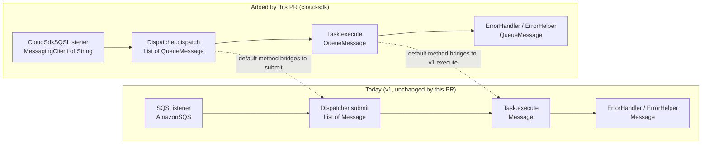
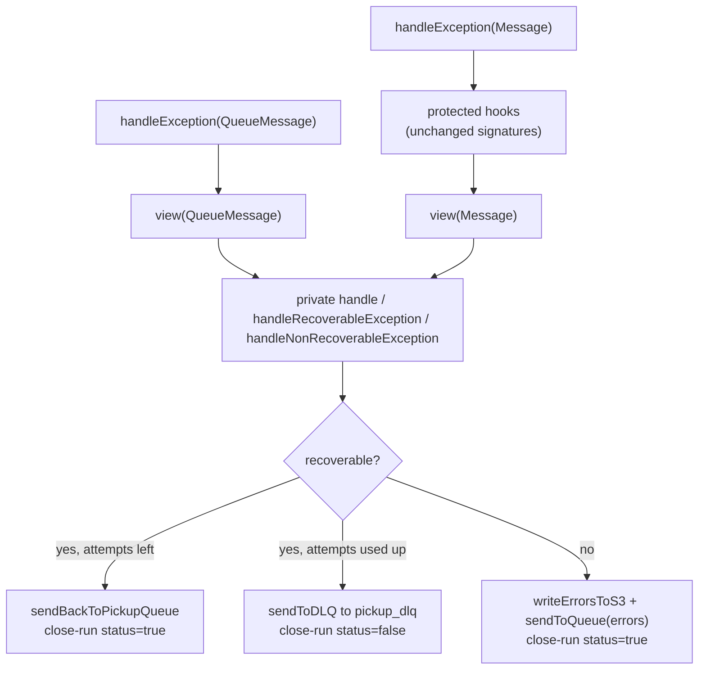
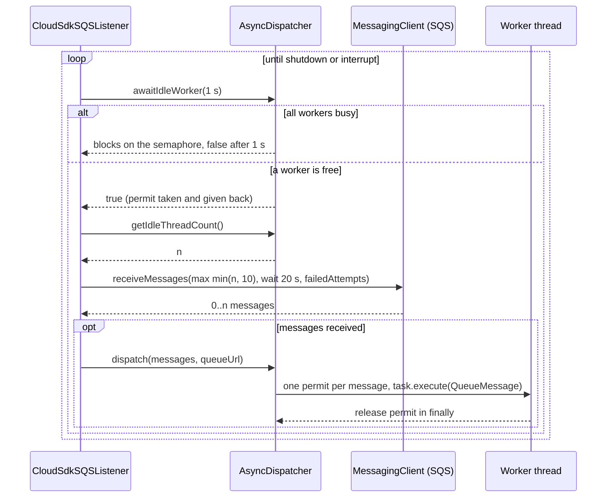

# PR — WI01124532 shared: cloud-sdk runtime building blocks (client profile, QueueMessage task model, back-pressure listener, exception mapping)

Branch `WI01124532-aws-sdk-upgrade-shared-runtime` → `WI01124532-aws-sdk-upgrade` · 13 commits `4d097fe5` … `0dc30210`

**Part 1** is the PR description that goes into Bitbucket; copy everything between the two `✂` lines. It opens with a short summary and the reasons for the change, then goes into the details.
**Part 2** walks through the change one commit at a time: the implementation, the tests, how each test is written and what its assertions check, with diagrams. It is for reading the PR; it doesn't go into Bitbucket.

---

## Part 1 — PR description (Bitbucket)

✂ ------------------------------------------------------------------

## Summary

Step 1c of the WI01124532 AWS SDK upgrade. This PR adds the **runtime building blocks** that services will use to talk to SQS, S3 and SNS through mercury-services-commons **cloud-sdk** (AWS SDK 2.x) instead of AWS SDK v1:

1. **Client profile**: one place that turns today's v1 client settings (timeouts, pool size, retries, backoff) into cloud-sdk client configurations.
2. **Task model on `QueueMessage`**: `Task`, `TaskFactory`, `Dispatcher`, `AsyncDispatcher`, `AbstractTask`, `ErrorHandler` and `ErrorHelper` accept the cloud-sdk `QueueMessage<String>` **next to** the v1 `Message`.
3. **Back-pressure listener on cloud-sdk**: `CloudSdkSQSListener`, the same receive loop as `SQSListener`, which waits for a free worker instead of spinning.
4. **Exception mapping**: `CloudSdkFailures` turns cloud-sdk failures into `RecoverableException`, as the v1 wrappers do for `SdkClientException` today.

The change is **additive only**. No service is switched over in this PR: every service still receives, processes and fails messages through the v1 code exactly as today. The new code is wired in by 1d (adapters + Guice module) and the module PRs (steps 2–4). The v1 halves are deleted in step 5.

Follows #78 (step 1b, merged). The feature branch also has `develop` merged in (PR #77 `sonar` profile, PR #79 transformer pins), so this PR shows only the 13 commits of step 1c.

## Why

- **Why this PR exists.** AWS SDK v1 is end-of-life, and the target is the commons cloud-sdk (AWS SDK 2.x behind SDK-neutral interfaces). Every AppianWay service sits on the same `shared` runtime (listener → dispatcher → task → error handler). Moving that runtime once in `shared` means each service PR later only swaps its own wiring.
- **Why overloads and not a replacement.** Services move one PR at a time (steps 2–4), and the feature branch must build and run at every step. So `shared` carries both the v1 and the cloud-sdk signatures for a while. A service not yet migrated runs unchanged, a migrated one uses the new path, and step 5 deletes the v1 half. The overloads bridge to each other, so mixed states (v2 listener + v1 task, or v1 listener + v2 task) also work.
- **Why a client profile.** cloud-sdk factories take their own config objects, with SDK 2.x defaults that differ from what AppianWay runs with today. Without an explicit profile the services would silently change timeouts, retry counts and backoff. `ClientSettings` / `ClientProfile` reproduce the **measured** v1 values; a characterization test records those values first.
- **Why a new listener.** cloud-sdk exposes `MessagingClient<String>`, not the v1 `AmazonSQS`. The listener keeps the existing back-pressure rule (never receive more messages than there are idle workers). It also fixes a long-standing cost: while all workers are busy, `SQSListener` calls `getIdleThreadCount()` in a tight loop, which keeps one CPU core per service busy. The new listener blocks on the dispatcher's semaphore instead.
- **Why the exception mapping.** The retry/DLQ logic (`ErrorHelper.isRecoverable`) depends on AWS failures arriving as `RecoverableException`. The v1 wrappers did that by catching `SdkClientException`. cloud-sdk throws different types, so without one mapping a transient S3/SQS/SNS failure would be treated as non-recoverable and go to the errors queue instead of being retried.

## Changes

1. **Client settings and profile** (`4d097fe5` test, `f243ef54` red, `975d0ac2` green).
   - `config.ClientSettings` (record) holds the per-role values. `sqsListener()`: connect 1 s, socket 50 s, call 60 s, 50 connections, 3 retries. `sqsSender()` and `sns()`: 1 s / 5 s / 10 s / 50 / 3. `s3()`: 1 s / 5 s / **10 min** / 50 / 3. Plus `withMaxRetries` and `withTimeouts` for modules that differ today.
   - `config.ClientProfile` builds the cloud-sdk `AwsMessagingClientConfig`, `AwsStorageConfig` and `NotificationClientConfig`. It uses one Apache HTTP pool per client and the SDK standard retry strategy with `maxAttempts = retries + 1`, 500 ms → 5 s exponential backoff without jitter, retrying every failure (as v1's `CustomRetryCondition` does).
   - `shared` now declares `cloud-sdk-api` and `cloud-sdk-aws` directly, excluding Jest and its signer (only ingestor needs them and declares its own).
2. **Task model on `QueueMessage`** (`e623a746` red, `d3c48534` green).
   - `Task.execute(QueueMessage<String>, String)` and `TaskFactory.getTask(QueueMessage<String>)` are default methods that bridge to the v1 method, so every existing lambda and task works with both.
   - `Dispatcher.dispatch(List<QueueMessage<String>>, String)` is a default method bridging to `submit`. It has a new name because two `List` overloads would erase to the same signature.
   - `AsyncDispatcher` gets a native `dispatch` / `work` for `QueueMessage`: same semaphore permit per message, same logging.
   - `AbstractTask` gets `process(QueueMessage<String>, String)` and a metered `execute(QueueMessage<String>, String)`. It detects once per instance which `process` the service overrides and calls that one, converting only when needed. A v1 task called the v1 way gets the **same `Message` object** as today, and the `messages-processed` meter counts each message once.
   - `task.V1MessageBridge` (`@Deprecated`, removed in step 5) converts `Message` ↔ `QueueMessage<String>`: id, receipt handle, body, system attributes, `SentTimestamp`, String message attributes such as `failedAttempts`.
3. **Error handling on `QueueMessage`** (`74a5bab2` red, `a4beed06` green).
   - `ErrorHelper` gets `QueueMessage` overloads of `getFailedAttempts`, `isRecoverableAttemptsNotMaxed`, `sendBackToPickupQueue` (both variants), `sendToDLQ` and `sendToQueue`. They share the existing private code, so the delay (`2^attempt × multiplier`), the `failedAttempts + 1`, the tokens and the log lines are identical.
   - `ErrorHandler` gets a `@Metered handleException(QueueMessage<String>, …)`. The v1 `handleException` keeps its original call path through the protected hooks that subclasses may override.
4. **Back-pressure listener** (`b348a833` red, `628fe1a6` green).
   - `listener.CloudSdkSQSListener` is the same loop as `SQSListener` on `MessagingClient<String>`. It receives at most the idle-worker count, capped at the SQS maximum of 10 per receive (`9a05bdc5` red, `0dc30210` green, from review), asks for the `failedAttempts` attribute, keeps the configured long-poll wait and sends no visibility timeout (the queue default applies, as today). An `InterruptedException` stops it; any other failure is logged and the loop continues. The log lines are the same.
   - `Dispatcher.awaitIdleWorker(Duration)` is new. In `AsyncDispatcher` it waits on the semaphore without taking a permit. The default (for dispatchers without a pool: ingestor, watermill-publisher) pauses at most 50 ms instead of spinning.
5. **Exception mapping, contract C9** (`c981b4fa` red, `016ffb6e` green).
   - `externalwrapper.exception.CloudSdkFailures`: `isCloudSdkFailure(Throwable)` and `toRecoverable(RuntimeException)`. Mapped: `CloudSdkException` (incl. SQS `MessagingException` and SNS `NotificationException`), `ParameterStoreException`, `S3OperationException`, `S3UploadException`, `FileTransferException`, `StorageClientInitializationException`, and anything that is, or is caused by, an AWS SDK 2.x `SdkException`.
   - Other exceptions are returned unchanged, and an existing `RecoverableException` is not wrapped again. The decision is by type only; `isRetryable()` is logged, not used to narrow, because v1 wrapped every SDK failure.
6. **Existing tests: type witnesses only.** Because `ErrorHelper`, `Task`, `TaskFactory` and `ErrorHandler` now have two overloads, a bare Mockito `any()` became ambiguous in 5 existing test classes (`shared` `AsyncDispatcherTest` and `ErrorHandlerTest`, ingestor `ErrorHandlerTest`, splitter `SplitErrorHandlerTest`, transformer `TransformerTaskTest`). They now say `any(Message.class)` / `ArgumentMatchers.<Message>any()` / `(Message) null`. No assertion changed.

## Backward compatibility

- **Runtime behaviour of every service is unchanged.** No service class, Guice module or configuration file changes. Services still build `SQSListener`, call `submit`, implement `process(Message, …)` and use the v1 `ErrorHelper` methods. The v1 code paths are the same lines as before (the `ErrorHandler` and `AbstractTask` v1 paths now route through private helpers with identical calls, pinned by the existing tests).
- **Wire formats** (contract C1–C9) are kept by the new paths too: the `failedAttempts` String attribute, `DelaySeconds`, the DLQ body unchanged and the close-run event tokens.
- **Client settings** reproduce today's values, as measured by `V1ClientConfigurationCharacterizationTest`. There are two deliberate differences, both forced by SDK 2.x, which always applies an API-call timeout (decision record DR-2): the listener call is capped at 60 s (above the 20 s long poll; v1 had none), and S3 at 10 min (v1's 10 s ended before the body was read; in SDK 2.x the download is inside the call).
- **Dependencies:** `shared` (and so every service jar) now carries cloud-sdk-api / cloud-sdk-aws and their AWS SDK 2.x modules. AWS SDK v1 stays until step 5. The `no-downgrade` and `logback-pair` enforcer rules pass in every module.

## Tests (new, JUnit 5 + AssertJ)

| Class | Tests | Pins |
|---|---|---|
| `V1ClientConfigurationCharacterizationTest` | 5 | Today's v1 values (evidence for the profile; removed in step 5) |
| `ClientSettingsTest` | 6 | The four role defaults; `withMaxRetries`; `withTimeouts` |
| `ClientProfileTest` | 5 | SQS / S3 / SNS configs carry the role values; retry delays 500 ms → 1 s → 2 s then stop; 0 retries = 1 attempt |
| `V1MessageBridgeTest` | 4 | Both conversions and the round trip |
| `TaskQueueMessageOverloadTest`, `TaskFactoryQueueMessageOverloadTest`, `DispatcherQueueMessageOverloadTest` | 1 + 2 + 1 | v1-only implementations (lambdas, ingestor-style dispatchers) serve the new overloads |
| `AsyncDispatcherQueueMessageTest` | 3 | Each message runs the v2 overload; a worker is busy until its task ends; a failing task frees its worker |
| `AbstractTaskQueueMessageTest` | 5 | Process then delete by receipt handle; no delete on failure; v1 and migrated tasks via both paths; meter counted once |
| `ErrorHelperQueueMessageTest` | 8 | Same attempts, delays, tokens and SQS calls as the v1 methods |
| `ErrorHandlerQueueMessageTest` | 3 | Recoverable → pickup queue or DLQ; non-recoverable → errors queue; close-run event |
| `CloudSdkSQSListenerTest` | 8 | Receive request, at most 10 per receive, dispatch, empty receive, no receive while busy, survives a failure, stops on interrupt, rejects an empty URL |
| `AsyncDispatcherIdleWorkerTest`, `DispatcherIdleWorkerDefaultTest` | 3 + 2 | Wait without taking a worker; timeout; wake-up when a worker finishes; default pause |
| `CloudSdkExceptionMappingTest` | 23 | 10 failure types → `RecoverableException` (same message as v1) and recognised; others unchanged; no double wrap |

79 new tests. Existing tests: only the type witnesses listed above; all pass unchanged in behaviour.

## Verification

- Full reactor `mvn clean verify` on the PR head `0dc30210`: green (12:01 min).
- Test counts: `shared` 1628 → 1707 (+79 new). Every other module unchanged (transformer 665, 5 skipped).
- The 4 timing-sensitive classes (listener, idle-worker, async dispatcher) were repeated 5× without a failure.

🤖 Generated with [Claude Code](https://claude.com/claude-code)

✂ ------------------------------------------------------------------

---

## Part 2 — Walkthrough

### 2.0 How to read along

```bash
git fetch origin
git log --oneline --reverse origin/WI01124532-aws-sdk-upgrade..origin/WI01124532-aws-sdk-upgrade-shared-runtime
git show 975d0ac2          # one commit: message + full diff
git show 975d0ac2 --stat   # only the files it touches
```

| # | Commit | Kind | What it does | Section |
|---|---|---|---|---|
| 1 | `4d097fe5` | test | Records what the v1 client configuration really does today | 2.2 |
| 2 | `f243ef54` | red | Tests for `ClientSettings` / `ClientProfile`; skeletons throw | 2.2 |
| 3 | `975d0ac2` | green | `shared` depends on cloud-sdk; implements settings and profile | 2.2 |
| 4 | `e623a746` | red | Tests for the `QueueMessage` overloads of the task model; skeletons; type witness in `AsyncDispatcherTest` | 2.3 |
| 5 | `d3c48534` | green | Implements the overloads, the bridge and `AbstractTask`'s dual path | 2.3 |
| 6 | `74a5bab2` | red | Tests for the `QueueMessage` error handling; type witnesses in 4 existing test classes | 2.4 |
| 7 | `a4beed06` | green | Implements `ErrorHelper` / `ErrorHandler` overloads | 2.4 |
| 8 | `b348a833` | red | Tests for `CloudSdkSQSListener` and `awaitIdleWorker`; skeletons | 2.5 |
| 9 | `628fe1a6` | green | Implements the listener loop and the idle-worker wait | 2.5 |
| 10 | `c981b4fa` | red | Tests for the exception mapping; skeleton | 2.6 |
| 11 | `016ffb6e` | green | Implements `CloudSdkFailures` | 2.6 |
| 12 | `9a05bdc5` | red | Test: a receive never asks for more than 10 messages (review of #80) | 2.5 |
| 13 | `0dc30210` | green | Listener clamps each receive to `min(idle, 10)` | 2.5 |

As in #78, every red commit compiles: new methods exist but throw `UnsupportedOperationException("not implemented")` (or return a wrong value), so only the tests fail. Each commit stays buildable for review and `git bisect`.

### 2.1 Background: how a message travels through `shared` today, and what this PR adds

Every SQS-driven AppianWay service (dispatcher, splitter, transformer, distributor, distributor-rest, event-writer, error-processor, email-sender, …) runs the same pipeline from `shared`:

1. **Listener** (`SQSListener`): one thread long-polls the pickup queue. It never asks for more messages than there are idle workers (**back-pressure**), so a busy service leaves messages in SQS for other instances.
2. **Dispatcher** (`AsyncDispatcher`): a fixed thread pool guarded by a `Semaphore` with one permit per worker. `submit` takes a permit per message and runs it on the pool.
3. **Task** (`TaskFactory` → `Task`, mostly `AbstractTask`): the service's `process(...)` does the work. On success `AbstractTask` deletes the message by its receipt handle. On failure it does not delete, so the message reappears after the visibility timeout.
4. **Error handling** (`ErrorHandler` + `ErrorHelper`): a `RecoverableException` with attempts left goes back to the pickup queue with a delay and `failedAttempts + 1`. When the attempts are used up it goes to the `_dlq`. A non-recoverable failure is written to S3 and sent to the errors queue. A close-run event is logged in every case.

Steps 1–4 are typed on the AWS SDK v1 `Message`. The upgrade moves them to the cloud-sdk `QueueMessage<String>`. This PR adds the cloud-sdk version of each step **beside** the v1 one:



The dotted arrows are the **bridges** (`V1MessageBridge`). A component that only implements the v1 method automatically serves the new one, so the module PRs can migrate one piece at a time. Step 5 deletes the top row and the bridges.

Next to the pipeline, the PR adds two pieces the 1d adapters need:

- **`ClientSettings` / `ClientProfile`**: the cloud-sdk client configs with today's values (2.2).
- **`CloudSdkFailures`**: the one mapping from cloud-sdk failures to `RecoverableException` (2.6).

#### Class diagram — after this PR

```mermaid
classDiagram
    direction LR
    class Listener {
        <<interface>>
        +startup()
        +shutdown()
    }
    class SQSListener {
        <<shared, unchanged, v1>>
    }
    class CloudSdkSQSListener {
        <<shared, new>>
        +startup()
        +shutdown()
    }
    class Dispatcher {
        <<interface, changed>>
        +getIdleThreadCount() int
        +awaitIdleWorker(Duration) boolean
        +submit(List~Message~, String)
        +dispatch(List~QueueMessage~, String)
    }
    class AsyncDispatcher {
        <<shared, changed>>
        +awaitIdleWorker(Duration) boolean
        +dispatch(List~QueueMessage~, String)
    }
    class Task {
        <<interface, changed>>
        +execute(Message, String)
        +execute(QueueMessage, String)
    }
    class AbstractTask {
        <<shared, changed>>
        +process(Message, String)
        +process(QueueMessage, String)
        +execute(Message, String)
        +execute(QueueMessage, String)
    }
    class V1MessageBridge {
        <<shared, new, deprecated>>
        +toQueueMessage(Message)$ QueueMessage
        +toV1Message(QueueMessage)$ Message
    }
    class MessagingClient {
        <<cloud-sdk-api>>
        +receiveMessages(ReceiveMessageOptions) List
    }
    Listener <|.. SQSListener
    Listener <|.. CloudSdkSQSListener
    CloudSdkSQSListener --> MessagingClient : receives through
    CloudSdkSQSListener --> Dispatcher : awaitIdleWorker, dispatch
    Dispatcher <|.. AsyncDispatcher
    AsyncDispatcher --> Task : execute QueueMessage
    Task <|.. AbstractTask
    AbstractTask ..> V1MessageBridge : converts when needed
```



### 2.2 Commits 1–3 — client settings and client profile

**Problem.** cloud-sdk creates SDK 2.x clients from config objects (`AwsMessagingClientConfig`, `AwsStorageConfig`, `NotificationClientConfig`). If AppianWay passed only the queue URL or the topic, the clients would run with cloud-sdk / SDK 2.x defaults (for example connect 5 s, socket 30 s, SDK retry policy with jitter). Those are not the values production uses today.

**Approach.** First measure the v1 values (commit 1), then reproduce them (commits 2–3).

#### Commit 1 — `4d097fe5` test: characterize the SDK v1 client settings used today

`V1ClientConfigurationCharacterizationTest` reads the four v1 configurations in `AWSClientConfiguration` (`sqs_listener`, `sqs_sender`, `s3_read_put_copy`, `sns_publish`) and asserts what they **actually** do. It passes on today's code; it is evidence, not a requirement.

| Test | What it proves | Why it matters |
|---|---|---|
| `retryPolicyIgnoresTheClientConfigurationRetryCountSoEveryRoleRetriesThreeTimes` | Every role's `RetryPolicy` has `isMaxErrorRetryInClientConfigHonored() == false` and `getMaxErrorRetry() == 3`; SNS's configured `2` is not used | The design table said SNS retries 2; in reality it is 3. `ClientSettings.sns()` uses 3 (DR-3, D14) |
| `retryConditionRetriesEveryFailure` | `shouldRetry` is `true` even for a "403 Access Denied" | The new strategy must retry every failure, not only SDK-classified retryable ones (D16) |
| `backoffIsExponentialFrom500MillisecondsCappedAt5SecondsWithoutJitter` | Delays 500, 1000, 2000 … capped at 5000 ms | Reproduced with `exponentialDelayWithoutJitter(500 ms, 5 s)` |
| `listenerUsesTheV1DefaultSocketTimeoutAndNoExecutionTimeout` | Listener socket = v1 default 50 000 ms; execution timeout 0 (none); connect 1 s; 50 connections | The listener's socket is 50 s, not 5 s |
| `senderS3AndSnsUseOneSecondConnectFiveSecondSocketAndTenSecondExecutionTimeouts` | 1 s / 5 s / 10 s / 50 for the other three roles | Source of the sender / S3 / SNS defaults |

#### Commits 2–3 — `f243ef54` red / `975d0ac2` green

`ClientSettings` is a Java `record` (an immutable value class whose `equals` compares all fields; see the #78 walkthrough, Appendix A.1):

```java
public record ClientSettings(Duration connectionTimeout, Duration socketTimeout, Duration apiCallTimeout,
                             int maxConnections, int maxRetries) {
    public static ClientSettings sqsListener() { … 1 s, 50 s, 60 s, 50, 3 }
    public static ClientSettings sqsSender()   { … 1 s,  5 s, 10 s, 50, 3 }
    public static ClientSettings s3()          { … 1 s,  5 s, 10 min, 50, 3 }
    public static ClientSettings sns()         { … 1 s,  5 s, 10 s, 50, 3 }
    public ClientSettings withMaxRetries(int retries) { … }
    public ClientSettings withTimeouts(Duration connection, Duration socket, Duration apiCall) { … }
}
```

Each factory method carries a comment naming the v1 setting it keeps. The `with…` methods are for modules whose clients differ today (for example error-processor); each future use will carry the same kind of comment.

**The API-call timeout (DR-2).** SDK 2.x always applies an overall timeout to a call (cloud-sdk factories reject "none"). v1 had none on the listener, and v1's 10 s on S3 ended **before** the response body was read, whereas in SDK 2.x reading the body is part of the call. So:

| Role | v1 | New | Reason |
|---|---|---|---|
| SQS listener | none | 60 s | Must exceed the 20 s long poll plus retries |
| S3 | 10 s (body read outside) | 10 min | Large workspace documents are read inside the call (A23 checks the largest on INT) |
| SQS sender, SNS | 10 s | 10 s | Same |

`ClientProfile` turns settings into cloud-sdk configs. It is the only AppianWay class that touches AWS SDK configuration types:

```java
public AwsMessagingClientConfig sqs(ClientSettings settings, String queueUrl) {
    return AwsMessagingClientConfig.builder()
            .region(region).credentialsProvider(credentials)
            .httpClient(httpClient(settings))                 // Apache pool with connect/socket/maxConnections
            .retryStrategy(retryStrategy(settings.maxRetries()))
            .clientExecutionTimeout(settings.apiCallTimeout())
            .maxConnections(settings.maxConnections())
            .queueUrl(queueUrl)
            .maxMessages(10)                                  // required by the builder, unused by the factory
            .build();
}

public static RetryStrategy retryStrategy(int maxRetries) {
    BackoffStrategy backoff = BackoffStrategy.exponentialDelayWithoutJitter(500 ms, 5 s);
    return DefaultRetryStrategy.standardStrategyBuilder()
            .maxAttempts(maxRetries + 1)        // SDK 2.x counts attempts, v1 counted retries
            .backoffStrategy(backoff)
            .retryOnException(failure -> true)  // v1 CustomRetryCondition: retry everything
            .build();
}
```

`httpClient(settings)` uses `AwsHttpClientWrapper.ofSyncBuilder(ApacheHttpClient.builder()…)`: the SDK client builds its **own** connection pool from the builder and closes it with the client (D17). That gives one pool per client, as in v1.

`shared/pom.xml` declares `cloud-sdk-api` and `cloud-sdk-aws` directly (they were only transitive through `commons` before), with Jest and `aws-signing-request-interceptor` excluded. Ingestor declares its own Jest 6.3.1 / signer 0.0.16 (checked with `dependency:tree`).

**Tests:**

| Test | Assertions |
|---|---|
| `ClientSettingsTest` (6) | `assertThat(ClientSettings.sqsListener()).isEqualTo(new ClientSettings(1 s, 50 s, 60 s, 50, 3))` and the same for the other roles: record equality compares every field at once. `withMaxRetries(0)` changes only the retries; `withTimeouts(…)` only the three timeouts |
| `ClientProfileTest.sqsConfigCarriesTheRoleSettings` | Queue URL, 60 s call timeout, 50 connections, `getRetryStrategy().maxAttempts() == 4`, same region object, `isSameAs(CREDENTIALS)` (the very same provider instance), `getHttpClient().isAsync() == false` |
| `s3ConfigCarriesTheTenMinuteCallCap`, `snsConfigCarriesTheTopicAndRoleSettings` | 10 min / 4 attempts / sync; topic ARN / 10 s / 4 attempts |
| `retryStrategyRetriesAnyFailureWithNoJitterBackoffLikeV1` | Drives the strategy by hand the way the SDK does: `acquireInitialToken`, then `refreshRetryToken` with a plain `RuntimeException("403 Access Denied")` three times. Delays must be exactly 500 ms, 1 s, 2 s (no jitter, otherwise they would vary). The fourth refresh throws `TokenAcquisitionFailedException`, meaning no more attempts |
| `zeroRetriesMeansOneAttempt` | `retryStrategy(0).maxAttempts() == 1` (the +1 conversion) |

### 2.3 Commits 4–5 — the task model accepts `QueueMessage` (B1)

**Problem.** The listener → dispatcher → task chain is typed on v1 `Message`. Changing those signatures would break every service at once. Adding a second set must not change anything for services that don't use it.

**Approach.** Add `QueueMessage<String>` overloads. Where an interface has a v1 method, the new one is a **default method that bridges** to the v1 method, so existing implementations, including lambdas, work unchanged.

| Type | New member | How it behaves until step 5 |
|---|---|---|
| `Task` (`@FunctionalInterface`) | `default execute(QueueMessage<String>, String)` | Converts with `V1MessageBridge.toV1Message` and calls `execute(Message, String)`. The v1 method stays the single abstract method, so `(m, q) -> …` lambdas still compile |
| `TaskFactory` | `default getTask(QueueMessage<String>)` | Bridges to `getTask(Message)`; the services' `message -> taskProvider.get()` lambdas serve both |
| `Dispatcher` | `default dispatch(List<QueueMessage<String>>, String)` | Converts the list and calls `submit`. It cannot be called `submit` because `submit(List<Message>)` and `submit(List<QueueMessage>)` erase to the same `submit(List)` (Java generics are erased at compile time; D19) |
| `AsyncDispatcher` | `dispatch` + `work(QueueMessage<String>, …)` | Native implementation, not a bridge: same `semaphore.acquire()` per message, same `CompletableFuture.runAsync` on the pool, same logs, `taskFactory.getTask(message)` and `task.execute(message, …)` on the v2 overloads, `semaphore.release()` in `finally` |
| `AbstractTask` | `process(QueueMessage<String>, String)` and `@Metered execute(QueueMessage<String>, String)` | See below |
| `V1MessageBridge` (new, `@Deprecated`) | `toQueueMessage(Message)`, `toV1Message(QueueMessage<String>)` | Id, receipt handle, body ↔ payload, system attributes, `SentTimestamp` ↔ `Instant` (absent → `EPOCH`), String message attributes. The v2 side is a private `record BridgedMessage(…) implements QueueMessage<String>`: the record's component names (`getMessageId`, …) are exactly the interface's getters, so the record implements them for free |

#### `AbstractTask` — two entry points, one body

Services extend `AbstractTask` and override **one** `process` method. Until step 5 that is `process(Message, …)` for every service; module PRs switch to `process(QueueMessage, …)`.

```java
private final boolean processesQueueMessages = overridesQueueMessageProcess(getClass());

@Metered(name = MESSAGES_PROCESSED)
public void execute(QueueMessage<String> message, String queueUrl) {
    run(message.getMessageId(), message.getReceiptHandle(), queueUrl, () -> {
        if (processesQueueMessages) process(message, queueUrl);
        else process(V1MessageBridge.toV1Message(message), queueUrl);
    });
}

@Metered(name = MESSAGES_PROCESSED)
public void execute(Message message, String queueUrl) {
    run(message.getMessageId(), message.getReceiptHandle(), queueUrl, () -> {
        if (processesQueueMessages) process(V1MessageBridge.toQueueMessage(message), queueUrl);
        else process(message, queueUrl);            // same Message instance as today
    });
}

private void run(String messageId, String receiptHandle, String queueUrl, Runnable processing) {
    // the previous execute body: log, processing.run(), sqs.deleteMessage(queueUrl, receiptHandle), log;
    // catch Exception → "Message is not processed; Message will reappear"
}
```

- `overridesQueueMessageProcess(getClass())` uses reflection once per task instance: `getMethod("process", QueueMessage.class, String.class).getDeclaringClass() != AbstractTask.class`. It is true only if the service class overrides the v2 method.
- **Same object for v1 tasks (D18):** a v1 task called through the v1 `execute` receives the original `Message`, not a converted copy. Anything a task reads from the v1 object (attributes, MD5s) is exactly as before.
- **Why the private `run` (D20):** `@Metered` works through Guice AOP, a generated subclass that intercepts **public calls coming from outside**. If v1 `execute` called the public v2 `execute`, both would be intercepted and `messages-processed` would count each message twice. A private method is not intercepted, so each message is counted once whichever entry point the dispatcher used.
- `process(Message, …)` is no longer `abstract` (its default throws `UnsupportedOperationException`), because a migrated service will only override the v2 one. In step 5 the v1 method is deleted and the v2 one becomes abstract again.

**Tests (16):**

| Test class | Case | How it checks |
|---|---|---|
| `V1MessageBridgeTest` (4) | v1 → v2 keeps every field; v1 without timestamp / attributes → `EPOCH` and empty maps; v2 → v1 builds a `MessageAttributeValue` with `DataType` "String"; round trip keeps body, receipt handle and `failedAttempts` | `containsExactly(Map.entry("failedAttempts", "3"))` checks the map has that entry and nothing else |
| `TaskQueueMessageOverloadTest` (1) | A v1 lambda `Task` called with a `QueueMessage` receives body, receipt handle and `failedAttempts` "2" | `AtomicReference` captures what the lambda received (a lambda cannot assign to a local variable) |
| `TaskFactoryQueueMessageOverloadTest` (2) | A lambda factory returns the same task for a `QueueMessage`; the payload reaches the v1 method | `isSameAs` = same instance |
| `DispatcherQueueMessageOverloadTest` (1) | A v1-only dispatcher (ingestor style) receives the converted messages in order and the queue once | `extracting(Message::getBody).containsExactly("a", "b")` maps each element before comparing |
| `AsyncDispatcherQueueMessageTest` (3) | Each message runs the **v2** overload (the v1 one throws `AssertionError`); a worker stays busy until its task ends (`CountDownLatch`); a failing task still frees its permit | Work runs on pool threads, so the test waits with **Awaitility**: `await().atMost(5 s).untilAsserted(...)` retries the assertion until it passes or 5 s elapse (new test-scope dependency `org.awaitility:awaitility`) |
| `AbstractTaskQueueMessageTest` (5) | Process then `deleteMessage("pickup", "receipt-m-1")`; no delete on failure; v1 task via v2 path; migrated task via v1 path; v1 `execute` does **not** call the public v2 `execute` | The last test overrides the public v2 `execute` to count calls and asserts the count is 0 (that's the D20 double-count guard) |

`TestQueueMessage` (test sources) is a `record` implementing `QueueMessage<String>` with `of(id, body)` and `withFailedAttempts(id, body, n)`. The receipt handle is `"receipt-" + id`, so tests can assert which message was deleted.

**Existing test touched:** `AsyncDispatcherTest` — `getTask(any())` became `getTask(any(Message.class))`. With two `getTask` overloads, Java can't tell which one a bare `any()` means and stops with "reference is ambiguous". The class literal picks the v1 overload; the test's behaviour is the same.

### 2.4 Commits 6–7 — error handling accepts `QueueMessage` (B2)

**Problem.** When a task fails, services call `ErrorHandler.handleException(message, …)`, which uses `ErrorHelper` to read `failedAttempts`, compute the retry delay and send the message back, to the DLQ or to the errors queue. All of it is typed on v1 `Message`.

#### `ErrorHelper` — thin overloads over the existing code

```java
public int getFailedAttempts(QueueMessage<String> message) {
    String failedAttempts = message.getMessageAttributes().get(FAILED_ATTEMPTS);   // String attributes only
    return failedAttempts == null ? 0 : Integer.parseInt(failedAttempts);
}
public Map<String, String> sendBackToPickupQueue(QueueMessage<String> message, String pickupQueue) {
    return sendToPickupQueue(getFailedAttempts(message), message.getPayload(), pickupQueue);   // existing private method
}
public Map<String, String> sendToDLQ(QueueMessage<String> message, String sqsUrl) {
    return sendBodyToDLQ(message.getPayload(), sqsUrl);   // new private method shared with the v1 sendToDLQ
}
```

Plus `isRecoverableAttemptsNotMaxed`, `sendBackToPickupQueue(message, metaData, queue)` and `sendToQueue`. Because the v2 overloads reuse the private methods, the delay `2^attempt × multiplier`, the `failedAttempts + 1`, the `DROP_OFF_QUEUE` / `NEXT_RETRY_TIME` tokens and the log lines cannot drift apart.

#### `ErrorHandler` — one decision tree, two message types

`ErrorHandler` has protected hooks typed on `Message` (`handleRecoverableException`, `publishCloseRunEvent`, `handleNonRecoverableException`). Subclasses could override them. None in the repo do (they override `getErrors()` only), but the hooks are public API of `shared`, so the v1 call path is kept exactly:

```java
// v2: new, metered
public void handleException(QueueMessage<String> message, …) { handle(view(message), …); }

// v1: unchanged path through the protected hooks
public void handleException(Message message, …) {
    if (errorHelper.isRecoverable(exception)) handleRecoverableException(message, …);   // protected hook
    else handleNonRecoverableException(message, …);                                     // protected hook
}
protected void handleRecoverableException(Message message, …) { handleRecoverableException(view(message), …); }
```

The actual logic lives once, in private methods over a private interface `FailedMessage` (`body()`, `attemptsNotMaxed()`, `sendBackToPickupQueue(queue)`, `sendToDLQ(queue)`). `view(Message)` and `view(QueueMessage)` return an anonymous implementation that calls the `ErrorHelper` overload of **its own** type. This matters for the existing tests, which verify for example `verify(errorHelper).sendToDLQ(message, …)` with the v1 object.



**Tests (11):**

| Test class | Case | Assertion |
|---|---|---|
| `ErrorHelperQueueMessageTest` (8) | `failedAttempts` "3" → 3; absent → 0 | `isEqualTo(3)`, `isZero()` |
| | Max attempts 5: 4 → not maxed, 5 → maxed; recovery disabled → maxed | `isTrue()` / `isFalse()` |
| | Send back with 2 previous attempts | `verify(sqs).sendMessage(PICKUP, "body", 80, 3)`: delay `2^3 × 10 = 80` s, attempts 3. Token `NEXT_RETRY_TIME = "2026-10-31T10:01:20"` from a `Clock.fixed(...)`, so "now + 80 s" is deterministic |
| | Send back with `MetaData` (no attribute) | `sendMessage(PICKUP, metaData.toJsonString(), 20, 1)`: `2^1 × 10` |
| | DLQ / send to queue | Body sent unchanged; DLQ token map `containsExactly(DROP_OFF_QUEUE → …_dlq)` |
| `ErrorHandlerQueueMessageTest` (3) | Recoverable, attempts left | `sendBackToPickupQueue(message, PICKUP)` called, `sendToDLQ` never, close-run event with body "body" and `status=true` |
| | Recoverable, attempts used up | `sendToDLQ(message, PICKUP + "_dlq")`, `status=false` |
| | Non-recoverable | `sendToQueue(metaData, ERRORS)`, `status=true` |

**Existing tests touched (type witnesses, no behaviour change):** `shared` `ErrorHandlerTest`, ingestor `ErrorHandlerTest`, splitter `SplitErrorHandlerTest`, transformer `TransformerTaskTest`. Example:

```java
// before                                          // after
isRecoverableAttemptsNotMaxed(any())               isRecoverableAttemptsNotMaxed(ArgumentMatchers.<Message>any())
isRecoverableAttemptsNotMaxed(null)                isRecoverableAttemptsNotMaxed((Message) null)
```

`ArgumentMatchers.<Message>any()` is an **explicit type argument**: it tells the compiler `any()` returns a `Message`, which selects the v1 overload (the matcher still matches anything, including `null`, as before). `(Message) null` does the same for a literal `null`. `any(Message.class)` would also select the overload, but since Mockito 2 it does not match `null`, so the explicit type argument keeps the old matching exactly.

### 2.5 Commits 8–9 — back-pressure listener on cloud-sdk (C)

**Today's loop (`SQSListener`):**

```java
while (!isStop()) {
    int maxNoOfMessages = dispatcher.getIdleThreadCount();
    if (maxNoOfMessages > 0) {
        pollAndExecute(createRequestParams(maxNoOfMessages));   // long poll, then submit
    }
    // all workers busy → loops straight back: a busy-wait on one CPU core
}
```

**New loop (`CloudSdkSQSListener`):**

```java
while (!isStop()) {
    try {
        if (dispatcher.awaitIdleWorker(Duration.ofSeconds(1)) && !isStop()) {
            List<QueueMessage<String>> messages = client.receiveMessages(ReceiveMessageOptions.builder()
                    .queueUrl(queueUrl)
                    .maxMessages(Math.min(dispatcher.getIdleThreadCount(), 10)) // back-pressure, SQS max 10
                    .waitTimeSeconds(waitTimeSeconds)                       // long poll, as configured
                    .messageAttributeNames(List.of(FAILED_ATTEMPTS))        // needed by ErrorHelper
                    .build());
            if (!messages.isEmpty()) dispatcher.dispatch(messages, queueUrl);
        }
    } catch (InterruptedException ex) { /* restore the flag, stop */ }
      catch (Throwable ex) { log.error("Exception in SQS Listener :", ex); /* keep listening */ }
}
```

`awaitIdleWorker` in `AsyncDispatcher`:

```java
public boolean awaitIdleWorker(Duration timeout) throws InterruptedException {
    if (semaphore.tryAcquire(timeout.toMillis(), TimeUnit.MILLISECONDS)) {
        semaphore.release();      // give it straight back: dispatch() takes the permit for the message
        return true;
    }
    return false;                 // timed out: loop re-checks the stop flag
}
```

`tryAcquire(timeout)` **blocks** the listener thread until a worker finishes (its `finally { semaphore.release(); }` wakes the listener) or the 1 s timeout passes, so there is no spinning. The 1 s bound keeps `shutdown()` responsive. The `Dispatcher` default for dispatchers without a pool (ingestor, watermill-publisher) returns at once if idle, otherwise sleeps `min(timeout, 50 ms)`.



**What stays the same as `SQSListener`:** receive size = idle workers. Every service sizes its pool from `pickupSqsConfig.maxNumberOfMessages` (all defaults ≤ 10), so for every current config the request is identical to today. Also the same: the wait time, the `failedAttempts` attribute, dispatch only when not empty, the same catch blocks and log lines, the constructor rejecting an empty queue URL and `shutdown()` setting the stop flag. **No visibility timeout** is sent: cloud-sdk never sends one (verified in `SqsMessagingClient`), and `SQSListener` doesn't either, so the queue's default applies in both.

**The differences:**

- While all workers are busy, the thread sleeps on the semaphore instead of spinning.
- Each receive is capped at 10 (`Math.min(idle, 10)`, commits 12–13, raised in review of #80). SQS rejects `MaxNumberOfMessages` above 10 with `InvalidParameterValue`, and neither cloud-sdk nor `SQSListener` clamps it. Today nothing exceeds 10 (D22). But if someone overrode a pickup `maxNumberOfMessages` above 10 to get a bigger pool, every receive in both listeners would fail. With the cap, a pool larger than 10 is filled over several receives.

**Tests (13):**

| Test class | Case | How |
|---|---|---|
| `CloudSdkSQSListenerTest` (8) | Request has queue, `maxMessages` = idle count 3, wait 20, attributes exactly `["failedAttempts"]` | Mockito `thenAnswer` records the `ReceiveMessageOptions` **and calls `listener.shutdown()`**, so the loop ends after one receive; the listener runs on its own thread and `run(...)` joins it with a 5 s limit, asserting it stopped |
| | 25 idle workers → `maxMessages` is 10 | Same recording `thenAnswer`; `RecordingDispatcher(25)` |
| | Received messages dispatched for the pickup queue; empty receive not dispatched | A hand-written `RecordingDispatcher` records payloads; its v1 `submit` throws `AssertionError`, proving the listener uses `dispatch` |
| | No receive while no worker is free | Idle 0 for 300 ms, then `verify(client, never()).receiveMessages(...)` |
| | Keeps listening after a `MessagingException` | First call throws, second returns a message: `calls == 2`, message dispatched |
| | Stops when its thread is interrupted; rejects an empty URL | `thread.interrupt()` → thread ends; `assertThatThrownBy(...).isInstanceOf(IllegalArgumentException.class)` |
| `AsyncDispatcherIdleWorkerTest` (3) | Returns at once with a free worker **without taking it** (idle count still 2); returns `false` after ≈ 200 ms when the only worker is busy; returns `true` as soon as the worker finishes | A task blocking on a `CountDownLatch` keeps the worker busy; another thread counts the latch down after 200 ms |
| `DispatcherIdleWorkerDefaultTest` (2) | Default returns at once when idle (< 1 s); pauses ≥ 40 ms and < 5 s when not | Elapsed time measured with `System.nanoTime()` |

The 4 timing-sensitive classes use generous bounds (seconds, not milliseconds) and were repeated 5× without a failure.

### 2.6 Commits 10–11 — cloud-sdk failures become `RecoverableException` (D, contract C9)

**Problem.** Today every v1 wrapper does:

```java
try { amazonSQS.sendMessage(...); }
catch (SdkClientException ex) { throw new RecoverableException(ex); }
```

`SdkClientException` is the v1 base of every client and service failure. `ErrorHelper.isRecoverable(exception)` then decides "retry later" versus "errors queue". cloud-sdk throws its own types, and not all of them share a base class:

| Source | Thrown type | Base |
|---|---|---|
| SQS (`SqsMessagingClient`) | `MessagingException` | `CloudSdkException` |
| SNS | `NotificationException` | `CloudSdkException` |
| SSM | `ParameterStoreException` | `RuntimeException` |
| S3 | `S3OperationException`, `S3UploadException`, `FileTransferException`, `StorageClientInitializationException` | `RuntimeException` |
| S3 string upload | bare `RuntimeException` wrapping an `S3Exception` | — |
| Leaks (for example reading the S3 response stream) | raw AWS SDK 2.x `SdkException` | — |

**Implementation:**

```java
private static final List<Class<? extends RuntimeException>> FAILURE_TYPES = List.of(
        CloudSdkException.class, ParameterStoreException.class, S3OperationException.class,
        S3UploadException.class, FileTransferException.class, StorageClientInitializationException.class);

public static boolean isCloudSdkFailure(Throwable failure) {
    if (FAILURE_TYPES.stream().anyMatch(type -> type.isInstance(failure))) return true;
    for (Throwable cause = failure; cause != null; cause = cause.getCause())   // walk the cause chain
        if (cause instanceof SdkException) return true;
    return false;
}

public static RuntimeException toRecoverable(RuntimeException failure) {
    if (failure instanceof RecoverableException || !isCloudSdkFailure(failure)) return failure;
    if (failure instanceof CloudSdkException c)                 // pattern-matching instanceof (Java 16+)
        log.warn("cloud-sdk failure: operation={}, resource={}, retryable={}", c.getOperation(), c.getResource(), c.isRetryable());
    return new RecoverableException(failure);                   // same constructor, so same message as v1
}
```

The 1d adapters will use it as `catch (RuntimeException e) { throw CloudSdkFailures.toRecoverable(e); }`.

**Why by type and not by `isRetryable()`:** v1 wrapped **every** SDK failure, including 403s, and the retry budget plus DLQ decide the outcome. Narrowing to `isRetryable()` would send, for example, a 403 that v1 retries straight to the errors queue, which is a behaviour change. `isRetryable()` is logged so INT can see what cloud-sdk thinks.

**Not mapped on purpose:**

- Client-side `IllegalArgumentException`, for example `delaySeconds > 900`. v1 got that from the server as an `SdkClientException`; it will be handled in the 1d SQS sender adapter.
- `SendEmailException` / `TemplateProcessingException`, which belong to the email-sender step (U8/U9).
- `DynamoSupportException`, which is in watermill, outside `shared`.

**Tests (23):** `CloudSdkExceptionMappingTest` is a **parameterized test**. `@MethodSource("cloudSdkFailures")` feeds 10 named failure cases (SQS, SNS, non-retryable `CloudSdkException`, SSM, S3 operation / upload / transfer / client init, raw SDK v2, S3 string upload) to two test methods, giving 20 cases:

- `cloudSdkFailureBecomesRecoverableWithTheFailureAsCause`: `isExactlyInstanceOf(RecoverableException.class)` (not a subclass), `getCause()` `isSameAs(failure)`, and `getMessage()` equals `failure.toString()`, which is what `new RecoverableException(ex)` produced in v1.
- `cloudSdkFailureIsRecognised`: `isCloudSdkFailure(...)` is true.

Plus 3: `IllegalArgumentException` returned unchanged, `UncheckedIOException(IOException)` returned unchanged (cause chain without an SDK exception), and an existing `RecoverableException` not wrapped twice.

### 2.7 Things a reviewer may ask

| Question | Answer |
|---|---|
| Does any service behave differently after this PR? | No. No service class, module or config changes; every service still uses `SQSListener`, `submit`, `process(Message)` and the v1 `ErrorHelper` methods. The v1 paths are pinned by the existing tests, which pass unchanged apart from the type witnesses |
| Why not replace the v1 signatures now? | Every service would have to change in this PR. Overloads let each module PR migrate on its own and keep the feature branch releasable; step 5 deletes the v1 half |
| Isn't reflection in `AbstractTask` slow? | It runs once per task instance (field initializer), not per message. Services create tasks through Guice providers; the cost is one `getMethod` lookup |
| `process(Message)` is no longer abstract, so can a service forget to implement it? | A service that overrides neither method compiles but fails on the first message with `UnsupportedOperationException` (and the message reappears). Every current service overrides the v1 method, and the module PRs switch to the v2 one with tests. In step 5 the v2 method becomes abstract and the compiler enforces it again |
| Why is the listener's API-call timeout 60 s when v1 had none? | SDK 2.x requires one (cloud-sdk rejects zero). 60 s is three times the 20 s long poll, so a normal receive never hits it (DR-2) |
| Is a 10-minute S3 call cap safe? | In v1 the 10 s timeout did not cover reading the body; in SDK 2.x it does. 10 min bounds a stuck download without cutting off large documents; A23 confirms the largest INT documents |
| Do services now ship AWS SDK 2.x jars? | Yes, through `shared` → `cloud-sdk-aws`. They were already partly present via `commons` since 1b. v1 is removed in step 5 |
| Can the listener ask SQS for more than 10 messages? | No. Each receive is `min(idle workers, 10)` (commits 12–13). For every current config the pool is ≤ 10, so the request is unchanged; the cap only protects a future override above 10 |
| Are the timing tests flaky? | Bounds are wide (5 s joins, ≥ 40 ms / ≥ 150 ms lower bounds) and the classes were run 5× in a row without a failure |
| What uses `ClientProfile` and `CloudSdkFailures`? | Nothing yet. 1d adds the S3 workspace, SQS sender and SNS publisher adapters and the v2 Guice module that build clients with `ClientProfile` and wrap calls with `CloudSdkFailures` |

### 2.8 What comes next

- **1d** `-shared-adapters`: workspace S3, SQS sender, SNS publisher and health checks on cloud-sdk, plus a v2 Guice module. It uses `ClientProfile` for every client and `CloudSdkFailures` in every adapter, with golden byte-identical tests against the v1 wrappers. S3 object size depends on decision A2.
- **1e** `-functional-testing`: cloud-sdk fakes, the JUnit 5 functional-test base and the `AwsSdkBoundaryArchTest` (only `ClientProfile`, `CloudSdkFailures` and the adapters may touch AWS SDK types).
- **Steps 2–4:** each module switches its listener to `CloudSdkSQSListener`, its tasks to `process(QueueMessage)` and its wiring to the v2 module.
- **Step 5:** delete `SQSListener`, `submit`, the v1 overloads, `V1MessageBridge` and the characterization test.

---

## Appendix A — Syntax used in this PR that #78's appendix does not cover

The #78 walkthrough (`2026-10-31-apway-pr-1b-shared-config-description.md`, Appendix A) explains records, lambdas, method references, anonymous classes, JUnit 5, parameterized tests and AssertJ. Additional constructs here:

| Construct | Example in this PR | Meaning |
|---|---|---|
| Default interface method | `default void execute(QueueMessage<String> m, String q) { … }` | An interface method with a body. Existing implementations inherit it without changing, which is how the v2 overloads reach every v1 task and dispatcher |
| `@FunctionalInterface` with a default method | `Task`, `TaskFactory` | Still exactly one abstract method, so lambdas keep working; default methods don't count |
| Type erasure | `submit(List<Message>)` vs `dispatch(List<QueueMessage<String>>)` | Generic type arguments disappear at runtime; two methods differing only in `List<A>` / `List<B>` would clash, hence the new name |
| Record implementing an interface | `record TestQueueMessage(String getMessageId, …) implements QueueMessage<String>` | A record's accessor is named exactly like its component, so naming components after the interface getters implements them |
| Explicit type argument | `ArgumentMatchers.<Message>any()` | Fixes the generic return type of a method call, which chooses between overloads |
| Pattern-matching `instanceof` | `if (failure instanceof CloudSdkException c)` | Tests the type and declares `c` already cast |
| `Semaphore.tryAcquire(timeout, unit)` | `AsyncDispatcher.awaitIdleWorker` | Waits up to the timeout for a permit; `true` if acquired. `release()` returns it |
| `CountDownLatch` | `release.await(5, SECONDS)` / `release.countDown()` | A one-shot gate: `await` blocks until `countDown` reaches zero; used to keep a test worker busy on purpose |
| `CopyOnWriteArrayList` | `RecordingDispatcher.dispatched` | A thread-safe list for values written on the listener thread and read on the test thread |
| Awaitility | `await().atMost(Duration.ofSeconds(5)).until(() -> dispatcher.getIdleThreadCount() == 2)` | Polls a condition until true or the time limit; avoids fixed `Thread.sleep` waits in asynchronous tests |
| Mockito `thenAnswer` | `when(client.receiveMessages(any())).thenAnswer(call -> { …; return List.of(); })` | Runs code when the mock is called (record the argument, stop the listener) instead of returning a fixed value |
| Mockito `verify(mock, never())` | `verify(client, never()).receiveMessages(any(ReceiveMessageOptions.class))` | Asserts the call did not happen |
