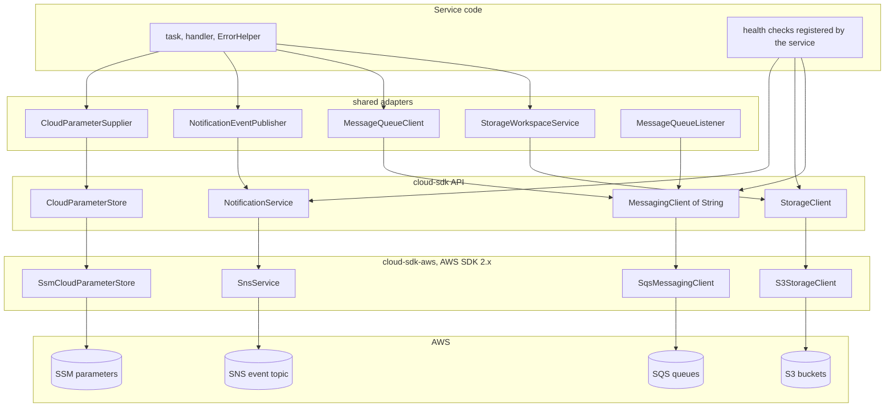
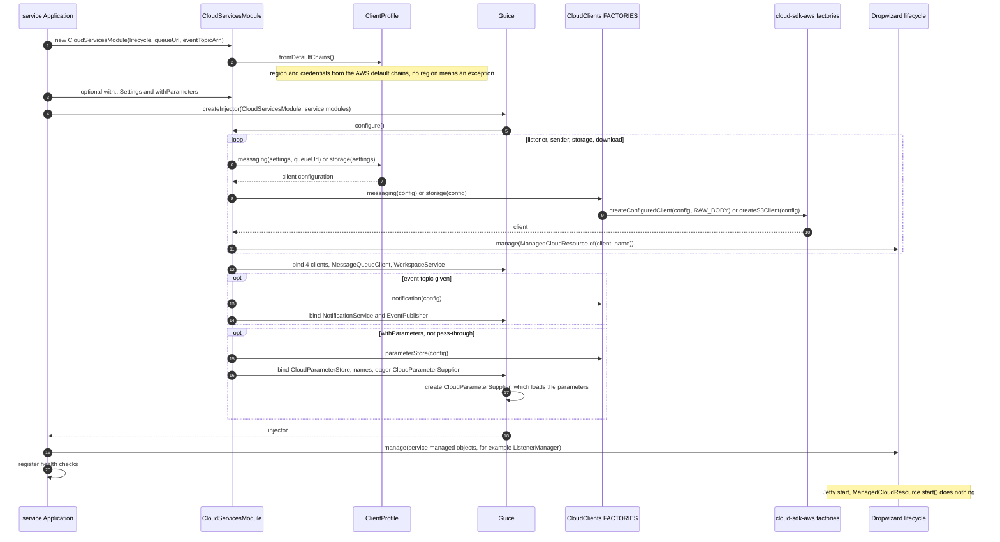
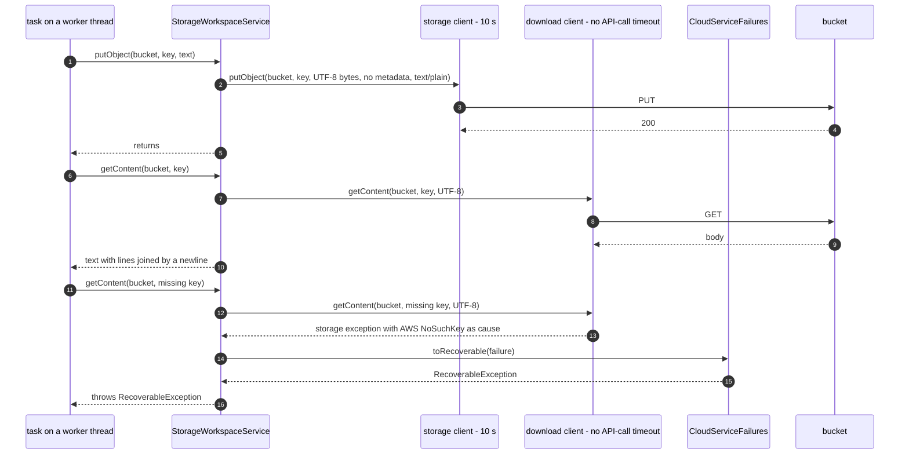
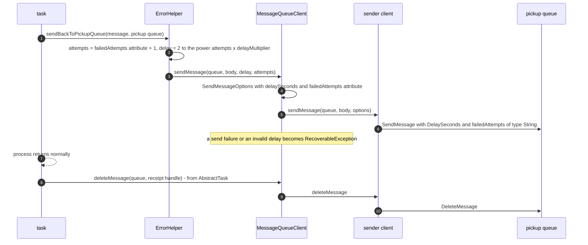
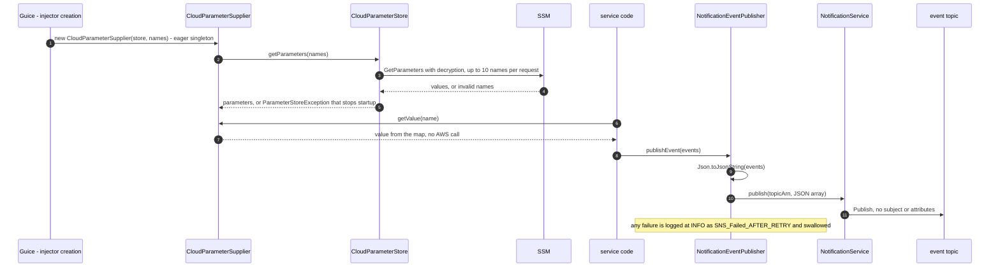
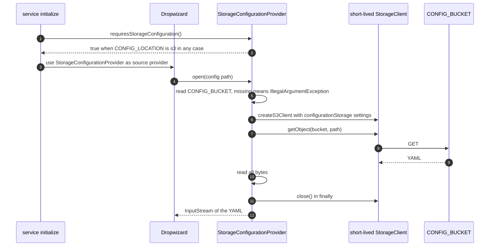
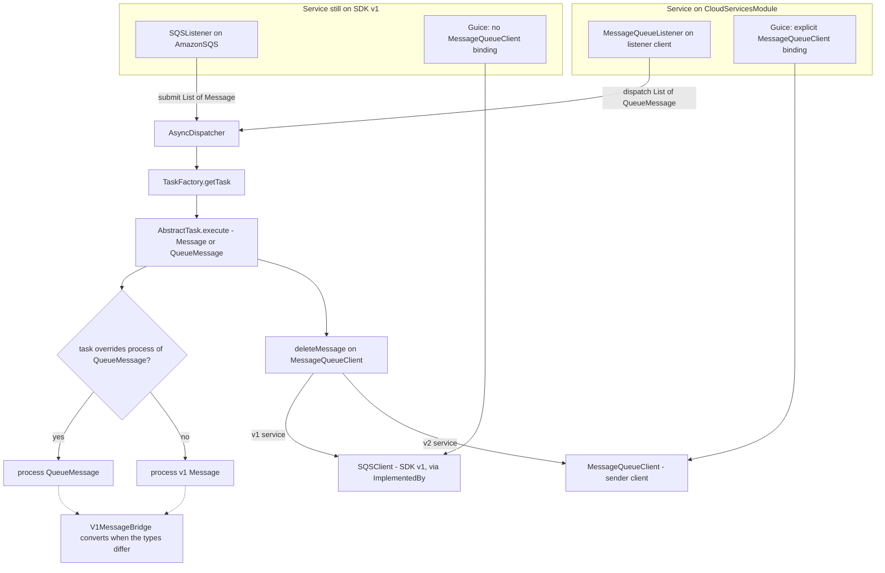
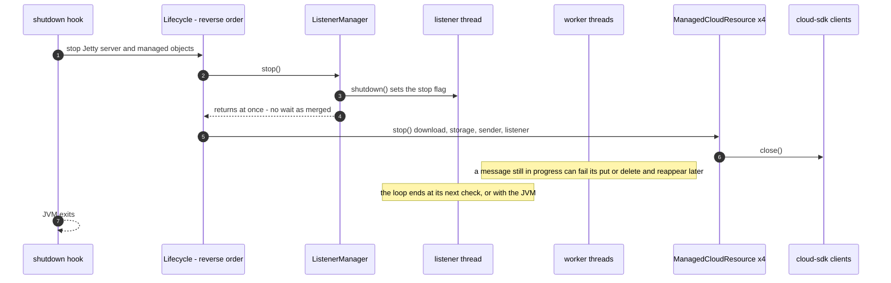

# PR — WI01124532 shared: cloud-sdk adapters, health checks and the v2 Guice module

Branch `WI01124532-aws-sdk-upgrade-shared-adapters` → `feature/WI01124532-aws-sdk-upgrade` · 29 commits `0534f2c3` … `366d13f7` (27 + 2 from the review)

- **Part 1** is the PR description for GitHub: copy everything between the two `✂` lines. It needs no other document.
- **Part 2** is your review guide, one section per commit (or red/green pair). It is for you only and does not go into the PR.
- **Part 3** walks through the shared cloud layer as merged: classes, bindings and settings per role, startup wiring, runtime calls, configuration from storage, health checks, the v1 migration bridge and shutdown (with diagrams).

---

## Part 1 — PR description (GitHub)

✂ ------------------------------------------------------------------

## Summary

Step 1d of the WI01124532 AWS SDK upgrade. This PR adds the `shared` classes that let a service use S3, SQS, SNS and SSM through mercury-services-commons **cloud-sdk** (AWS SDK 2.x) with exactly today's behaviour, and one Guice module that wires them.

| Today (AWS SDK v1, deleted at the end of the migration) | New (cloud-sdk) |
|---|---|
| `S3WorkspaceService` | `StorageWorkspaceService` |
| `SQSClient` | `MessageQueueClient` |
| `SNSEventPublisher` | `NotificationEventPublisher` |
| `InboundSqsHealthCheck`, `OutboundSqsHealthCheck`, `S3ReadHealthCheck`, `S3WriteHealthCheck`, `SnsPublishHealthCheck` | `InboundMessageQueueHealthCheck`, `OutboundMessageQueueHealthCheck`, `StorageReadHealthCheck`, `StorageWriteHealthCheck`, `NotificationPublishHealthCheck` |
| `ParameterStoreModule`, `SsmParameterSupplier` | `CloudServicesModule.withParameters(..)`, `CloudParameterSupplier` |
| `S3ConfigurationProvider` | `StorageConfigurationProvider` |
| SDK v1 client bindings in each service's `ExternalServicesModule` | `CloudServicesModule` |

**No service is switched over.** Every service still runs on SDK v1 exactly as today. Each service moves to the new classes in its own PR, and a final PR deletes the v1 classes.

## Why

- **Same behaviour on the new SDK.** Each new class sends the same bytes, uses the same content types and attributes, and fails the same way (`RecoverableException` wherever the v1 class threw it) as the class it replaces. Health checks keep their names.
- **One wiring class instead of a copy in every service.** `CloudServicesModule` holds the client wiring each service's `ExternalServicesModule` repeats today, with per-service setting overrides. It is shared code only: each service (each ECS task) builds its own clients, so nothing is shared between services.
- **Clients per service.** The same as today, plus one: storage now has two clients, one for downloads and one for everything else, to keep v1's timeouts (see *Storage timeouts* below). Health checks use the service's clients instead of each creating its own.

## Changes

1. Renames from the previous PR's review: client code is named after the cloud-sdk concepts (messaging, storage, notification), not after AWS services.
2. Consumes commons **1.0.39-SNAPSHOT**, which adds what this PR needs: object size without a download, empty objects, a receive that does not hide messages, and "no API-call timeout".
3. Timeouts as in v1: the queue listener and storage downloads have no API-call timeout; storage uploads, copies and metadata requests keep the 10 s limit. This needs two storage clients (review follow-up, see below).
4. `WorkspaceService` put methods return `void` instead of the SDK v1 `PutObjectResult` (no caller used it).
5. New `StorageWorkspaceService`: the workspace on cloud-sdk storage.
6. New `MessageQueueClient`: the queue sender on cloud-sdk messaging.
7. `SQSClient` extends `MessageQueueClient` until the v1 code is deleted, so `AbstractTask` and `ErrorHelper` work for both migrated and not-yet-migrated services.
8. New `NotificationEventPublisher`: lineage events on cloud-sdk notification.
9. Five new health checks on the service's own cloud-sdk clients.
10. New `CloudServicesModule`: binds the clients and the classes above for a service.
11. New `CloudParameterSupplier`: parameter store values on cloud-sdk.
12. New `StorageConfigurationProvider`: reads the service configuration from S3 through cloud-sdk.
13. New golden test: the requests the new classes send to AWS are byte-identical to today's.

## Storage timeouts (review follow-up)

The review pointed out that removing the API-call timeout for the whole storage client also removed v1's 10 s limit on uploads, copies and metadata requests. That is correct. v1's S3 client has a 10 s execution timeout that runs until S3 starts answering:

| Operation | When S3 answers | What v1's 10 s covered | Now |
|---|---|---|---|
| GET that reads a file (`getContent`, `getS3ObjectWrapper`, `getS3InputStream`, copy to file) | when the headers arrive; v1 then reads the body outside the timeout | the headers only, never the download | download client, no API-call timeout: same as v1 |
| PUT (all puts) | after receiving the whole upload | the whole upload | 10 s: same as v1 |
| COPY | after the copy completes | the whole copy | 10 s: same as v1 |
| HEAD (`getMetaData`, `getFileSize`) | at once (no body) | the whole call | 10 s: same as v1 |

So storage now has two clients: one without an API-call timeout for GETs that read the body (an SDK 2.x API-call timeout would include the download), and one with v1's 10 s for everything else. A stalled download is still ended by the 5 s socket timeout. Without this, a slow upload or copy would keep a worker busy for as long as bytes kept flowing, where today it fails after 10 s and the message is retried later.

## Backward compatibility

- **No runtime change for any service.** No service application, module or configuration file changes.
- **Two `shared` signatures change, compatible with every service.** `AbstractTask` and `ErrorHelper` take a `MessageQueueClient`, and today's `SQSClient` is one. The `WorkspaceService` put methods return `void`. One transformer test double is adjusted.
- **Differences on the new classes, none reached by today's callers:**
  - cloud-sdk does not send `DelaySeconds` for a delay of 0 (v1 sent 0). The only delayed send, the retry in `ErrorHelper`, is always at least 20 s.
  - `copyS3FileToFileSystem` downloads, then writes the file, instead of streaming. Nothing outside `shared` calls it.
  - cloud-sdk logs one INFO line per SNS publish.
  - The inbound queue health check does not wait for messages. v1 used the queue's default wait, which is 0 unless a queue sets otherwise.

## Testing

- `shared`: **1707 → 1818 tests**, 0 failures. Each behaviour has a failing test first, then the change.
- Full reactor build (`mvn -B clean verify`) of the PR head `366d13f7`: **BUILD SUCCESS**, all 26 build units, 0 failures. Every other module's test count is unchanged:

  | Module | Tests before | Tests after | Skipped |
  |---|---|---|---|
  | shared | 1707 | 1818 **(+111)** | 1 |
  | structuralvalidator | 239 | 239 | 10 |
  | gen2-parser | 1726 | 1726 | 0 |
  | event-writer | 3 | 3 | 0 |
  | dispatcher | 15 | 15 | 0 |
  | splitter | 179 | 179 | 2 |
  | transformer | 665 | 665 | 5 |
  | distributor | 48 | 48 | 4 |
  | distributor-rest | 142 | 142 | 0 |
  | ingestor | 179 | 179 | 0 |
  | error-processor | 2 | 2 | 0 |
  | email-sender | 13 | 13 | 0 |
  | watermill-publisher | 153 | 153 | 0 |
  | watermill consumer-commons | 149 | 149 | 0 |
  | watermill consumer-framework | 38 | 38 | 0 |
  | registration-inbound-consumers | 10 | 10 | 0 |
  | ebl-inbound-consumers | 10 | 10 | 0 |
  | itv-gps-consumer | 80 | 80 | 0 |
  | cargoscreen-consumer | 0 | 0 | 0 |
  | booking-inbound-consumer | 173 | 173 | 0 |
  | visibility-inbound-consumer | 318 | 318 | 0 |

  cargoscreen-consumer already runs no tests on `develop`.

## Not in this PR

- Moving each service to the new classes (one PR per service).
- Test fakes for the functional tests, and an architecture test that keeps AWS SDK types out of service code (next `shared` PR).
- Deleting the v1 classes (last PR).
- A released commons version instead of the snapshot (before the final PR into `develop`).

🤖 Generated with [Claude Code](https://claude.com/claude-code)

✂ ------------------------------------------------------------------

---

## Part 2 — Review guide (for you only, not in the PR)

### How to read this

The commits come in **red / green pairs**. The red commit adds the test, plus a stub of the new class so it compiles, and the test fails. The green commit adds the code that makes it pass. Reviewing a pair means: do the tests describe the behaviour we want, and does the code do exactly that? `refactor` commits change names or signatures only. `test` commits record what v1 does today, or add a test that passes against today's code. Every new test class is JUnit 5 + AssertJ with Mockito mocks, and needs no AWS.

### Labels used below

The design keeps a numbered list of compatibility rules (**C**) and of development decisions (**D**). Each label is explained here, so nothing needs looking up.

| Label | Meaning |
|---|---|
| C1 | JSON payloads are written by `shared` `Json` only, never by cloud-sdk's `JsonSupport` (which writes dates, nulls and enums differently) |
| C2 | S3 behaves as today: string put is UTF-8 `text/plain`, byte put is `application/octet-stream`, empty objects allowed, user metadata trimmed on write and returned case-insensitive and changeable, plain copy keeps the source metadata, copy with metadata replaces it with `application/octet-stream`, a failed copy or a missing key raises `RecoverableException`, `getContent` joins lines with `\n`, size is read without downloading |
| C3 | SQS behaves as today: same queue URLs and raw body; a retry send carries the `failedAttempts` String attribute and `DelaySeconds` |
| C4 | SNS behaves as today: same topic, events as a raw JSON array, no subject or attributes |
| C7 | SSM behaves as today: same names, decrypted, values unchanged, an unknown name stops startup |
| C9 | Wherever v1 wrapped an AWS failure in `RecoverableException` (so the task retries the message), the new class wraps the cloud-sdk failure the same way |
| D13 | (replaced in this PR) In the previous PR the storage and listener clients had a 10 min / 60 s API-call cap, because cloud-sdk could not express "none" |
| D25 | Naming rule: client code uses the cloud-sdk concepts (messaging, storage, notification), never AWS service names |
| D26 | `WorkspaceService` puts return `void`, to remove the v1 type from the interface |
| D27 | During the migration, the v1 `SQSClient` extends the new `MessageQueueClient` |
| D28 | The storage read health check tells a missing key (healthy) from a missing bucket (unhealthy) by the AWS error code |
| D29 | The parameter store and configuration storage clients keep the v1 SDK defaults, including its retry rule |
| D30 | Shape of `CloudServicesModule` (inputs, optional parts, overrides, shutdown) |
| D31 | `StorageConfigurationProvider` replaces `S3ConfigurationProvider` |
| D32 | (review follow-up) Two storage clients: downloads without an API-call timeout, PUT / COPY / HEAD with v1's 10 s |

---

### 1–4. Renames from the previous PR's review

`0534f2c3`, `a5577fee`, `8d89e8a3`, `28c65967` · refactor · **D25**

**Why.** The previous PR's review asked that client code not use AWS names, so the code reads the same whichever cloud implementation sits behind cloud-sdk.

**Changes.** Names only; behaviour and test logic are unchanged.

| Before | After |
|---|---|
| `CloudSdkSQSListener` (+ test) | `MessageQueueListener` (+ test) |
| constant `SQS_MAX_MESSAGES_PER_RECEIVE` | `MESSAGING_QUEUE_MAX_MESSAGES_PER_RECEIVE` |
| `CloudSdkFailures.isCloudSdkFailure` (+ test `CloudSdkExceptionMappingTest`) | `CloudServiceFailures.isCloudServiceFailure` (+ `CloudServiceFailuresTest`) |
| `ClientSettings.sqsListener()`, `sqsSender()`, `s3()`, `sns()` | `messageQueueListener()`, `messageQueueSender()`, `storage()`, `notification()` |
| `ClientProfile.sqs(..)`, `s3(..)`, `sns(..)` | `messaging(..)`, `storage(..)`, `notification(..)` |

Log texts stay as in v1, so log searches keep working. The new WARN text `cloud service failure: …` was added in the previous PR, so it has no v1 equivalent.

**Review.** The renames are mechanical (`git mv`). No other module referenced the old names.

---

### 5. Commons 1.0.39-SNAPSHOT

`926ac3ac` · build

**Changes.** Root `pom.xml`: `mercury.commons.version` 1.0.38-SNAPSHOT → 1.0.39-SNAPSHOT. Version comments are updated in the pom and in `PlatformLibraryVersionsTest`.

**Why it is safe.** Between 1.0.38 and 1.0.39 the commons poms change only their version (`git diff` of every commons `pom.xml`), so no Jetty, Jackson, logback or slf4j pin moves. The snapshot was published to `inttra-maven` on 2026-11-17; the published jars have the same classes and class sizes as the ones these builds used.

**Tests.** `PlatformLibraryVersionsTest` (7, unchanged) still passes. The full reactor build passes.

---

### 6–7. No API-call timeout for the storage and queue-listener clients (storage corrected in 28–29)

`da5762cd` red · `80c2ec9c` green · replaces **D13**

> **As merged (after 28–29):** only the listener and the new `storageDownload()` role have no API-call timeout. `storage()` is back to v1's 10 s for PUT, COPY and HEAD, and body-reading GETs go through the separate download client. The storage test named below was split in 28–29 into `storageConfigKeepsTheTenSecondApiCallTimeoutForPutCopyAndHead` and `storageDownloadConfigHasNoApiCallTimeoutSoLargeReadsAreNotCapped`. The rest of this section describes the commits as they were made.

**Why.** In v1 the listener client has no execution timeout. The storage client's 10 s timeout ended when the response started, so reading a large file was never cut off. In SDK 2.x an API-call timeout also covers reading the body, which is why the previous PR used generous caps. Commons now lets a client have no API-call timeout, so we match v1 exactly. Stalled connections are still ended by the socket timeout (5 s for storage, 50 s for the listener).

**Changes.**
- `ClientSettings.apiCallTimeout` is now `Optional<Duration>`, where empty means no timeout. The listener and storage roles are empty; the sender and notification roles keep 10 s. (Storage changed again in 28–29: see the note above.)
- `ClientProfile` applies it in one place, `apiCallTimeout(builder, settings)`: `clientExecutionTimeout(..)` when present, `noClientExecutionTimeout()` when empty.

**Tests.** `ClientProfileTest`:
- `messageQueueListenerHasNoApiCallTimeoutLikeV1`: the listener config reports the timeout disabled.
- `storageConfigHasNoApiCallTimeoutSoLargeReadsAreNotCapped`: same for storage; the retry count is still 4 attempts. (Split in 28–29: see the note above.)
- `messageQueueSenderKeepsTheTenSecondApiCallTimeout`: the sender is not disabled and has 10 s.
- `notificationConfigCarriesTheTopicAndRoleSettings`: also checks notification keeps 10 s.

`ClientSettingsTest` expects the new values. Its two renamed tests say why there is no timeout.

**Review.** `ClientProfile.apiCallTimeout`; the four role values in `ClientSettings`.

---

### 8. `WorkspaceService` put methods return `void`

`94a264a2` · refactor · **D26**

**Why.** The three put methods returned the SDK v1 `PutObjectResult`, which would tie the new class to SDK v1. No production code uses the return value (checked across all modules: no chained call, assignment or mock stub).

**Changes.** `WorkspaceService.putObject(String)`, `putObject(byte[])` and `putObjectWithMetaData` return `void`. `S3WorkspaceService` follows. The transformer test double `InboundTransformationTest` drops its unused return values.

**Tests.** `S3WorkspaceServiceTest` (39, unchanged count) now verifies that the SDK v1 call was made, instead of comparing the returned object.

**Review.** Behaviour is unchanged: the same SDK call, without its result.

---

### 9–10. `StorageWorkspaceService`, the workspace on cloud-sdk storage

`0077bca0` red · `df28dbd4` green · **C2, C9**

**Changes.** `workspace.StorageWorkspaceService` implements `WorkspaceService` on the cloud-sdk `StorageClient`:
- **Puts** go through the byte overload with an explicit content type: `text/plain` for strings (UTF-8 bytes), `application/octet-stream` for bytes. It never uses cloud-sdk's string put, which would send `text/plain; charset=UTF-8` and refuse empty content.
- **Metadata** keys and values are trimmed on write, as SDK v1 does (confirmed in its bytecode). On read, metadata comes back in a case-insensitive map the caller may change, like v1's `ObjectMetadata.getUserMetadata()`.
- **Copies.** A plain copy uses cloud-sdk's copy, which keeps the source metadata. A copy with metadata replaces it and sends `application/octet-stream`, which v1 added to every request without a content type. cloud-sdk returns `false` for a failed copy (missing source, 400/403/404); that becomes `RecoverableException` with both paths in the message.
- **Reads.**
  - `getContent(bucket, key)` decodes UTF-8 and joins the lines with `\n`, like v1's line reader.
  - `getContent(bucket, key, charset)` returns the decoded text unchanged.
  - `getFileSize` uses one HEAD request, without downloading.
  - `getMetaData` reads only the metadata.
  - `getS3ObjectWrapper` is one GET for both content and metadata.
  - `copyS3FileToFileSystem` writes the downloaded body to the file.
- **Failures** go through `CloudServiceFailures`, so every cloud-sdk failure, including a missing key, becomes `RecoverableException`. Other exceptions, such as invalid arguments, pass through unchanged, as in v1.

**Tests.** `StorageWorkspaceServiceTest` (21) mocks `StorageClient` and checks the exact call made:

| Test | Checks |
|---|---|
| `stringPutSendsUtf8BytesAsTextPlainLikeV1` | `"Grüße"` is sent as its UTF-8 bytes with `text/plain` and no metadata |
| `emptyStringPutWritesAZeroLengthObject` / `emptyBytePutWritesAZeroLengthObject` | empty content is written as a 0-byte object |
| `bytePutIsAnOctetStreamLikeV1` | bytes are sent with `application/octet-stream` |
| `putWithMetadataTrimsKeysAndValuesLikeV1` | `" fileName " → " order.xml "` is sent as `fileName → order.xml` |
| `stringPutNeverUsesTheCloudSdkStringPutWithItsCharsetContentType` | the string overload of `StorageClient` is never called |
| `putFailureRaisesRecoverableException` | a storage failure becomes `RecoverableException` with it as the cause |
| `plainCopyKeepsTheSourceMetadata` | the 4-argument copy is used |
| `copyWithMetadataReplacesItTrimmedAndSendsOctetStreamLikeV1` | the replacing copy gets trimmed metadata and `application/octet-stream` |
| `copyThatStorageReportsAsFailedRaisesRecoverableException`, `copyWithMetadataThatStorageReportsAsFailedRaisesRecoverableException` | `false` from storage becomes `RecoverableException` naming source and target |
| `copyFailureRaisesRecoverableException` | a thrown storage failure becomes `RecoverableException` |
| `getContentDecodesUtf8AndJoinsLinesWithNewlineLikeV1` | `"Grüße\r\nline 2\rline 3\n"` reads as `"Grüße\nline 2\nline 3"` |
| `getContentOfAnEmptyObjectIsEmpty` | empty object reads as `""` |
| `getContentWithCharsetDecodesTheBytesUnchanged` | with a charset the text is returned untouched (line breaks kept) |
| `objectWrapperHasTheLineJoinedContentAndTheUserMetadataFromOneRead` | content line-joined, metadata case-insensitive, no separate metadata call |
| `metadataIsReadWithoutTheBodyAndReturnedAsACaseInsensitiveMutableCopy` | `get("FILENAME")` works, the map accepts `put`, no body download |
| `fileSizeIsOneHeadWithoutDownloadingTheObject` | size comes from the size call; no download or content call |
| `inputStreamHoldsTheWholeBody` | the stream returns every byte (binary content) |
| `copyToFileWritesTheBodyToTheGivenFile` | the file on disk (temporary folder) holds the body |
| `missingKeyRaisesRecoverableExceptionLikeV1` | a missing key on every read method becomes `RecoverableException` |

**Review.** The content types; `trimmed(..)` and `caseInsensitiveCopy(..)`; `requireCopied(..)`; that every storage call goes through `call(..)` / `run(..)`, which maps failures.

---

### 11–12. `MessageQueueClient`, the queue sender on cloud-sdk

`b98d8480` red · `8d9fe7c3` green · **C3, C9**

**Changes.** `messaging.MessageQueueClient` has the same public methods as `SQSClient`, on the sender-role cloud-sdk `MessagingClient<String>` (Guice name `messageQueueSender`):
- `sendMessage(queue, body)` sends the body unchanged.
- `sendMessage(queue, body, delay)` sets `DelaySeconds`.
- `sendMessage(queue, body, delay, failedAttempts)` also sets the `failedAttempts` attribute, which cloud-sdk sends with type `String`, as v1 did.
- Every failed send becomes `RecoverableException`. That includes a delay outside 0–900 s: SQS rejected it in v1, and cloud-sdk rejects it before sending.
- `deleteMessage` and `getVisibilityTimeout` are not wrapped, exactly as in v1.

**Tests.** `MessageQueueClientTest` (10), with a mocked `MessagingClient`:

| Test | Checks |
|---|---|
| `sendsTheBodyUnchanged` | the body reaches the client as given |
| `delayedSendSetsTheDelayAndNoAttributes` | delay 40, no attributes |
| `retrySendSetsTheDelayAndFailedAttemptsAsAStringAttribute` | delay 80 and `failedAttempts = "3"` |
| `theQueueMaximumDelayIsSent` | 900 s is still sent |
| `delayAboveTheQueueMaximumRaisesRecoverableExceptionLikeV1` | 1280 and 901 → `RecoverableException`, nothing sent |
| `sendFailureRaisesRecoverableException` | a messaging failure on each send variant → `RecoverableException` with it as the cause |
| `deletesByReceiptHandle` / `deleteFailureIsNotWrappedLikeV1` | delete passes through; its failure is thrown as is |
| `visibilityTimeoutIsReadFromTheQueueAttributes` / `visibilityTimeoutFailureIsNotWrappedLikeV1` | reads the `VisibilityTimeout` attribute; its failure is thrown as is |

**Review.** `send(..)`: the delay check before sending, and the mapping of send failures only.

---

### 13–14. `SQSClient` extends `MessageQueueClient` during the migration

`29717207` red · `8ae15846` green · **D27**

**Why.** About 40 classes in 15 modules, plus `AbstractTask` and `ErrorHelper` in `shared`, take an `SQSClient`. Services move to cloud-sdk one PR at a time, so `AbstractTask` and `ErrorHelper` must work with both senders in the meantime. Making the v1 class a subclass of the new one does that with no extra type, and deleting `SQSClient` in the last PR removes the bridge completely.

**Changes.**
- `SQSClient extends MessageQueueClient` and overrides every method with its unchanged v1 code (now marked `@Override`).
- `MessageQueueClient` gets a protected no-argument constructor for `SQSClient`, and `@ImplementedBy(SQSClient.class)`. In a service still on SDK v1, Guice then supplies that service's own `SQSClient` wherever a `MessageQueueClient` is asked for. The new Guice module binds `MessageQueueClient` explicitly, which takes precedence.
- `AbstractTask(MessageQueueClient)` and `ErrorHelper(MessageQueueClient, …)`: only the parameter type changes.

**Tests.** `MessageQueueClientTransitionTest` (2) uses a Guice injector with only the v1 binding (`@Named("amazonSQSForSender") AmazonSQS`), like a service that has not migrated:
- `aV1ServiceGetsItsSqsClientWhereAMessageQueueClientIsInjected`: asking for `MessageQueueClient` returns the same singleton `SQSClient`.
- `theV1SqsClientSeenAsAMessageQueueClientStillSendsThroughSdkV1`: a retry send reaches the v1 `AmazonSQS` with delay 40 and `failedAttempts = "2"`.

Red failed with Guice's "no implementation for `MessagingClient` named `messageQueueSender`", which is exactly the failure a v1 service would hit at startup without this change. The full reactor build passes, so every service compiles and passes its tests against the new constructor types.

**Review.** `SQSClient` is unchanged apart from `extends` and `@Override`. Check that the annotation and the protected constructor are marked for removal.

---

### 15–16. `NotificationEventPublisher`, lineage events on cloud-sdk

`e7e107c7` red · `9c6eb7f5` green · **C1, C4**

**Changes.** `event.NotificationEventPublisher` implements `EventPublisher` on the cloud-sdk `NotificationService`. It sends the events as one JSON array written by `shared` `Json`, with `publish(topicArn, message)`, and no subject or attributes. Any failure is logged with the v1 text `SNS_Failed_AFTER_RETRY :<events>` and swallowed, as `SNSEventPublisher` does, so a publish failure never fails the task.

**Tests.** `NotificationEventPublisherTest` (4):
- `publishesTheEventsAsOneJsonArrayWrittenBySharedJson`: the message equals `Json.toJsonString(events)`.
- `sendsExactlyTheMessageTheV1PublisherSends`: the v1 publisher and the new one run on the same events, and the messages are equal.
- `failedPublishIsLoggedWithTheEventsAndDoesNotFailTheCaller`: no exception; exactly one log line with the v1 text (captured with a logback list appender).
- `anyOtherFailureIsAlsoLoggedAndSwallowedLikeV1`: also for a non-cloud exception.

---

### 17–18. Health checks on the service's cloud-sdk clients

`7f883aad` red · `04a4d8cd` green · **D28**

**Why.** Each v1 health check builds its own default SDK client. The new checks take the service's client, keep the v1 check name (so dashboards and alerts keep working) and keep the same healthy/unhealthy rule.

**Changes.**

| New check | Name (unchanged) | Probe |
|---|---|---|
| `InboundMessageQueueHealthCheck` | `InboundQueue -> <url>` | receive **1** message, wait 0, visibility 0. With cloud-sdk's defaults it would take 10 messages and wait 20 s; taking more messages would raise their receive counts towards the dead-letter limit |
| `OutboundMessageQueueHealthCheck` | `OutboundQueue -> <url>` | send `HEALTHCHECK` |
| `StorageReadHealthCheck` | `S3 read -> <bucket>` | GET `anykey`. Healthy if it exists or the key is missing; unhealthy for anything else, including a missing bucket |
| `StorageWriteHealthCheck` | `S3 write -> <bucket>` | write `HEALTHCHECK` as `text/plain` |
| `NotificationPublishHealthCheck` | `SNS publish -> <topic>` | publish `HEALTHCHECK` |

The storage read check: v1 matched the text "The specified key does not exist", and cloud-sdk words it differently. The new check looks for the AWS error code `NoSuchKey` instead (`CloudServiceFailures.isMissingStorageKey`). It keeps the GET because a HEAD returns the same 404 for a missing bucket, so a deleted bucket would look healthy.

**Tests.**
- Each check (3 tests; 5 for storage read) checks the name, the exact probe call, and that a failure is unhealthy and carries that failure.
- `StorageReadHealthCheckTest` also covers a missing key (healthy), an existing key (healthy), a missing bucket (unhealthy) and access denied (unhealthy).
- `CloudServiceFailuresTest` (+3) covers `NoSuchKey` recognised through the cloud-sdk wrapper, `NoSuchBucket` not taken for a missing key, and no error code meaning no match.

---

### 19–20. `CloudServicesModule`, the Guice module

`3153d6b2` red · `601e0fb7` green · **D30**

> **As merged:** this section describes the module at the merge (`673a3d65`). Two later commit pairs extended it: the download storage client (28–29) and the parameter supplier (23–25). Each item says where it came from.

**Changes.** `cloud.CloudServicesModule(lifecycle, queueUrl, eventTopicArn)`. A service installs it in place of the SDK v1 client bindings in its `ExternalServicesModule`.

It builds one client per role when the module is configured, from `ClientProfile` and the role's `ClientSettings`, and binds:
- `MessagingClient<String>` named `messageQueueListener` and `messageQueueSender`;
- `StorageClient` (PUT, COPY, HEAD, with v1's 10 s), and a second `StorageClient` named `storageDownload` for GETs that read the body (no API-call timeout; added in 28–29);
- `MessageQueueClient`, bound explicitly so the migration annotation does not apply;
- `WorkspaceService` → `StorageWorkspaceService`, on both storage clients;
- only when the service has an event topic: `NotificationService` and `EventPublisher` → `NotificationEventPublisher`;
- only with `withParameters(names...)`: `ParameterSupplier` → `CloudParameterSupplier` (eager, with `CloudParameterStore` and the names), or `PassThroughParameterSupplier` with `withParameters(true, names...)` (added in 23–25).

Settings and lifecycle:
- `with…Settings(..)` overrides a role's settings, for a service whose v1 clients differ (for example, no retries). `withStorageDownloadSettings(..)` came in 28–29, `withParameterStoreSettings(..)` in 23–25.
- The 4 messaging and storage clients (listener, sender, storage, download) are closed on shutdown through the service's Dropwizard lifecycle. The notification and parameter store clients are not; cloud-sdk has nothing to close on them.
- `ClientProfile.fromDefaultChains()` takes the region and credentials from the AWS default chains, as the v1 client builders do.
- A package-private `CloudClients` interface wraps the cloud-sdk factories, so the test can see the configurations without creating AWS clients.

**Tests.**

`CloudServicesModuleTest` uses a recording `CloudClients` that returns mocks. It had 7 tests at `601e0fb7` and has **11 at the merge**:

| Test | Checks | From |
|---|---|---|
| `listenerAndSenderAreSeparateMessagingClientsWithTheirRoleSettings` | two distinct clients, both for the service queue; listener has no timeout, sender 10 s | 19–20 |
| `messageQueueClientIsTheV2SenderOnTheSenderClient` | `MessageQueueClient` is exactly that class (not `SQSClient`) and sends on the sender client | 19–20 |
| `workspaceUsesATimedStorageClientForPutsAndAnUntimedOneForDownloads` | two distinct storage clients; a put reaches the timed one (10 s), a read the download one (no timeout). Was `workspaceIsTheStorageAdapterOnTheStorageClientWithTheStorageSettings` ("storage has no timeout") until 28–29 | 19–20, rewritten in 28–29 |
| `eventPublisherPublishesToTheEventTopicThroughTheNotificationService` | `NotificationEventPublisher` publishes to the topic; notification has 10 s | 19–20 |
| `withoutAnEventTopicThereIsNoNotificationServiceOrEventPublisher` | no topic, no binding, no notification client | 19–20 |
| `roleSettingsCanBeOverriddenPerService` | overrides with 0 retries give 1 attempt; sets both storage roles since 28–29 | 19–20 |
| `messagingAndStorageClientsAreClosedOnShutdown` | **4** lifecycle objects; stopping them closes the 2 messaging and 2 storage clients (was 3 until 28–29) | 19–20, updated in 28–29 |
| `parametersAreLoadedFromTheParameterStoreWhenTheServiceStarts` | eager: `getParameters` is called while the injector is created | 23–25 |
| `unknownParameterNameStopsTheServiceFromStarting` | an unknown name fails injector creation | 23–25 |
| `passThroughParametersComeFromTheConfigurationAndNeedNoParameterStore` | pass-through supplier, no parameter store client built | 23–25 |
| `withoutParametersThereIsNoParameterSupplier` | no `withParameters`, no binding | 23–25 |

`ClientProfileTest.defaultChainsResolveTheRegionLikeTheV1ClientBuilders` sets the standard `aws.region` property and checks that the configuration uses that region.

---

### 21–22. Golden wire test

`568af86d` refactor · `f261c632` test · **C1, C3, C4**

**Why.** This is the end-to-end proof that the bytes reaching AWS do not change. It runs the real cloud-sdk code and mocks only the AWS SDK clients.

**Changes.** `CloudClients.RAW_BODY`, the converter that sends queue bodies unchanged, becomes a named constant so the test uses the same one (refactor, no behaviour change).

**Tests.** `JsonWireCompatibilityTest` (17) runs each payload through the v1 path and the new path, captures the request object handed to each AWS SDK, and compares them.

| Test | v1 path | New path | Compared |
|---|---|---|---|
| `queueBodyReachesTheSdkByteIdentical` (7 payloads) | `SQSClient` → SDK v1 `AmazonSQS` | `MessageQueueClient` → cloud-sdk `SqsMessagingClient` → SDK v2 `SqsClient` | body byte-for-byte, queue URL, no delay, no attributes |
| `retrySendReachesTheSdkWithTheSameBodyDelayAndAttribute` (7 payloads) | same | same | body, delay 80, `failedAttempts` with type `String` and value `3` |
| `eventMessageReachesTheSdkByteIdentical` (5 event lists) | `SNSEventPublisher` → SDK v1 `AmazonSNS` | `NotificationEventPublisher` → cloud-sdk `SnsService` → SDK v2 `SnsClient` | message byte-for-byte, topic, no subject, no message structure, no attributes |

Payloads:
- `MetaData`: all fields; null and empty fields.
- `Event`: minimal; with annotations, tokens and content; with null and empty fields.
- `List<Event>`, including an empty list.
- Text with unicode and line breaks.
- Text with leading and trailing whitespace.

**Proven to fail.** With a converter that strips the body, the whitespace payload fails in both queue tests. That payload was added after a first check showed the other payloads could not catch it.

---

### 23–25. `CloudParameterSupplier`, parameter store values on cloud-sdk

`51bc70d1` test · `c7405b10` red · `626e2d0a` green · **C7, D29**

**Why the settings differ from the other clients.** v1 built the SSM client with the plain SDK defaults, not with the AppianWay client settings. Those defaults are connect 10 s, socket 50 s, no execution timeout, 50 connections, and 3 retries of throttling, server and network errors only. The new client keeps exactly that, instead of the "retry every failure" rule the queue, storage and notification clients use.

**Changes.**
- `parameterstore.CloudParameterSupplier` loads all its names in one `getParameters` call when it is created. cloud-sdk decrypts them and throws for any unknown name. It then serves the values by name, unchanged.
- `ClientSettings.parameterStore()` and `ClientProfile.parameterStore(..)` use the AWS SDK's legacy retry strategy, the counterpart of the v1 default.
- `CloudServicesModule.withParameters(names..)` binds the supplier as an eager singleton, so an unknown name stops startup, as with v1 `ParameterStoreModule`.
- `withParameters(true, names..)` binds `PassThroughParameterSupplier` (plain-text values in the configuration) and builds no client.

**Tests.**
- `V1ClientConfigurationCharacterizationTest.parameterStoreClientUsesThePlainSdkV1Defaults` (test commit): records the v1 values, including that an access-denied failure is **not** retried.
- `CloudParameterSupplierTest` (4):
  - one batch call at construction, values served unchanged (including spaces and `${..}`);
  - values are not fetched again on read;
  - an unknown name gives `null`, as in v1;
  - an unknown name thrown by the store fails construction.
- `ClientSettingsTest` (+1) and `ClientProfileTest` (+1): the role values, no timeout, 4 attempts, and access denied not retried.
- `CloudServicesModuleTest` (+4):
  - parameters are loaded while the injector is created;
  - an unknown name makes injector creation fail;
  - pass-through serves the configured text and builds no client;
  - without parameters there is no supplier.

The green commit also fixes two mistakes in the new test itself: the mock-setup order, and a varargs check that this Mockito version does not support.

---

### 26–27. `StorageConfigurationProvider`, service configuration from S3

`1c43c604` red · `f0c3bff4` green · **D31, D29**

**Changes.** `config.StorageConfigurationProvider` keeps the `S3ConfigurationProvider` behaviour:
- `CONFIG_LOCATION=s3` (any case) selects it.
- `CONFIG_BUCKET` names the bucket. Both are read from the environment first, then from system properties.
- The configuration path is the object key.
- A missing bucket setting fails with the v1 message `S3 configuration: bucket not set`.

It runs at bootstrap, before Guice. So when a file is opened it builds its own storage client with the cloud-sdk factory, using the v1 default settings (`ClientSettings.configurationStorage()`, retrying like the parameter store). It reads the file with one GET and closes the client afterwards, which v1 never did. `ClientProfile` shares one retry helper between the parameter store and configuration storage.

**Tests.**
- `StorageConfigurationProviderTest` (10, using system properties because a test cannot set the environment):
  - `s3` / `S3` select storage;
  - `file`, empty, `s3://bucket` and `classpath` do not, nor does an unset value;
  - the file is read from the configured bucket and the client is closed;
  - a missing bucket setting fails with the v1 message before any client is built;
  - a missing file fails startup and the client is still closed.
- `ClientSettingsTest` (+1) and `ClientProfileTest` (+1): the role values and retry rule.

---

### 28–29. Review follow-up: storage keeps v1's 10 s for PUT, COPY and HEAD

`761e12e8` red · `366d13f7` green · **D32**, corrects commits 6–7 for storage

**The review comment** (GitHub Copilot reviewer, on `ClientSettings.storage()`): with no API-call timeout, PUT, COPY and HEAD lose v1's 10 s execution deadline, so a slow upload can hold a task worker much longer, because the socket timeout is not a total limit. It suggested keeping downloads uncapped but keeping the deadline for the other storage calls.

**Is it right? Yes.** It was a gap in our earlier analysis, which looked only at downloads. v1's 10 s runs until S3 starts answering:

| Operation | When S3 answers | What v1's 10 s covered | Before this fix (commits 6–7) | After |
|---|---|---|---|---|
| GET that reads the body | when the headers arrive; v1 reads the body afterwards, outside the timeout | the headers only, so large downloads were never cut off | no cap, same as v1 | no cap, same as v1 |
| PUT | after receiving the whole upload | the whole upload | no cap: looser than v1 | 10 s, same as v1 |
| COPY | after the copy completes | the whole copy | no cap: looser than v1 | 10 s, same as v1 |
| HEAD | at once | the whole call | no cap: looser than v1 | 10 s, same as v1 |

**What actually changes.** Today, a PUT or COPY still running after 10 s fails with `RecoverableException`; the message is retried later with a delay and goes to the DLQ after the maximum attempts. Without this fix it would keep going as long as bytes kept flowing; only a 5 s pause would end it (the socket timeout), and a slow but steady upload would hold a worker thread (one of at most 10 per service) for longer. With the fix, the behaviour is v1's again, operation by operation.

**Options considered.**
- Two storage clients: chosen; the only option available today that matches v1 for every operation.
- A per-request timeout: cloud-sdk's `StorageClient` has no per-request override, so it would need a commons change.
- Keep and document: looser than v1.
- One generous cap for everything: a mismatch both ways.

**Changes.**
- `ClientSettings.storage()` is back to v1's 10 s, for PUT, COPY and HEAD. New `ClientSettings.storageDownload()`: connect 1 s, socket 5 s, no API-call timeout, 50 connections, 3 retries.
- `StorageWorkspaceService(StorageClient storage, @Named("storageDownload") StorageClient download)`. `getContent` (both), `getS3ObjectWrapper`, `getS3InputStream` and `copyS3FileToFileSystem` use `download`; puts, copies, `getMetaData` and `getFileSize` use `storage`.
- `CloudServicesModule` builds both clients, binds the second one with `@Named("storageDownload")`, closes both on shutdown, and has `withStorageDownloadSettings(..)` for overrides.
- Resource cost: one more storage client per service, with its own pool of 50 connections, inside that service only.

**Tests.**
- `ClientSettingsTest`:
  - `storageKeepsTheV1TenSecondTimeoutForPutCopyAndHead`
  - `storageDownloadHasNoApiCallTimeoutBecauseTheBodyIsReadInsideTheCall`
  - `withTimeoutsChangesOnlyTheTimeouts` now starts from the download role.
- `ClientProfileTest`:
  - `storageConfigKeepsTheTenSecondApiCallTimeoutForPutCopyAndHead`: not disabled, 10 s.
  - `storageDownloadConfigHasNoApiCallTimeoutSoLargeReadsAreNotCapped`: disabled.
- `StorageWorkspaceServiceTest` uses two mocks, and every read test now stubs the download client. Two new tests:
  - `readsThatDownloadTheBodyUseTheClientWithoutAnApiCallTimeout`: all five body-reading methods run, and the timed client is never touched.
  - `putsCopiesAndHeadRequestsUseTheClientWithTheTenSecondApiCallTimeout`: all puts, both copies, metadata and size run, and the download client is never touched.
- `CloudServicesModuleTest`:
  - `workspaceUsesATimedStorageClientForPutsAndAnUntimedOneForDownloads`: two distinct clients; a put reaches the timed one (10 s) and a read reaches the download one (no timeout).
  - The override test sets both storage roles.
  - The shutdown test expects 4 managed clients, and both storage clients closed.
  - The green commit also makes the download mock return an empty file in that test.

`shared` 1814 → 1818.

---

### Full commit list

| # | Commit | Type | Subject |
|---|---|---|---|
| 1 | `0534f2c3` | refactor | rename CloudSdkSQSListener to MessageQueueListener |
| 2 | `a5577fee` | refactor | rename CloudSdkFailures to CloudServiceFailures |
| 3 | `8d89e8a3` | refactor | name the ClientSettings roles after the cloud-sdk-api concepts |
| 4 | `28c65967` | refactor | name the ClientProfile builders after the cloud-sdk-api concepts |
| 5 | `926ac3ac` | build | consume commons 1.0.39-SNAPSHOT |
| 6 | `da5762cd` | red | storage and message-queue listener clients have no API-call timeout |
| 7 | `80c2ec9c` | green | no API-call timeout for storage and the message-queue listener |
| 8 | `94a264a2` | refactor | WorkspaceService put methods return void |
| 9 | `0077bca0` | red | workspace on cloud-sdk storage keeps the v1 behaviour |
| 10 | `df28dbd4` | green | workspace on cloud-sdk storage |
| 11 | `b98d8480` | red | message queue sender on cloud-sdk keeps the v1 SQSClient behaviour |
| 12 | `8d9fe7c3` | green | message queue sender on cloud-sdk |
| 13 | `29717207` | red | v1 services get their SQSClient where a MessageQueueClient is injected |
| 14 | `8ae15846` | green | v1 SQSClient extends MessageQueueClient for the transition |
| 15 | `e7e107c7` | red | lineage events reach the notification topic exactly as with v1 |
| 16 | `9c6eb7f5` | green | lineage events published through the cloud-sdk NotificationService |
| 17 | `7f883aad` | red | health checks on the injected cloud-sdk clients keep the v1 names and results |
| 18 | `04a4d8cd` | green | health checks on the injected cloud-sdk clients |
| 19 | `3153d6b2` | red | v2 Guice module binds the cloud-sdk clients and the shared adapters |
| 20 | `601e0fb7` | green | v2 Guice module CloudServicesModule |
| 21 | `568af86d` | refactor | name the raw-body message converter in CloudClients |
| 22 | `f261c632` | test | golden wire test, v2 queue and topic requests byte-identical to v1 |
| 23 | `51bc70d1` | test | characterize the SDK v1 parameter store client settings |
| 24 | `c7405b10` | red | parameter supplier on the cloud-sdk parameter store keeps the v1 behaviour |
| 25 | `626e2d0a` | green | parameter supplier on the cloud-sdk parameter store |
| 26 | `1c43c604` | red | service configuration read from storage keeps the v1 S3ConfigurationProvider behaviour |
| 27 | `f0c3bff4` | green | service configuration read from storage through cloud-sdk |
| 28 | `761e12e8` | red | storage keeps the v1 10 s timeout for PUT, COPY and HEAD; downloads stay uncapped |
| 29 | `366d13f7` | green | storage PUT, COPY and HEAD keep the v1 10 s timeout; downloads use their own client |

---

## Part 3 — How the shared cloud layer works (as merged in PR #2)

This part describes the `shared` cloud layer as of `673a3d65`, the merge of this PR: its classes, how a service wires it, what each adapter does at runtime, the health checks, the migration bridge, and shutdown. Classes are in `shared` unless marked *(cloud-sdk)*. *(earlier PR)* marks a class that came from the shared-runtime PR (`fa3efede`) and is shown here because the new classes depend on it.

No service uses these classes yet at this merge. Sections 3.3 and 3.8 describe how a service uses them once it moves over (event-writer is the first, in its own PR).

### 3.1 The classes

| Class | Kind | Role |
|---|---|---|
| `CloudServicesModule` | Guice module | Builds one cloud-sdk client per role, registers the messaging and storage clients with the Dropwizard lifecycle, and binds the clients and the adapters below. Optional: event topic, parameters, per-role settings |
| `CloudClients` | package-private interface | Creates the 4 kinds of client from their configurations. `FACTORIES` calls the cloud-sdk-aws factories. `RAW_BODY` is the message converter that sends and receives bodies unchanged. Tests pass their own implementation |
| `ClientSettings` *(earlier PR, changed here)* | record | One role's connect timeout, socket timeout, optional API-call timeout, pool size and retries. One factory method per role (3.2) |
| `ClientProfile` *(earlier PR, changed here)* | config builder | Region and credentials (`fromDefaultChains()`), plus one builder per role that turns `ClientSettings` into a cloud-sdk-aws configuration. The only class that handles AWS SDK configuration types |
| `StorageWorkspaceService` | `WorkspaceService` | The workspace on two `StorageClient`s: one for PUT, COPY and HEAD, one (`@Named("storageDownload")`) for GETs that read the body |
| `MessageQueueClient` | `MessageSender` | Send, delayed send, retry send with `failedAttempts`, delete, and visibility timeout, on the sender `MessagingClient<String>` (`@Named("messageQueueSender")`) |
| `SQSClient` *(v1)* | extends `MessageQueueClient` | The SDK v1 sender, unchanged apart from `extends`. Lets services not yet moved over keep working (3.7) |
| `NotificationEventPublisher` | `EventPublisher` | Publishes lineage events as one JSON array to the event topic. Logs and swallows failures |
| `CloudParameterSupplier` | `ParameterSupplier` | Loads the named parameters once, when it is created, and serves them by name |
| `StorageConfigurationProvider` | `ConfigurationSourceProvider` | Reads the service YAML from storage when `CONFIG_LOCATION=s3`, with a short-lived `StorageClient` (3.5) |
| `CloudServiceFailures` *(earlier PR, renamed here)* | static helper | Decides which failures are cloud service failures (→ `RecoverableException`) and which storage failure is a missing key |
| `InboundMessageQueueHealthCheck`, `OutboundMessageQueueHealthCheck`, `StorageReadHealthCheck`, `StorageWriteHealthCheck`, `NotificationPublishHealthCheck` | health checks | Probes on the service's own clients, with the v1 names (3.6) |
| `MessageQueueListener` *(earlier PR, renamed here)* | `Listener` | The poll loop on the listener `MessagingClient<String>` |
| `ListenerManager` *(earlier PR)* | Dropwizard `Managed` | `start()`: runs `listener.startup()` on a single-thread executor. `stop()`: calls `listener.shutdown()` only |
| `AsyncDispatcher`, `Dispatcher` *(earlier PR)* | dispatcher | A fixed worker pool and a semaphore with as many permits. `dispatch(List of QueueMessage, queue)` runs one task per message |
| `AbstractTask`, `Task`, `TaskFactory` *(earlier PR)* | task model | Two `execute` overloads (v1 `Message` and `QueueMessage`). `AbstractTask` deletes the message after `process` returns. Its constructor now takes a `MessageQueueClient` |
| `V1MessageBridge` *(earlier PR)* | static helper | Converts between v1 `Message` and `QueueMessage<String>` |
| `ErrorHelper` *(changed here)* | retry and DLQ helper | Now takes a `MessageQueueClient`. Its retry send uses `sendMessage(queue, body, delay, failedAttempts)` |
| `MessagingClient<String>`, `StorageClient`, `NotificationService`, `CloudParameterStore` *(cloud-sdk)* | cloud-sdk API | The interfaces the adapters call |
| `SqsMessagingClient`, `S3StorageClient`, `SnsService`, `SsmCloudParameterStore` *(cloud-sdk)* | cloud-sdk-aws | The AWS SDK 2.x implementations the factories create |
| `ManagedCloudResource` *(cloud-sdk)* | Dropwizard `Managed` | `start()` does nothing. `stop()` logs `Closing {name} on application shutdown` and calls `close()`. A `RuntimeException` from `close()` is logged as a WARN and swallowed |

### 3.2 Layers, bindings and clients

Service code talks only to the `shared` adapters and the cloud-sdk API interfaces. The cloud-sdk-aws implementation is created in one place, `CloudClients.FACTORIES`.

**Bindings made by `CloudServicesModule`:**

| Binding | Bound to | Client settings | Closed on shutdown |
|---|---|---|---|
| `MessagingClient<String>` `@Named("messageQueueListener")` (`CloudServicesModule.LISTENER`) | listener client | `messageQueueListener()` | yes |
| `MessagingClient<String>` `@Named("messageQueueSender")` (`MessageQueueClient.SENDER`) | sender client | `messageQueueSender()` | yes |
| `StorageClient` | storage client (PUT, COPY, HEAD) | `storage()` | yes |
| `StorageClient` `@Named("storageDownload")` (`StorageWorkspaceService.DOWNLOAD`) | download client | `storageDownload()` | yes |
| `MessageQueueClient` | `new MessageQueueClient(sender)` | — | — |
| `WorkspaceService` | `StorageWorkspaceService` | — | — |
| `NotificationService` *(only with an event topic)* | notification client | `notification()` | no (see below) |
| `EventPublisher` *(only with an event topic)* | `new NotificationEventPublisher(topic, notification)` | — | — |
| `CloudParameterStore` *(only with `withParameters(names)`)* | parameter store client | `parameterStore()` | no (see below) |
| `String[]` `@Named("parameter-store-names")` *(same)* | the names | — | — |
| `ParameterSupplier` *(only with `withParameters`)* | `CloudParameterSupplier`, eager singleton; or `PassThroughParameterSupplier`, eager singleton, with `withParameters(true, names)` | — | — |

The listener client is bound but not used by the module itself. The service passes it to its `MessageQueueListener` (and usually to `InboundMessageQueueHealthCheck`).

**Not closed on shutdown:**
- The notification client. `SnsService` does not override `CloudResource.close()`, whose default does nothing. The module's Javadoc says the notification service "holds nothing cloud-sdk can close".
- The parameter store client. `CloudParameterStore` is not a `CloudResource`, so it has no `close()`.

**Settings per role** (`ClientSettings`), each the v1 value it replaces:

| Role | Method | Connect | Socket | API-call timeout | Pool | Retries | Retry rule |
|---|---|---|---|---|---|---|---|
| Queue listener | `messageQueueListener()` | 1 s | 50 s | none | 50 | 3 | every failure |
| Queue sender | `messageQueueSender()` | 1 s | 5 s | 10 s | 50 | 3 | every failure |
| Storage PUT, COPY, HEAD | `storage()` | 1 s | 5 s | 10 s | 50 | 3 | every failure |
| Storage download | `storageDownload()` | 1 s | 5 s | none | 50 | 3 | every failure |
| Notification | `notification()` | 1 s | 5 s | 10 s | 50 | 3 | every failure |
| Parameter store | `parameterStore()` | 10 s | 50 s | none | 50 | 3 | retryable failures only |
| Configuration storage | `configurationStorage()` | 10 s | 50 s | none | 50 | 3 | retryable failures only |

- "Every failure" is `ClientProfile.retryStrategy(maxRetries)`: `maxRetries + 1` attempts, backoff doubling from 500 ms up to 5 s without jitter, retry on any exception.
- "Retryable failures only" is the AWS SDK legacy retry strategy with `maxRetries + 1` attempts, the counterpart of the v1 default policy.
- "None" means `noClientExecutionTimeout()`: the call is bounded only by the socket timeout.
- Each client gets its own Apache HTTP client (`AwsHttpClientWrapper.ofSyncBuilder`), so its own connection pool, which the SDK client owns and closes.
- A service overrides a role with `withMessageQueueListenerSettings`, `withMessageQueueSenderSettings`, `withStorageSettings`, `withStorageDownloadSettings`, `withNotificationSettings` or `withParameterStoreSettings`, usually starting from the role default with `withMaxRetries(..)` or `withTimeouts(..)`.

### 3.3 How a service wires it at startup

1. **`new CloudServicesModule(environment.lifecycle(), queueUrl, eventTopicArn)`.** The public constructor calls `ClientProfile.fromDefaultChains()` straight away: the region comes from the AWS default region chain (`aws.region` property, `AWS_REGION`, profile file, container or instance metadata), the credentials from `DefaultCredentialsProvider`. No region found means the constructor throws, as v1 did. `queueUrl` is one of the service's queues: cloud-sdk needs a queue in the messaging configuration, but every call passes its own. `eventTopicArn` is `null` when the service publishes no events.
2. **Optional:** `with...Settings(..)` per role, and `withParameters(names...)` or `withParameters(true, names...)`.
3. **`Guice.createInjector(cloudServicesModule, serviceModule...)`** runs `CloudServicesModule.configure()`. The clients are built here, not lazily, in this order:
   1. listener: `profile.messaging(listenerSettings, queueUrl)` → `clients.messaging(config)` → `MessagingClientFactory.createConfiguredClient(config, RAW_BODY)` → registered with the lifecycle as `ManagedCloudResource.of(client, "message queue listener client")`;
   2. sender: the same, `"message queue sender client"`;
   3. storage: `profile.storage(storageSettings)` → `StorageClientFactory.createS3Client(config)` → `"storage client"`;
   4. download: the same with `storageDownloadSettings` → `"storage download client"`.
4. The module binds the 4 clients, `MessageQueueClient` (explicitly, so the `@ImplementedBy(SQSClient.class)` annotation does not apply) and `WorkspaceService` → `StorageWorkspaceService`.
5. **With an event topic:** `profile.notification(notificationSettings, topic)` → `NotificationClientFactory.createConfiguredClient(config)`. Bound as `NotificationService`, plus `EventPublisher` → `NotificationEventPublisher`. Not registered with the lifecycle.
6. **With parameters:**
   - pass-through: `ParameterSupplier` → `PassThroughParameterSupplier`, eager; no parameter store client is built;
   - otherwise: `profile.parameterStore(parameterStoreSettings)` → `ParameterStoreClientFactory.createParameterStore(config)`, bound with the names, and `ParameterSupplier` → `CloudParameterSupplier` as an **eager singleton**. Guice creates it while the injector is created, so the parameters are loaded then, and an unknown name fails injector creation (the service does not start), as with v1 `ParameterStoreModule`.
7. The service then registers its own managed objects (for example its `ListenerManager`) and its health checks. Anything registered after the module is stopped before the clients (3.8).
8. When Jetty starts, the managed objects start in registration order. `ManagedCloudResource.start()` does nothing; the clients are already usable.

### 3.4 Runtime interactions

#### 3.4.1 Receive and dispatch *(earlier PR)*

Shown briefly, because the adapters below run inside it.

1. `ListenerManager.start()` submits `listener.startup()` to a single-thread executor.
2. `MessageQueueListener` waits up to 1 s for a free worker (`dispatcher.awaitIdleWorker`). `AsyncDispatcher` does this with `tryAcquire` on its semaphore and gives the permit straight back.
3. It long-polls the **listener client**: `receiveMessages` with `maxMessages = min(idle workers, 10)`, the configured `waitTimeSeconds`, and `messageAttributeNames = [failedAttempts]`. No visibility timeout is sent, so the queue's default applies.
4. A non-empty result goes to `dispatcher.dispatch(messages, queueUrl)`. `AsyncDispatcher` takes one permit per message and runs `work` on its pool.
5. `work` gets a task from `taskFactory.getTask(QueueMessage)`, calls `task.execute(message, queue)`, and releases the permit in `finally`.
6. `AbstractTask.execute` calls the service's `process`, then **`MessageQueueClient.deleteMessage(queue, receiptHandle)`**. If anything throws, it logs `Message is not processed; Message will reappear` (WARN), and the message comes back after the visibility timeout.
7. A receive failure is logged as `Exception in SQS Listener :` (ERROR) and the loop carries on.

#### 3.4.2 Workspace put and get

`StorageWorkspaceService` sends every call through `call(..)` or `run(..)`, which maps failures with `CloudServiceFailures.toRecoverable`.

| Method | Client | cloud-sdk call | Notes |
|---|---|---|---|
| `putObject(bucket, key, String)` | storage | `putObject(bucket, key, bytes, null, "text/plain")` | UTF-8 bytes. Not the cloud-sdk string put, which sends `text/plain; charset=UTF-8` and rejects empty content |
| `putObject(bucket, key, byte[])` | storage | `putObject(bucket, key, bytes, null, "application/octet-stream")` | |
| `putObjectWithMetaData` | storage | same, with the metadata trimmed | keys and values trimmed, as SDK v1 did |
| `copyObject` | storage | `copyObject(4 args)` | keeps the source metadata. `false` → `RecoverableException` naming both paths |
| `copyObjectWithMetaDate` | storage | `copyObject(6 args)` with trimmed metadata and `application/octet-stream` | replaces the metadata. `false` → `RecoverableException` |
| `getFileSize` | storage | `getObjectSize` | one HEAD, no download |
| `getMetaData` | storage | `getMetadata` | returned as a mutable, case-insensitive copy |
| `getContent(bucket, key)` | download | `getContent(bucket, key, UTF_8)` | lines joined with `\n` |
| `getContent(bucket, key, charset)` | download | `getContent(bucket, key, charset)` | returned unchanged. Logs `Getting S3Object for bucket = ... and filename = ...` (INFO) |
| `getS3ObjectWrapper` | download | `getObject` | one GET: body (UTF-8, lines joined) and case-insensitive metadata |
| `getS3InputStream` | download | `getObject` | whole body read into a `ByteArrayInputStream` |
| `copyS3FileToFileSystem` | download | `getObject` | body copied to the file. An `IOException` → `RecoverableException` |

**How errors are translated** (`CloudServiceFailures.toRecoverable`):
- Already a `RecoverableException`: returned unchanged.
- A cloud service failure → wrapped in `RecoverableException`. That is: a `CloudSdkException` (messaging, notification), `ParameterStoreException`, `S3OperationException`, `S3UploadException`, `FileTransferException`, `StorageClientInitializationException`, or any exception with an AWS SDK 2.x `SdkException` in its cause chain. A missing key is one of these, so it also becomes `RecoverableException`.
- For a `CloudSdkException` it first logs `cloud service failure: operation=..., resource=..., retryable=...` (WARN). `isRetryable()` is only logged; it does not change the decision.
- Anything else (for example an invalid argument) is thrown unchanged.
- An `IOException` while reading a body is wrapped in `RecoverableException` directly.

#### 3.4.3 Message send and delete

`MessageQueueClient` works on the sender client.

| Method | cloud-sdk call | Failure |
|---|---|---|
| `sendMessage(queue, body)` | `sendMessage(queue, body)` | → `toRecoverable` |
| `sendMessage(queue, body, delay)` | `sendMessage(queue, body, SendMessageOptions(delaySeconds = delay, no attributes))` | → `toRecoverable`. A delay that `SendMessageOptions` rejects (outside 0..900 s) → `RecoverableException` before anything is sent |
| `sendMessage(queue, body, delay, failedAttempts)` | same, with attribute `failedAttempts` = `String.valueOf(failedAttempts)` | same |
| `deleteMessage(queue, receiptHandle)` | `deleteMessage(queue, receiptHandle)` | not wrapped, as in v1 |
| `getVisibilityTimeout(queue)` | `getQueueAttributes(queue).get("VisibilityTimeout")`, parsed as a `long` | not wrapped, as in v1 |

Bodies go through `CloudClients.RAW_BODY`, so the body is sent exactly as given. cloud-sdk sends the `failedAttempts` attribute with data type `String`, as v1 did. cloud-sdk does not send `DelaySeconds` for a delay of 0; the only delayed caller, `ErrorHelper`, never sends 0.

**The retry loop.** The listener asks for the `failedAttempts` attribute on every receive. `ErrorHelper.getFailedAttempts(QueueMessage)` reads it from `getMessageAttributes()` (0 when absent). `sendBackToPickupQueue` adds 1, computes the delay as `2^attempts × delayMultiplier`, and sends the body back to the pickup queue with that delay and the new count. When the task's `process` then returns normally, `AbstractTask` deletes the original.

#### 3.4.4 Event publish

`NotificationEventPublisher.publishEvent(events)`:
1. Writes the events as one JSON array with `shared` `Json.toJsonString(events)`.
2. Calls `notification.publish(topicArn, message)`: no subject, no message attributes.
3. Any `Exception` is caught and logged at INFO as `SNS_Failed_AFTER_RETRY :` followed by the message (the v1 text). The caller never sees the failure.

#### 3.4.5 Parameter lookup

`CloudParameterSupplier` calls `parameterStore.getParameters(names...)` once, in its constructor. The AWS implementation sends `GetParameters` with decryption, at most 10 names per request, and throws `ParameterStoreException` for invalid names. The values are kept in a map. `getValue(name)` is a map lookup: no call to AWS, and a name that was not loaded gives `null`.

### 3.5 Configuration from storage

`StorageConfigurationProvider` runs at bootstrap, before Guice, so it cannot use the module's clients.

1. The service's `initialize(bootstrap)` calls `StorageConfigurationProvider.requiresStorageConfiguration()`: true when `CONFIG_LOCATION` is `s3` in any case. Each switch is read from the environment first, then from the system properties.
2. If true, the service sets it as the configuration source provider. Dropwizard later calls `open(path)`, where the path is the object key.
3. `open` reads `CONFIG_BUCKET`. Not set → `IllegalArgumentException("S3 configuration: bucket not set")`, before any client is built.
4. It builds a new client: `StorageClientFactory.createS3Client(ClientProfile.fromDefaultChains().configurationStorage(ClientSettings.configurationStorage()))`. These are the plain SDK v1 default settings, with the "retryable failures only" rule.
5. One `getObject(bucket, path)`. The body is read fully into a `ByteArrayInputStream`, which is returned.
6. The client is closed in `finally`, also when the read fails. A failed read fails startup.

### 3.6 Health checks

Each check takes a client and a resource name in its constructor. The service creates and registers them; `CloudServicesModule` does not. Each implements `HasName`, and `getName()` gives the v1 name.

| Check | Name | Client passed | Call | Healthy when |
|---|---|---|---|---|
| `InboundMessageQueueHealthCheck` | `InboundQueue -> {queueUrl}` | a `MessagingClient<String>` (the listener client in practice) | `receiveMessages(queueUrl, maxMessages 1, waitTimeSeconds 0, requestVisibilityTimeoutSeconds 0)` | the receive does not throw. A message it sees is visible again at once |
| `OutboundMessageQueueHealthCheck` | `OutboundQueue -> {queueUrl}` | a `MessagingClient<String>` (the sender client in practice) | `sendMessage(queueUrl, "HEALTHCHECK")` | the send does not throw |
| `StorageReadHealthCheck` | `S3 read -> {bucket}` | a `StorageClient` | `getObject(bucket, "anykey")` | the GET succeeds, or fails with AWS error code `NoSuchKey` (`CloudServiceFailures.isMissingStorageKey`). Any other failure, including a missing bucket, is unhealthy |
| `StorageWriteHealthCheck` | `S3 write -> {bucket}` | a `StorageClient` | `putObject(bucket, "HEALTHCHECK", "HEALTHCHECK" bytes, null, "text/plain")` | the put does not throw |
| `NotificationPublishHealthCheck` | `SNS publish -> {topicArn}` | the `NotificationService` | `publish(topicArn, "HEALTHCHECK")` | the publish does not throw |

An unhealthy result carries the exception (`Result.unhealthy(e)`). The read check uses a GET, not `objectExists` (HEAD), because a HEAD answers 404 for a missing bucket as well.

### 3.7 Migration bridge: how v1 services keep working

At this merge every service still runs on SDK v1. Three things let `shared` serve both kinds of service:

1. **`SQSClient extends MessageQueueClient`.** `SQSClient` overrides every method with its v1 code, on `@Named("amazonSQSForSender") AmazonSQS`. It uses the protected no-argument constructor of `MessageQueueClient`, which leaves the cloud-sdk client `null`.
2. **`@ImplementedBy(SQSClient.class)` on `MessageQueueClient`.** `AbstractTask` and `ErrorHelper` now ask for a `MessageQueueClient`. In a v1 service, which has no binding for it, Guice falls back to the annotation and supplies the service's singleton `SQSClient`. In a service that installs `CloudServicesModule`, the explicit binding wins and the v2 `MessageQueueClient` is used.
3. **Both message types through the task model** *(earlier PR)*:
   - The v1 `SQSListener` calls `dispatcher.submit(List of Message)`. `MessageQueueListener` calls `dispatcher.dispatch(List of QueueMessage)`.
   - `AsyncDispatcher` implements both. A dispatcher that implements only `submit` gets the default `Dispatcher.dispatch`, which converts each message with `V1MessageBridge.toV1Message` and calls `submit`.
   - `TaskFactory.getTask(QueueMessage)` and `Task.execute(QueueMessage)` default to converting to v1 and calling the v1 method.
   - `AbstractTask` overrides both `execute` methods. When it is created, it checks whether the service task overrides `process(QueueMessage, String)`. Each `execute` then calls the `process` the task implements, converting with `V1MessageBridge` when the types differ. Both `execute` methods are `@Metered("messages-processed")` and share one private `run`, which deletes the message through the `MessageQueueClient`.
   - `ErrorHelper` has `Message` and `QueueMessage` overloads for reading `failedAttempts`, sending to the DLQ and sending back to the pickup queue.

The bridge goes away in the final PR: `SQSClient`, the `@ImplementedBy` annotation, the protected constructor, `V1MessageBridge` and the v1 overloads are deleted together.

### 3.8 Shutdown

The JVM shutdown hook stops the Jetty server, and Dropwizard stops the managed objects **in reverse registration order**. For a service that installs `CloudServicesModule` and then registers its `ListenerManager`:

1. **`ListenerManager.stop()`** calls `listener.shutdown()`, which sets the stop flag. As merged, that is all it does: it does not wait for the poll loop to end or for the workers to finish, and the single-thread executor from `start()` is never shut down.
2. **The 4 clients close**, in reverse order: storage download client, storage client, message queue sender client, message queue listener client. Each `ManagedCloudResource.stop()` logs `Closing {name} on application shutdown` and calls `close()`. A failure to close is logged as a WARN and does not stop the others.
3. The notification and parameter store clients are not closed (3.2).
4. The JVM exits.

**The gap as merged.** Because step 1 does not wait, a worker still processing a message can find its storage or sender client already closed. Its put or delete then fails, `AbstractTask` logs the WARN, and the message reappears after the visibility timeout. A service whose handler swallows the failure (event-writer does, a known defect) goes on to delete the message, so it can be lost. That is the case Copilot raised on PR #4. The same applies to a long poll in progress on the listener client. This was fixed later, in the event-writer PR (PR #4, commits `c7856876` red / `9367939c` green): `ListenerManager.stop()` now also drains the dispatcher (up to 20 s) before the clients close.

### 3.9 Tests and what they cover

Counts are test methods at `673a3d65`. A parameterized method counts once; its number of runs is in brackets.

| Area | Test |
|---|---|
| Module bindings, role settings, overrides, optional topic and parameters, closing on shutdown | `CloudServicesModuleTest` (11) |
| Bytes reaching the AWS SDK identical to v1 (queue body, retry send, event message) | `JsonWireCompatibilityTest` (3 parameterized: 7 + 7 + 5 runs) |
| Role settings | `ClientSettingsTest` (9) |
| Configurations built from the settings, default chains | `ClientProfileTest` (11) |
| v1 client settings recorded for comparison | `V1ClientConfigurationCharacterizationTest` (6) |
| Configuration from storage | `StorageConfigurationProviderTest` (6; 10 runs) |
| Workspace: content types, metadata, copies, reads, which client, failures | `StorageWorkspaceServiceTest` (23) |
| Message queue sender | `MessageQueueClientTest` (10) |
| v1 service gets its `SQSClient` where a `MessageQueueClient` is injected | `MessageQueueClientTransitionTest` (2) |
| Event publisher | `NotificationEventPublisherTest` (4) |
| Parameter supplier | `CloudParameterSupplierTest` (4) |
| Failure mapping and missing-key detection | `CloudServiceFailuresTest` (8) |
| Health checks | `InboundMessageQueueHealthCheckTest` (3), `OutboundMessageQueueHealthCheckTest` (3), `StorageReadHealthCheckTest` (5), `StorageWriteHealthCheckTest` (3), `NotificationPublishHealthCheckTest` (3) |
| Listener loop | `MessageQueueListenerTest` (8) |
| v1 workspace after the `void` put change | `S3WorkspaceServiceTest` (39) |
| Task model and bridge *(earlier PR)* | `AbstractTaskTest` (42), `AbstractTaskQueueMessageTest` (5), `V1MessageBridgeTest` (4) |
| Dispatcher *(earlier PR)* | `AsyncDispatcherTest` (2), `AsyncDispatcherQueueMessageTest` (3), `AsyncDispatcherIdleWorkerTest` (3), `DispatcherIdleWorkerDefaultTest` (2), `DispatcherQueueMessageOverloadTest` (1) |
| Shutdown order and drain | none at this merge. `ListenerManagerTest` came with the fix in PR #4 |
| Real AWS clients | not automated. The factories are replaced by a recording `CloudClients` in `CloudServicesModuleTest`, and the golden test mocks only the AWS SDK clients |
