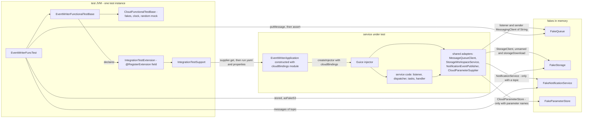
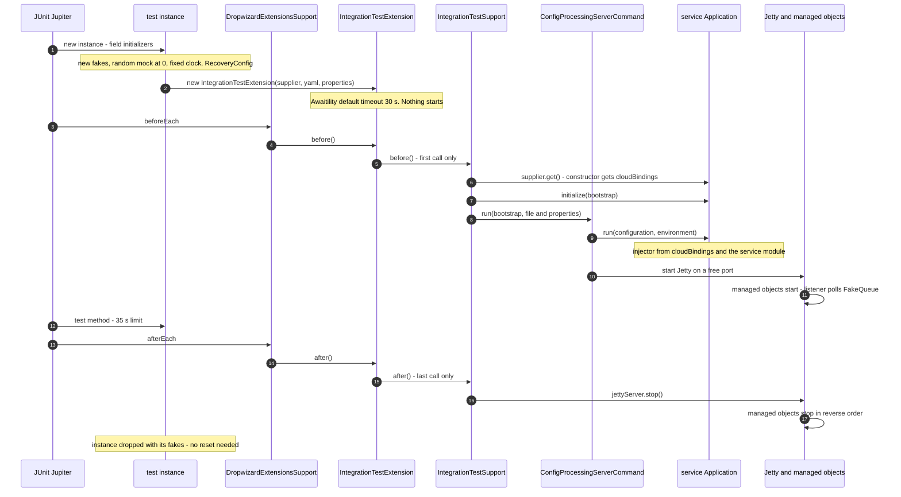
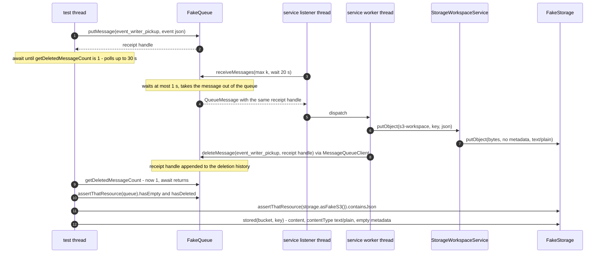

# PR — WI01124532 functional-testing: cloud-sdk fakes, JUnit 5 base and the AWS SDK boundary rule

Branch `WI01124532-aws-sdk-upgrade-functional-testing` → `feature/WI01124532-aws-sdk-upgrade` (PR #2 merged as `673a3d65`) · 12 commits `c0fe1b3a` … `78b936f8`

- **Part 1** is the PR description for GitHub, already in the repository's template sections; copy everything between the two `✂` lines.
- **Part 2** is your review guide, for you only. It does not go into the PR.
- **Part 3** covers review round 1: the replies to post, plus notes for you.
- **Part 4** is the command log for the review, the replies, the PR update, the merges and the branch checks.
- **Part 5** walks through functional-testing as merged: classes, how a test boots the service on the fakes, the fakes' behaviour, threads, the AWS SDK boundary rule, and old vs new (with diagrams).

---

## Part 1 — PR description (GitHub)

✂ ------------------------------------------------------------------

## Link to Story/Defect this work relates to

**WI01124532**: AppianWay AWS SDK v1 → v2 upgrade (re-base `shared` on mercury-services-commons cloud-sdk). This PR is step 1e, the test tooling the services need before they move to cloud-sdk. It builds on #2 (shared adapters), now merged.

## What/Why I Did the changes

`functional-testing` is the library every service's functional tests use. Today it offers only SDK v1 fakes and a JUnit 4 base. This PR adds what a service on cloud-sdk needs, next to the existing SDK v1 tooling, which stays until the v1 code is deleted.

| Today (SDK v1) | New (cloud-sdk) |
|---|---|
| `FakeSQSImpl` (fake `AmazonSQS`) | `FakeQueue` (fake `MessagingClient<String>`) |
| `FakeS3Impl` (fake `AmazonS3`) | `FakeStorage` (fake `StorageClient`) |
| SNS mock + `ArgumentCaptor<PublishRequest>` | `FakeNotificationService` |
| none (the real SSM client) | `FakeParameterStore` |
| `FunctionalTestBase` (JUnit 4) + `IntegrationTestRule` | `CloudFunctionalTestBase` (JUnit 5) + `IntegrationTestExtension` |
| none | `AwsSdkBoundary`: architecture rule that keeps AWS SDK types out of service code |

### Why

- **The fakes behave like cloud-sdk, not just like a map.** Where a test could notice, they do what the real client does:
  - a missing key fails the way the real client does;
  - a copy of a missing object returns `false`;
  - a receive returns only the attributes asked for, never more messages than asked;
  - a receive with visibility 0 (the inbound health check) leaves the messages in the queue.

  So a service's functional tests catch the same mistakes production would.
- **Existing assertions keep working.** `FakeQueue` is also a `FakeSQS`, and `FakeStorage.asFakeS3()` is a `FakeS3`, so a service can switch fakes without rewriting its `SqsAssert` / `S3Assert` checks.
- **One base for every migrated service.** `CloudFunctionalTestBase.cloudBindings(..)` binds the fakes exactly where the new `CloudServicesModule` binds the real clients, so a service test passes one module to its application instead of the real one.
- **The boundary rule stops a service from going around cloud-sdk.** A migrated service adds a one-line test; using an AWS SDK client, request or response type in its code then fails the build.
- **functional-testing was out of line with the services.** It has no parent pom, so none of the reactor's version management reached it:
  - Dropwizard 4.0.16 testing classes sat next to the Dropwizard 5.0.2 runtime, with older Mockito, logback and slf4j;
  - its own tests ran on JUnit 5.12.2, pulled in through Jersey, with whatever Surefire the local Maven install chose by default.

### Changes

1. functional-testing follows the reactor:
   - Dropwizard 5.0.2, Mockito 2.27.0, logback 1.5.38 (classic and core), slf4j 2.0.18;
   - `junit-bom` 5.14.4, the one the reactor's Dropwizard BOM brings;
   - Surefire 3.2.5.

   Tests guard all of these.
2. Four fakes: `FakeQueue`, `FakeStorage`, `FakeNotificationService`, `FakeParameterStore`.
3. `CloudFunctionalTestBase` (JUnit 5): fresh fakes per test, the same fixed clock, random-id mock and recovery settings as the JUnit 4 base, a 35 s limit, and `cloudBindings(topic, parameters...)`.
4. `IntegrationTestExtension`, the JUnit 5 version of `IntegrationTestRule`. `IntegrationTestSupport` now also accepts the server command a service starts with; the default is unchanged.
5. `AwsSdkBoundary.check(packages)`: fails if the service's main classes use AWS SDK v1 or 2.x types, except the DynamoDB entity annotations and `ConditionalCheckFailedException`. A service can allow its documented exceptions.
6. New dependency: ArchUnit 1.3.0, core only. Services check the rule from an ordinary JUnit 5 test, so ArchUnit's own JUnit runner is not needed.

### Backward compatibility

- No production code changes. Every service still uses the SDK v1 fakes and `FunctionalTestBase`; nothing is removed.
- The library versions change for every service's test classpath (item 1). Every service's tests pass with them (see Testing Notes).
- `IntegrationTestSupport`'s existing constructor is unchanged.

## Next Steps

- Each service's PR moves its functional tests to `CloudFunctionalTestBase` and adds its boundary test, starting with event-writer, error-processor and email-sender.
- The SDK v1 fakes and the JUnit 4 base are deleted with the v1 code at the end of the migration.

## Testing Notes

- functional-testing had no tests; it now has **48**:
  - library and test-platform versions (6);
  - fakes (31), which also run the `shared` adapters and health checks on them;
  - JUnit 5 base (5), which start a minimal Dropwizard app through the new extension;
  - boundary rule (6), with compliant and violating fixture classes.
- Each change has a failing test first, then the change.
- Full reactor build (`mvn -B clean verify`) of the PR head `78b936f8`: **BUILD SUCCESS** in 8:49 min, all 26 build units, 0 failures and 0 errors.

  | Module | Tests before (PR #2 head) | Tests after | Skipped |
  |---|---|---|---|
  | functional-testing | 0 | 48 **(+48)** | 0 |
  | shared | 1818 | 1818 | 1 |
  | structuralvalidator | 239 | 239 | 10 |
  | gen2-parser | 1726 | 1726 | 0 |
  | event-writer | 3 | 3 | 0 |
  | dispatcher | 15 | 15 | 0 |
  | splitter | 179 | 179 | 2 |
  | transformer | 665 | 665 | 5 |
  | distributor | 48 | 48 | 4 |
  | distributor-rest | 142 | 142 | 0 |
  | ingestor | 179 | 179 | 0 |
  | error-processor | 2 | 2 | 0 |
  | email-sender | 13 | 13 | 0 |
  | watermill-publisher | 153 | 153 | 0 |
  | watermill consumer-commons | 149 | 149 | 0 |
  | watermill consumer-framework | 38 | 38 | 0 |
  | registration-inbound-consumers | 10 | 10 | 0 |
  | ebl-inbound-consumers | 10 | 10 | 0 |
  | itv-gps-consumer | 80 | 80 | 0 |
  | cargoscreen-consumer | 0 | 0 | 0 |
  | booking-inbound-consumer | 173 | 173 | 0 |
  | visibility-inbound-consumer | 318 | 318 | 0 |

  Every service runs its functional tests with the aligned library versions; only functional-testing changed its test count. cargoscreen-consumer already runs no tests on `develop`.

🤖 Generated with [Claude Code](https://claude.com/claude-code)

✂ ------------------------------------------------------------------

---

## Part 2 — Review guide (for you only, not in the PR)

### How to read this

The commits come in red/green pairs. Each red commit adds the tests and a stub that compiles, and those tests fail; the green commit makes them pass. For the fakes and the boundary rule, the stub was generated from the real class (every public method throws, or the rule never fails), so each red run fails because of the behaviour under test.

### Labels used below

| Label | Meaning |
|---|---|
| test plan 9 | `shared` design, new test 9: `AwsSdkBoundaryArchTest` "in functional-testing, reused by every migrated module" |
| open issue 14 | `shared` design: the AWS SDK boundary and its allowed list (DynamoDB annotations, `ConditionalCheckFailedException`, ingestor's Jest signer credentials, the client-profile configuration types in `shared`) |
| item 17 | `shared` design component 17: cloud-sdk fakes in functional-testing "that copy real cloud-sdk behaviour", a JUnit 5 base on `DropwizardAppExtension`, `IntegrationTestSupport` accepting an injected server command |
| build order 1e | progress tracker §5: fakes, JUnit 5 base, `AwsSdkBoundaryArchTest`, functional-testing pins aligned |

---

### 1–2. functional-testing pins follow the reactor

`c0fe1b3a` red · `135b7b19` green · build order 1e ("functional-testing pins aligned")

**Why.** functional-testing has no parent pom, so its versions are its own. `mvn dependency:tree` showed:
- `dropwizard-testing`, `-jackson` and `-lifecycle` at **4.0.16**, while `dropwizard-core` came in at **5.0.2** through `shared`. Every service's functional tests therefore mixed two Dropwizard major versions.
- Mockito 2.8.9 (reactor 2.27.0), logback 1.5.33 (1.5.38), slf4j 2.0.17 (2.0.18).

**Changes.** `functional-testing/pom.xml`: Dropwizard 5.0.2, Mockito 2.27.0, logback 1.5.38, slf4j 2.0.18. `logback-core` and `slf4j-api` are now declared explicitly, so they cannot drift through a transitive dependency.

**Tests.** `FunctionalTestingLibraryVersionsTest` (4), which reads the resolved versions from the test classpath:
- `dropwizardTestingIsTheSameDropwizardAsTheRuntime`: testing, jackson and lifecycle equal core, and core is 5.0.2.
- `logbackIsTheReactorVersionAndClassicAndCoreMatch`
- `slf4jIsTheReactorVersion`
- `mockitoIsTheReactorVersion`: read from the jar manifest, because the Mockito jar has no `pom.properties`.

All 4 failed in red with the real mismatches (4.0.16, 1.5.33, 2.0.17, 2.8.9).

---

### 3–4. Cloud-sdk fakes

`24fc7867` red · `23c97e6e` green · design item 17

**Changes**, in package `com.inttra.mercury.test.cloud`:

| Fake | Implements | Behaves like cloud-sdk where a test could notice |
|---|---|---|
| `FakeQueue` | `MessagingClient<String>` and the existing `FakeSQS` | <ul><li>a receive returns at most `maxMessages`, in send order, and **only the message attributes that were asked for** (as SQS does);</li><li>it waits at most 1 s for the first message instead of the long poll (commits 11–12 refine both of these);</li><li>a delay and attributes on a sent message are recorded, not applied, so tests do not wait;</li><li>`getQueueAttributes` returns a settable `VisibilityTimeout`.</li></ul> |
| `FakeStorage` | `StorageClient`, plus `asFakeS3()` | <ul><li>a missing key throws `S3OperationException` caused by an AWS `NoSuchKey` error, so `isMissingStorageKey` and the workspace's `RecoverableException` mapping behave as in production;</li><li>a copy of a missing source returns `false`;</li><li>the string put rejects empty content and stores `text/plain; charset=UTF-8`;</li><li>byte, stream and file puts accept 0 bytes (`application/octet-stream` by default);</li><li>metadata keys come back lower-case, as S3 returns them;</li><li>a plain copy keeps metadata and content type; a copy with metadata replaces both;</li><li>a blank bucket or key throws `IllegalArgumentException`.</li></ul> |
| `FakeNotificationService` | `NotificationService` | records each `publish(topic, message)` exactly as given; rejects a null topic or message |
| `FakeParameterStore` | `CloudParameterStore` | the batch returns values in request order and fails naming **every** unknown name; values come back unchanged |

**One design point.** `FakeStorage` cannot implement `FakeS3` directly. `FakeS3.putObject(String, String, String)` returns `PutObjectResult`, while `StorageClient.putObject(String, String, String)` returns `void`, and Java does not allow both on one class. So `asFakeS3()` returns a view that writes to the same store. For test set-up, its `putObject` stores `text/plain`, as the workspace string put does.

**Tests.** 29, in `com.inttra.mercury.test.cloud`; commits 11–12 add 2 more.
- `FakeStorageTest` (11):
  - empty byte put;
  - the string put's rejection and content type;
  - lower-case metadata;
  - stream and file puts;
  - missing key on every read, recognised as a missing key;
  - copy keep / replace / missing source;
  - blank names;
  - list by prefix and delete;
  - `S3Assert` through `asFakeS3()`;
  - `StorageWorkspaceService` round trip on the fake (line joining, trimmed and case-insensitive metadata, `RecoverableException` for a missing key and a failed copy);
  - `StorageReadHealthCheck` healthy on the fake.
- `FakeQueueTest` (9):
  - at most `maxMessages`;
  - only the requested attributes;
  - an empty queue returns after a short wait;
  - delay and attributes kept;
  - deletions and queue attributes;
  - `SqsAssert` on a `MetaData` message;
  - `MessageQueueClient` retry send;
  - `getVisibilityTimeout`;
  - `InboundMessageQueueHealthCheck` healthy.
- `FakeNotificationServiceTest` (4):
  - publishes recorded per topic;
  - nulls rejected;
  - `NotificationEventPublisher` sends one JSON array;
  - the notification health check.
- `FakeParameterStoreTest` (5):
  - request order;
  - unknown names listed;
  - a single unknown lookup is empty;
  - put without overwrite;
  - `CloudParameterSupplier` on the fake.

Red: all 29 failed against generated stubs.

---

### 5–6. JUnit 5 functional-test base

`9bf56929` red · `98163ba8` green · design item 17

**Changes.**
- `CloudFunctionalTestBase`:
  - `@ExtendWith(DropwizardExtensionsSupport.class)` and `@Timeout(35)`;
  - protected fresh fakes `queue`, `storage`, `notification` and `parameterStore` (JUnit 5 makes one instance per test, so no reset is needed);
  - the same `RandomGenerator` mock (`RANDOM_VALUE_n`, `eventId_n`), fixed clock (`2007-12-03T23:15:30Z`) and `RecoveryConfig(true, 5, 10)` as `FunctionalTestBase`.
- `cloudBindings(eventTopicArn, parameterNames...)` binds what `CloudServicesModule` binds:
  - the queue as the listener and sender `MessagingClient<String>`;
  - the storage as both storage clients;
  - an explicit `MessageQueueClient`, and `WorkspaceService` → `StorageWorkspaceService`;
  - with a topic, `NotificationService` and a `NotificationEventPublisher`;
  - with parameter names, the parameter store and an eager `CloudParameterSupplier`;
  - plus `RandomGenerator`, `Clock` and `RecoveryConfig`.
- `IntegrationTestExtension` extends Dropwizard's `DropwizardAppExtension` around our `IntegrationTestSupport`. It uses the same files as the rule: the service YAML, its test properties, then `../configuration/dev/network-services.properties` and `datadog.properties`. It sets the same Awaitility default.
- `IntegrationTestSupport`: a new constructor takes `Function<Application<C>, Command>`, and `defaultServerCommand()` is `ConfigProcessingServerCommand::new`. The old constructor delegates to it, so existing tests are unchanged.

**Tests**, in `com.inttra.mercury.test.base`. They use `PingApplication`, a tiny Dropwizard app that takes its cloud module the way the services do. Its `ping.yaml` resolves `${ping.name}` from `ping-test.properties`.
- `CloudFunctionalTestBaseTest` (4):
  - the service starts with its resolved configuration;
  - the adapters it gets work on the fakes:
    - a workspace put lands in `storage` as `text/plain`;
    - a retry send lands in `queue` with delay 20;
    - events land in `notification` as one JSON array;
    - the parameter supplier returns the fake's value;
  - the clients are bound under the cloud module's names;
  - each test starts with empty fakes and the fixed clock and random ids.
- `IntegrationTestSupportCommandTest` (1): a counting subclass of the shared command runs exactly once and starts the service.

Red: 4 of 5 failed, because the bindings were empty and the injected command was ignored. The start-up test passes in red, because starting does not depend on either.

---

### 7–8. AWS SDK boundary rule

`55f3f049` red · `80d93521` green · test plan 9, open issue 14

**Changes.** `com.inttra.mercury.test.architecture.AwsSdkBoundary`:
- `rule()` / `ruleAllowing(typesOrPackages...)`: no class may depend on `com.amazonaws..` or `software.amazon.awssdk..`, except:
  - the DynamoDB enhanced-client annotations package;
  - `DefaultAttributeConverterProvider`, the default value of `@DynamoDbBean(converterProviders)` (the compliant fixture surfaced it);
  - `ConditionalCheckFailedException`;
  - a service's documented extras.
- `check(packages...)` / `checkAllowing(..)` import the **main** classes only and check them. ArchUnit fails a rule that checked no classes, so a mistyped package cannot pass.
- **Not `archunit-junit5`.** Its engine brings JUnit Platform 1.9-era classes, which broke the Surefire fork (`OutputDirectoryProvider` missing). Services call `check(..)` from a normal JUnit 5 test instead:

  ```java
  @Test void staysInsideTheAwsSdkBoundary() { AwsSdkBoundary.check("com.inttra.mercury.eventstore"); }
  ```
- `shared` applies the rule only once its v1 code is deleted at the end of the migration.

**Tests.** `AwsSdkBoundaryTest` (6), with fixture classes under `architecture.fixture`:
- `CompliantRepository` passes: cloud-sdk `StorageClient`, `@DynamoDbBean`, `@DynamoDbPartitionKey`, catching `ConditionalCheckFailedException`.
- `UsesSdkV1Client` (`AmazonS3`) and `UsesSdk2Request` (`SendMessageRequest`) fail, with both type names in the message.
- `ruleAllowing` both passes.
- Allowing one type still rejects the other.
- `check` reads main classes: it fails on functional-testing's own fakes, which use the v1 `Message` on purpose.
- `check` on a package without classes fails.

Red: 4 of 6 failed, because the stub rule never fails. The compliant and "allowing both" cases pass trivially.

---

### 9–10. Test platform: junit-bom and Surefire (review round 1, R1)

`a410715e` red · `b3a96744` green

**Why.** functional-testing has no parent, so the reactor's test set-up never reached it:
- **Surefire** came from the Maven install's default. That happens to be 3.2.5 on Maven 3.9.11, but Maven 3.8 defaults to 2.12.4, which has no JUnit Platform provider and would skip every Jupiter test with "Tests run: 0".
- **JUnit** came only through `dropwizard-testing → jersey-test-framework-core → junit-jupiter` 5.12.2. The services run **5.14.4 / Platform 1.14.4**, from the `junit-bom` that the reactor's `dropwizard-dependencies` 5.0.2 imports.
- The main code (`CloudFunctionalTestBase`, `IntegrationTestExtension`) compiled against a Jupiter API that was never declared.

**Changes.** `functional-testing/pom.xml`:
- imports `org.junit:junit-bom` `${junit-bom.version}` = 5.14.4 in `dependencyManagement`, as commons' `cloud-sdk-aws` and `dynamo-integration-test` import theirs;
- declares `junit-jupiter-api` at compile scope and `junit-jupiter-engine` at test scope, with versions from the BOM. Services still get their engine from the root pom;
- pins `maven-surefire-plugin` `${maven-surefire-plugin.version}` = 3.2.5, as the root pom does.

**Tests.** 2 new ones in `FunctionalTestingLibraryVersionsTest`:
- `junitIsTheReactorVersionWithJupiterAndPlatformAligned`: the Jupiter API, params and engine jars are 5.14.4, and Platform engine and commons are 1.14.4 (read from manifests; the classes are looked up by name, because engine and Platform are runtime-only).
- `testPlatformIsDeclaredInThisPomNotLeftToMavenOrJersey` reads the module pom and the root pom:
  - Surefire must equal the root's version, and the root's version must not be empty;
  - `junit-bom` must be imported;
  - the Jupiter API must be at compile scope and the engine at test scope, both without their own version.

Red: both failed (`5.12.2` instead of `5.14.4`; Surefire not declared). Green: `dependency:tree` shows `junit-jupiter-api:5.14.4:compile` and `junit-jupiter-engine:5.14.4:test`, and the build log shows `surefire:3.2.5:test` with the `JUnitPlatformProvider`.

---

### 11–12. Queue fake: visibility-0 receive and wait time (review round 1, R2)

`f082ed16` red · `78b936f8` green

**Why.** `InboundMessageQueueHealthCheck` receives with a request visibility timeout of 0, so on SQS the message stays visible to the listener. `FakeQueue` ignored that option and removed the message, so a health probe could take work away from the listener. The fake also waited its full 1 s even when the receive asked not to wait.

**Changes.** In `FakeQueue`:
- a receive with request visibility 0 returns up to `maxMessages` **without removing them**;
- `receiveMessages` and `listMessages` wait `min(waitTimeSeconds, 1 s)`;
- any other receive still takes the messages, and the fake never redelivers a message that was received but not deleted (stated in the javadoc).

**Tests.** 2 new ones in `FakeQueueTest`:
- `inboundHealthCheckLeavesAQueuedMessageForTheListener`: after the probe, the size is still 1, and a normal receive returns the same message id and body.
- `aReceiveThatDoesNotWaitReturnsAtOnceOnAnEmptyQueue`: `waitTimeSeconds(0)` returns in under 500 ms.

Red: size 0 instead of 1, and a wait of about 1 s.

---

### Full commit list

| # | Commit | Type | Subject |
|---|---|---|---|
| 1 | `c0fe1b3a` | red | functional-testing uses the same libraries as the services |
| 2 | `135b7b19` | green | functional-testing pins follow the reactor |
| 3 | `24fc7867` | red | cloud-sdk fakes for the functional tests behave like cloud-sdk |
| 4 | `23c97e6e` | green | cloud-sdk fakes for the functional tests |
| 5 | `9bf56929` | red | JUnit 5 functional-test base with the fakes bound like the cloud module |
| 6 | `98163ba8` | green | JUnit 5 functional-test base for services on cloud-sdk |
| 7 | `55f3f049` | red | AWS SDK boundary rule for services on cloud-sdk |
| 8 | `80d93521` | green | AWS SDK boundary rule for services on cloud-sdk |
| 9 | `a410715e` | red | functional-testing runs the reactor's JUnit and Surefire |
| 10 | `b3a96744` | green | functional-testing imports the reactor's junit-bom and pins Surefire |
| 11 | `f082ed16` | red | the queue fake leaves a health-probed message in the queue |
| 12 | `78b936f8` | green | a visibility-0 receive leaves messages in the queue fake |

---

## Part 3 — Review round 1 (Copilot on `80d93521`)

Both comments were valid and are fixed in commits 9–12. The replies below are ready to post once the commits are pushed.

### R1. Surefire and the Jupiter engine are not pinned

[discussion_r4609856127](https://github.com/wtg-e2open/INTTRA.appianway/pull/3#discussion_r4609856127) · `functional-testing/pom.xml`

**Reply:**

> Agreed. With no parent, this module got Surefire from the Maven install's default and Jupiter 5.12.2 only through Jersey's test framework, while the services run 5.14.4. It now imports `junit-bom` 5.14.4 (the one the reactor's Dropwizard BOM brings), declares the Jupiter API (compile) and engine (test) with versions from the BOM, and pins Surefire 3.2.5 as the root pom does. `FunctionalTestingLibraryVersionsTest` guards all of it. The module report shows all 48 tests.

### R2. Visibility-0 health probes consume queued messages

[discussion_r4609856168](https://github.com/wtg-e2open/INTTRA.appianway/pull/3#discussion_r4609856168) · `functional-testing/src/main/java/com/inttra/mercury/test/cloud/FakeQueue.java`

**Reply:**

> Agreed. A receive with request visibility 0 now leaves the messages in the fake queue, as on SQS, and the wait follows `waitTimeSeconds` (at most 1 s). `inboundHealthCheckLeavesAQueuedMessageForTheListener` runs the health check on a populated queue, then receives the same message. The SDK v1 `FakeSQSImpl` has the same simplification; it is left as is, since it is removed with the v1 code.

### Notes (for you only)

- **Why we missed them.**
  - **R1:** the pin alignment compared dependency versions only. Build plugins and the test engine are not dependencies, and every local run looked right because Maven 3.9.11 happens to bind Surefire 3.2.5. Checking R1 also showed that the 5.12.2 from the first attempt was Jersey's version, not the reactor's.
  - **R2:** the fake's receive copied the v1 fake, which removes every message it receives. The health-check test ran on an empty queue.
- **Real impact of R2 is low.** No service schedules health checks, so a functional test is affected only if it calls `/healthcheck` while messages are queued.
- **Full builds need `-Daether.enhancedLocalRepository.trackingFilename=_any.repositories`.** The bill-of-lading consumers (not upgraded yet) declare the deprecated `dynamo-client:1.0` without the watermill `lib/` repository it comes from. Without the flag, Maven 3.9 refuses the cached jar there. This is unrelated to this PR, and `80d93521` fails the same way without the flag.
- **Done 2026-11-18:**
  - pushed `80d93521..78b936f8`;
  - Part 1 pasted into the PR description;
  - both replies posted and both threads resolved;
  - backup branch `backup/WI01124532-ft-r1-junit5122` deleted.

  The Jenkins set-build-status job is not needed on GitHub: PRs into the feature branch have no required check.
- **Merged 2026-11-18:** PR #2 as `673a3d65`, then PR #3 (retargeted to the feature branch) as `58aee71b`. Both are merge commits with subjects starting `WI01124532`, and both branches are deleted.

---

## Part 4 — Command log: review, reply, update and merge (2026-11-18)

These are the commands used for PR #3's review round and for merging PRs #2 and #3, in order.

- **Where to run them:** Git Bash, in `c:\Users\arijit.kundu\projects\appianway`.
- **Placeholders:** `R=wtg-e2open/INTTRA.appianway` stands for the repository. Comment ids, thread ids and review ids are the real ones from this round.
- **The two `gh` styles:**
  - `gh api` calls GitHub's REST API, or GraphQL with `gh api graphql`.
  - `gh pr …` is the higher-level PR command.
  - `--jq` filters the JSON reply, using `jq` syntax built into `gh`; no separate `jq` install is needed.

### 4.1 Read the PR and its review comments

```bash
# PR overview: title, branches, state, reviews, PR-level comments; plus which remote is origin
gh pr view 3 --json number,title,headRefName,baseRefName,url,state,reviews,comments
git remote -v

# Inline review comments (the ones attached to code lines): id, file, line, the diff hunk and the text
gh api repos/$R/pulls/3/comments --jq '.[] | {id, path, line, original_line, diff_hunk, body}'
```

- `pulls/3/comments` returns only **inline** code comments.
- PR-level conversation comments are at `issues/3/comments`.
- Review summaries, such as Copilot's overview, are at `pulls/3/reviews`.

### 4.2 Fix locally (red/green), redo R1, verify

```bash
# Keep the first R1 attempt (JUnit 5.12.2) on a backup branch, then move the branch back to the PR head
git branch backup/WI01124532-ft-r1-junit5122 055a978c
git reset -q --hard 80d93521          # local only; 80d93521 was the pushed head, so nothing pushed is rewritten

# Commits: stage by explicit path, never `git add -A` (docs and IDE files stay untracked)
git add functional-testing/src/test/java/com/inttra/mercury/test/FunctionalTestingLibraryVersionsTest.java
git commit -q -F - <<'EOF'
WI01124532 red: functional-testing runs the reactor's JUnit and Surefire
...
Co-Authored-By: Claude Opus 5.5 <noreply@anthropic.com>
EOF
# same pattern for b3a96744 (pom.xml), f082ed16 (FakeQueueTest), 78b936f8 (FakeQueue)

# Confirm the remote head is still the old one and list the new local commits
git fetch -q origin WI01124532-aws-sdk-upgrade-functional-testing
git rev-parse --short origin/WI01124532-aws-sdk-upgrade-functional-testing   # 80d93521
git log --oneline 80d93521..HEAD                                              # the 4 new commits
```

- **`git commit -F -`** reads the message from standard input, which the heredoc (`<<'EOF' … EOF`) provides. This keeps a multi-line message intact with its `Co-Authored-By` line.
- **Full build** (G4 worktree): `mvn -B clean verify -Daether.enhancedLocalRepository.trackingFilename=_any.repositories` in `../appianway-build`, detached at `78b936f8`. The progress document has the build commands in §9.4–9.5.

### 4.3 Push, then find the review threads

```bash
git status --short | grep -v '^??'      # nothing staged or modified (untracked docs only)
git log --oneline -5
git push origin WI01124532-aws-sdk-upgrade-functional-testing   # 80d93521..78b936f8, fast-forward

# Review threads (GraphQL only: REST has no "thread" or "resolved" concept)
gh api graphql -f query='query{repository(owner:"wtg-e2open",name:"INTTRA.appianway"){
  pullRequest(number:3){reviewThreads(first:20){nodes{id isResolved
    comments(first:5){nodes{databaseId path author{login} body}}}}}}}' \
  --jq '.data.repository.pullRequest.reviewThreads.nodes[]
        | {id, isResolved, c:[.comments.nodes[] | {databaseId, path, login:.author.login, b:(.body[0:120])}]}'
```

The GraphQL result gives each comment two ids:

- `databaseId` (e.g. `4609856127`) is the REST comment id, used to **reply**.
- The thread `id` (e.g. `PRRT_kwDOVviyWs64zW99`) is the GraphQL node id, used to **resolve**.

### 4.4 Post the replies and resolve the threads

```bash
D=docs/redesign/pr-details/2026-11-17-apway-pr-1e-functional-testing-description.md
R1=$(sed -n '345p' $D | sed 's/^> //')   # reply text = the quoted line in Part 3, without "> "
R2=$(sed -n '353p' $D | sed 's/^> //')

# Reply inside the existing thread (not a new top-level comment)
gh api repos/$R/pulls/3/comments/4609856127/replies -f body="$R1" --jq .html_url
gh api repos/$R/pulls/3/comments/4609856168/replies -f body="$R2" --jq .html_url

# Resolve each thread
for t in PRRT_kwDOVviyWs64zW99 PRRT_kwDOVviyWs64zW-V; do
  gh api graphql -f query="mutation{resolveReviewThread(input:{threadId:\"$t\"}){thread{isResolved}}}" \
    --jq .data.resolveReviewThread.thread.isResolved      # prints true
done
```

- `-f body=…` sends a string field. `gh api` uses POST when fields are given.
- A reply shows up as a small `COMMENTED` review by you; that is how GitHub stores thread replies.

### 4.5 Update the PR description

```bash
S=<scratchpad>/pr3-body.md
sed -n '15,110p' $D > $S            # Part 1 only: the lines between the two ✂ markers
gh pr edit 3 --body-file $S
gh pr view 3 --json body --jq .body | grep -E '48|78b936f8|ArchUnit'   # spot-check the new text is live
```

`--body-file` replaces the whole description. Check the line range first (`head -3 $S`, `tail -2 $S`), because the file's line numbers shift when it is edited.

### 4.6 Why "Changes recommended / 2 open issues" still showed

```bash
# All reviews with their state and the commit they were made on
gh api repos/$R/pulls/3/reviews --jq '.[] | {id, user:.user.login, state, commit:.commit_id[0:8], submitted_at}'

# What GitHub uses for merging: overall decision, merge state, pending reviewers
gh pr view 3 --json reviewDecision,reviewRequests,mergeStateStatus,latestReviews \
  --jq '{reviewDecision, mergeStateStatus, reviewRequests:[.reviewRequests[] | .login // .name],
         latest:[.latestReviews[] | {a:.author.login, s:.state}]}'

# The text of Copilot's review (the banner is just markdown in this body)
gh api repos/$R/pulls/3/reviews/5951626815 --jq .body | head -20

# Thread status
gh api graphql -f query='query{repository(owner:"wtg-e2open",name:"INTTRA.appianway"){
  pullRequest(number:3){reviewThreads(first:20){nodes{isResolved isOutdated}}}}}' \
  --jq '.data.repository.pullRequest.reviewThreads.nodes'
```

What the results showed:

- Copilot's review state is `COMMENTED`, so it doesn't block.
- `reviewDecision` is `APPROVED` and `mergeStateStatus` is `CLEAN`.
- Both threads are resolved.
- The banner is fixed text from the review of `80d93521`. Only a new Copilot review replaces it.

### 4.7 Check PR #2's threads

```bash
gh api graphql -f query='query{repository(owner:"wtg-e2open",name:"INTTRA.appianway"){
  pullRequest(number:2){headRefName headRefOid reviewThreads(first:50){nodes{id isResolved isOutdated path line
    comments(first:10){nodes{databaseId author{login} createdAt body}}}}}}}' \
  --jq '.data.repository.pullRequest | "head \(.headRefName) \(.headRefOid[0:8])",
        (.reviewThreads.nodes[] | "=== \(.id) resolved=\(.isResolved) \(.path):\(.line)",
          (.comments.nodes[] | "-- \(.author.login) \(.createdAt) #\(.databaseId)\n\(.body[0:600])"))'
gh api repos/$R/pulls/2/reviews --jq '.[] | "\(.user.login) \(.state) \(.commit_id[0:8]) \(.submitted_at)"'
gh api repos/$R/issues/2/comments --jq '.[] | "\(.user.login) \(.created_at) \(.body[0:150])"'
gh pr view 2 --json reviewDecision,mergeStateStatus --jq .
```

Result: one thread, already resolved, with our reply. PR #2 was approved and `CLEAN`, so there was nothing to resolve.

### 4.8 Before merging: merge settings, rulesets, and whether PR #3 had the PR #2 fix

```bash
# Merge methods allowed, auto-delete, default merge commit title
gh api repos/$R --jq '{allow_merge_commit, allow_squash_merge, allow_rebase_merge,
                       delete_branch_on_merge, merge_commit_title, squash_merge_commit_title}'
gh pr view 2 --json baseRefName,commits --jq '{base:.baseRefName, n:(.commits|length)}'

# Every ruleset in full (Commit_Check = WI prefix regex on all branches but develop/master)
for r in $(gh api repos/$R/rulesets --jq '.[].id'); do
  gh api repos/$R/rulesets/$r --jq '{name, conditions:.conditions.ref_name, rules:[.rules[] | {type, p:.parameters}]}'
done

# Is PR #2's head (with its review fix) already inside PR #3?
git fetch origin -q
git rev-parse --short origin/WI01124532-aws-sdk-upgrade-shared-adapters            # 366d13f7
git merge-base --is-ancestor origin/WI01124532-aws-sdk-upgrade-shared-adapters \
                             origin/WI01124532-aws-sdk-upgrade-functional-testing && echo "PR #2 head is in PR #3"
git log --oneline origin/WI01124532-aws-sdk-upgrade-shared-adapters..origin/WI01124532-aws-sdk-upgrade-functional-testing   # PR #3's own 12
git log --oneline origin/WI01124532-aws-sdk-upgrade-functional-testing..origin/WI01124532-aws-sdk-upgrade-shared-adapters   # empty
git merge-base --is-ancestor origin/feature/WI01124532-aws-sdk-upgrade \
                             origin/WI01124532-aws-sdk-upgrade-shared-adapters && echo "PR #2 is up to date with feature"
```

- **`git merge-base --is-ancestor A B`** exits 0 when commit A is contained in B, so `&& echo` prints only on success.
- **`A..B`** lists the commits in B that are not in A. An empty result the other way round means B has everything A has.
- **Why "Create a merge commit":** squash or rebase would give PR #2's commits new ids on feature, and then PR #3 would need a rebase.
- **The merge title has to start with `WI01124532`.** The default `Merge pull request #2 from …` fails `Commit_Check`.

### 4.9 After PR #2 merged: retarget PR #3 and check its diff

```bash
git fetch origin -q
gh pr view 2 --json state,mergedAt,mergeCommit --jq '{state, mergedAt, m:.mergeCommit.oid[0:8]}'   # MERGED, 673a3d65
git log -1 --format='%h %p | %s' origin/feature/WI01124532-aws-sdk-upgrade   # merge commit, its 2 parents, subject
git merge-base --is-ancestor 366d13f7 origin/feature/WI01124532-aws-sdk-upgrade && echo "366d13f7 in feature"

gh pr edit 3 --base feature/WI01124532-aws-sdk-upgrade      # retarget
gh pr view 3 --json baseRefName,commits,files,mergeStateStatus,reviewDecision \
  --jq '{base:.baseRefName, commits:(.commits|length), first:.commits[0].oid[0:8], last:.commits[-1].oid[0:8],
         files:(.files|length), mergeStateStatus, reviewDecision}'     # 12 commits, 23 files, CLEAN

# The same check locally: three dots = changes on the PR branch since it split from feature
git diff --stat origin/feature/WI01124532-aws-sdk-upgrade...origin/WI01124532-aws-sdk-upgrade-functional-testing | tail -1
git diff --name-only origin/feature/WI01124532-aws-sdk-upgrade...origin/WI01124532-aws-sdk-upgrade-functional-testing \
  | grep -v '^functional-testing/'       # empty = nothing from PR #2 shows up again
```

- **`%p`** prints the parent ids. A merge commit has two: the old feature head and the merged PR head.
- **Two dots and three dots.** `git diff A..B` compares the two tips. `git diff A...B` compares B with the point where it split from A, which is what GitHub shows as the PR diff.
- **The PR description line** "stacked on #2" was changed to "builds on #2 (shared adapters), now merged" and re-uploaded with `gh pr edit 3 --body-file` (4.5).

### 4.10 After both merges: check the feature branch and clean up branches

```bash
git fetch origin --prune -q                      # --prune drops origin/... refs of deleted remote branches
git log --oneline --first-parent -4 origin/feature/WI01124532-aws-sdk-upgrade   # only the merge commits on feature
git log -1 --format='parents: %p' origin/feature/WI01124532-aws-sdk-upgrade      # 673a3d65 78b936f8
git diff --stat 78b936f8 origin/feature/WI01124532-aws-sdk-upgrade | tail -1    # empty = same files as the built commit
git branch -r | grep -E 'shared-adapters|functional-testing'                    # empty = remote branches deleted
gh pr list --state all --limit 5 --json number,title,state,baseRefName \
  --jq '.[] | "#\(.number) \(.state) → \(.baseRefName) | \(.title)"'

# Local: switch to feature, fast-forward only (fails rather than creating a merge), delete merged branches
git checkout -q feature/WI01124532-aws-sdk-upgrade
git merge --ff-only -q origin/feature/WI01124532-aws-sdk-upgrade
git branch -d WI01124532-aws-sdk-upgrade-shared-adapters WI01124532-aws-sdk-upgrade-functional-testing
git branch -d backup/WI01124532-aws-sdk-upgrade-pre-commons-u-items-2026-11-12
git branch -D backup/WI01124532-ft-r1-junit5122  # -D: never merged (superseded attempt)
git branch -vv; git worktree list; git config user.email
```

- **`--first-parent`** follows only the first parent of each merge, so the log shows the feature branch's own history: one line per merged PR.
- **An empty `git diff` between `78b936f8` and feature** means the merged result has exactly the files we built and tested, so no new build was needed.
- **`git branch -d` deletes only fully merged branches**, so it is safe to use. `-D` forces the delete, and was used for the backup branch that was never merged.

---

## Part 5 — How functional-testing works (as merged in PR #3)

This part describes `functional-testing` as of `58aee71b`, the merge of this PR: its classes, how a functional test boots a service on the fakes, what happens before and after each test, how the fakes behave, the threads involved, the AWS SDK boundary rule, and the pom. The worked example is event-writer's migrated tests on `WI01124532-aws-sdk-upgrade-event-writer`. Packages are under `com.inttra.mercury.test` unless marked *(shared)* or *(cloud-sdk)*.

### 5.1 The classes

**New in this PR**

| Class | Kind | Role |
|---|---|---|
| `CloudFunctionalTestBase` | abstract JUnit 5 base | `@ExtendWith(DropwizardExtensionsSupport.class)`, `@Timeout(35)`. Holds the fakes, the `RandomGenerator` mock, the fixed `Clock` and `RecoveryConfig(true, 5, 10)` as instance fields. `cloudBindings(eventTopicArn, parameterNames...)` returns a Guice module that binds them |
| `IntegrationTestExtension<C>` | extends Dropwizard's `DropwizardAppExtension<C>` | The JUnit 5 version of `IntegrationTestRule`. Wraps an `IntegrationTestSupport` with the service YAML and properties. Registered as an instance field with `@RegisterExtension` |
| `cloud.FakeQueue` | implements `MessagingClient<String>` *(cloud-sdk)* and `FakeSQS` | In-memory queues. Stands in for the listener and the sender messaging clients |
| `cloud.FakeStorage` | implements `StorageClient` *(cloud-sdk)* | In-memory buckets. Stands in for both storage clients. `stored(bucket, key)` and `asFakeS3()` for assertions |
| `cloud.FakeNotificationService` | implements `NotificationService` *(cloud-sdk)* | Records every `publish(topic, message)`. `messages(topic)`, `published()`, `clear()` |
| `cloud.FakeParameterStore` | implements `CloudParameterStore` *(cloud-sdk)* | In-memory parameters. `with(name, value)` for set-up |
| `architecture.AwsSdkBoundary` | final utility, ArchUnit | `check(packages...)`, `checkAllowing(..)`, `rule()`, `ruleAllowing(..)`: a service's main classes must not use AWS SDK v1 or 2.x types |

**Existing (SDK v1, JUnit 4), kept until the v1 code is removed**

| Class | Kind | Role |
|---|---|---|
| `FunctionalTestBase` | abstract JUnit 4 base | `@Rule Timeout` 35 s. `getCommonBindings()` binds spied `FakeSQSImpl` / `FakeS3Impl` as `AmazonSQS` / `AmazonS3` and a mocked `AmazonSNS`. `@Before resetSpies()` resets the spies and the random mock |
| `IntegrationTestRule<C>` | JUnit 4 `ExternalResource` | Boots the service before each test and stops it after |
| `IntegrationTestSupport<C>` | extends `DropwizardTestSupport<C>` | Starts the service the way it runs: `run <yaml> <properties...>` through its server command. **Changed in this PR:** a second constructor takes the server command; `defaultServerCommand()` is `ConfigProcessingServerCommand::new` *(shared)* |
| `aws.FakeSQS`, `aws.FakeS3` | interfaces | The test-facing views the assertions read. `FakeQueue` implements `FakeSQS`; `FakeStorage.asFakeS3()` returns a `FakeS3` |
| `aws.impl.FakeSQSImpl`, `aws.impl.FakeS3Impl` | SDK v1 fakes | Fake `AmazonSQS` and `AmazonS3` |
| `assertions.ResourceAssertions` | static entry point | `assertThatResource(FakeSQS)` → `SqsAssert`, `assertThatResource(FakeS3)` → `S3Assert`, `assertThatResource(ArgumentCaptor<PublishRequest>)` → `SnsAssert` |
| `util.TestDSL` | static helpers | `content(path)` reads a classpath resource, `prettify(json)`, `snsEvents(path)` |

### 5.2 Components and how they connect

The service under test gets one Guice module from the test instead of `CloudServicesModule` *(shared)*. That module, `cloudBindings(..)`, binds the fakes under the same keys `CloudServicesModule` binds the real clients. The service's own code and the shared adapters cannot tell the difference. The test reads the same fake objects to assert.



What `cloudBindings(eventTopicArn, parameterNames...)` binds, next to what `CloudServicesModule` binds in production:

| Key | `CloudServicesModule` *(shared)* | `cloudBindings(..)` |
|---|---|---|
| `MessagingClient<String>` named `CloudServicesModule.LISTENER` (`"messageQueueListener"`) | real listener client | `queue` |
| `MessagingClient<String>` named `MessageQueueClient.SENDER` (`"messageQueueSender"`) | real sender client | `queue` (the same instance) |
| `StorageClient` (no name) | real storage client | `storage` |
| `StorageClient` named `StorageWorkspaceService.DOWNLOAD` (`"storageDownload"`) | real download client | `storage` (the same instance) |
| `MessageQueueClient` | `new MessageQueueClient(sender)` | `new MessageQueueClient(queue)` |
| `WorkspaceService` | → `StorageWorkspaceService` | → `StorageWorkspaceService` |
| `NotificationService`, `EventPublisher` | only when the topic is not null | only when the topic is not null: `notification`, and `new NotificationEventPublisher(topic, notification)` |
| `CloudParameterStore`, `String[]` named `CloudParameterSupplier.PARAMETER_NAMES`, `ParameterSupplier` → `CloudParameterSupplier` (eager) | only with `withParameters(..)` | only when parameter names are given: `parameterStore` |
| `RandomGenerator`, `Clock`, `RecoveryConfig` | not bound | the base's mock, fixed clock and `RecoveryConfig(true, 5, 10)` |

Two differences from production follow from this:

- **One fake per role pair.** Listener and sender are the same `FakeQueue`; storage and download are the same `FakeStorage`. A message sent by the service to any queue lands in the one `queue`, keyed by queue URL.
- **The fakes are not registered with the lifecycle.** `CloudServicesModule` registers each real client with `environment.lifecycle()` so it is closed on shutdown. `cloudBindings(..)` only binds instances, so nothing closes the fakes; they are dropped with the test instance.

### 5.3 Lifecycle of a test class and of one test

JUnit 5 creates **a new instance of the test class for every test method** (the default lifecycle). The fakes, the mock and the extension are instance fields, so every test gets new ones, and **the service is booted and stopped once per test**.

**Before all.** Nothing boots. `DropwizardExtensionsSupport.beforeAll` only looks for **static** `DropwizardExtension` fields, and the extension is an instance field. `DropwizardAppExtension` also implements `BeforeAllCallback`, but JUnit does not call class-level callbacks of an extension registered through an instance field.

**Before each**, in order:

1. **JUnit creates the test instance.** Field initializers run, base class first:
   - `CloudFunctionalTestBase`: new `FakeQueue`, `FakeStorage`, `FakeNotificationService`, `FakeParameterStore`; a `RandomGenerator` mock whose counters start at 0, so the first `randomUUID()` is `RANDOM_VALUE_1` and the first `randomEventId()` is `eventId_1`; `Clock.fixed(2007-12-03T23:15:30Z, UTC)`; `RecoveryConfig(true, 5, 10)`.
   - The subclass's `IntegrationTestExtension` field. Its constructor sets Awaitility's default timeout to `IntegrationTestRule.DEFAULT_TIMEOUT` (30 s), adds any `ConfigOverride`s to the system properties, and creates the `IntegrationTestSupport` with the YAML and the properties list `[service properties, ../configuration/dev/network-services.properties, ../configuration/dev/datadog.properties]`. Nothing starts yet.
   - A test that needs parameters sets them here, in an instance initializer, because the parameter supplier loads them at startup (`CloudFunctionalTestBaseTest` does `parameterStore.with("clientId", "app-1")`).
2. **`DropwizardExtensionsSupport.beforeEach`** finds every `DropwizardExtension` field on the instance and its superclasses, and calls `before()`. `DropwizardAppExtension.before()` calls `IntegrationTestSupport.before()` on the first call only (a call counter).
3. **`IntegrationTestSupport.before()`** (returns at once if a server is already running):
   - calls the application supplier, for example `() -> new EventWriterApplication(cloudBindings(null))`. So `cloudBindings(..)` runs now, after the fakes exist;
   - builds a `Bootstrap` whose `run(configuration, environment)` also captures the configuration, the environment and the Jetty server (through a server lifecycle listener);
   - calls `application.initialize(bootstrap)`;
   - builds the server command (by default `ConfigProcessingServerCommand`, or the one passed to the extension) and runs it with `file = <yaml>` and `properties = <the list>`.
4. **`ConfigProcessingServerCommand.run`** *(shared)* installs its configuration source: the YAML from the **classpath** (event-writer's `conf/` is a resource directory), the properties files from the **file system**, relative to the module directory, with `${...}` resolved. Then Dropwizard's server command parses the configuration and calls `application.run(..)`. The service creates its injector with the `cloudBindings` module, registers its managed objects and health checks, and Jetty starts. Managed objects start with it; for event-writer, the listener thread starts polling `queue`.
5. **Ports.** The test properties set `server.connector.port=0` (event-writer) or the YAML has `port: 0` (`ping.yaml`), so Jetty takes a free port. `service.getLocalPort()` and `service.getAdminPort()` return it; with `server.type: simple`, the admin endpoints are under `/admin` on the same port.

**The test runs** with a 35 s limit (`@Timeout(35)` on the base class).

**After each.** `DropwizardExtensionsSupport.afterEach` calls `after()`; on the last call `IntegrationTestSupport.after()` calls `jettyServer.stop()` and sets it to `null`. Stopping Jetty stops the service's managed objects in reverse registration order. The fakes are **not reset**: the instance, and with it the fakes, the mock and the application, is simply dropped.

**After all.** Nothing, for the same reason as before all.



### 5.4 The fakes in detail

All four live in `com.inttra.mercury.test.cloud`. Each behaves like the real cloud-sdk client where a functional test could notice, and is simpler everywhere else.

| Fake | State | Behaviour that matters in tests | Test-side methods |
|---|---|---|---|
| `FakeQueue` | per queue URL: a `LinkedBlockingQueue<Sent>` of messages not yet received; a sent history; a deletion history of receipt handles; settable queue attributes | see below | `putMessage(queue, body)` → receipt handle; `sent(queue)`; `size`, `isEmpty`, `isNotEmpty`; `getMessages(queue)` (SDK v1 `Message`s), `getMessages(queue, type)` (JSON bodies parsed); `getHistory`; `getDeletionHistory`; `getDeletedMessageCount`; `setQueueAttribute` |
| `FakeStorage` | per bucket: key → `Stored(byte[] content, Map metadata, String contentType, String eTag, Instant lastModified)`; plus a set of created buckets | see below | `stored(bucket, key)` (the record, or `null`; `text()` decodes UTF-8); `asFakeS3()` |
| `FakeNotificationService` | a list of `Published(topicArn, message)`; a set of topic ARNs | `publish` rejects a null topic or message with `IllegalArgumentException` and records the message exactly as given. `publishEvent(List<Event>)` throws `UnsupportedOperationException`: AppianWay publishes its shared events as JSON through `publish`. `createTopic` returns `arn:aws:sns:us-east-1:000000000000:<name>` | `published()` (all, in order), `messages(topic)` (one topic, in order), `clear()`, static `subscriptionArn(topic)` |
| `FakeParameterStore` | name → stored parameter (name, value, type, last modified, version) | `getParameters(names...)` returns the values in request order, unchanged, and fails with `ParameterStoreException` naming **every** unknown name. `getParameter(name)` is empty for an unknown name. `putParameter` without overwrite fails if the name exists; each overwrite bumps the version. `replacePlaceholders` throws `UnsupportedOperationException` | `with(name, value)`: stores a `SECURE_STRING`, overwriting |

**`FakeQueue` semantics**

- **Send.** Every send (`sendMessage` in its three forms, and `putMessage`) creates a `Sent(messageId, receiptHandle, body, messageAttributes, delaySeconds, sentTimestamp)` with random UUIDs for the ids, appends it to the sent history and to the queue, and logs it. The **delay is recorded, not applied**: the message can be received at once, so a test never waits for a retry delay.
- **Receive** (`receiveMessages(options)` and `listMessages(queue, max, wait)`):
  - waits for the first message for `min(waitTimeSeconds, 1 s)`. A receive with `waitTimeSeconds` 0 returns at once on an empty queue. The listener's 20 s long poll becomes 1 s;
  - returns at most `maxMessages`, in send order;
  - returns only the message attributes named in the request (or all of them for `"All"`). `getAttributes()` holds only `SentTimestamp`;
  - **takes the messages out of the queue**, unless the request visibility timeout is 0.
- **Visibility 0** (the inbound health probe, `InboundMessageQueueHealthCheck`: max 1, wait 0, visibility 0). The messages are returned but **left in the queue**, as on SQS, where they stay visible to the listener. This was review round 1: before it, a health check could take a message away from the listener.
- **No redelivery.** There is no in-flight state and no visibility timer. A message that is received and never deleted does not come back. A test that needs "the message reappears" cannot get it from this fake.
- **Delete.** `deleteMessage(queue, receiptHandle)` only appends the receipt handle to the deletion history; the message already left the queue when it was received. The receipt handle a service deletes is the one `putMessage` returned, so `hasDeleted(queue, receipt)` works.
- **Size.** `size`, `isEmpty` and `getMessages` see only messages **not yet received**. So `hasEmpty(queue)` is already true once the listener has received the message, before it is processed. That is why the tests wait on the deleted count, not on the size.
- **Queue attributes.** `getQueueAttributes` returns `VisibilityTimeout` `"30"`, `ApproximateNumberOfMessages` (the size), then anything set with `setQueueAttribute`. `MessageQueueClient.getVisibilityTimeout` reads it.
- **The v1 view.** As a `FakeSQS`, it returns SDK v1 `Message` objects built from `Sent` (attributes as `String` values), so `SqsAssert` works unchanged.

**`FakeStorage` semantics**

- **Puts.** The byte, stream and file puts accept empty content. Without a content type they store `application/octet-stream`. The cloud-sdk **string** put rejects empty content and stores `text/plain; charset=UTF-8`. `StorageWorkspaceService.putObject(bucket, key, String)` *(shared)* does not use it: it puts the UTF-8 bytes with `text/plain`, which is what event-writer's test checks.
- **Metadata.** Keys are stored in lower case, as S3 returns them. No metadata is stored as an empty map.
- **Reads of a missing key** (`getObject`, `getContent`, `getMetadata`, `getObjectSize`) throw `S3OperationException` caused by a `NoSuchKeyException` with error code `NoSuchKey` and status 404. So `CloudServiceFailures.isMissingStorageKey` and the workspace's `RecoverableException` mapping behave as in production. `objectExists` returns `false`.
- **Copies.** A plain copy keeps the source metadata and content type; a copy with metadata replaces both. A missing source returns `false`.
- **Names.** A null or blank bucket or key throws `IllegalArgumentException`.
- **Other.** `listObjects(bucket, prefix)` is sorted by key. `generatePresignedUrl` returns `https://fake-storage.local/<bucket>/<key>?expires=<seconds>`.
- **The v1 view.** `asFakeS3()` returns a separate `FakeS3` object over the same store. It cannot be the same class, because `FakeS3.putObject(String, String, String)` returns `PutObjectResult` and `StorageClient.putObject(String, String, String)` returns `void`. Through the view, `putObject(bucket, key, text)` stores `text/plain` (for test set-up), and `getContent` of a missing key throws `IllegalStateException` listing every stored file.

**A typical test, end to end** (`EventWriterFuncTest.storesEachEventAndDeletesTheMessage`):



### 5.5 The threads

| Thread | Created by | What runs on it |
|---|---|---|
| test thread | JUnit | Field initializers, `beforeEach` (the whole service boot), the test method, `afterEach` (Jetty stop). Set-up (`putMessage`, `parameterStore.with`) and every assertion |
| the service's own threads | the service, as in production | For event-writer: the listener thread (polls `queue`) and the dispatcher's worker threads (store, then delete). These write to the fakes while the test thread reads them |
| Jetty request threads | Dropwizard | HTTP requests the test sends, such as `/admin/opsHealthcheck` in `EventWriterFuncTest`. Health checks run here and call the fakes |
| Awaitility polling | Awaitility | `await().until(..)` evaluates the condition repeatedly until it is true or the default timeout (30 s) passes |

**Why the tests wait.** `putMessage` returns as soon as the message is in the queue. Receiving, storing and deleting happen later on the service's threads. The test therefore waits on the **last** visible step: the delete comes after the put, so once the deleted count is 1, the stored object is there too. Waiting on the queue size would not be enough (5.4: the size drops at receive time).

**Thread safety of the fakes.** None of them uses `synchronized`; they rely on concurrent collections, which is enough for one writer side and one reader side:

| Fake | Collections |
|---|---|
| `FakeQueue` | `ConcurrentHashMap` per queue URL; `LinkedBlockingQueue` for the messages (`poll` with timeout, `drainTo`); `CopyOnWriteArrayList` for the sent and deletion histories. `getDeletionHistory` returns the live list, which is safe to read while workers append |
| `FakeStorage` | `ConcurrentHashMap` of `ConcurrentHashMap`; the `Stored` records are immutable records with copied maps (the `byte[]` itself is not copied on read) |
| `FakeNotificationService` | `CopyOnWriteArrayList` for publishes, a concurrent key set for topics |
| `FakeParameterStore` | `ConcurrentHashMap`. `putParameter`'s exists-then-put is not atomic, which is fine for set-up from one thread |
| `RandomGenerator` mock | its two counters are `AtomicInteger`s |

**After the test.** `jettyServer.stop()` stops the managed objects; the listener may still be inside a receive on the old `FakeQueue`, which now lasts at most 1 s instead of SQS's 20 s. The next test has its own fakes, so a late receive cannot reach them. Since PR #4 (`9367939c`), `ListenerManager.stop()` also waits, up to 20 s, for the messages in progress. A test that ends with a message still being processed therefore has a slower teardown, but no worker writes to the fakes after the stop.

### 5.6 The AWS SDK boundary rule

`architecture.AwsSdkBoundary` turns "services reach AWS only through cloud-sdk" into a test.

- **The rule.** `noClasses().should().dependOnClassesThat(..)` a type whose name starts with `com.amazonaws.` or `software.amazon.awssdk.`, unless it is on the allowed list. The failure reason ends with "(AWS SDK boundary)".
- **Allowed for every service:**
  - the package `software.amazon.awssdk.enhanced.dynamodb.mapper.annotations.` (the DynamoDB entity annotations);
  - `software.amazon.awssdk.enhanced.dynamodb.DefaultAttributeConverterProvider`, the default value of `@DynamoDbBean(converterProviders)`;
  - `software.amazon.awssdk.services.dynamodb.model.ConditionalCheckFailedException`, caught for version conflicts.
- **Extra allowances.** `ruleAllowing(typesOrPackages...)` / `checkAllowing(packages, typesOrPackages...)`. An entry ending in `.` is a package prefix; otherwise it matches the exact class and its nested classes (`name$...`).
- **What is checked.** `check(packages...)` imports the packages with `ImportOption.DoNotIncludeTests`, so only main classes. A package with no classes fails ("failed to check any classes"), so a mistyped package cannot pass silently.
- **How a service uses it.** From an ordinary JUnit 5 test (ArchUnit core only, no ArchUnit test engine). event-writer's `AwsSdkBoundaryArchTest`:

  ```java
  @Test
  void staysInsideTheAwsSdkBoundary() {
      AwsSdkBoundary.check("com.inttra.mercury.eventstore");
  }
  ```

- **event-writer's second rule.** The same test class has `usesTheSharedCloudAdaptersNotTheSdkV1Ones`, a separate ArchUnit rule (not an extension of `AwsSdkBoundary`). It forbids a dependency on any class in `SHARED_SDK_V1_CLASSES`, the shared v1 classes a migrated service stops using: `AWSClientConfiguration`, `S3ConfigurationProvider`, `SQSListener`, `SQSListenerClient`, `SQSClient`, `S3WorkspaceService`, `InboundSqsHealthCheck`, `S3WriteHealthCheck`. These are `com.inttra.mercury.shared` classes, so `AwsSdkBoundary` alone would not catch them.
- **functional-testing itself does not pass the rule**, on purpose: `FakeQueue` uses the v1 `Message`, `FakeStorage` the v1 S3 model types and the 2.x `NoSuchKeyException`. `AwsSdkBoundaryTest.checkReadsTheMainClassesOfThePackages` relies on that.

### 5.7 Build and pom

`functional-testing` has **no parent pom**, so none of the reactor's version management reaches it. The pom pins what the services run with:

| Item | Before | After | Why |
|---|---|---|---|
| `io.dropwizard.version` (`dropwizard-testing` and the rest) | 4.0.16 | 5.0.2 | The runtime is Dropwizard 5.0.2; the testing classes were 4.0.16 |
| `mockito.version` | 2.8.9 | 2.27.0 | reactor version |
| `logback-classic` and `logback-core` | 1.5.33 (classic only) | 1.5.38, both declared | a matched pair that cannot drift |
| `slf4j-api` | 2.0.17 (not declared) | 2.0.18, declared | reactor version |
| `org.junit:junit-bom`, imported in `dependencyManagement` | none | 5.14.4 | the BOM the reactor's Dropwizard 5.0.2 BOM imports (Jupiter 5.14.4, Platform 1.14.4). Before, JUnit 5.12.2 came only through Jersey's test framework |
| `junit-jupiter-api` | not declared | compile scope, version from the BOM | the main code (`CloudFunctionalTestBase`, `IntegrationTestExtension`) uses the Jupiter API |
| `junit-jupiter-engine` | not declared | test scope, version from the BOM | runs this module's own tests; services get their engine from the root pom |
| `maven-surefire-plugin` | Maven's default | 3.2.5 | the root pom's version. Maven 3.8's default 2.12.4 has no JUnit Platform provider and would run 0 Jupiter tests |
| `com.tngtech.archunit:archunit` | none | 1.3.0, compile scope | for `AwsSdkBoundary`. Core only: `archunit-junit5` brings an older JUnit Platform engine |

JUnit 4 (`junit` 4.13.2) stays, for `FunctionalTestBase` and the services' existing tests. `FunctionalTestingLibraryVersionsTest` guards the versions: it reads the resolved jars on the test classpath (`pom.properties`, or the manifest `Bundle-Version` for Mockito and JUnit), and reads this pom and the root pom to check the Surefire version, the BOM import and the Jupiter scopes.

### 5.8 Old and new side by side

| | JUnit 4, SDK v1 (existing) | JUnit 5, cloud-sdk (this PR) |
|---|---|---|
| Base class | `FunctionalTestBase` | `CloudFunctionalTestBase` |
| Service boot | `@Rule IntegrationTestRule` | `@RegisterExtension IntegrationTestExtension` (driven by `DropwizardExtensionsSupport`) |
| How the boot is done | `IntegrationTestSupport` | the same `IntegrationTestSupport`, now with an optional server command |
| When it boots | before each test, stopped after | the same |
| Fake bindings | `getCommonBindings()`: `AmazonSQS` named `amazonSQSForListener` and `amazonSQSForSender`, `AmazonS3`, `AmazonSNS` mock | `cloudBindings(topic, parameterNames...)`: the keys in 5.2 |
| Queue fake | `sqs`: spied `FakeSQSImpl` (waits up to 1 s, returns at most one message per receive, ignores visibility 0) | `queue`: `FakeQueue` |
| Storage fake | `s3`: spied `FakeS3Impl` | `storage`: `FakeStorage`; `storage.asFakeS3()` for `S3Assert` |
| Notification | `ArgumentCaptor<PublishRequest> sns` on a mocked `AmazonSNS` | `notification.messages(topic)` |
| Parameter store | none | `parameterStore.with(..)` |
| Reset between tests | `@Before resetSpies()`: `Mockito.reset` on the spies and the random mock | none needed: a new instance with new fakes per test |
| Clock, random ids, recovery | fixed `2007-12-03T23:15:30Z`, `RANDOM_VALUE_n` / `eventId_n`, `RecoveryConfig(true, 5, 10)` | the same values |
| Time limit | `@Rule Timeout.seconds(35)` | `@Timeout(35)` |
| Assertions | `assertThatResource(sqs)`, `assertThatResource(s3)` | `assertThatResource(queue)`, `assertThatResource(storage.asFakeS3())`, plus `storage.stored(..)` and `queue.sent(..)` |

**Migrating a service's functional tests (event-writer as the example):**

1. **The application takes the cloud module.** `EventWriterApplication(Module cloudServices)` already had a module constructor for the v1 tests. On cloud-sdk, `run()` uses that module when it is not null and otherwise builds `new CloudServicesModule(environment.lifecycle(), pickupQueueUrl, null)`.
2. **The base class.** Before:

   ```java
   public abstract class EventWriterFunctionalTestBase extends FunctionalTestBase
           implements Supplier<Application<EventWriterConfiguration>> {
       @Rule
       public IntegrationTestRule<EventWriterConfiguration> rule = new IntegrationTestRule<>(
               this, "event-writer.yaml", "src/test/resources-functional/conf/test-event-writer.properties");

       @Override
       public EventWriterApplication get() {
           // install(getCommonBindings()) in an AbstractModule
           return new EventWriterApplication(externalServiceModule);
       }
   }
   ```

   After:

   ```java
   public abstract class EventWriterFunctionalTestBase extends CloudFunctionalTestBase {
       @RegisterExtension
       final IntegrationTestExtension<EventWriterConfiguration> service = new IntegrationTestExtension<>(
               () -> new EventWriterApplication(cloudBindings(null)),
               "event-writer.yaml",
               "src/test/resources-functional/conf/test-event-writer.properties");
   }
   ```

   `null`: event-writer publishes no lineage events. No parameter names: it loads none. The YAML and properties files are unchanged.
3. **The tests.** `org.junit.jupiter.api.Test`, package-private methods. `sqs` → `queue`; `s3` → `storage.asFakeS3()`; the assertions themselves are unchanged. event-writer's test now also checks the stored object through `storage.stored(..)` (exact bytes, `text/plain`, no metadata), the logger levels, and the health checks over HTTP on `service.getAdminPort()`. A v1 `Message` built for the converter became the test helper `TestQueueMessage.withBody(..)`.
4. **The boundary test.** Add `AwsSdkBoundaryArchTest` with `AwsSdkBoundary.check(<service package>)` (5.6).

### 5.9 Tests in functional-testing

functional-testing had no tests before this PR; it now has 48.

| Area | Test | Count |
|---|---|---|
| Library and test-platform versions | `FunctionalTestingLibraryVersionsTest` | 6 |
| Queue fake, plus `MessageQueueClient` and `InboundMessageQueueHealthCheck` on it | `FakeQueueTest` | 11 |
| Storage fake, plus `StorageWorkspaceService` and `StorageReadHealthCheck` on it | `FakeStorageTest` | 11 |
| Notification fake, plus `NotificationEventPublisher` and `NotificationPublishHealthCheck` on it | `FakeNotificationServiceTest` | 4 |
| Parameter store fake, plus `CloudParameterSupplier` on it | `FakeParameterStoreTest` | 5 |
| JUnit 5 base: a minimal Dropwizard app (`PingApplication`, `ping.yaml`, `ping-test.properties`) started through the extension; configuration resolved, adapters on the fakes, binding names, fresh fakes and fixed helpers per test | `CloudFunctionalTestBaseTest` | 4 |
| The injected server command starts the service | `IntegrationTestSupportCommandTest` | 1 |
| Boundary rule, on fixture classes (`CompliantRepository`, `UsesSdkV1Client`, `UsesSdk2Request`) | `AwsSdkBoundaryTest` | 6 |
