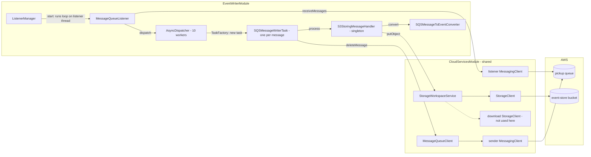
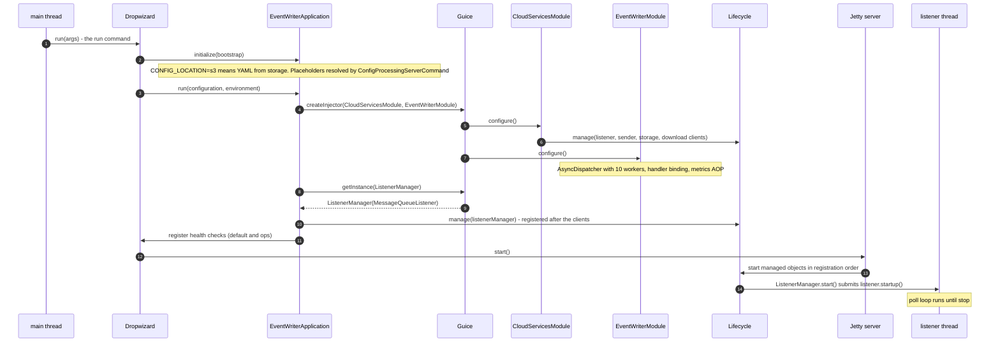
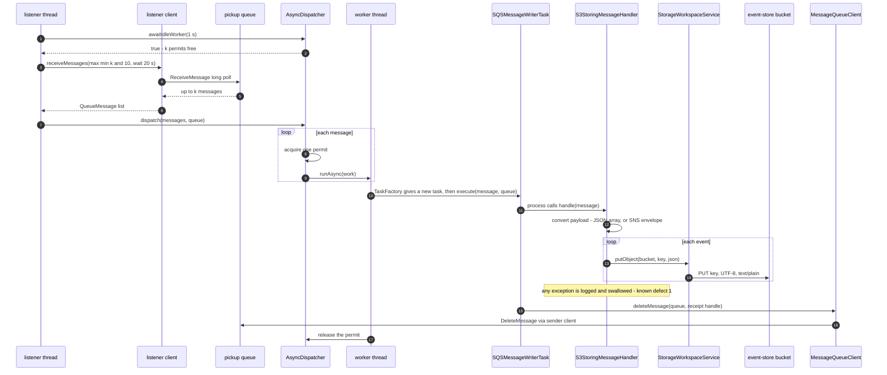
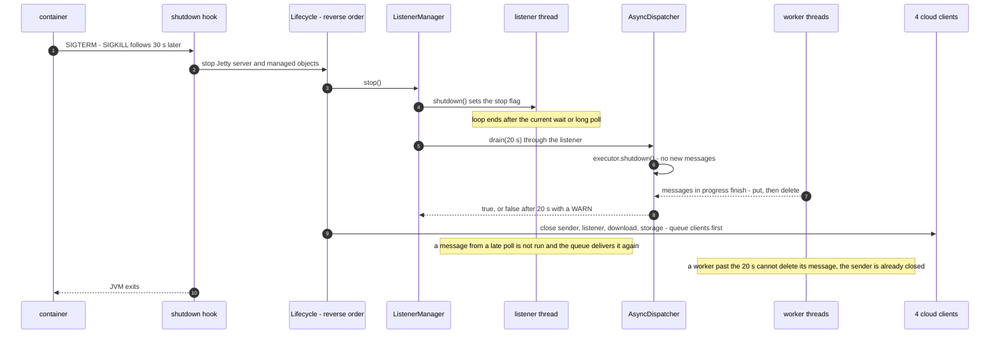

# PR — WI01124532 event-writer: cloud-sdk clients and the shared adapters

Branch `WI01124532-aws-sdk-upgrade-event-writer` → `feature/WI01124532-aws-sdk-upgrade` (from `58aee71b`) · 13 commits `672034c2` … `89a6077d` (8 original, then 2 + 2 + 1 for the review rounds) · [PR #4](https://github.com/wtg-e2open/INTTRA.appianway/pull/4)

- **Part 1** is the PR description for GitHub; copy everything between the two `✂` lines.
- **Part 2** is your review guide, for you only. It does not go into the PR.
- **Part 3** covers the review rounds (Copilot's comments, the fixes, the replies). **Part 4** is the command log for them.
- **Part 5** walks through event-writer from start to shutdown: classes, wiring, threads, one message, health checks, shutdown (with diagrams).

Suggested PR title: `WI01124532 event-writer: cloud-sdk clients and the shared adapters`

---

## Part 1 — PR description (GitHub)

✂ ------------------------------------------------------------------

## Link to Story/Defect this work relates to

**WI01124532**: AppianWay AWS SDK v1 → v2 upgrade. This PR is the first service, event-writer, moved onto the `shared` cloud-sdk adapters (#2) and tested with the functional-testing fakes (#3).

## What/Why I Did the changes

event-writer reads lifecycle events from its pickup queue and stores each event as JSON in the event-store bucket. It now does this through cloud-sdk (AWS SDK 2.x) instead of AWS SDK v1. Stored objects, keys, content type, queue handling and health-check names are unchanged.

| | Before (SDK v1) | After (cloud-sdk) |
|---|---|---|
| Clients | `ExternalServicesModule`: `AmazonSQS` ×2, `AmazonS3` | `shared` `CloudServicesModule` (same per-role client settings) |
| Listener | `SQSListener` | `MessageQueueListener` |
| Message type in handler / task | SDK v1 `Message` | `QueueMessage<String>` |
| Storage | `S3WorkspaceService` | `StorageWorkspaceService` (writes UTF-8, `text/plain`, no metadata, as before) |
| Health checks | `InboundSqsHealthCheck`, `S3WriteHealthCheck` (own clients) | `InboundMessageQueueHealthCheck`, `StorageWriteHealthCheck` on the injected clients; same names |
| Configuration from storage | `S3ConfigurationProvider` | `StorageConfigurationProvider` (same switches) |
| Functional test | JUnit 4 `FunctionalTestBase`, SDK v1 fakes | JUnit 5 `CloudFunctionalTestBase`, cloud-sdk fakes |
| Shutdown (`shared`, every service) | Listener flag only; clients never closed | Listener stops, messages in progress finish (up to 20 s), then the clients close, queue clients before storage |

### Changes

1. **Proof first:** a golden test fixes what event-writer stores today, as written by the SDK v1 code: the key and body of each object, for minimal, rich (unicode, escapes, annotations) and sparse events, and for the SNS envelope. It passes before and after the change. A converter test covers both message shapes (raw array, SNS envelope).
2. Handler, converter and task work on `QueueMessage<String>`.
3. The application builds `CloudServicesModule` from its configuration (pickup queue, no event topic). `ExternalServicesModule` is removed. Functional tests pass the fakes through `EventWriterApplication(Module)`.
4. `event-writer.yaml`: `com.inttra.mercury.cloudsdk: WARN`. cloud-sdk logs every storage put at INFO, which would about double the log volume (one put per event).
5. An architecture test fails the build if event-writer uses an AWS SDK type or a `shared` SDK v1 class.
6. Two existing defects are kept as they are, each with a disabled test that asserts the correct behaviour:
   - a failed write is swallowed and the message deleted, so the event is lost;
   - the `messages-failed` meter is never marked, so `errorsPerSecondAverage` is always healthy.
7. **Safe shutdown** (`shared`, from the review). `CloudServicesModule` (#2) closes the cloud clients on shutdown, which the SDK v1 code never did, but `ListenerManager.stop()` returned at once. A message still in progress could then fail its write on a closed client and, through the handler defect in change 6, be deleted with its event lost. Now:
   - `ListenerManager.stop()` stops the listener and waits up to 20 s for the messages in progress. Messages received after the stop stay on the queue.
   - The clients close only after that, queue clients before storage. A message that outlives the 20 s cannot be deleted, so it is delivered again.

   This covers every service that uses the shared `ListenerManager`. ingestor and watermill-publisher have their own listener manager; they are unaffected while on SDK v1 and get the same handling when they migrate.

### Backward compatibility

- Same queue, bucket, keys, bodies (byte-identical, golden test), `Content-Type: text/plain`, no user metadata.
- Same client settings (connect, socket and execution timeouts, connections, retries) as the SDK v1 clients.
- Same health-check names on the default and the ops endpoint.
- Same configuration keys; the only YAML change is the logger line.
- Shutdown can now take up to 20 s longer, while messages in progress finish. Normal processing is unchanged.

## Next Steps

- INT: boot event-writer and check that an event lands under the same key with the same body and content type.
- INT: stop the service while messages are being processed. The log should show the drain and then the clients closing, and every message in progress should be either stored and deleted or delivered again, with no event missing.
- Next services: error-processor, then email-sender.

## Testing Notes

- event-writer had 3 tests; it now runs **19**, 2 of them skipped (the disabled defect tests):
  - golden stored objects (3), converter (4), handler (3), task (2);
  - architecture (2);
  - functional (3): stores the event and deletes the message; health checks; logger level;
  - known defects (2, disabled). Both fail when enabled.
- `shared` `ListenerManagerTest` (5), on the real `MessageQueueListener` and `AsyncDispatcher`:
  - stop waits for the message in progress;
  - the clients close only after it finishes (a Dropwizard lifecycle attached to a Jetty server, as in the service);
  - a message received after the stop is not run;
  - stop gives up after the timeout;
  - both listeners drain their dispatcher.
  Four of them fail without the fix.
- `shared` `ShutdownAcknowledgementTest` (1), on the real `CloudServicesModule` with clients that fail once closed: a two-event message whose second write is still running at the drain deadline is not deleted, and the clients close in the order sender, listener, download, storage. It fails without the fix: the message is deleted with one event missing.
- `shared` `ClosedSenderRefusesDeleteTest` (1): checks what that fix relies on with the real cloud-sdk sender, built as in production. Once closed, it refuses a delete before sending any request, so no network is needed.
- Each change has a failing test first, then the change.
- Full reactor build (`mvn -B clean verify`) of `6a0e2381`: **BUILD SUCCESS** in 9:54 min, all 26 build units, 0 failures and 0 errors. Only event-writer changed its test count (3 → 19); shared 1818, functional-testing 48, transformer 665 and every other module are unchanged.
- Full reactor build of `9367939c` (with the shutdown fix): **BUILD SUCCESS** in 10:37 min, all 26 build units, 0 failures and 0 errors. shared 1818 → 1823 (the 5 shutdown tests); every other module unchanged, event-writer 19 (2 skipped).
- Full reactor build of `53c9b564` (close order): **BUILD SUCCESS** in 9:47 min, all 26 build units, 0 failures and 0 errors. shared 1823 → 1824 (the regression test); every other module unchanged.
- `89a6077d` adds only that real-client test: all `shared` tests pass (1825, 1 skipped as before).

🤖 Generated with [Claude Code](https://claude.com/claude-code)

✂ ------------------------------------------------------------------

---

## Part 2 — Review guide (for you only, not in the PR)

### Commits

| # | Commit | What to look at |
|---|---|---|
| 1 | `672034c2` test: characterize the events event-writer stores and the message shapes it reads | `EventWireCompatibilityTest`, `wire/*.expected.txt` (written from the v1 handler, never regenerated), `SQSMessageToEventConverterTest`. Finding F12 came from building the fixture: an unknown event field drops the whole message (`Event.Builder` lacks `ignoreUnknown`), so the fixture has none |
| 2 | `0b37403f` red: … queue messages … | `TestQueueMessage` record; handler/task tests now JUnit 5 (they had to change anyway); throwing skeletons (D10); task constructor takes `MessageQueueClient` (D27) |
| 3 | `fa88d6e4` green: … queue messages … | Small diff: `getBody()` → `getPayload()`. The v1 functional test still passes, so the D15 bridge works end to end |
| 4 | `4a2d3194` red: … cloud-sdk clients … | `AwsSdkBoundaryArchTest`: the list of shared SDK v1 classes is local to event-writer (could move to functional-testing once a second service needs it). Functional test keeps the v1 `assertThatResource(...)` lines |
| 5 | `8a076bf1` green: … cloud-sdk clients … | D37 (no `ExternalServicesModule`). Health checks now use the injected clients (v1 checks built their own). No `with...Settings`: the defaults are the v1 roles (`ClientSettings` comments) |
| 6–7 | `e555d2a7` / `5042748d` | Logger test on the effective logback level; YAML adds 2 lines |
| 8 | `6a0e2381` test: disabled defects | Verified failing with `-Djunit.jupiter.conditions.deactivate=org.junit.*DisabledCondition` |
| 9 | `c7856876` red: messages in progress finish before the cloud clients close | Review fix (Part 3). `ListenerManagerTest` (5) on the real listener and dispatcher; stub defaults `Listener.drain`, `Dispatcher.drain` (return true, wait for nothing) and the package-private `ListenerManager(Listener, Duration)` so the red compiles. 4 fail, the timeout guard passes |
| 10 | `9367939c` green: same | `AsyncDispatcher.drain` = `executor.shutdown()` + `awaitTermination`; `run(...)` skips a message after the drain (and gives the permit back if the executor rejects it in the race); both listeners delegate; `ListenerManager.stop()` = flag, poller executor shutdown, drain 20 s, WARN if it times out |
| 11 | `065370bb` red: a message still in progress after the drain timeout is not acknowledged | Review round 2 (Part 3). `ShutdownAcknowledgementTest` in `shared.cloud` (package-private `CloudServicesModule` constructor): `ClosableClients` mocks that throw once closed, storage `close()` sleeps 300 ms like a real pool shutdown, the second put waits for the storage close then throws; a two-event `AbstractTask` that swallows; drain 200 ms; Jetty lifecycle. `ListenerManager(Listener, Duration)` is now public for it. Fails: `deleted = [receipt-m-1]` |
| 12 | `53c9b564` green: same | `CloudServicesModule.configure()`: clients built in the same order, registered storage, download, listener, sender, so closed sender, listener, download, storage. Comment and Javadoc say why. Passed 3 runs in a row |
| 13 | `89a6077d` test: a closed real cloud-sdk sender refuses to delete a message | Answers Copilot's third review ("Needs a closer look": the shutdown safety was only checked with mocks). `ClosedSenderRefusesDeleteTest`: the real sender from `CloudClients.FACTORIES` with `messageQueueSender()` settings, closed, then `MessageQueueClient.deleteMessage` → fails with `RejectedExecutionException` in the cause chain (refused locally, before any request). Passes as is (characterization), so `test:` |

### Points you may want to decide

- **D37:** delete `ExternalServicesModule` (done) or keep it as a thin wrapper as the design text says.
- **F12:** add to the known-defects list, or fix later in `shared` (one annotation on `Event.Builder`).
- Not automated: the production `CloudServicesModule` in event-writer (it builds real AWS clients). Covered by key parity (1e test) and the INT boot.

### Local commands

```bash
# event-writer only (module builds need -am: the local ~/.m2 mercury-shared 1.0 is stale)
mvn -B -o -pl event-writer -am clean test -Dsurefire.failIfNoSpecifiedTests=false \
    '-Dtest=com.inttra.mercury.eventstore.**.*Test,functional.EventWriter*Test'
# run the disabled defect tests
mvn -B -o -pl event-writer -am test -Dsurefire.failIfNoSpecifiedTests=false -Dtest=EventWriterKnownDefectsTest \
    '-Djunit.jupiter.conditions.deactivate=org.junit.*DisabledCondition'
# push and raise the PR (after your OK)
git push -u origin WI01124532-aws-sdk-upgrade-event-writer
gh pr create --base feature/WI01124532-aws-sdk-upgrade --head WI01124532-aws-sdk-upgrade-event-writer \
    --title "WI01124532 event-writer: cloud-sdk clients and the shared adapters" --body-file <Part 1>
```

---

## Part 3 — Review rounds

## Review round 1 (Copilot on `6a0e2381`, 2026-11-18)

### Copilot's comment

One inline comment, high severity, on `EventWriterApplication.java:83` (comment `4622487404`). The review itself (`5967114033`) is `COMMENTED`, so it does not block the merge.

> `CloudServicesModule` now closes clients during shutdown, but `ListenerManager.stop()` only sets a flag and does not wait for polling or `AsyncDispatcher` workers to finish. In-flight processing can therefore attempt writes against a closed storage client; since the handler swallows write failures, an incomplete message can also be acknowledged if the sender is still open. Stop and join the polling thread, then drain dispatched tasks before allowing the managed clients to close.

### Assessment: valid, a small window

- **Order:** `CloudServicesModule` registers its 4 clients with the lifecycle while the injector is created. The application registers `ListenerManager` after that. Dropwizard stops in reverse order, so the listener stops first. But `stop()` only set the flag and returned, so the clients closed at once (download, storage, sender, listener) while workers could still run.
- **Loss path:** the in-flight `putObject` throws on the closed storage client → the handler swallows it (known defect, `EventWriterKnownDefectsTest`) → `AbstractTask` deletes the message. If the delete reaches the sender before it closes too (microseconds later), the event is lost.
- **New or not:** v1 had no drain either, but it never closed its clients. At JVM exit an in-flight message was cut off, not deleted, and redelivered. The client closing came with `CloudServicesModule` in #2 (`601e0fb7`). event-writer is the first service on it, so Copilot flagged it here. The error-processor branch has the same exposure and gets the fix through the feature branch.

### Fix, in this PR (your decision)

Red `c7856876`, green `9367939c` (see Part 2 rows 9–10). Design points:

- **Don't wait for the poll.** Every service long-polls for 20 s, and the container is killed 30 s after the stop signal. `stop()` doesn't join the poller. A poll that returns after the stop hands its messages to a drained dispatcher, which doesn't run them, and the queue delivers them again.
- **Bounded wait:** 20 s for the messages in progress, then a WARN and the shutdown goes on.
- **Additive:** `Listener.drain` and `Dispatcher.drain` are default methods, so the other implementations still compile unchanged.
- **Wider effect:** every service that uses the shared `ListenerManager` now drains on shutdown, which is the intended behaviour; the full build covers them. ingestor and watermill-publisher have their own listener manager and synchronous dispatcher. They are unaffected while on SDK v1 (no client is closed) and need the same handling when they migrate. mftdispatcher, cerberus, fulfiller, router and validator are out of scope (F11).

### Reply posted on the thread

Pushed `6a0e2381..9367939c`, replied ([r4624233142](https://github.com/wtg-e2open/INTTRA.appianway/pull/4#discussion_r4624233142)), thread `PRRT_kwDOVviyWs65QmI9` resolved, PR description updated. After the round: `mergeStateStatus` CLEAN, Copilot review `COMMENTED` (not blocking).

> Valid, thanks. Closing the clients on shutdown came with the shared `CloudServicesModule` (#2), and `ListenerManager.stop()` returned without waiting. Fixed here in c7856876 (red) / 9367939c (green): `stop()` now stops the listener and drains it. The shared `AsyncDispatcher` takes no more messages (one received after the stop stays on the queue and is delivered again) and waits up to 20 s for the ones in progress. The clients are registered before the `ListenerManager`, so Dropwizard closes them only after that. This covers every service that uses `ListenerManager`.

---

---

## Review round 2 (Copilot on `9367939c`, 2026-11-19)

### Copilot's comment

One inline comment, high severity, on `shared/.../listener/support/ListenerManager.java:44` (comment `4624303508`, review `5969289614`, `COMMENTED`):

> If a multi-event message exceeds the 20-second drain timeout, its worker keeps running while the lifecycle closes storage before the queue sender. A remaining write can then fail and be swallowed, allowing the message to be deleted with events missing. Before closing clients on timeout, prevent unfinished tasks from acknowledging their messages, and add a regression test for a multi-event message that outlives the deadline.

### Assessment: valid, a gap in round 1's fix

- **The timeout can run out.** One storage put has a 10 s API-call timeout and 4 attempts with backoff (0.5 + 1 + 2 s), so about 43.5 s at worst. A message with several events can outlive 20 s when S3 is slow.
- **The close order allowed the loss.** Registration was listener, sender, storage, download, so the close order was download, storage, sender, listener. After a timeout, storage closed while the sender was still open: a remaining write failed, the handler swallowed it (known defect), and the delete went through.
- **Root cause** is still the swallowed write (known defect, kept). Shutdown must just not be able to trigger it.

### Fix: close the queue clients first

Red `065370bb`, green `53c9b564` (Part 2 rows 11–12). `CloudServicesModule` registers the storage clients before the messaging clients, so they close sender, listener, download, storage.

- After a timeout, a delete hits the closed sender and throws. `AbstractTask` logs `Message is not processed; Message will reappear`, and the queue delivers the message again.
- Storage closes only after the sender, so a write that fails on a closed storage client can never be followed by a delete.
- Worst case is a repeat: the message is stored again under the same keys (each key includes the event id), a harmless rewrite of identical objects.
- About 4 lines, no new state, and it covers every service, including error-processor's email sends and event publishes.
- **Considered and not done:** a "shutting down, don't acknowledge" flag that `AbstractTask` checks. It needs new state shared between `ListenerManager` and every task, and the close order gives the same guarantee.

### Round 2 reply posted on the thread

> Valid, thanks. One storage put can take about 40 s with its retries, so a multi-event message can outlive the 20 s drain, and the clients then closed storage before the sender. Fixed in 065370bb (red) / 53c9b564 (green): `CloudServicesModule` now registers the storage clients before the messaging clients, so Dropwizard closes the sender and listener first. A task still running after the deadline can no longer delete its message: the delete fails, `AbstractTask` logs that the message will reappear, and the queue delivers it again (stored again under the same keys). The regression test `ShutdownAcknowledgementTest` runs the real module with clients that fail once closed and a two-event task that swallows write failures, as event-writer's handler does. It failed on the old order: the message was deleted with one event missing.

Pushed `9367939c..53c9b564`, replied ([r4624431720](https://github.com/wtg-e2open/INTTRA.appianway/pull/4#discussion_r4624431720)), thread `PRRT_kwDOVviyWs65Uvl4` resolved, PR description updated (change 7 now also says where each part of the problem came from).

---

## Review round 3 (Copilot on `53c9b564`, 2026-11-19)

No inline comment. The review says **No open issues**, lists round 2 as resolved, and changes the verdict from "Changes recommended" to **"Needs a closer look"**:

> Shutdown safety depends on real cloud-client close semantics that mocked tests do not verify, requiring human validation of timeout and redelivery behavior across shared consumers.

**Checked with the real clients** (a throwaway run, then a permanent test):

| Real client after `close()` | Result |
|---|---|
| Queue sender, `deleteMessage` | Refused inside the client, before any request (`MessagingException` caused by `RejectedExecutionException`: its executor is shut down) |
| Storage, `putObject` | Still works: cloud-sdk's `S3StorageClient` does not override `close()` (F15). The throwaway run sent one request to AWS with fake credentials, which S3 rejected with 403 |

- The fix relies only on the sender refusing a late delete, which holds. `89a6077d` makes it a permanent test that needs no network (Part 2 row 13).
- Storage is safer than the tests assume: an in-flight write does not fail at shutdown with today's cloud-sdk. The stricter mock still protects us if cloud-sdk's `close()` becomes real.
- Nothing to resolve (no thread). Arijit re-requests a Copilot review after the push.
- PR comment posted ([issuecomment-7000358258](https://github.com/wtg-e2open/INTTRA.appianway/pull/4#issuecomment-7000358258)):

> Re the "needs a closer look" note on real close behaviour: checked with the real cloud-sdk clients. A closed sender refuses a delete inside the client, before any request is sent. That is all the shutdown fix relies on, and it is now a permanent test (`ClosedSenderRefusesDeleteTest`, 89a6077d, no network needed). In-flight storage writes are not affected by the shutdown in practice, so the stricter mock in `ShutdownAcknowledgementTest` is a conservative case rather than the expected one.

---

## Review round 4 (Copilot on `89a6077d`, 2026-11-19)

No inline comment, "No open issues", still "Needs a closer look":

> Shared ListenerManager shutdown changes require human runtime validation because the fakes do not model outstanding long polls or write/delete operations racing with real client closure at the drain deadline.

Not a code finding: it asks for a runtime check that no test can give. Both cases it names are covered by design (a late poll's messages are not run and come back; at the deadline the sender closes first and refuses a late delete). Answer: the INT shutdown check, added to the PR's Next Steps and tracked as **A27 🔴** in the progress tracker. No reply and no code change.

---

## Part 4 — Command log: review rounds 1 and 2

Run in Git Bash, in `c:\Users\arijit.kundu\projects\appianway`. `R=wtg-e2open/INTTRA.appianway`. The ids are the real ones from this round. PR #3's doc (Part 4) explains the `gh api` / GraphQL patterns in more detail.

### 4.1 Read Copilot's comment and review

```bash
R=wtg-e2open/INTTRA.appianway
# Inline comments: id, author, file, line, whether it is a reply, text
gh api repos/$R/pulls/4/comments --jq '.[] | {id, user: .user.login, path, line, in_reply_to_id, body}'
# Review summaries (Copilot's overview with the "Changes recommended" banner)
gh api repos/$R/pulls/4/reviews --jq '.[] | {id, user: .user.login, state, body}'
```

### 4.2 Check the claim in the code

```bash
git fetch -q origin
# The flagged lines, as pushed
git show origin/WI01124532-aws-sdk-upgrade-event-writer:event-writer/src/main/java/com/inttra/mercury/eventstore/EventWriterApplication.java | sed -n 60,100p
# What stop() does, and how the clients are registered
cat shared/src/main/java/com/inttra/mercury/shared/listener/support/ListenerManager.java
grep -n "managed(\|lifecycle.manage" shared/src/main/java/com/inttra/mercury/shared/cloud/CloudServicesModule.java
# v1: were the clients ever closed? (no lifecycle registration)
git show 58aee71b:event-writer/src/main/java/com/inttra/mercury/eventstore/modules/ExternalServicesModule.java
# The swallowed write, and the delete after it
git show origin/WI01124532-aws-sdk-upgrade-event-writer:event-writer/src/main/java/com/inttra/mercury/eventstore/services/S3StoringMessageHandler.java
grep -n "delete\|process(" shared/src/main/java/com/inttra/mercury/shared/task/AbstractTask.java
# Which commit introduced the client closing
git log --oneline -1 -S'ManagedCloudResource.of' -- shared/src/main/java/com/inttra/mercury/shared/cloud/CloudServicesModule.java
```

### 4.3 How far a shared fix reaches

```bash
grep -rln --include=*.java "implements Dispatcher\|extends AsyncDispatcher" . | grep -v /test/          # shared, ingestor, watermill-publisher
grep -rln --include=*.java "implements Listener" shared/src/main                                       # SQSListener, MessageQueueListener
grep -rln --include=*.java "shared.listener.support.ListenerManager" . | grep -v /test/ | awk -F/ '{print $2}' | sort -u  # services on the shared one
grep -rhn "waitTimeSeconds" --include=*.yaml . | sort | uniq -c                                       # all long-poll 20 s
git diff --stat 58aee71b WI01124532-aws-sdk-upgrade-error-processor -- shared                         # error-processor: no shared change
```

### 4.4 Red, then green

```bash
git checkout WI01124532-aws-sdk-upgrade-event-writer          # up to date with origin at 6a0e2381

# Red: stub defaults + ListenerManagerTest; 4 of 5 fail for the expected reason
mvn -B -q -o -pl shared clean test -Dtest=ListenerManagerTest -Dsurefire.failIfNoSpecifiedTests=false
git add shared/src/main/java/com/inttra/mercury/shared/listener/Listener.java \
        shared/src/main/java/com/inttra/mercury/shared/listener/support/ListenerManager.java \
        shared/src/main/java/com/inttra/mercury/shared/threaddispatcher/Dispatcher.java \
        shared/src/test/java/com/inttra/mercury/shared/listener/support/ListenerManagerTest.java
git commit -q -F <message file>      # "WI01124532 red: messages in progress finish before the cloud clients close" ... Co-Authored-By
# -> c7856876

# Green: the fix; the new test and the existing listener and dispatcher tests pass
mvn -B -q -o -pl shared clean test '-Dtest=ListenerManagerTest,AsyncDispatcher*,*Listener*Test,Dispatcher*' \
    -Dsurefire.failIfNoSpecifiedTests=false
git add shared/src/main/java/com/inttra/mercury/shared/listener/support/ListenerManager.java \
        shared/src/main/java/com/inttra/mercury/shared/listener/MessageQueueListener.java \
        shared/src/main/java/com/inttra/mercury/shared/listener/SQSListener.java \
        shared/src/main/java/com/inttra/mercury/shared/threaddispatcher/AsyncDispatcher.java
git commit -q -F <message file>      # "WI01124532 green: messages in progress finish before the cloud clients close" ... Co-Authored-By
# -> 9367939c
```

The commits were made with `git commit -q -F -` and a heredoc, as in PR #3's log (4.2).

### 4.5 Full build

```bash
cd ../appianway-build                                   # the G4 build worktree
git checkout -q --detach WI01124532-aws-sdk-upgrade-event-writer
# UTC so that consumer-commons' S3PublishServiceTest does not fail after 19:00 EST (F14)
JAVA_TOOL_OPTIONS=-Duser.timezone=UTC mvn -B clean verify \
    -Daether.enhancedLocalRepository.trackingFilename=_any.repositories > build.log 2>&1
grep -E "Tests run:.*Fail|BUILD|Total time" build.log | tail -40
cd ../appianway
```

### 4.6 Push, reply, resolve

```bash
git status --short | grep -v '^??'                      # nothing staged or modified
git push origin WI01124532-aws-sdk-upgrade-event-writer # 6a0e2381..9367939c, fast-forward

# Thread id for comment 4622487404 (GraphQL; needed to resolve)
gh api graphql -f query='query{repository(owner:"wtg-e2open",name:"INTTRA.appianway"){
  pullRequest(number:4){reviewThreads(first:20){nodes{id isResolved
    comments(first:5){nodes{databaseId author{login}}}}}}}}' \
  --jq '.data.repository.pullRequest.reviewThreads.nodes[] | {id, isResolved, c:[.comments.nodes[].databaseId]}'

# Reply inside the thread: the quoted text in Part 3, without "> "
D=docs/redesign/pr-details/2026-11-18-apway-pr-2-event-writer-description.md
REPLY=$(sed -n '/^### Reply posted on the thread/,/^---/p' $D | grep '^> ' | sed 's/^> //')
gh api repos/$R/pulls/4/comments/4622487404/replies -f body="$REPLY" --jq .html_url

# Resolve (THREAD_ID from the query above)
gh api graphql -f query="mutation{resolveReviewThread(input:{threadId:\"$THREAD_ID\"}){thread{isResolved}}}" \
  --jq .data.resolveReviewThread.thread.isResolved      # true
```

### 4.7 Update the PR description

```bash
S=<scratchpad>/pr4-body.md
awk '/^✂/{n++; next} n==1' $D > $S                     # Part 1 only: the lines between the two ✂ markers
head -3 $S; tail -2 $S                                  # check the ends before replacing
gh pr edit 4 --body-file $S
gh pr view 4 --json body --jq .body | grep -E 'Shutdown|9367939c'   # spot-check
# Status after the round
gh pr view 4 --json reviewDecision,mergeStateStatus,latestReviews \
  --jq '{reviewDecision, mergeStateStatus, latest:[.latestReviews[] | {a:.author.login, s:.state}]}'
```

Copilot's "Changes recommended" banner is fixed text in its review of `6a0e2381`. It changes only if Copilot reviews again, which it may do on the new commits.

---

### 4.8 Round 2: read the new comment

```bash
# Top-level inline comments only (replies have in_reply_to_id), with the commit each was made on
gh api repos/$R/pulls/4/comments --jq '.[] | select(.in_reply_to_id==null)
  | {id, user: .user.login, path, line, commit: .commit_id[0:8], created_at, body}'
gh api repos/$R/pulls/4/reviews --jq '.[] | {id, user: .user.login, state, commit: .commit_id[0:8], submitted_at}'
```

### 4.9 Round 2: red, then green

```bash
# Red: ShutdownAcknowledgementTest; ListenerManager(Listener, Duration) made public for it
mvn -B -q -o -pl shared clean test -Dtest=ShutdownAcknowledgementTest -Dsurefire.failIfNoSpecifiedTests=false
#   -> Expecting empty but was: ["receipt-m-1"]  (the message was deleted with one event missing)
git add shared/src/test/java/com/inttra/mercury/shared/cloud/ShutdownAcknowledgementTest.java \
        shared/src/main/java/com/inttra/mercury/shared/listener/support/ListenerManager.java
git commit -q -F <message file>      # -> 065370bb

# Green: registration order in CloudServicesModule; run the new and related tests 3 times (timing-based test)
for i in 1 2 3; do
  mvn -B -q -o -pl shared clean test '-Dtest=ShutdownAcknowledgementTest,CloudServicesModuleTest,ListenerManagerTest' \
      -Dsurefire.failIfNoSpecifiedTests=false > /dev/null 2>&1; echo "run $i exit=$?"
done
git add shared/src/main/java/com/inttra/mercury/shared/cloud/CloudServicesModule.java
git commit -q -F <message file>      # -> 53c9b564
```

Full build as in 4.5, detached at `53c9b564`.

### 4.10 Round 2: push, reply, resolve, update

```bash
git push origin WI01124532-aws-sdk-upgrade-event-writer     # 9367939c..53c9b564

# Thread id of comment 4624303508 (same query as 4.6)
gh api graphql -f query='query{repository(owner:"wtg-e2open",name:"INTTRA.appianway"){
  pullRequest(number:4){reviewThreads(first:20){nodes{id isResolved
    comments(first:5){nodes{databaseId author{login}}}}}}}}' \
  --jq '.data.repository.pullRequest.reviewThreads.nodes[] | {id, isResolved, c:[.comments.nodes[].databaseId]}'

REPLY=$(sed -n '/^### Round 2 reply posted on the thread/,/^ROUND2\|^Pushed/p' $D | grep '^> ' | sed 's/^> //')
gh api repos/$R/pulls/4/comments/4624303508/replies -f body="$REPLY" --jq .html_url
gh api graphql -f query="mutation{resolveReviewThread(input:{threadId:\"$THREAD_ID\"}){thread{isResolved}}}" \
  --jq .data.resolveReviewThread.thread.isResolved

awk '/^✂/{n++; next} n==1' $D > $S && gh pr edit 4 --body-file $S     # as 4.7
```

---

## Part 5 — How event-writer works: from start to shutdown (after this PR)

This part describes event-writer as of `9367939c`, the head of this PR: its classes, the Guice wiring, its threads, how one message is processed, the health checks, and shutdown. Classes are in `event-writer` unless marked *(shared)* or *(cloud-sdk)*.

### 5.1 The classes

| Class | Kind | Role |
|---|---|---|
| `EventWriterApplication` | Dropwizard `Application` | Entry point (`main`). Picks the configuration source, creates the Guice injector, registers the `ListenerManager` with the lifecycle, and registers the health checks |
| `EventWriterConfiguration` | Dropwizard `Configuration` | `pickupSqsConfig` (queue URL, `waitTimeSeconds` 20, `maxNumberOfMessages` 10), `s3Config.bucket`, `s3EventStorePath`, `errorRateThreshold` (5.0) |
| `ConfigProcessingServerCommand` *(shared)* | Dropwizard `ServerCommand` "run" | Resolves `${...}` in the YAML from the properties files, environment and parameter store, then runs the server |
| `StorageConfigurationProvider` *(shared)* | `ConfigurationSourceProvider` | Only when `CONFIG_LOCATION=s3`: reads the YAML from `CONFIG_BUCKET` with a short-lived `StorageClient`, which it closes straight after |
| `CloudServicesModule` *(shared)* | Guice module | Builds the 4 cloud-sdk clients and registers each with the lifecycle so it is closed on shutdown. Binds them, plus `MessageQueueClient` and `WorkspaceService` |
| `EventWriterModule` | Guice module | Binds the configuration, the `AsyncDispatcher`, the handler, the listener, the `ListenerManager` and the metrics AOP |
| `ListenerManager` *(shared)* | Dropwizard `Managed` | `start()`: runs the listener loop on its own thread. `stop()`: stops the listener, then drains it (up to 20 s) |
| `MessageQueueListener` *(shared)* | `Listener` | The poll loop: wait for a free worker, long-poll up to `min(idle workers, 10)` messages, hand them to the dispatcher |
| `AsyncDispatcher` *(shared)* | `Dispatcher` | A fixed pool of `maxNumberOfMessages` (10) workers plus a semaphore with as many permits. Runs one task per message. `drain()` stops it taking messages and waits for the ones in progress |
| `SQSMessageWriterTask` | `AbstractTask` *(shared)* | New instance per message (Guice provider). `process()` calls the handler. `AbstractTask.execute` then deletes the message, meters `messages-processed`, and logs a WARN if anything throws (the message then reappears) |
| `S3StoringMessageHandler` | `SQSMessageHandler`, singleton | Converts the message to events and stores each one through `WorkspaceService.putObject`. Swallows every exception (known defect 1) |
| `SQSMessageToEventConverter` | static helper | Reads the payload as a JSON array of `Event`. If that fails, reads it as an SNS envelope and parses its `Message` |
| `StorageWorkspaceService` *(shared)* | `WorkspaceService` | `putObject(bucket, key, String)`: UTF-8 bytes, `text/plain`, no metadata, on the `StorageClient` |
| `MessageQueueClient` *(shared)* | adapter | `deleteMessage(queue, receiptHandle)` on the sender `MessagingClient` |
| `MessagingClient<String>` ×2, `StorageClient` ×2 *(cloud-sdk)* | AWS SDK 2.x clients | Listener client (receive), sender client (delete), storage client (put), download client (bound but not used by event-writer) |
| `InboundMessageQueueHealthCheck`, `ErrorThresholdHealthCheck`, `StorageWriteHealthCheck` *(shared)* | Health checks | See 5.6 |

### 5.2 Components and how they connect



### 5.3 Startup

1. **`main`** → `new EventWriterApplication().run(args)`. The container runs it as `run <config.yaml> <properties files...>`.
2. **`initialize(bootstrap)`:** if `CONFIG_LOCATION=s3`, the YAML is read from storage (`StorageConfigurationProvider`). The `run` command is replaced with `ConfigProcessingServerCommand`, which resolves the `${...}` placeholders.
3. Dropwizard parses and validates `EventWriterConfiguration`, then calls **`run(configuration, environment)`**.
4. **`Guice.createInjector(CloudServicesModule, EventWriterModule)`:**
   - `CloudServicesModule.configure()` builds the 4 clients, using the `ClientProfile` from the default AWS credential and region chains and the v1 settings per role. It **registers each client with the lifecycle** (`ManagedCloudResource`) and binds them, with `MessageQueueClient` (on the sender) and `WorkspaceService` → `StorageWorkspaceService`.
   - `EventWriterModule.configure()` binds the configuration, `Dispatcher` → `new AsyncDispatcher(taskFactory, 10)` (the 10 worker threads are created lazily, on first use), `SQSMessageHandler` → `S3StoringMessageHandler`, and `MetricsInstrumentationModule`, which adds AOP for `@Metered`.
5. **`injector.getInstance(ListenerManager.class)`** → `MessageQueueListener(listener client, 20, pickup queue, dispatcher)` → `ListenerManager(listener)`. **`environment.lifecycle().manage(listenerManager)`** registers it after the 4 clients. That order is what makes shutdown safe (5.7).
6. **Health checks are registered** (5.6).
7. Dropwizard builds the Jetty server (`type: simple`: one connector on 8081, admin under `/admin`), attaches the lifecycle, and **starts** it. Managed objects start in registration order: the 4 clients (nothing to do), then **`ListenerManager.start()`**, which submits `listener.startup()` to a single-thread executor. From here, the listener thread polls.



### 5.4 The threads

| Thread | Created by | What runs on it |
|---|---|---|
| `main` | JVM | Bootstrap, configuration, injector, `run()`, starting Jetty. Then waits for the server to stop |
| **listener** (`pool-N-thread-1`) | `ListenerManager.start()`, single-thread executor | `MessageQueueListener.startup()`: the poll loop. Blocks in `awaitIdleWorker` (1 s at a time) or in the long poll (up to 20 s) |
| **workers** (`pool-M-thread-1..10`) | `AsyncDispatcher`, fixed pool of `maxNumberOfMessages` | One message each: task → handler → `putObject` per event → `deleteMessage` |
| Jetty request threads (`dw-*`) | Dropwizard's Jetty pool | HTTP requests: `/admin/healthcheck`, `/admin/opsHealthcheck`, `/admin/metrics`, and the other admin endpoints. Health checks run on these threads, on demand |
| shutdown hook | JVM, on SIGTERM | Stops the Jetty server and with it the managed objects (5.7) |
| AWS SDK internals | the cloud-sdk clients | Connection pooling inside each client. event-writer does not run code on them |

**Back-pressure:** the semaphore has 10 permits. The listener asks for at most as many messages as there are free permits (and never more than 10 per receive). So a received message never waits in a queue inside the service; it runs straight away on a free worker.

### 5.5 One message, end to end



- **Key:** `{s3EventStorePath}/{yyyy-MM-dd of the event timestamp}/{rootWorkflowId}/{component}-{type}-{eventId}.json`. The body is `Json.toJsonString(event)`.
- **What deletes the message:** `AbstractTask.run` deletes it after `process()` returns normally. The handler swallows every exception, including an unparseable payload and a failed put, so the message is always deleted (known defect 1, disabled test).
- **When a message reappears:** only if something escapes the handler or the delete itself fails. `AbstractTask` then logs `Message is not processed; Message will reappear` (WARN), and the queue's visibility timeout brings the message back.
- **Metrics:** `messages-processed` is marked for every message on `AbstractTask.execute`; Guice AOP intercepts it because the task is created by Guice. `messages-failed` sits on a private method, so it is never marked (known defect 2).

### 5.6 Health checks

| Name | Check | On the default `/admin/healthcheck` | On `/admin/opsHealthcheck` |
|---|---|---|---|
| `InboundQueue -> {pickup queue}` | receive at most 1 message with wait 0 and visibility timeout 0, on the **listener client** (a message it sees becomes visible again at once) | yes | yes |
| `errorsPerSecondAverage` | five-minute rate of the `SQSMessageWriterTask.messages-failed` meter ≥ `errorRateThreshold` → unhealthy (always healthy today, known defect 2) | yes | yes |
| `S3 write -> {bucket}` | PUT a small health-check object, on the **storage client** | no | yes |

Each check runs on the Jetty request thread that serves the request, not on the listener or worker threads.

### 5.7 Shutdown

The container sends SIGTERM and kills the process 30 s later. The JVM shutdown hook stops the Jetty server, and **the managed objects stop in reverse registration order**:

1. **`ListenerManager.stop()`** (this PR):
   - `listener.shutdown()` sets the stop flag. The loop ends at its next check: after the current `awaitIdleWorker` (≤ 1 s) or the current long poll (≤ 20 s).
   - The listener executor is shut down, so it takes no new work.
   - `listener.drain(20 s)` → `AsyncDispatcher.drain`: the worker pool takes no more messages and `awaitTermination` waits for those in progress. If they don't finish in 20 s, a WARN is logged and shutdown carries on.
   - If a long poll returns messages after the stop, `dispatch` sees the drained pool and does not run them. They were never deleted, so the queue delivers them again after the visibility timeout.
2. **The 4 clients close** (`ManagedCloudResource.stop` → `close()`), in reverse registration order: **sender, listener, download, storage**. `CloudServicesModule` registers the storage clients first on purpose. By now no message is in progress, unless the 20 s ran out. If it did (one storage put can take about 40 s with its retries), the worker still running can no longer delete its message: the sender is already closed, so the delete throws, `AbstractTask` logs `Message is not processed; Message will reappear`, and the queue delivers the message again. Storage closes only after that, so a write that fails on a closed storage client can never be followed by a delete. The repeat stores the same keys again, which is harmless.
3. Jetty stops its connectors and the JVM exits. Threads still running, such as the listener thread in a long poll, end with the JVM. A long poll cut off by the closed listener client may log one `Exception in SQS Listener` ERROR. That was already possible before this PR and is harmless.



**Before this PR**, `ListenerManager.stop()` only set the flag, so step 2 ran while workers were still writing, and storage closed before the sender (Part 3, rounds 1 and 2). SDK v1 event-writer never closed its clients, so in-flight work was simply cut off at JVM exit and redelivered.

### 5.8 Tests and what they cover

| Area | Test |
|---|---|
| Stored objects byte-identical to v1 | `EventWireCompatibilityTest` (3), golden files in `src/test/resources/wire/` |
| Both payload shapes | `SQSMessageToEventConverterTest` (4) |
| Handler keys and failure behaviour | `S3StoringMessageHandlerTest` (3) |
| Task delegates, then deletes | `SQSMessageWriterTaskTest` (2) |
| No AWS SDK or shared v1 class used | `AwsSdkBoundaryArchTest` (2) |
| Whole service on the fakes: store, delete, health checks, logger level | `EventWriterFuncTest` (3) on `CloudFunctionalTestBase` |
| Known defects 1 and 2 | `EventWriterKnownDefectsTest` (2, disabled) |
| Shutdown order and drain | *(shared)* `ListenerManagerTest` (5), `ShutdownAcknowledgementTest` (1), `ClosedSenderRefusesDeleteTest` (1, real client) |
| Production client wiring | not automated (real AWS clients); key parity test in shared, plus the INT boot |
