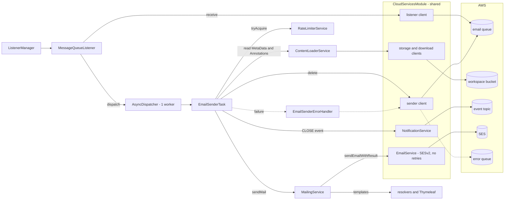
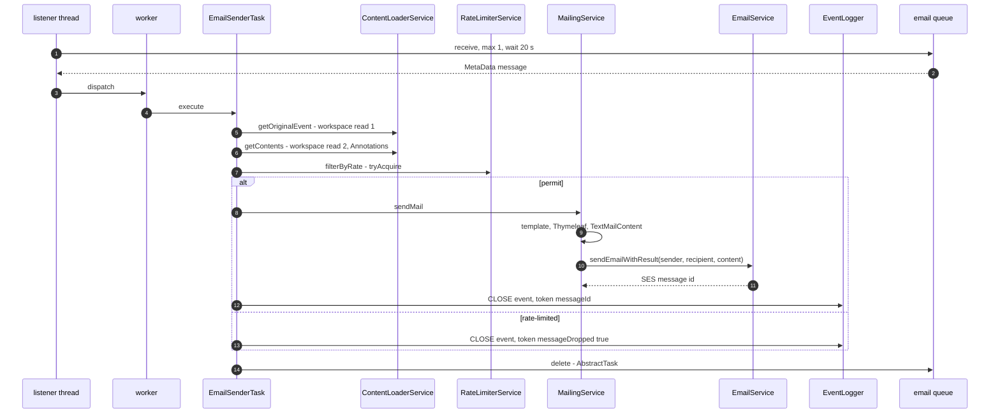

# PR — WI01124532 email-sender: cloud-sdk clients, the shared adapters and the cloud-sdk email service

Branch `WI01124532-aws-sdk-upgrade-email-sender` → `feature/WI01124532-aws-sdk-upgrade` (from `ff281fa1`, after PR #5) · 15 commits `6e7b6335` … `838104b6` · [PR #6](https://github.com/wtg-e2open/INTTRA.appianway/pull/6) · **merged 2026-11-19 as `feca5faf`**

- **Part 1** is the PR description for GitHub; copy everything between the two `✂` lines.
- **Part 2** is your review guide, for you only. It does not go into the PR.
- **Part 3** walks through email-sender from start to shutdown: classes, wiring, threads, one message, the failure path, health checks, shutdown (with diagrams).

Suggested PR title: `WI01124532 email-sender: cloud-sdk clients, the shared adapters and the cloud-sdk email service`

---

## Part 1 — PR description (GitHub)

✂ ------------------------------------------------------------------

## Link to Story/Defect this work relates to

**WI01124532**: AppianWay AWS SDK v1 → v2 upgrade. This PR moves email-sender onto the `shared` cloud-sdk adapters, as #4 and #5 did for event-writer and error-processor, and sends email through the cloud-sdk email service. It completes step 2.

## What/Why I Did the changes

email-sender reads a message from the email queue, reads the failure details from the workspace, renders the subject and body, sends one plain-text email through SES (at most one per 120 s per instance; the rest are dropped), and publishes a CLOSE event with the SES message id or `messageDropped`. It now does this through cloud-sdk (AWS SDK 2.x) instead of AWS SDK v1. The email and the events are unchanged.

| | Before (SDK v1) | After (cloud-sdk) |
|---|---|---|
| Clients | `ExternalServicesModule`: `AmazonSQS` ×2, `AmazonS3`, `AmazonSNS`, `AmazonSimpleEmailService` | `ExternalServicesModule` installs `shared` `CloudServicesModule` with email; `Clock` binding kept |
| Email | v1 SES `SendEmail`, no retries | cloud-sdk `EmailService` (SESv2), same settings: no retries, no execution timeout |
| Listener | `SQSListener` | `MessageQueueListener` |
| Task message type | SDK v1 `Message` | `QueueMessage<String>` |
| Event publisher | `SNSEventPublisher` | `NotificationEventPublisher` |
| Health checks | each built its own default client | run on the service's clients; same names, placement and retries |
| Configuration from storage | `S3ConfigurationProvider` | `StorageConfigurationProvider` |
| Functional tests | JUnit 4, SDK v1 fakes | JUnit 5 `CloudFunctionalTestBase`, cloud-sdk fakes |

### Changes

1. **Proof first:** a golden test, written on the v1 code, records the exact email handed to SES (from, to, cc, bcc, reply-to, subject and body with their charsets, no HTML part) and both CLOSE events, sent and rate-limited. It passes unchanged after the migration. The tests now run the real cloud-sdk email service on a mocked SES client, so they compare the actual SESv2 request.
2. The task works on `QueueMessage<String>`. Its tests cover the sent and the dropped path, both workspace reads and the failure path.
3. **`shared`: an email client role.** `ClientSettings.email()` keeps v1's SES client settings: no retries, so a timed-out but accepted send is not repeated. `CloudServicesModule.withEmail()` binds the cloud-sdk `EmailService`.
4. `MailingService` sends through `EmailService` and returns the SES message id. Send failures, and requests cloud-sdk rejects before sending, are recoverable, as in v1. The resolvers no longer use the SDK v1 email types.
5. `ExternalServicesModule` installs `CloudServicesModule`; the application builds it from its configuration, and the functional tests pass the fakes. A test builds the production module with the real clients (no request is sent) and checks every binding.
6. `email-sender.yaml`: cloud-sdk logs at WARN (it logs every storage read at INFO), except the one line per client that shows it closing at shutdown.
7. An architecture test fails the build if email-sender uses an AWS SDK type or a `shared` SDK v1 class.
8. One existing defect is kept, with a disabled test asserting the correct behaviour: any failure fails again while its failure event is built (the `pickupQueue` token is added twice), so the event is not published and the message returns until the queue's redrive.

### Backward compatibility

- **Same email:** from, to, reply-to, subject and text body, no HTML part, no charset (golden test, on the SESv2 request).
- **Same events:** the CLOSE event for a sent and a dropped email is byte-identical (golden test).
- **Same client settings** as the SDK v1 clients, including no retries for SES.
- **Same health checks:** names, placement and retries.
- **Same configuration keys;** the only YAML change is the logger lines.
- **SES API:** SESv2 `SendEmail` instead of v1 `SendEmail`. Same `ses:SendEmail` IAM action, same identity.

## Next Steps

- INT: boot email-sender and send an email-queue message. Check the email received and the event against the v1 build.
- INT: stop the service while a message is being processed. The log should show the clients closing, and the message should be either fully processed and deleted or delivered again.

## Testing Notes

- **Test counts:** email-sender ran 13 tests. It now runs **25**, 1 of them skipped (the disabled defect test):
  - task (3), mailing (5), template resolvers (9), architecture (2), production module wiring (1);
  - functional (3): happy flow, health checks, logger levels;
  - golden (1);
  - known defect (1, disabled). It fails when enabled.
- `shared` gains 6 tests: the email role, its configuration and the module's email binding.
- **Test-first:** each behaviour change has a failing test first, then the change.
- **Full reactor build** (`mvn -B clean verify`) of `838104b6`: **BUILD SUCCESS** in 10:00 min, all 26 build units, 0 failures and 0 errors. Only email-sender (13 → 25) and shared (1831 → 1837) changed their test counts.

🤖 Generated with [Claude Code](https://claude.com/claude-code)

✂ ------------------------------------------------------------------

---

## Part 2 — Review guide (for you only, not in the PR)

### Commits

| # | Commit | What to look at |
|---|---|---|
| 1 | `6e7b6335` test: characterize the email and events | Golden test on v1 (JUnit 4, v1 fakes). `wire/sent-and-dropped.expected.txt` written by v1, never regenerated. Normalized: the SES message id in `tokens` only (the fixture ids in `eventContent` stay checked), `startTimestamp` (the task uses `LocalDateTime.now()`, not the clock), CRLF |
| 2–3 | `480074eb` / `5e8344a3` | Task on `QueueMessage<String>`; `MessageQueueClient` (D27). Task test JUnit 5, 3 tests (was 1). `TestQueueMessage` copied (4th copy; follow-up) |
| 4–5 | `a6a98bf2` / `c0840802` | **shared**: `ClientSettings.email()` = v1 `ClientConfiguration().withMaxErrorRetry(0)` (compared with the v1 class in the test); `ClientProfile.email(..)` (`AwsSesEmailConfig`, v1 default retry rule, 1 attempt, no API-call timeout); `CloudClients.email(..)` → `EmailClientFactory.createSesClient`; `CloudServicesModule.withEmail()` |
| 6–7 | `80a3d031` / `4b7aa85c` | `MailingService` on `EmailService.sendEmailWithResult` (U8 message id); `TextMailContent` (local `MailContent`); `MailMessage` replaces v1 `Message` in the resolvers; `MailDetails` removed. **`SesCapture`**: the real `SesEmailServiceImpl` on a mocked `SesV2Client`, so the golden test compares the real SESv2 request. The golden file is unchanged |
| 8–9 | `ca327a26` / `4dad22f8` | `ExternalServicesModule(configuration, lifecycle)` installs `CloudServicesModule(...).withEmail()`; module defaults = v1 sqs_listener / sqs_sender / s3_read_put_copy / sns_publish (no overrides). `MessageQueueListener`; health checks on the injected clients (listener and notification roles both retry 3 times = v1 default clients, so no `RetryingHealthCheck`). Functional tests JUnit 5 |
| 10–11 | `b8098f92` / `8c42eebf` | Logger WARN + `ManagedCloudResource` INFO (A27) |
| 12 | `67828276` test | Known defect, disabled. Verified both ways: passes with the one-line fix (task passes `ImmutableMap.of()`), fails without |
| 13–14 | `65c28dab` / `f04f4399` | Pre-review: `withEmailSettings` alone enables email (was silently ignored); Javadoc says why notification and email are not closed |
| 15 | `838104b6` refactor | Pre-review: exact comment on pre-send validation; bounded HTTP call in the health-check test |

### Pre-review (2026-11-19)

Independent review (`code-review` skill, high) of the whole branch before the final build. 10 points:

| # | Point | Outcome |
|---|---|---|
| 1 | cloud-sdk's pre-send `IllegalArgumentException` is recoverable; a whitespace-only subject that v1's SES would probably have sent is now retried | As designed (design open issue 4). Comment made exact (commit 15). Cannot happen with our templates (fixed subject text) |
| 2 | The SES client is never closed | cloud-sdk's `close()` on it does nothing (no override in `SesEmailServiceImpl`, like F15). Javadoc made explicit (commit 14). Candidate commons ask |
| 3 | Pom still declares v1 `aws-java-sdk-ses` / `-sqs` | Checked: shared brings both; removing them downgrades 1.12.730 → 1.12.720. Kept until step 5 |
| 4 | `withEmailSettings` without `withEmail` silently ignored | Fixed (commits 13–14) |
| 5 | Logger override per service instead of cloud-sdk logging reads at DEBUG | Program approach; a commons ask would remove it |
| 6, 7, 9 | Duplicated arch list, `TestQueueMessage`, `TypeLiteral` keys | Follow-ups (functional-testing / shared) |
| 8 | `MailMessage` and `TextMailContent` similar | Deliberate: template output vs SES request (adds reply-to) |
| 10 | Unbounded HTTP call in the health-check test | Fixed (commit 15) |

### Notes

- **Known defect (failure events):** a real and visible one: every email-sender failure loops until redrive with no failure event. The fix is one line in the task (stop passing `pickupQueue`); the disabled test proves it. Your call whether to fix it now or keep it under the known-defects policy.
- **The v1 error-flow functional test** had no `@Test` since 2017 (`4c4863c8`); it fails on v1 because of the defect above. It is now the disabled known-defect test (JUnit 5, cloud fakes).
- **`startTimestamp` uses the wall clock** (`LocalDateTime.now()` in the task), not the injected `Clock`. Unchanged, normalized in the golden test.
- **Shared change in this PR:** the email role and `withEmail()` (additive). Other services are unaffected.

---

## Part 3 — How email-sender works: from start to shutdown (after this PR)

### 3.1 The classes

| Class | Kind | Role |
|---|---|---|
| `EmailSenderApplication` | Dropwizard `Application` | Picks the configuration source, creates the injector, registers the `ListenerManager` and the two health checks |
| `EmailSenderConfiguration`, `MailConfig` | configuration | Pickup queue (`maxNumberOfMessages` 1, wait 20 s), event topic, workspace bucket, error queue, environment; sender, reply-to, `rateLimitInSeconds` (120) |
| `ExternalServicesModule` | Guice module | Installs `CloudServicesModule(lifecycle, pickup, topic).withEmail()`; binds `Clock` |
| `CloudServicesModule` *(shared)* | Guice module | The 4 queue and storage clients (closed on shutdown), `MessageQueueClient`, `WorkspaceService`, `NotificationService` + `EventPublisher`, `EmailService` |
| `EmailSenderModule` | Guice module | Configuration, `AsyncDispatcher` (1 worker), `ErrorMessage`, metrics AOP, `MessageQueueListener`, `ListenerManager`, Thymeleaf TEXT engine, the subject and body resolver lists |
| `ListenerManager`, `MessageQueueListener`, `AsyncDispatcher` *(shared)* | listener | Poll loop on the listener thread; one worker; drain on stop (20 s) |
| `EmailSenderTask` | `AbstractTask` | One per message: reads the workspace, rate-limits, sends, logs the CLOSE event; failures go to the error handler |
| `ContentLoaderService` | service | `getOriginalEvent`: reads the `MetaData` the message names; `getContents`: reads the `Annotations` that `MetaData` names |
| `RateLimiterService` | singleton | Guava `RateLimiter`, one permit per `rateLimitInSeconds`; `tryAcquire` without waiting |
| `MailingService` | service | Template → `MailMessage` → `TextMailContent` → `EmailService.sendEmailWithResult` → message id |
| `MailTemplateResolver`, `ErrorSubjectResolver`, `ErrorBodyResolver` | resolvers | Choose the subject and body templates for the context |
| `PropertyPlaceholdersResolver` | resolver | Thymeleaf TEXT: renders subject and body into a `MailMessage` |
| `TextMailContent` | `MailContent` *(cloud-sdk API)* | Subject, text body, reply-to; no HTML, no attachments |
| `EmailSenderErrorHandler` | `ErrorHandler` *(shared)* | Recoverable → back to pickup with delay, or DLQ; otherwise → errors to the workspace, failure `MetaData` to the error queue; then the failure event |
| `EmailService` *(cloud-sdk)* | SESv2 client | `SesEmailServiceImpl` from `EmailClientFactory`; validates, builds the SESv2 `SendEmailRequest`, returns the message id |

### 3.2 Components



### 3.3 Startup and threads

1. `main` → `run`. If `CONFIG_LOCATION=s3`, the YAML is read from storage (`StorageConfigurationProvider`); `ConfigProcessingServerCommand` resolves the placeholders.
2. `Guice.createInjector(ExternalServicesModule, EmailSenderModule)`. `CloudServicesModule` builds the queue, storage, notification and email clients (region and credentials from the default chains). The 4 queue and storage clients are registered for closing: storage first, so they close queue first.
3. The `ListenerManager` is registered after them, then the health checks. Jetty starts, and the listener thread starts polling.

Threads: `main`; one **listener** thread (long poll 20 s); one **worker** (`maxNumberOfMessages` 1, so one message at a time); Jetty request threads (health checks); the shutdown hook.

### 3.4 One message



- Both workspace reads happen before the rate check, so a dropped message still costs two reads (as v1).
- The CLOSE event has no sub-type; its `startTimestamp` is the wall clock.
- A failed send (`SendEmailException`) or a request cloud-sdk rejects before sending (`IllegalArgumentException`) becomes `RecoverableException`.

### 3.5 The failure path (and the known defect)

1. The task catches the exception and calls `EmailSenderErrorHandler.handleException` with the token `pickupQueue`.
2. Recoverable (send, workspace or queue failure): the message is sent back to the pickup queue with `failedAttempts` and a delay (2^n × 10 s), or to `{pickup}_dlq` after 5 attempts. Otherwise (template or parse failure): the errors are written to the workspace and the failure `MetaData` goes to the error queue.
3. The handler then builds the failure event and adds `pickupQueue` itself. With the task's `pickupQueue` token too, `ImmutableMap` throws on the duplicate key (**known defect**). The exception reaches `AbstractTask`: no event, no delete, so the message returns and is handled again until the queue's redrive. `EmailSenderKnownDefectsTest` (disabled) shows the correct behaviour.

### 3.6 Health checks

| Name | Check | Client | Default endpoint | Ops endpoint |
|---|---|---|---|---|
| `InboundQueue -> {pickup}` | receive at most 1, wait 0, visibility 0 | listener (3 retries) | yes | yes |
| `SNS publish -> {topic}` | publish `HEALTHCHECK` | notification (3 retries) | no | yes |

The v1 checks built default clients that also retried 3 times, so the behaviour is the same.

### 3.7 Shutdown

As for the other services (shared, PR #4): `ListenerManager.stop()` stops the listener and waits up to 20 s for the message in progress; then the clients close, queue clients first, so a message past the deadline cannot be deleted and is delivered again. The notification and email clients are not closed (their cloud-sdk `close()` does nothing). With one worker and one email per 120 s, a message in progress at shutdown is the normal case to check in INT (A27).

### 3.8 Tests and what they cover

| Area | Test |
|---|---|
| Email and events identical to v1 (real SESv2 request) | `EmailSenderWireCompatibilityTest` (1), `wire/sent-and-dropped.expected.txt` |
| Sent, dropped, reads, failure path | `EmailSenderTaskTest` (3) |
| SES call, message id, failure classification | `MailingServiceTest` (5) |
| Templates | `MailTemplateResolverTest` (2), `PropertyPlaceholdersResolverTest` (2), `ErrorSubjectResolverTest` (2), `ErrorBodyResolverTest` (3) |
| Production wiring with real clients | `ExternalServicesModuleWiringTest` (1) |
| No AWS SDK or shared v1 class | `AwsSdkBoundaryArchTest` (2) |
| Service on the fakes: happy flow, health checks, logger levels | `EmailSenderFuncTest` (3) |
| Known defect | `EmailSenderKnownDefectsTest` (1, disabled) |
| Email role, configuration, module binding | *(shared)* `ClientSettingsTest`, `ClientProfileTest`, `CloudServicesModuleTest` (+6) |

---

## Part 4 — Command log: reviewing the diff, building, publishing, merging

Run in Git Bash, in `c:\Users\arijit.kundu\projects\appianway`. `R=wtg-e2open/INTTRA.appianway`. The ids are the real ones from this PR. PR #3's doc (Part 4) explains the `gh api` / GraphQL patterns in more detail.

### 4.1 Review the diff

The PR is 15 commits on top of `ff281fa1` (the error-processor merge). Review it by area first, then commit by commit.

```bash
B=ff281fa1; H=838104b6        # base and head of PR #6 (the head is now inside feca5faf)

# Size and spread: which files, and how much in each module
git diff --stat $B $H
git diff --dirstat=files,0 $B $H                 # share of changed files per directory

# The shared part alone (additive: the email role)
git diff $B $H -- shared/src/main

# email-sender production code and configuration only, without tests
git diff $B $H -- email-sender/src/main email-sender/conf

# The tests: which are new and which changed
git diff --stat $B $H -- '*/src/test/*'

# One commit at a time, with its message (a red commit shows the test, its green commit the fix)
git log --reverse --format='%h %s' $B..$H
git show 480074eb                                # red: the task test
git show 5e8344a3                                # green: the task change

# The golden file: written by v1 in commit 1 and never changed afterwards
git log --format='%h %s' $B..$H -- email-sender/src/test/resources/wire/sent-and-dropped.expected.txt   # one line: 6e7b6335
git diff 6e7b6335 $H -- email-sender/src/test/resources/wire/                                         # no output

# No AWS SDK v1 import left in email-sender's production code (expect no output)
git grep -n "com.amazonaws" $H -- email-sender/src/main
```

What each command tells you:

- **`--stat` / `--dirstat`:** where the change is. Most of it is email-sender tests; the shared part is four small classes.
- **`-- shared/src/main`:** 4 files, 54 lines added and 3 removed. The shared change only adds (`ClientSettings.email()`, `ClientProfile.email(..)`, `CloudClients.email(..)`, `withEmail()` / `withEmailSettings(..)`); the 3 removed lines are `CloudServicesModule` Javadoc, rewritten. No existing binding changes, so other services are unaffected.
- **The golden file check:** the file has exactly one commit, the v1 characterization. The migrated code passes against it, so it produces the same email and events as v1.
- **`git grep com.amazonaws`:** `AwsSdkBoundaryArchTest` enforces the same rule at build time.

### 4.2 Characterize v1 first

```bash
git checkout -b WI01124532-aws-sdk-upgrade-email-sender ff281fa1

# Golden test on the v1 code (v1 fakes): it writes the expected file, later runs compare against it
mvn -B -q -pl email-sender -am test -Dtest=EmailSenderWireCompatibilityTest -Dsurefire.failIfNoSpecifiedTests=false
git add email-sender/src/test/java/functional/EmailSenderWireCompatibilityTest.java \
        email-sender/src/test/resources/wire/sent-and-dropped.expected.txt
git commit -q -F <message file>      # "WI01124532 test: characterize the email and events email-sender produces" ... Co-Authored-By
# -> 6e7b6335
```

`-am` builds shared along with the module. Module builds need it because the local `~/.m2` holds a stale `mercury-shared`. The commits were made with `git commit -q -F -` and a heredoc, as in PR #3's log (4.2).

### 4.3 Red, then green (one pair per behaviour)

Every pair follows the same pattern: write the test, run it and see it fail for the expected reason, commit the red; then make the fix, run the same tests green, commit the green. Files are staged by explicit path, never `git add -A`, so docs and IDE files stay untracked.

```bash
# Pair 1: the task on QueueMessage<String>
mvn -B -q -pl email-sender -am test -Dtest=EmailSenderTaskTest -Dsurefire.failIfNoSpecifiedTests=false
# -> 480074eb (red), 5e8344a3 (green)

# Pair 2 (shared): the email role with the v1 SES settings
mvn -B -q -pl shared test '-Dtest=ClientSettingsTest,ClientProfileTest,CloudServicesModuleTest,ShutdownAcknowledgementTest'
# -> a6a98bf2 (red), c0840802 (green)

# Pair 3: MailingService on the cloud-sdk EmailService; the golden test now runs the real SESv2 service (SesCapture)
mvn -B -q -pl email-sender -am test \
    '-Dtest=MailingServiceTest,PropertyPlaceholdersResolverTest,EmailSenderFuncTest,EmailSenderWireCompatibilityTest' \
    -Dsurefire.failIfNoSpecifiedTests=false
# -> 80a3d031 (red), 4b7aa85c (green)

# Pair 4: the service on CloudServicesModule, the shared listener and the health checks
mvn -B -q -pl email-sender -am test \
    '-Dtest=ExternalServicesModuleWiringTest,AwsSdkBoundaryArchTest,EmailSenderFuncTest,EmailSenderWireCompatibilityTest' \
    -Dsurefire.failIfNoSpecifiedTests=false
# -> ca327a26 (red), 4dad22f8 (green)

# Pair 5: logger levels (cloud-sdk WARN, ManagedCloudResource INFO)
mvn -B -q -pl email-sender -am test -Dtest=EmailSenderFuncTest -Dsurefire.failIfNoSpecifiedTests=false
# -> b8098f92 (red), 8c42eebf (green)
```

### 4.4 The known defect (F16), checked both ways

```bash
# Commit the disabled test, which asserts the correct behaviour
git add email-sender/src/test/java/functional/EmailSenderKnownDefectsTest.java
# -> 67828276

# Check, not committed: remove @Disabled locally and run. It fails today (no failure event is published)
mvn -B -q -pl email-sender -am test -Dtest=EmailSenderKnownDefectsTest -Dsurefire.failIfNoSpecifiedTests=false
# Then apply the one-line fix in EmailSenderTask (stop passing pickupQueue) and run again: it passes.
# Undo both local changes and confirm nothing is left (expect no output):
git checkout -- email-sender/src && git status --short | grep -v '^??'
```

### 4.5 Independent pre-review, and its fixes

The `code-review` skill (high) reviewed the branch against `ff281fa1`. Each of its 10 points was checked against the code (Part 2 table).

```bash
# Point 3: would removing the v1 SES and SQS pins from the pom help? No: shared brings both, and the version drops
mvn -B -q -pl email-sender -am dependency:tree -Dincludes=com.amazonaws:aws-java-sdk-ses,com.amazonaws:aws-java-sdk-sqs

# Point 4: withEmailSettings(..) alone was ignored -> red/green
mvn -B -q -pl shared test -Dtest=CloudServicesModuleTest
# -> 65c28dab (red), f04f4399 (green)

# Points 1 and 10: the exact comment and the bounded HTTP call -> refactor
mvn -B -q -pl email-sender -am test '-Dtest=MailingServiceTest,EmailSenderFuncTest' -Dsurefire.failIfNoSpecifiedTests=false
# -> 838104b6
```

### 4.6 Full build

```bash
cd ../appianway-build                                   # the build worktree (VS Code autobuild cannot touch its target/)
git checkout -q --detach WI01124532-aws-sdk-upgrade-email-sender
# UTC so that consumer-commons' S3PublishServiceTest does not fail after 19:00 EST (F14)
JAVA_TOOL_OPTIONS=-Duser.timezone=UTC mvn -B clean verify \
    -Daether.enhancedLocalRepository.trackingFilename=_any.repositories > build.log 2>&1
grep -E "Tests run:.*Fail|BUILD|Total time" build.log | tail -40
# -> BUILD SUCCESS, 10:00 min; email-sender 25 (1 skipped), shared 1837, 0 failures
cd ../appianway
```

### 4.7 Push and raise the PR

```bash
git config user.email                                   # the WTG address, so commits credit the gh login
git status --short | grep -v '^??'                      # nothing staged or modified
git log --format=%s ff281fa1..HEAD | grep -vc '^WI01124532'     # 0: every subject has the WI prefix
git push -u origin WI01124532-aws-sdk-upgrade-email-sender

# Part 1 of this doc, saved to a file, is the PR body
gh pr create --base feature/WI01124532-aws-sdk-upgrade --head WI01124532-aws-sdk-upgrade-email-sender \
    --title "WI01124532 email-sender: cloud-sdk clients, the shared adapters and the cloud-sdk email service" \
    --body-file <Part 1 file>
gh pr view 6 --json state,mergeStateStatus              # OPEN, CLEAN
```

### 4.8 Copilot's review and the reply

```bash
# Review summary (the "Needs a closer look" banner) and inline comments (none on this PR)
gh pr view 6 --json reviews --jq '.reviews[] | "\(.author.login) \(.state)\n\(.body)"'
gh api repos/$R/pulls/6/comments --jq '.[] | {id, path, line, body}'

# The banner asked for human checks, not code changes: answered with one PR comment
gh pr comment 6 --body-file <reply file>
# -> https://github.com/wtg-e2open/INTTRA.appianway/pull/6#issuecomment-7011293813
# Edited later to add the cloud-sdk snapshot point (PATCH keeps the same comment and link)
gh api -X PATCH repos/$R/issues/comments/7011293813 -F body=@<reply file>
```

The banner is static text and does not change after a reply. "No open issues" means nothing to fix in code; the INT checks are in Next Steps.

### 4.9 After the merge

```bash
git fetch -q origin --prune
gh pr view 6 --json state,mergedAt,mergeCommit --jq '.state, .mergedAt, .mergeCommit.oid'
# -> MERGED, 2026-11-19T14:03:06Z, feca5faf
git log --oneline --first-parent origin/feature/WI01124532-aws-sdk-upgrade -3    # feca5faf, ff281fa1, 62b07687

# The feature tree is exactly the built head, so no rebuild is needed
git merge-base --is-ancestor 838104b6 origin/feature/WI01124532-aws-sdk-upgrade && echo contained
git diff --stat 838104b6 origin/feature/WI01124532-aws-sdk-upgrade               # no output

git ls-remote --heads origin WI01124532-aws-sdk-upgrade-email-sender            # no output: GitHub deleted it
git checkout -q feature/WI01124532-aws-sdk-upgrade
git merge --ff-only origin/feature/WI01124532-aws-sdk-upgrade                    # local feature branch -> feca5faf
git branch -d WI01124532-aws-sdk-upgrade-email-sender                           # -d refuses if not merged
```
