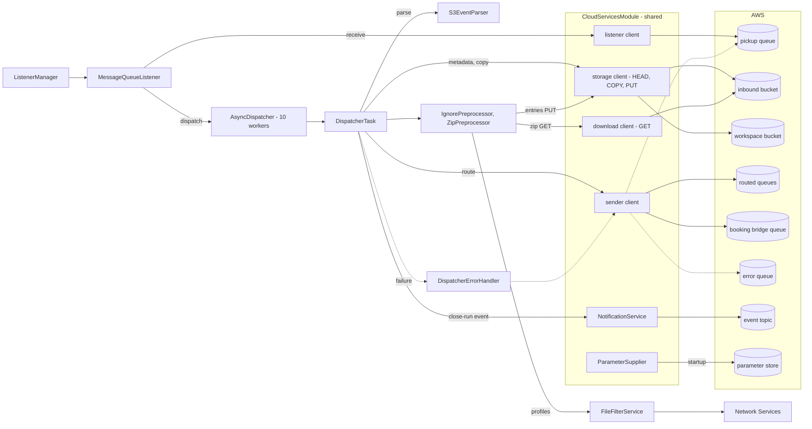
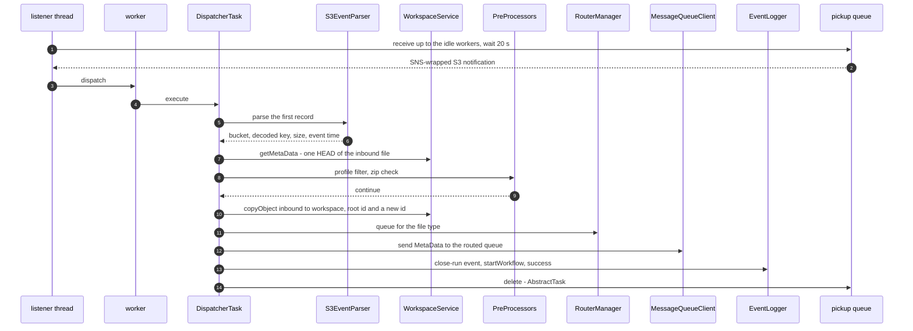
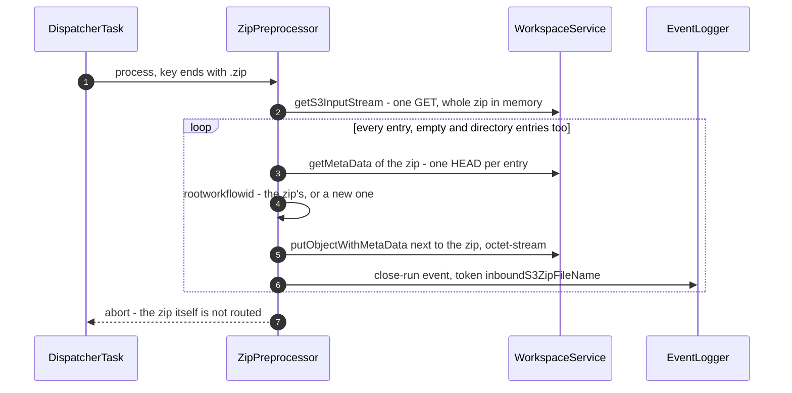
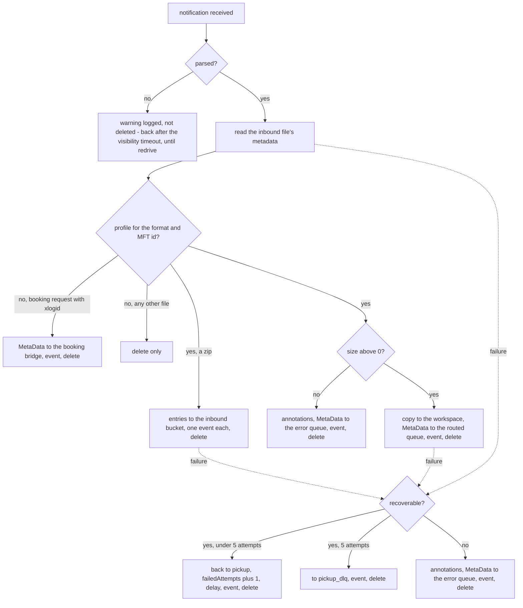

# PR — WI01124532 dispatcher: cloud-sdk clients and the shared adapters

Branch `WI01124532-aws-sdk-upgrade-dispatcher` → `feature/WI01124532-aws-sdk-upgrade` (from `feca5faf`, after PR #6) · 14 commits `ecc48acc` … `07596e24` · [PR #7](https://github.com/wtg-e2open/INTTRA.appianway/pull/7) (raised 2026-11-19)

- **Part 1** is the PR description for GitHub; copy everything between the two `✂` lines.
- **Part 2** is your review guide, for you only. It does not go into the PR.
- **Part 3** walks through dispatcher from start to shutdown: classes, wiring, threads, one message, a zip, the failure and retry path, health checks, shutdown (with diagrams).
- **Part 4** is the command log: reviewing the diff, characterizing, red/green, the defect checks, the pre-review, the build, the PR.

Suggested PR title: `WI01124532 dispatcher: cloud-sdk clients and the shared adapters`

---

## Part 1 — PR description (GitHub)

✂ ------------------------------------------------------------------

## Link to Story/Defect this work relates to

**WI01124532**: AppianWay AWS SDK v1 → v2 upgrade. This PR moves dispatcher onto the `shared` cloud-sdk adapters, as #4, #5 and #6 did for event-writer, error-processor and email-sender. It is the first service of step 3.

## What/Why I Did the changes

dispatcher is AppianWay's inbound gate. It reads S3 "object created" notifications (wrapped by SNS) from its pickup queue, keeps only files whose format and MFT id have a Network Services integration profile, copies the file into the workspace and sends its `MetaData` to the queue for its file type. A zip is expanded into the inbound bucket instead, and a booking request without a profile goes to the booking bridge. It now does this through cloud-sdk (AWS SDK 2.x) instead of AWS SDK v1. Messages, stored objects and events are unchanged.

| | Before (SDK v1) | After (cloud-sdk) |
|---|---|---|
| Clients | `ExternalServicesModule`: `AmazonSQS` ×2, `AmazonS3`, `AmazonSNS`; `ParameterStoreModule` (SDK v1 SSM) | `ExternalServicesModule` installs `shared` `CloudServicesModule`, with the Network Services credentials from the parameter store |
| S3 notification model | SDK v1 `S3EventNotification` (joda-time) | cloud-sdk-api `S3EventNotification` (`java.time`) |
| Listener | `SQSListener` | `MessageQueueListener` |
| Task message type | SDK v1 `Message` | `QueueMessage<String>` |
| Event publisher | `SNSEventPublisher` | `NotificationEventPublisher` |
| Health checks | each built its own default client | run on the service's clients; same names and placement |
| Configuration from storage | `S3ConfigurationProvider` | `StorageConfigurationProvider` |
| Functional tests | JUnit 4, SDK v1 fakes | JUnit 5 `CloudFunctionalTestBase`, cloud-sdk fakes |

### Changes

1. **Proof first:** a golden test, written on the v1 code, records everything dispatcher sends, stores and publishes for five kinds of notification: routed to the default queue, routed by file type with a URL-encoded key, a booking request without a profile, an empty file, and a file without a profile. It passes unchanged on cloud-sdk.
2. The notification parser and the zip expansion were characterized on the v1 code first (key decoding, event time format, bad notifications; entry keys, bytes and metadata, empty and directory entries, one event per entry). Those tests are unchanged after the move.
3. The task and its preprocessors work on `QueueMessage<String>`.
4. The parser reads the cloud-sdk-api notification model, and the zip expansion uses plain `java.util.zip`. Neither uses an SDK v1 type any more.
5. `ExternalServicesModule` installs `CloudServicesModule`. The Network Services credentials are loaded from the parameter store through it. Every client keeps its SDK v1 settings. A test builds the production module with the real clients (no request is sent) and checks every binding.
6. The six health checks run on the injected clients, with the same names and placement.
7. `dispatcher.yaml`: cloud-sdk logs at WARN (it logs every metadata read, copy, put and publish at INFO), except the one line per client that shows it closing at shutdown.
8. An architecture test fails the build if dispatcher uses an AWS SDK type, a `shared` SDK v1 class or joda-time. The module no longer declares the SDK v1 SQS client; it still comes through `shared` at the same version.
9. Three existing defects are kept, each with a disabled test asserting the correct behaviour. Each test fails when enabled. All three have existed since 2018; this PR does not change them.
   - **Duplicate tokens after a failed routed send** (since June 2018). When the `MetaData` cannot be sent to the next queue, the error handler builds the failure event from the task's tokens plus its own, and both hold `pickupQueue` and `dropOffQueue`. `ImmutableMap` rejects the duplicate keys, so building the event fails and the message is not deleted.
     *Functional effect:* the retry copy and the re-delivered original are both processed, so the file reaches the next service (splitter or booking bridge) twice, and the failed attempt has no lineage event. Happens only when that send fails (SQS outage, throttling, permissions).
   - **Error-rate health check reads the wrong meter** (since May 2018). The check watches `DispatcherTask.messages-failed`, but failures are counted in `ErrorHandler.messages-failed`.
     *Functional effect:* `errorsPerSecondAverage` stays healthy however many files fail, so monitoring that relies on it does not notice. File processing is not affected.
   - **Zip storage failures are not retried** (since November 2018). The zip expansion catches every exception and re-throws it as a plain `RuntimeException`, which hides that a storage failure is recoverable.
     *Functional effect:* a temporary S3 problem while reading a zip or writing its entries sends the zip to the error queue as a permanent failure instead of retrying it. Entries written before the failure are processed; the rest are lost.

### Backward compatibility

- **Same messages:** the routed, booking-bridge and error-queue `MetaData` are byte-identical (golden test).
- **Same objects:** the workspace copy (a plain copy that keeps the source metadata), the error annotations, and the zip entries: same keys and bytes, the zip's metadata plus `rootworkflowid`, `application/octet-stream`, empty entries written too.
- **Same events:** byte-identical (golden test).
- **Same notification parsing:** first record, key URL-decoded as UTF-8, event time in UTC with hundredths. A notification that cannot be parsed still stays on the queue until its redrive.
- **Same retry path:** the original notification goes back to the pickup queue with `failedAttempts` and a delay of 20 to 320 s, then to the dead-letter queue (functional test).
- **Same client settings** as the SDK v1 clients, and the same parameter names: decrypted, loaded at startup, an unknown name fails startup.
- **Same health checks:** names, placement and retries.
- **Same configuration keys.** The only YAML change is the logger lines.
- **One log difference:** cloud-sdk logs a missing storage key at ERROR, with a stack trace. The storage-read health check is healthy when its probe key is missing, so each run of that check logs one such ERROR line. error-processor has the same check. A follow-up will remove the line.

## Next Steps

- INT: boot dispatcher, then drop an EDI file and a zip into the inbound bucket. Compare the routed `MetaData`, the workspace copy, the zip entries and the events with the v1 build.
- INT: drop a file with `xlogid` and `originalfilename` user metadata, and check that both reach the `MetaData` projections and the event tokens. Check that each zip entry's own notification is dispatched with the zip's `rootworkflowid`.
- INT: stop the service while files are being processed. The log should show the clients closing, and each message should either be fully processed and deleted or be delivered again.

## Testing Notes

- **Test counts:** dispatcher ran 15 tests. It now runs **50**, 3 of them skipped (the disabled defect tests):
  - task (10), notification parser (12), zip expansion (6), profile filter (3), architecture (3), production module wiring (1);
  - functional (7): the three v1 flows, zip expansion, retries up to the dead-letter queue, health checks, logger levels;
  - golden (5);
  - known defects (3, disabled). Each fails when enabled.
- **Test-first:** each behaviour change has a failing test first, then the change.
- **No change to `shared` or functional-testing** in this PR.
- **Full reactor build** (`mvn -B clean verify`) of `07596e24`: **BUILD SUCCESS** in 14:29 min, all 26 build units, 0 failures and 0 errors. Only dispatcher (15 → 50) changed its test count.

🤖 Generated with [Claude Code](https://claude.com/claude-code)

✂ ------------------------------------------------------------------

---

## Part 2 — Review guide (for you only, not in the PR)

Labels used here: **F#** = finding ([findings](../../tracker/findings.md)); **D#** = decision ([decisions](../../tracker/decisions.md)); **A#** = pending action ([actions](../../tracker/actions.md)); **U#** = commons ask ([plan](../../tracker/plan.md#upstream-commons-asks)). Tracker home: [docs/tracker/README.md](../../tracker/README.md).

### Commits

| # | Commit | What to look at |
|---|---|---|
| 1 | `ecc48acc` test: characterize what dispatcher sends, stores and publishes | Golden test on v1 (JUnit 4, v1 fakes), 5 cases, 5 `wire/*.expected.txt` written by v1 and never changed after (`git log` on the folder shows only this commit). Two new notification fixtures: `s3Event_fileTypeRoute.json` (key `status+report%C3%A9%2B1.txt` → `status reporté+1.txt`, route `315_IFTSTA` → CE queue) and `s3Event_ignored.json` (MFT `CU9999`, no profile). The `é` is written `\u00e9` in the source: dispatcher's build has no `sourceEncoding`, so a literal would compile as Cp1252 on Windows |
| 2 | `4b5429e2` test: characterize the parser and the zip | Both tests JUnit 5. Parser 5 → 11 cases, all first run on v1: UTF-8 key decoding, UTC hundredths **truncated** (`.999` → `.99`), 5 GB size, first record only, unknown fields, **missing event time = time of parsing** (v1 joda prints a null instant as "now"), unusable notifications throw. Zip 2 → 6: entries built in memory (binary 0–255, empty, directory, 5000-byte nested), metadata per entry incl. `rootworkflowid`, one HEAD per entry, one event per entry, a failed write wrapped in `RuntimeException` |
| 3–4 | `5a443e67` / `dbb6712a` task and preprocessors on `QueueMessage` | `TestQueueMessage` copied (5th copy; follow-up). Task test 4 → 10, extended: every token of the close-run event, `rootworkflowid` reuse, empty file, copy reported failed → `RecoverableException` (real `StorageWorkspaceService` on a mocked `StorageClient`), booking bridge with and without `xlogid`, ignored file, parse failure before the handler. D21-style type witness on `preProcessors.execute(..)`. Green renames the task's `sqsClient` field to `queueClient` (D25) |
| 5–6 | `6e32e704` / `421a1d1c` parser and zip off SDK v1 | Red: boundary test scoped to `services` and `preprocessor`, plus "no joda". Also a no-key parser case: v1 fails in the parser (NPE in `URLDecoder`), cloud-sdk `getUrlDecodedKey()` would return null and push the failure into the task's `try` (error queue): so the green keeps `requireNonNull` on the key. Green: `ZonedDateTime.now()` for a missing time (default zone, as joda), `Json.DATE_FORMATTER` at UTC otherwise; `zis.readAllBytes()` per entry, try-with-resources on the zip stream |
| 7–8 | `0ddc55c7` / `2ad5bab9` the service on `CloudServicesModule` | Functional base on `CloudFunctionalTestBase`; inbound files carry `xlogid=123456789` because the v1 fake's `getObjectMetadata` was hard-coded to return it (F22). New functional tests: zip end to end (content type, metadata, empty entry), **full retry path** (missing inbound object → 5 retries with `failedAttempts` 1–5 and delays 20/40/80/160/320 → DLQ, replacing the `@Ignore`d v1 reprocessing test, which had no `@Test` and stale expectations), six health-check names on default/ops. Wiring test overrides two bindings that call out at injector creation: `CloudParameterStore` (fake with the configured names, so it proves the names are wired) and `AuthClient` (token fetch in its constructor). Green also fixes the v1 booking test's inbound key (it put the file under `pickup-edi.txt`; the v1 fake's HEAD never checked keys) |
| 9–10 | `2d9c0d6b` / `d5d01887` loggers | `com.inttra.mercury.cloudsdk: WARN`, `ManagedCloudResource: INFO` (A27). Checked in commons: metadata reads (`S3StorageClient:739`), copies (`:1006`), puts and SNS publishes all log at INFO |
| 11 | `e479822e` known defects | A12. Three disabled functional tests; injected failures via a `Proxy` over the fake that throws one AWS `SdkClientException` (what cloud-sdk lets through; shared maps it to recoverable). **Each verified both ways:** fails today, passes with a minimal fix (not committed): (a) remove the two tokens before `handleException`, (b) give the check `name(ErrorHandler.class, ...)`, (c) rethrow `RecoverableException` in `ZipPreprocessor`. The meter test reads the meter the registered check holds (AssertJ `extracting("meter.count")`), so it passes for any fix |
| 12 | `b4b8f4b4` refactor (pre-review) | Golden test sends LF inputs instead of normalizing CRLF in the output, so line breaks on the wire are compared. Parser javadoc exact |
| 13 | `f3cb0a3e` build | Direct `aws-java-sdk-sqs` removed (design page says so). Unlike email-sender's SES pin, `shared` brings SQS at the same 1.12.730, so nothing changes (`dependency:tree` with `-pl shared,dispatcher`) |
| 14 | `07596e24` refactor | Boundary-test comment: joda-time also arrives through `jackson-datatype-joda` |

### Pre-review (2026-11-19)

Independent review (`code-review` skill, high) of `feca5faf..` before the full build. 10 points, each checked against the code:

| # | Point | Outcome |
|---|---|---|
| 1 | The storage-read health check logs an ERROR with a stack trace on every run, because cloud-sdk logs `NoSuchKey` at ERROR (`AbstractStorageObject.handleNoSuchKeyException:187`) and the probe's healthy answer is a missing key | **Confirmed.** Same in error-processor (merged). Not fixable by a logger level: that logger also carries real S3 errors. **Your decision** (below). Stated in Part 1 |
| 2 | Parse failures run outside the `try` (e.g. `s3:TestEvent` without records) | v1 behaviour, kept on purpose (design FR1); characterized |
| 3 | Javadoc says "no bucket" fails, but a nameless bucket gives null | v1 behaves the same (null name). Javadoc made exact (commit 12) |
| 4 | Directory and sub-folder zip entries produce keys dispatcher cannot process later | v1 behaviour, characterized (`nested/`, `nested/large.bin`). Observation for you, not a fix here |
| 5 | One HEAD of the zip per entry | v1 behaviour (design "Performance"); kept |
| 6 | Zip buffered twice (cloud-sdk bytes + adapter copy) | Transient: the cloud-sdk copy is dropped when `getS3InputStream` returns; v1's `IOUtils.toByteArray` also peaked at about 2×. Returning cloud-sdk's stream directly would rely on it staying in memory (distributor's caller too). Kept |
| 7 | Per-service logger override, ignores `logging.level` | Program approach (4 services). A commons change (routine calls at DEBUG) would remove it |
| 8 | `TypeLiteral` lookups duplicated | Known follow-up (shared `Key` constants) |
| 9 | Golden normalization hides line-break changes | **Fixed** (commit 12) |
| 10 | Wiring test leaves the SSM and SNS clients open | Test JVM only; their cloud-sdk `close()` does nothing anyway (F15/F17). Kept |

### Decisions for you

1. **Health-check ERROR line (point 1).** Options: (a) commons: log a missing key at DEBUG (or WARN without the stack trace), the clean fix, one release; (b) shared: probe with `objectExists` (HEAD), no log, but a deleted bucket would look healthy, which is why D28 chose the GET; (c) accept until (a). My recommendation: (a), with (c) meanwhile.
2. **Three known defects.** Fix now or later? Each fix is one or two lines (Part 2, commit 11). The duplicate-token one is visible in production: a failed routed send leads to the file being routed twice.
3. **Zip folders (point 4).** Existing behaviour; a defect only if zips with folders are expected. Your call whether to log it.

### Notes

- **Design page differences** (for A21's batched edit): it says a zip that fails part-way "is re-expanded on retry"; in fact it is never retried (defect c). It says the inbound probe uses `getQueueAttributes`; since U5 it receives with visibility 0. Versions: commons 1.0.39-SNAPSHOT, SDK v1 1.12.730.
- **v1 fakes** hid two things: the hard-coded metadata (F22) and keys never checked on HEAD. Both are test-only.
- `ZipPreprocessor` uses `LocalDateTime.now()` (wall clock) for the event's start time; unchanged.

---

## Part 3 — How dispatcher works: from start to shutdown (after this PR)

### 3.1 The classes

| Class | Kind | Role |
|---|---|---|
| `DispatcherApplication` | Dropwizard `Application` | Picks the configuration source, creates the injector, registers the `ListenerManager` and the six health checks |
| `DispatcherConfiguration`, `BookingBridgeConfiguration` | configuration | Pickup queue (`maxNumberOfMessages` 10, wait 20 s), route map, error queue, event topic, workspace and inbound buckets, Network Services, booking-bridge queue |
| `ExternalServicesModule` | Guice module | Installs `CloudServicesModule(lifecycle, pickup, topic).withParameters(clientId, clientSecret)`; Network Services clients, `AuthClient` (eager), `RecoveryConfig`, system clock, Jersey client |
| `CloudServicesModule` *(shared)* | Guice module | The 4 queue and storage clients (closed on shutdown), `MessageQueueClient`, `WorkspaceService`, `NotificationService` + `EventPublisher`, `ParameterSupplier` |
| `DispatcherModule` | Guice module | Configuration, `AsyncDispatcher` (10 workers), route map, metrics AOP, `MessageQueueListener`, `ListenerManager`, preprocessor list |
| `ListenerManager`, `MessageQueueListener`, `AsyncDispatcher` *(shared)* | listener | Poll loop; receive at most the idle workers (≤ 10); drain on stop (20 s) |
| `DispatcherTask` | `AbstractTask` | One per message: parse, metadata read, preprocessors, workspace copy, route, close-run event; failures to the error handler |
| `S3EventParser` | parser | cloud-sdk-api `S3EventNotification` → `S3Event` (bucket, decoded key, size, event time text) |
| `PreProcessors` → `IgnorePreprocessor`, `ZipPreprocessor` | preprocessors | Abort when the file has no profile; expand a zip and abort |
| `FileFilterService` | singleton | Archive format × MFT id pairs from Network Services, cached 30 min |
| `RouterManager` | router | Queue for the file type, else `default` |
| `DispatcherErrorHandler` | `ErrorHandler` *(shared)* | Recoverable → back to pickup with delay, or DLQ; otherwise → annotations to the workspace, failure `MetaData` to the error queue; then the failure event |

### 3.2 Components



### 3.3 Startup and threads

1. `main` → `run`. If `CONFIG_LOCATION=s3`, the YAML is read from storage (`StorageConfigurationProvider`); `ConfigProcessingServerCommand` resolves the placeholders.
2. `Guice.createInjector(ExternalServicesModule, DispatcherModule)`. `CloudServicesModule` builds the queue, storage, notification and parameter-store clients (region and credentials from the default chains). The Network Services client id and secret are loaded from the parameter store while the injector is created (an unknown name stops startup). `AuthClient` fetches its first token, also during injector creation. The 4 queue and storage clients are registered for closing.
3. The `ListenerManager` is registered after them, then the health checks. Jetty starts and the listener thread starts polling.

Threads: `main`; one **listener** thread (long poll 20 s); up to **10 workers** (`maxNumberOfMessages`); Jetty request threads (health checks); the shutdown hook.

### 3.4 One routed file



- The workflow ids are random, unless the inbound file has a `rootworkflowid` (a zip entry): then it is reused.
- The `MetaData` projections carry the file type, MFT id, pickup file name, S3 event time and receive time, plus every user-metadata entry of the inbound file.
- A booking request (`300_IFTMBF`) without a profile but with an `xlogid` goes to the booking bridge, with no workspace copy. Any other file without a profile is only deleted.

### 3.5 A zip



Each entry written to the inbound bucket raises its own notification, so dispatcher then handles every entry as a file and reuses its `rootworkflowid`.

### 3.6 Outcomes, failures and retries



1. Inside the task's `try`, any failure goes to `DispatcherErrorHandler` with the token map built so far.
2. **Recoverable** (a cloud service failure, a copy that storage reports as failed, a Network Services failure): the original notification goes back to the pickup queue with `failedAttempts` + 1 and a delay of 2^n × 10 s (20, 40, 80, 160, 320 s), then to `{pickup}_dlq` after 5 attempts. A failure event is published, and the message is deleted.
3. **Not recoverable** (empty file, key without five parts, a zip failure): the annotations go to the workspace and the failure `MetaData` to the error queue. A failure event is published, and the message is deleted.
4. **Before the `try`** (a notification that cannot be parsed): `AbstractTask` logs a warning and does not delete. The message comes back until the queue's redrive.
5. **Known defects:** a failure after the routed send was attempted cannot build its failure event (tokens twice), so the message is not deleted and comes back. A zip storage failure is not retried. The error-rate check never sees failures.

### 3.7 Health checks

| Name | Check | Client | Default endpoint | Ops endpoint |
|---|---|---|---|---|
| `InboundQueue -> {pickup}` | receive at most 1, wait 0, visibility 0 | listener | yes | yes |
| `S3 read -> {inbound bucket}` | GET `anykey`: healthy when the key is missing | storage | yes | yes |
| `errorsPerSecondAverage` | 5-minute failure rate under the threshold (5.0) | meter | yes | yes |
| `OutboundQueue -> {error queue}` | send `HEALTHCHECK` | sender | no | yes |
| `S3 write -> {workspace bucket}` | put `HEALTHCHECK` | storage | no | yes |
| `SNS publish -> {topic}` | publish `HEALTHCHECK` | notification | no | yes |

All four client roles retry 3 times, as the v1 checks' default clients did, so no extra retry wrapper.

### 3.8 Shutdown

As for the other services (shared, PR #4): `ListenerManager.stop()` stops the listener and waits up to 20 s for the messages in progress; then the clients close, queue clients first, so a message past the deadline cannot be deleted and is delivered again. With 10 workers and a zip possibly being expanded, the INT shutdown check matters here.

### 3.9 Tests and what they cover

| Area | Test |
|---|---|
| Messages, objects, events identical to v1 (5 kinds of notification) | `DispatcherWireCompatibilityTest` (5), `wire/*.expected.txt` |
| Notification parsing | `S3EventParserTest` (12) |
| Zip expansion | `ZipPreprocessorTest` (6) |
| Profile filter | `IgnorePreprocessorTest` (3) |
| Task paths, tokens, recoverable copy failure | `DispatcherTaskTest` (10) |
| Production wiring with real clients | `ExternalServicesModuleWiringTest` (1) |
| No AWS SDK, shared v1 class or joda-time | `AwsSdkBoundaryArchTest` (3) |
| Service on the fakes: v1 flows, zip, retry to DLQ, health checks, loggers | `DispatcherFuncTest` (7) |
| Known defects | `DispatcherKnownDefectsTest` (3, disabled) |

---

## Part 4 — Command log

Run in Git Bash, in `c:\Users\arijit.kundu\projects\appianway`. `R=wtg-e2open/INTTRA.appianway`.

### 4.1 Review the diff

```bash
B=feca5faf; H=07596e24

git diff --stat $B $H                              # 29 files, dispatcher only
git diff --dirstat=files,0 $B $H
git diff $B $H -- dispatcher/src/main dispatcher/conf dispatcher/pom.xml
git log --reverse --format='%h %s' $B..$H

# The golden files: written by v1 in commit 1 and never changed afterwards
git log --format='%h %s' $B..$H -- dispatcher/src/test/resources-functional/wire/   # one line: ecc48acc (plus no later commits)
git diff --stat ecc48acc $H -- 'dispatcher/src/test/resources-functional/wire/*.expected.txt'   # no output

# No AWS SDK v1 import or joda-time left in production code (expect no output)
git grep -n "com.amazonaws\|org.joda" $H -- dispatcher/src/main
```

### 4.2 Characterize v1 first

```bash
git checkout -b WI01124532-aws-sdk-upgrade-dispatcher feca5faf
mvn -B -q -pl dispatcher -am test -Dsurefire.failIfNoSpecifiedTests=false     # baseline: 15 tests

# The golden files were generated once from the v1 build: a temporary line in assertMatches wrote captured()
# to src/test/resources-functional/wire/, was removed again, and the test was run twice against the files
mvn -B -q -pl dispatcher -am test -Dtest=DispatcherWireCompatibilityTest -Dsurefire.failIfNoSpecifiedTests=false
# -> ecc48acc
mvn -B -q -pl dispatcher -am test '-Dtest=S3EventParserTest,ZipPreprocessorTest' -Dsurefire.failIfNoSpecifiedTests=false
# -> 4b5429e2 (18 tests, all green on v1)
```

### 4.3 Red, then green

```bash
mvn -B -q -pl dispatcher -am test -Dsurefire.failIfNoSpecifiedTests=false
# red pairs fail only with the skeleton's UnsupportedOperationException (counted per report file):
grep -c 'UnsupportedOperationException: not yet' dispatcher/target/surefire-reports/*.txt
# -> 5a443e67 / dbb6712a, 6e32e704 / 421a1d1c, 0ddc55c7 / 2ad5bab9, 2d9c0d6b / d5d01887
```

### 4.4 The known defects, checked both ways

```bash
# 1. enabled (no @Disabled yet): all three fail
mvn -B -q -pl dispatcher -am test -Dtest=DispatcherKnownDefectsTest -Dsurefire.failIfNoSpecifiedTests=false
# 2. with the three minimal fixes applied locally: all three pass
# 3. undo the fixes and check nothing is left
git checkout -- dispatcher/src/main && git status --short | grep -v '^??'
# -> e479822e (disabled)
```

### 4.5 Pre-review and its fixes

```bash
# code-review skill, high, on feca5faf..HEAD; points checked against commons:
grep -n "handleNoSuchKeyException" -A4 ../mercury-services-commons/cloud-sdk-aws/src/main/java/com/inttra/mercury/cloudsdk/storage/impl/AbstractStorageObject.java
# -> b4b8f4b4 (golden LF inputs, parser javadoc)
mvn -B -pl shared,dispatcher dependency:tree -Dincludes=com.amazonaws:aws-java-sdk-sqs     # 1.12.730 through shared
# -> f3cb0a3e, 07596e24
```

### 4.6 Full build

```bash
cd ../appianway-build
git checkout -q --detach WI01124532-aws-sdk-upgrade-dispatcher
JAVA_TOOL_OPTIONS=-Duser.timezone=UTC mvn -B clean verify \
    -Daether.enhancedLocalRepository.trackingFilename=_any.repositories > build.log 2>&1
grep -E "Tests run:.*Fail|BUILD|Total time" build.log | tail -40
cd ../appianway
```

### 4.7 Push and raise the PR

```bash
git config user.email                                   # the WTG address
git status --short | grep -v '^??'                      # nothing staged or modified
git log --format=%s feca5faf..HEAD | grep -vc '^WI01124532'     # 0
git push -u origin WI01124532-aws-sdk-upgrade-dispatcher
gh pr create --base feature/WI01124532-aws-sdk-upgrade --head WI01124532-aws-sdk-upgrade-dispatcher \
    --title "WI01124532 dispatcher: cloud-sdk clients and the shared adapters" --body-file <Part 1 file>
gh pr view 7 --json state,mergeStateStatus        # OPEN
```
