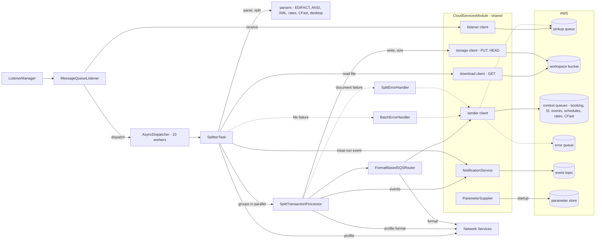
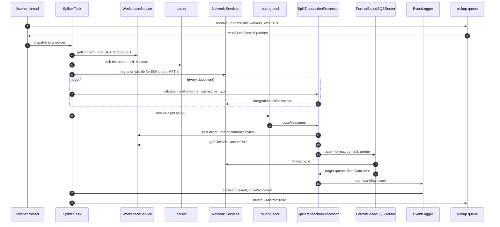
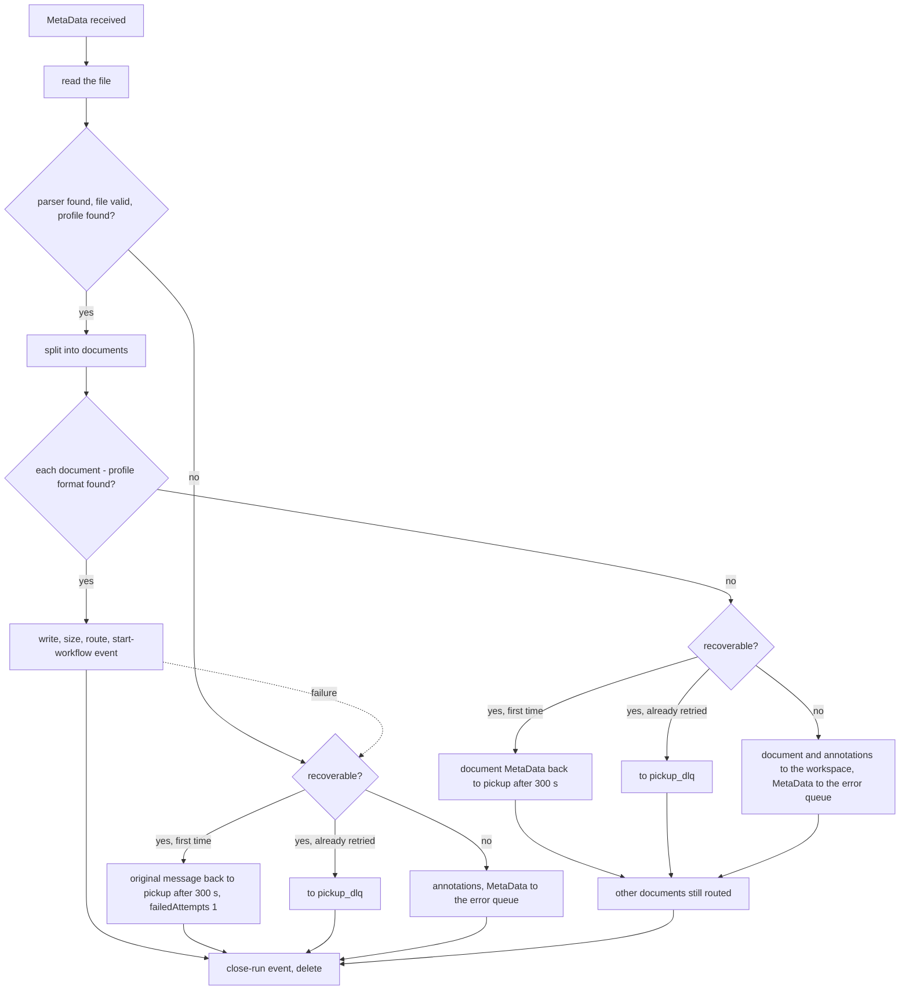

# PR — WI01124532 splitter: cloud-sdk clients and the shared adapters

Branch `WI01124532-aws-sdk-upgrade-splitter` → `feature/WI01124532-aws-sdk-upgrade` (from `07b5106f`, after PR #7) · 11 commits `fcc07a08` … `8feabd5f` · [PR #8](https://github.com/wtg-e2open/INTTRA.appianway/pull/8) (raised 2026-11-19, merged 2026-11-20 as `222d58be`)

- **Part 1** is the PR description for GitHub; copy everything between the two `✂` lines.
- **Part 2** is your review guide, for you only. It does not go into the PR.
- **Part 3** walks through splitter from start to shutdown: classes, wiring, threads, one batch, a single document, the failure and retry paths, health checks, shutdown (with diagrams).
- **Part 4** is the command log: reviewing the diff, characterizing, red/green, the defect checks, the pre-review, the build, the PR.

Suggested PR title: `WI01124532 splitter: cloud-sdk clients and the shared adapters`

---

## Part 1 — PR description (GitHub)

✂ ------------------------------------------------------------------

## Link to Story/Defect this work relates to

**WI01124532**: AppianWay AWS SDK v1 → v2 upgrade. This PR moves splitter onto the `shared` cloud-sdk adapters, as #4–#7 did for event-writer, error-processor, email-sender and dispatcher. It is the second service of step 3.

## What/Why I Did the changes

splitter takes each inbound file that dispatcher routed to it, reads it from the workspace, finds its parser (EDIFACT, ANSI X12, XML bookings, rates, CFast, desktop), checks the sender's integration profile and splits the file into its documents. Each document is checked against its profile format, written to the workspace (unless the file is a single valid document, which is kept as it is) and routed to the queue for its format's context (booking, SI, container event, schedule, rates, CFast), with a lineage event. It now does this through cloud-sdk (AWS SDK 2.x) instead of AWS SDK v1. Messages, stored objects and events are unchanged.

| | Before (SDK v1) | After (cloud-sdk) |
|---|---|---|
| Clients | `ExternalServicesModule`: `AmazonSQS` ×2, `AmazonS3`, `AmazonSNS`; `ParameterStoreModule` (SDK v1 SSM) | `ExternalServicesModule` installs `shared` `CloudServicesModule`, with the Network Services credentials from the parameter store |
| Listener | `SQSListener` | `MessageQueueListener` |
| Task, processor, error handler message type | SDK v1 `Message` | `QueueMessage<String>` |
| Sender | `SQSClient` | `MessageQueueClient` |
| Workspace, event publisher | `S3WorkspaceService`, `SNSEventPublisher` | `StorageWorkspaceService`, `NotificationEventPublisher` (from `CloudServicesModule`) |
| Health checks | each built its own default client | run on the service's clients; same names and placement |
| Configuration from storage | `S3ConfigurationProvider` | `StorageConfigurationProvider` |
| Functional tests | JUnit 4, SDK v1 fakes | JUnit 5 `CloudFunctionalTestBase`, cloud-sdk fakes |

### Changes

1. **Proof first:** a golden test, written on the v1 code, records everything splitter sends, stores and publishes for seven kinds of input: ten documents split and routed one by one, the same file with a grouped format (routed as one document), a single valid document (kept, not rewritten), a file that cannot be parsed, a document without a profile format, and a recoverable failure of the whole file and of one document (each retried once). It passes on cloud-sdk with the same expected files.
2. Two more characterization tests on v1: split documents are written as ISO-8859-1 bytes (non-ASCII included) and their size read back; splitter's own retry setting sends a recoverable failure back once, after 300 s with `failedAttempts` 1, then to the dead-letter queue.
3. The task, the transaction processor and the error handler work on `QueueMessage<String>`; the processor and the router send through `MessageQueueClient`. The processor no longer takes a queue client it never used.
4. `ExternalServicesModule` installs `CloudServicesModule`; the Network Services credentials are loaded from the parameter store through it. Every client keeps its SDK v1 settings; splitter's retry setting (one retry after 300 s), the cached Network Services clients and the UTC clock are unchanged. A test builds the production module with the real clients (no request is sent) and checks every binding.
5. The health checks run on the injected clients, with the same names and placement: the default endpoint has the pickup queue, Network Services and the error rate; the ops endpoint adds both outbound queues, the event topic and the workspace write.
6. `splitter.yaml`: cloud-sdk logs at WARN (it logs every read, put and publish at INFO), except the one line per client that shows it closing at shutdown.
7. An architecture test fails the build if splitter uses an AWS SDK type or a `shared` SDK v1 class. The module no longer declares the SDK v1 SQS client; it still comes through `shared` at the same version.
8. Four existing defects are kept, each with a disabled test asserting the correct behaviour. Each test fails when enabled and passes with a one- or two-line fix. This PR does not change them, and none of them has been reported.
   - **Parallel groups share the control number** (since June 2018). The groups of one file are routed in parallel, and each writes its control number into the parent's shared projections map before copying it.
     *Functional effect:* in a file with several groups, a split document can carry another document's `documentControlNumber` (in the test, 900 of 1000 did), or the whole file fails and is retried.
   - **The whole document is logged at INFO** (since September 2023).
     *Functional effect:* every partner document, with its names, addresses and cargo details, is copied into the service log.
   - **Retried and routed** (since November 2018). For a document that needs no splitting, a failed authorization check is handed to the error handler and the document is routed anyway.
     *Functional effect:* when Network Services fails at that moment, the document reaches the next service at once and again after the retry (or goes downstream while a failure goes to the error queue).
   - **Error-rate health check reads the wrong meter** (since April 2017, as in dispatcher). The check watches `SplitterTask.messages-failed`; failures are counted on the error handlers' meters.
     *Functional effect:* `errorsPerSecondAverage` stays healthy however many files fail. File processing is not affected.

### Backward compatibility

- **Same messages, objects and events:** everything sent to each queue, every object written to the workspace and every event published is identical to v1 for the seven golden inputs.
- **Same bytes:** split documents are written as ISO-8859-1, `application/octet-stream`, one size read (HEAD) each, as before.
- **Same retry path:** splitter's own setting, one retry after 300 s with `failedAttempts`, then the dead-letter queue; a whole-file retry sends the original message, a document retry its own `MetaData`.
- **Same client settings** as the SDK v1 clients, and the same parameter names: decrypted, loaded at startup, an unknown name fails startup.
- **Same health checks:** names, placement and retries.
- **Same configuration keys.** The only YAML change is the logger lines.
- **Listener:** `MessageQueueListener` asks for at most as many messages as there are idle workers, and drains on shutdown, as in the other migrated services.

## Next Steps

> ✅ **Verified on QA (2026-11-19):** the new build was run locally against QA, with inputs and outputs on borrowed DLQs. No real messages or queues were affected.

- ✅ **Boot and AWS access:** starts cleanly, health checks healthy, and the queue, storage, topic and parameter store work through cloud-sdk. Network Services works too. Routing to QA's configured queue names works as with v1.
- ✅ **Single document:** an IFTMBF booking request is kept and routed with the same `MetaData` and events as v1.
- ✅ **Split:** an IFTMBC file with two confirmations is split into the same two documents, byte for byte, with the same `MetaData` and events as v1 and as QA's own run of the same file.
- ✅ **Stop:** on Ctrl+C the clients close and the service exits in 1 s.

## Testing Notes

- **Test counts:** splitter ran 179 tests, 2 of them skipped. It now runs **182**, 4 of them skipped (the disabled defect tests):
  - task (16), transaction processor (24, plus the ISO-8859-1 write), error handler (15, plus the real retry setting), router (4 + 3), parsers and others unchanged;
  - architecture (2), production module wiring (1);
  - functional (4): the two active v1 flows with their assertions unchanged, health checks by name and placement, logger levels;
  - golden (7), run with one pickup worker so that a retry cannot overtake its first attempt;
  - known defects (4, disabled). Each fails when enabled.
- **Removed:** two v1 functional tests ignored since 2018 (they stubbed the wrong format service and the SDK v1 S3 fake), covered by the golden test with the format stubbed correctly; and 14 module tests that only checked the constructor returns an object, replaced by the wiring test.
- **Test-first:** each behaviour change has a failing test first, then the change.
- **No change to `shared` or functional-testing** in this PR.
- **Full reactor build** (`mvn -B clean verify`) of `337cf1a7`: **BUILD SUCCESS** in 10:31 min, all 26 build units, 0 failures and 0 errors. Only splitter changed its test count. The two later commits change splitter's tests only (the disabled tests' reasons, the golden test's worker count); splitter was re-run on them.

🤖 Generated with [Claude Code](https://claude.com/claude-code)

✂ ------------------------------------------------------------------

---

## Part 2 — Review guide (for you only, not in the PR)

Labels used here: **F#** = finding ([findings](../../tracker/findings.md)); **KD-#** = known defect ([known defects](../../tracker/known-defects.md)); **D#** = decision ([decisions](../../tracker/decisions.md)); **A#** = pending action ([actions](../../tracker/actions.md)). Tracker home: [docs/tracker/README.md](../../tracker/README.md).

### Commits

| # | Commit | What to look at |
|---|---|---|
| 1 | `fcc07a08` test: characterize what splitter sends, stores and publishes | Golden test on v1 (JUnit 4, v1 fakes), 7 cases, `wire/*.expected.txt` written by v1 and never changed after. The v1 happy-flow functional tests were `@Ignore`d since 2018 because they stub `CacheFormatService` while the router uses `FormatService` (null format → NPE → error queue); the golden test stubs `FormatService`. Normalized: `messageId`, the wall-clock `startTimestamp` of a per-document failure event (F27), random ids renumbered by first appearance (the fake delivers a retry at once, so two attempts can draw ids in either order) |
| 2 | `9568dbdb` test: characterize split-document writes and retries | ISO-8859-1 bytes incl. `é` (written `\u00e9`: no `sourceEncoding`), size read from the same key; a retained document is not written; the real `ErrorHelper` with `RecoveryConfig(true, 1, 150)`: one retry at 2^1 × 150 = 300 s with `failedAttempts` 1, then `_dlq` |
| 3–4 | `c1f337c9` / `06e2bec3` task, processor, error handler on `QueueMessage` | `TestQueueMessage` record with `getMessageAttributes` (6th copy, follow-up). JUnit 4 kept for these big tests; a typed `anyQueueMessage()` matcher avoids ambiguous `any()` while both overloads exist; `(QueueMessage<String>) null` where the v1 tests passed `null`. Red: 57 errors, 48 "not yet" and 9 functional/golden timeouts from the task throwing. Green renames `sqsClient`/`sqsMessage`/`sendToSqs` (D25) |
| 5–6 | `b449af6e` / `691c02cd` the service on `CloudServicesModule` | Functional base on `CloudFunctionalTestBase`. Health-check test asserts the **v1 placement**, which differs from dispatcher's: default has no outbound checks, ops has no error rate, so `HealthCheckRegistrar` (read/write split) does not fit and the two registries are built as in v1. The ops endpoint reports unhealthy in the test (Network Services unreachable); names and writes are checked. Wiring test overrides `CloudParameterStore`, `AuthClient` and the Jersey `Client` (bound in `SplitterModule`). Green also adapts the golden test to F28: each routed `splitterFileSize` must equal the stored length, then is printed as 0. `ExternalServicesModuleTest` (14 constructor-only tests) replaced |
| 7 | `a101fcb1` build | Direct `aws-java-sdk-sqs` removed; `shared` brings it at the same version |
| 8 | `68f5ad49` known defects (KD-8, KD-9) | Race test: 50 rounds × 20 groups on 10 threads with plain stubs (no Mockito on the hot path); fails with 900/1000 wrong numbers. Verified both ways; note the fix needs a **deep** copy (`Builder(metaData).setProjections(..)` writes into the shared map, CME). Logging test: `ListAppender` on `SplitterTask` |
| 9 | `5aad26b2` refactor (pre-review) | Unused `MessageQueueClient` removed from the processor |
| 10 | `337cf1a7` known defects (KD-10, KD-11), from the pre-review | Validate fall-through (unit), error-rate meter (functional, as dispatcher's). Verified both ways |
| 11 | `8feabd5f` test | `@Disabled` reasons give the start month from `git log -S` (the logging is from 2023, not 2018 as the design page implied) |

### Pre-review (2026-11-19)

Independent review (`code-review` skill, high) of `07b5106f..68f5ad49`. 10 points, each checked against the code:

| # | Point | Outcome |
|---|---|---|
| 1 | Non-splitting `validate` falls through to `return true` after handling the failure | **Confirmed**, since Nov 2018 → KD-10, disabled test (commit 10) |
| 2 | Format ids come from the shared, mutable identifier | **Confirmed by reading**, since Feb 2018; only files mixing message types → F26, **your decision** |
| 3 | Error-rate check reads a meter nothing marks | **Confirmed**, as dispatcher's KD-2 → KD-11, disabled test (commit 10) |
| 4 | The `TaskFactory` lambda implements the v1 `getTask(Message)`, so each message is converted to SDK v1 | True in every migrated service (the shared default method); goes away in step 5 when `getTask(QueueMessage)` becomes the only method. Kept |
| 5 | Failure event start time from the wall clock | Since 2021 → F27. Kept (no behaviour change in this program) |
| 6 | Unused queue client in the processor | **Fixed** (commit 9) |
| 7 | A HEAD per written split document | v1 behaviour (design "Performance"); kept |
| 8 | 6th `TestQueueMessage` copy | Known follow-up (move to functional-testing) |
| 9 | `TypeLiteral` key lookups duplicated | Known follow-up (shared `Key` constants) |
| 10 | `NetworkServiceConfig` bound in both modules | v1 has both; the functional tests rely on `SplitterModule`'s. Kept |

### Decisions (2026-11-20)

1. **Known defects KD-8 to KD-11: not fixed** (no one has reported them; D43).
2. **F26: no effect in practice.** Files do not mix message types (IFTMBF, IFTSTA …), so it stays a finding.
3. **Copilot (golden test order): fixed** in `e36bc10f`, one pickup worker for the golden test (D44); thread answered and resolved.

### Notes

- **Design page differences** (for A21's batched edit): the logging defect is from September 2023; the race write is from June 2018 (parallel routing from February 2018). The pre-review found two more defects (KD-10, KD-11) that the design page does not list.
- **v1 fakes** hid one more value: the size 0 (F28).
- No storage-read health check in splitter, so F25 (the retried 404) does not apply.

---

## Part 3 — How splitter works: from start to shutdown (after this PR)

### 3.1 The classes

| Class | Kind | Role |
|---|---|---|
| `SplitterApplication` | Dropwizard `Application` | Picks the configuration source, creates the injector, registers the `ListenerManager` and the health checks (default and ops) |
| `SplitterConfiguration` | configuration | Pickup queue (`maxNumberOfMessages` 10, wait 20 s), router and error queues, event topic, workspace bucket, enabled parsers, route map by context code, routers order, Network Services, health-check settings |
| `ExternalServicesModule` | Guice module | Installs `CloudServicesModule(lifecycle, pickup, topic).withParameters(clientId, clientSecret)`; cached Network Services clients, `AuthClient` (eager), `RecoveryConfig(true, 1, 150)`, UTC clock |
| `CloudServicesModule` *(shared)* | Guice module | The 4 queue and storage clients (closed on shutdown), `MessageQueueClient`, `WorkspaceService`, `NotificationService` + `EventPublisher`, `ParameterSupplier` |
| `SplitterModule` | Guice module | Configuration, `AsyncDispatcher` (10 workers), routing executor (10 threads), parsers, error messages, identifier, route map, metrics AOP, `MessageQueueListener`, `ListenerManager`, Jersey client |
| `ListenerManager`, `MessageQueueListener`, `AsyncDispatcher` *(shared)* | listener | Poll loop; receive at most the idle workers (≤ 10); drain on stop (20 s) |
| `SplitterTask` | `AbstractTask` | One per message: read the file, pick and run the parser, check the profile, split, route each group in parallel, close-run event; batch failures to `BatchErrorHandler` |
| `SplitTransactionProcessor` | processor | Per document: authorize (format check), write to the workspace (unless retained), read its size, route, start-workflow event; document failures to `SplitErrorHandler` |
| `RouterManager` → `FormatBasedSQSRouter` | router | Format by id → context code → queue from the route map; sends the `MetaData` |
| `BatchErrorHandler` | `ErrorHandler` *(shared)* | Whole-file failures: retry with the original message, or error queue with annotations |
| `SplitErrorHandler` | error handler | Per-document failures: retry with the document's `MetaData`, or error queue with annotations |

### 3.2 Components



### 3.3 Startup and threads

1. `main` → `run`. If `CONFIG_LOCATION=s3`, the YAML is read from storage (`StorageConfigurationProvider`); `ConfigProcessingServerCommand` resolves the placeholders.
2. `Guice.createInjector(ExternalServicesModule, SplitterModule)`. `CloudServicesModule` builds the queue, storage, notification and parameter-store clients (region and credentials from the default chains). The Network Services client id and secret are loaded from the parameter store while the injector is created (an unknown name stops startup); `AuthClient` fetches its first token. The 4 queue and storage clients are registered for closing.
3. The `ListenerManager` is registered after them, then the health checks. Jetty starts and the listener thread starts polling.

Threads: `main`; one **listener** thread (long poll 20 s); up to **10 workers** (`maxNumberOfMessages`); a **routing pool** of 10 threads shared by all workers (one task per group); Jetty request threads (health checks); the shutdown hook.

### 3.4 One file split into documents



- A file whose only document is valid is not rewritten: the routed `MetaData` names the original object (`retain`).
- A grouped format sends the whole group as one document.
- The routed `MetaData` carries the control numbers, EDI id, profile ids, format id and code, context code and the split file size.

### 3.5 A document that needs no splitting

XML bookings, desktop and other single-document formats: the parser says no splitting, the processor checks the one profile format, the projections are added to the original `MetaData` and it is routed with the original object (`retain`). This is the path of known defect KD-10: a failing check is handled and the document is routed as well.

### 3.6 Outcomes, failures and retries



1. **Whole-file failures** (no parser, a structural error, no profile, a Network Services or storage failure while routing) go to `BatchErrorHandler`: recoverable → the original message back to pickup once, after 300 s, then the DLQ; otherwise annotations and the error queue. A failure event is published and the message is deleted.
2. **Per-document failures** (no profile format, a failed format check) go to `SplitErrorHandler` with the document's own `MetaData` (its text written to the workspace first): recoverable → that `MetaData` back to pickup once, then the DLQ; otherwise annotations and the error queue. The other documents are still routed.
3. **Known defects:** KD-8 (parallel groups share the control number), KD-10 (a single document is retried and routed), KD-11 (the error-rate check never sees failures), KD-9 (the document is logged at INFO).

### 3.7 Health checks

| Name | Check | Client | Default endpoint | Ops endpoint |
|---|---|---|---|---|
| `InboundQueue -> {pickup}` | receive at most 1, wait 0, visibility 0 | listener | yes | yes |
| `HTTP GET -> {Network Services health URL}` | GET, 1 s connect, 3 s read | its own HTTP client | yes | yes |
| `errorsPerSecondAverage` | 5-minute failure rate under the threshold (5.0) | meter (KD-11) | yes | no |
| `OutboundQueue -> {router queue}` | send `HEALTHCHECK` | sender | no | yes |
| `OutboundQueue -> {error queue}` | send `HEALTHCHECK` | sender | no | yes |
| `SNS publish -> {topic}` | publish `HEALTHCHECK` | notification | no | yes |
| `S3 write -> {workspace bucket}` | put `HEALTHCHECK` | storage | no | yes |

All client roles retry 3 times, as the v1 checks' default clients did, so no extra retry wrapper.

### 3.8 Shutdown

As for the other services (shared, PR #4): `ListenerManager.stop()` stops the listener and waits up to 20 s for the messages in progress; then the clients close, queue clients first, so a message past the deadline cannot be deleted and is delivered again. Verified on QA with dispatcher (same code): receiving stopped at once, the 10 messages in progress finished, the clients closed after them, exit in 9 s, each message processed exactly once.

### 3.9 Tests and what they cover

| Area | Test |
|---|---|
| Messages, objects, events identical to v1 (7 inputs) | `SplitterWireCompatibilityTest` (7), `wire/*.expected.txt` |
| Task paths | `SplitterTaskTest` (16) |
| Authorization, writes (ISO-8859-1), routing, retained documents | `SplitTransactionProcessorTest` (24) |
| Per-document failures, real retry setting | `SplitErrorHandlerTest` (15) |
| Routing | `FormatBasedSQSRouterTest` (4), `RouterManagerTest` (3) |
| Parsers | unchanged |
| Production wiring with real clients | `ExternalServicesModuleWiringTest` (1) |
| No AWS SDK or shared v1 class | `AwsSdkBoundaryArchTest` (2) |
| Service on the fakes: v1 flows, health checks, loggers | `SplitterFuncTest` (4) |
| Known defects | `SplitterKnownDefectsTest` (3), `SplitterKnownDefectsFuncTest` (1), all disabled |

---

## Part 4 — Command log

Run in Git Bash, in `c:\Users\arijit.kundu\projects\appianway`. `R=wtg-e2open/INTTRA.appianway`.

### 4.1 Review the diff

```bash
B=07b5106f; H=8feabd5f

git diff --stat $B $H                              # splitter only
git diff $B $H -- splitter/src/main splitter/conf splitter/pom.xml
git log --reverse --format='%h %s' $B..$H

# The golden files: written by v1 in commit 1 and never changed afterwards
git log --format='%h %s' $B..$H -- splitter/src/test/resources-functional/wire/   # one line: fcc07a08

# No AWS SDK v1 import left in production code (expect no output)
git grep -n "com.amazonaws" $H -- splitter/src/main
```

### 4.2 Characterize v1 first

```bash
git checkout -b WI01124532-aws-sdk-upgrade-splitter 07b5106f
mvn -B -q -pl splitter -am test                    # baseline: 179 tests, 2 skipped
# golden files generated once from the v1 build, then the test run 4 times against them
# -> fcc07a08, 9568dbdb (189 tests on v1)
```

### 4.3 Red, then green

```bash
# faster loop: upstream modules installed once, then splitter alone
mvn -B -o -q -pl splitter -am install -DskipTests
mvn -B -o -q -pl splitter test
grep -c 'not yet' splitter/target/surefire-reports/*.txt
# -> c1f337c9 / 06e2bec3, b449af6e / 691c02cd; a101fcb1 (pom)
```

### 4.4 The known defects, checked both ways

```bash
# 1. enabled: all four fail
mvn -B -o -q -pl splitter test '-Dtest=SplitterKnownDefects*' -Dsurefire.failIfNoSpecifiedTests=false \
    "-Djunit.jupiter.conditions.deactivate=org.junit.*DisabledCondition"
# 2. with the minimal fixes applied locally (deep copy per group, log at DEBUG, return false, the handler's meter): all pass
# 3. restore the production files and check nothing is left
git status --short splitter/src/main
# -> 68f5ad49, 337cf1a7, 8feabd5f
```

### 4.5 Pre-review and its fixes

```bash
# code-review skill, high, on 07b5106f..68f5ad49; each point checked, dates from git log -S
git log --format='%h %ad' --date=short -S'String content of file' 07b5106f -- splitter/src/main
# -> 5aad26b2 (unused queue client), 337cf1a7 (two more defect tests)
```

### 4.6 Full build

```bash
cd ../appianway-build
git checkout -q --detach 337cf1a7
JAVA_TOOL_OPTIONS=-Duser.timezone=UTC mvn -B clean verify \
    -Daether.enhancedLocalRepository.trackingFilename=_any.repositories > build.log 2>&1
grep -E "Tests run:.*Fail|BUILD|Total time" build.log | tail -40
cd ../appianway
```

### 4.7 Push and raise the PR

```bash
git config user.email                                   # the WTG address
git status --short | grep -v '^??'                      # nothing staged or modified
git log --format=%s 07b5106f..HEAD | grep -vc '^WI01124532'     # 0
git push -u origin WI01124532-aws-sdk-upgrade-splitter
gh pr create --base feature/WI01124532-aws-sdk-upgrade --head WI01124532-aws-sdk-upgrade-splitter \
    --title "WI01124532 splitter: cloud-sdk clients and the shared adapters" --body-file <Part 1 file>
```
