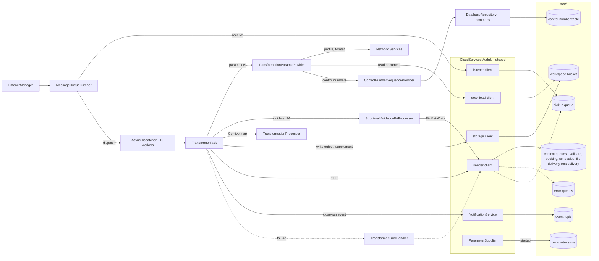
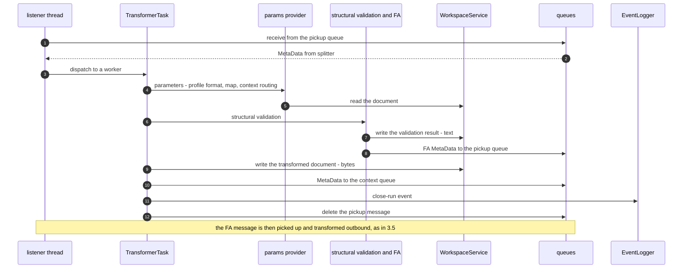
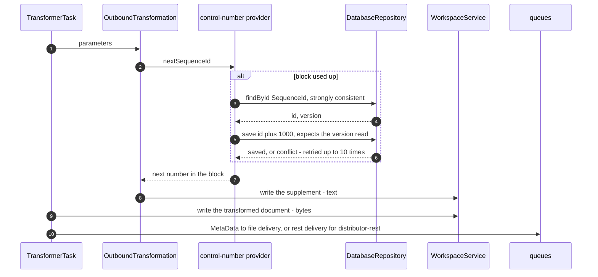

# PR — WI01124532 transformer: cloud-sdk clients, the control-number repository and the shared adapters

Branch `WI01124532-aws-sdk-upgrade-transformer` → `feature/WI01124532-aws-sdk-upgrade` (from `222d58be`, after PR #8) · 13 commits `08efee7d` … `d937538e` · PR: [#9](https://github.com/wtg-e2open/INTTRA.appianway/pull/9)

- **Part 1** is the PR description for GitHub; copy everything between the two `✂` lines.
- **Part 2** is your review guide, for you only. It does not go into the PR.
- **Part 3** walks through transformer from start to shutdown: classes, wiring, one inbound document with FA, one outbound document with control numbers, failures and retries, health checks, `create-table`, shutdown (with diagrams).
- **Part 4** is the command log.

Suggested PR title: `WI01124532 transformer: cloud-sdk clients, control-number repository and shared adapters`

---

## Part 1 — PR description (GitHub)

✂ ------------------------------------------------------------------

## Link to Story/Defect this work relates to

**WI01124532**: AppianWay AWS SDK v1 → v2 upgrade. This PR moves transformer onto the `shared` cloud-sdk adapters and its control-number table onto the commons DynamoDB repository, as #4–#8 did for the earlier services. It is the third service of step 3.

## What/Why I Did the changes

transformer takes each routed document, reads it from the workspace, runs structural validation (and sends a functional acknowledgement, FA, when the partner asked for one), transforms it with its Contivo map (inbound to canonical, outbound from canonical with a supplement carrying control numbers), writes the result to the workspace and sends it to the queue for its context, with a lineage event. It now does this through cloud-sdk (AWS SDK 2.x) instead of AWS SDK v1. Messages, stored objects, events and the control-number item are unchanged.

| | Before (SDK v1) | After (cloud-sdk) |
|---|---|---|
| Clients | `ExternalServicesModule`: `AmazonSQS` ×2, `AmazonS3`, `AmazonSNS`, `AmazonDynamoDB` + `DynamoDBMapper`; `ParameterStoreModule` (SDK v1 SSM) | `ExternalServicesModule` installs `shared` `CloudServicesModule` (parameters as before, pass-through honoured) and binds the commons `DatabaseRepository` for the sequence table |
| Control numbers | `DynamoDBMapper`: consistent scan, versioned save | `DatabaseRepository`: strongly consistent read of the one item by key, versioned save (enhanced client); same item, same optimistic locking |
| Listener, message type | `SQSListener`, SDK v1 `Message` | `MessageQueueListener`, `QueueMessage<String>` |
| Workspace, event publisher, sender | `S3WorkspaceService`, `SNSEventPublisher`, `SQSClient` | `StorageWorkspaceService`, `NotificationEventPublisher`, `MessageQueueClient` |
| Health checks | each built its own default client | run on the service's clients; same names and placement |
| `create-table` | SDK v1 `createTable` (fails if the table exists) | commons `DynamoDbAdminUtil` through `shared`; same table, key and capacity; leaves an existing table as it is |
| AWS SDK CloudWatch metrics | `AwsSdkMetrics` (`AWSSDK_<env>_<component>`) | not carried over |
| Functional tests | JUnit 4, SDK v1 fakes (all `@Ignore`d) | JUnit 5 `CloudFunctionalTestBase`, cloud-sdk fakes |

### Changes

1. **Proof first:** a golden test, written on the v1 code, records everything transformer sends, stores and publishes for eight kinds of input: an inbound document routed to its context queue; an inbound document with an FA (validated, the FA put back on the pickup queue and transformed outbound); an inbound XML booking that fails the schema (FA, then a structural error); inbound and outbound documents whose map is missing; an empty transformation output; an outbound document with a supplement and a control number; an outbound document for distributor-rest. The Contivo mapping is replaced by a predictable stand-in (the maps are not in the repository and the upgrade does not touch them); everything around it is the real code. It passes on cloud-sdk with the same expected files.
2. **Control-number parity on DynamoDB Local:** the new code writes exactly the item v1 writes (`keyId` S, `id` N, `version` N), continues an item v1 wrote and the other way round, continues QA's real item, and rejects a stale version. Old and new builds can share the table during a rolling deploy.
3. The task and the structural-validation processor work on `QueueMessage<String>` and send through `MessageQueueClient`.
4. The control-number item uses the SDK 2.x enhanced-client annotations; the DAO reads it by its key with a strongly consistent read and saves it through the repository (versioned put). A version conflict is still the SDK's `ConditionalCheckFailedException`, retried 10 times as before.
5. `shared` (new code only): the DynamoDB client configuration (v1's defaults: connect 10 s, socket 50 s, no overall call timeout, 50 connections) and a table-creation helper, so transformer itself uses no AWS SDK type.
6. `ExternalServicesModule` installs `CloudServicesModule` and binds the repository; the listener, workspace and event publisher come from the shared module. A test builds the production module with the real clients (no request is sent) and checks every binding.
7. The health checks run on the injected clients, with the same names and placement: the default endpoint has the pickup queue, Network Services and the error rate; the ops endpoint adds the event topic, the workspace write and every routing queue.
8. `create-table` keeps its name, table name (`dynamoDbSequenceTable`), key (`keyId`, S) and capacity (10/10). It now leaves an existing table as it is and returns once the table is active. CI never runs it; it is a manual command.
9. `transformer.yaml`: cloud-sdk logs at WARN, except the one line per client that shows it closing at shutdown.
10. An architecture test fails the build if transformer uses an AWS SDK type (other than the DynamoDB entity annotations and the conflict exception) or a `shared` SDK v1 class.
11. pom: the direct SDK v1 SQS, DynamoDB and CloudWatch metrics dependencies are removed. `structuralvalidator` declared an SDK v1 SQS dependency it never used (no AWS code in the module); it is removed, and with it transformer's SDK v1 BOM.
12. Three existing defects are kept, each with a disabled test asserting the correct behaviour. Each test fails when enabled and passes with a small fix. This PR does not change them, and none of them has been reported.
    - **Control-number retries do not reset** (since March 2019). The provider's conflict-retry counter resets only after a successful save.
      *Functional effect:* after one block reservation uses up its 10 retries (heavy contention between instances), every later reservation in that instance fails at its first conflict until it restarts; those documents fail.
    - **A permanent failure builds the parameters twice** (since May 2018). The error handler builds the transformation parameters again to find the error queue.
      *Functional effect:* the document is read again and an outbound document gets a second supplement and reserves a second control number (a control number is skipped).
    - **Unknown routing ends in a NullPointerException** (since May 2018). When those parameters cannot be built again, the handler fails instead of using the configured error queue.
      *Functional effect:* the message is never handled and is delivered again until the queue's redrive.

### Backward compatibility

- **Same messages, objects and events:** everything sent to each queue, every object written to the workspace and every event published is identical to v1 for the eight golden inputs.
- **Same control-number item:** same attributes, types and values; same optimistic locking (the first write expects no item, later ones the version read). Both builds can run on the same table.
- **Same retry path:** a recoverable failure goes back to the pickup queue with the shared retry setting, then to its dead-letter queue.
- **Same client settings** as the SDK v1 clients, and the same parameter names. One difference: DynamoDB calls are tried 9 times on throttling or a server error (the SDK 2.x DynamoDB default) instead of 11, because the commons repository factory accepts only a retry mode.
- **Same health checks:** names and placement.
- **Same configuration keys.** The only YAML change is the logger lines.
- **No AWS SDK CloudWatch metrics:** dashboards or alarms on the `AWSSDK_<env>_transformer` namespace, if any, get no data.
- **The control-number read:** the one item is read by its key (`SequenceId`), as the provider only ever writes that key. The v1 consistent scan also failed on a second item; that check returns when commons adds a consistent scan.

## Next Steps

- Run the new build locally against QA with the real Contivo maps (booking request and confirmation from the QA traces) and compare with QA's own transformer output.

## Testing Notes

- **Test counts:** transformer ran 665 tests, 5 of them skipped. It now runs **661**, 9 of them skipped:
  - golden (8), DynamoDB Local parity (12), functional (6: retry then success, retries exhausted to the dead-letter queue, content types, empty output, health checks, loggers);
  - architecture (2), production module wiring (2), `create-table` on DynamoDB Local (3);
  - control numbers: DAO (5), item schema, provider;
  - skipped: the 5 real-map functional tests (disabled as before: the Contivo maps are not in the repository), the disabled error-handler test, and the 3 known-defect tests.
- **Removed:** 28 `create-table` tests that built SDK v1 requests without running the command (replaced by 3 on DynamoDB Local); 20 DAO tests on SDK v1 mapper settings (replaced by 5).
- **`shared`:** +7 tests (client settings, client profile with a retry count measured against a local endpoint, table creation against a scripted endpoint, the v1 DynamoDB defaults). **`structuralvalidator`:** pom only, 239 tests unchanged.
- **Test-first:** each behaviour change has a failing test first, then the change.
- **Full reactor build** (`mvn -B clean verify`) at the PR head: BUILD SUCCESS, all 26 modules, 12:31 min.

🤖 Generated with [Claude Code](https://claude.com/claude-code)

✂ ------------------------------------------------------------------

---

## Part 2 — Review guide (for you only, not in the PR)

Labels: **F#** finding, **KD-#** known defect, **D#** decision, **A#** action. Tracker: [docs/tracker/README.md](../../tracker/README.md); step log: [step-3-transformer.md](../../tracker/steps/step-3-transformer.md).

### Commits

| # | Commit | What to look at |
|---|---|---|
| 1 | `08efee7d` test: golden | JUnit 4 on v1 fakes, 8 cases; `StubTransformationProcessor` (`<map>sources</map>`, `MISSING…` not found, `EMPTY…` no bytes), `ValidStructuralValidator`, sequence counting from 100000001000. Own complete properties (the v1 test properties lacked five keys), one worker. Normalized: message ids (also escaped inside events), `timeTakenFor…`, random ids. No retry case: the v1 S3 fake answers a missing key non-recoverably |
| 2 | `1bd64de5` test: DynamoDB Local parity | commons `dynamo-integration-test` (embedded, no Docker); pom copies the SQLite natives to `target/native-libs` (`.dll`, `.so`, `.dylib`, so Linux CI works) |
| 3–4 | `e0c9e95a` / `0c31d589` queue messages | The shared error handler's queue-message path still calls transformer's `createAnnotations` / `getErrorQueue` overrides |
| 5–6 | `ccc79da6` / `346ad490` control numbers | `@DynamoDbVersionAttribute` is in `extensions.annotations` (named in the boundary test). Read by key, not scan (design open issue 2, commons U6). Parity keeps a test-only copy of the v1 DAO and item |
| 7–8 | `bdeb4975` / `45ac9eab` shared | **First shared change here, additive.** `ClientSettings.database()`, `ClientProfile.database()` (no retry mode on purpose, F29: a mode replaces the SDK's DynamoDB policy; measured 9 attempts against a local 500 endpoint), `DatabaseTables` |
| 9–10 | `cfb60fa4` / `bc54e035` wiring | Golden moved to the cloud fakes, wire files untouched (the only diff on the first run was a `ControlNumberGenerators` mock carried from the v1 base, moved to the disabled real-map tests). Recurring failure ends on `sqs_ce_inbound_pu_dlq` after 1 + 5 attempts (shared handler, not the error queue). `@Disabled` is not inherited: on the concrete outbound classes |
| 11 | `b5feb735` build | Your request: structuralvalidator's unused SQS dependency, then the BOM (enforcer upper-bound passes; tree shows one v1 version, 1.12.730) |
| 12 | `7ecca08d` known defects | Three disabled tests (unit ×2, functional ×1), checked both ways (fails enabled; passes with the fix; fixes reverted) |
| 13 | `d937538e` pre-review fixes | `create-table` waits for a table still being created; one DynamoDB client (`createEnhancedRepository`); v1 `AwsSdkMetrics` test removed; `.gitignore` for DynamoDB Local's metadata file |

### Pre-review (2026-11-20)

`code-review` skill, high, on `222d58be..7ecca08d`. 9 points:

| # | Point | Outcome |
|---|---|---|
| 1 | Read by key: the "more than one item" guard is dead, an item under another key invisible | Design open issue 2 / commons U6, accepted; QA has one `SequenceId` item. Other environments to check before cut-over (PROD only with your OK) |
| 2 | `ClientSettings.database()` retry count recorded but not applied | F29, documented; the SDK's DynamoDB policy applies (9 attempts) |
| 3 | SDK CloudWatch metrics removed | D45, your decision; in the PR text |
| 4 | Two DynamoDB clients per repository | **Fixed** (commit 13) |
| 5 | `create-table` returns while an existing table is CREATING | **Fixed** (commit 13), test first |
| 6 | Tests compile on transitive SDK v1 | `AwsSdkMetrics` test **removed**; parity test's v1 side and the ignored `TransformerStressTest` stay until step 5 (action) |
| 7 | `maxConnections` set on the config and the HTTP client | Same as the other `ClientProfile` roles; kept |
| 8 | Default chains resolved twice | As v1 (per client); kept |
| 9 | DynamoDB Local metadata file in the module root | **Fixed** (`.gitignore`) |

### Notes

- **`create-table`** is never run by CI (Jenkins `AppianWay-transformer_Build` log): the tables were created by hand. Commons' `dynamo-create` (booking) was not used: fixed `@Table` name with a validated prefix (CVT's `inttra2_cv_` would be rejected), default 5/5, different command name.
- **Contivo:** `transformer/contivo-lib/` is the engine (local Maven repo), `transformer/lib/maps/` only four FA maps; business maps come from the internal Maven site (CI) or `/app01/maps` on the ECS hosts.
- **Step 5 actions:** port or drop `TransformerStressTest` (ignored, SDK v1 clients) and the parity test's v1 side when `shared` drops SDK v1.

---

## Part 3 — How transformer works: from start to shutdown (after this PR)

### 3.1 The classes

| Class | Kind | Role |
|---|---|---|
| `TransformerApplication` | Dropwizard `Application` | Configuration source, `create-table` command, injector, `ListenerManager`, health checks (default and ops via `HealthCheckRegistrar`) |
| `ExternalServicesModule` | Guice module | `CloudServicesModule(lifecycle, pickup, topic).withParameters(usePassThrough, clientId, clientSecret)`; the sequence `DatabaseRepository`; cached Network Services clients; `AuthClient` (eager); UTC clock; Jersey client |
| `CloudServicesModule` *(shared)* | Guice module | The 4 queue and storage clients (closed on shutdown), `MessageQueueClient`, `WorkspaceService`, `NotificationService` + `EventPublisher`, `ParameterSupplier` |
| `TransformerModule` | Guice module | Configuration, transformations flow, `AsyncDispatcher` (10 workers), Contivo properties, control-number generators, preprocessors, metrics AOP, `MessageQueueListener`, `ListenerManager` |
| `TransformerTask` | `AbstractTask` | One per message: parameters, preprocessing, structural validation and FA, transform, route, close-run event |
| `TransformationParamsProvider` → `InboundTransformation` / `OutboundTransformation` | parameters | Map name, sources, context routing; outbound: supplement with control numbers |
| `StructuralValidationFAProcessor` | processor | Structural validation result to the workspace; FA `MetaData` back to the pickup queue |
| `ControlNumberSequenceProvider` → `ControlNumberSequenceDao` → `DatabaseRepository` | control numbers | Blocks of 1000 from the one `SequenceId` item, versioned save, 10 conflict retries |
| `TransformerErrorHandler` | `ErrorHandler` *(shared)* | Recoverable: back to pickup, then `_dlq`. Permanent: annotations, error queue of the context |
| `DynamoTableCommand` | command | `create-table` through `shared` `DatabaseTables` |

### 3.2 Components



### 3.3 Startup and threads

1. `main` → `run`. With `CONFIG_LOCATION=s3` the YAML is read from storage (`StorageConfigurationProvider`); `ConfigProcessingServerCommand` resolves the placeholders.
2. `Guice.createInjector(ExternalServicesModule, TransformerModule)`. `CloudServicesModule` builds the queue, storage, notification and parameter-store clients; the Network Services credentials are loaded (or used as configured with pass-through); the sequence repository is built (no request yet). `AuthClient` fetches its first token.
3. The control-number provider reserves its first block when first injected (the first task).
4. The `ListenerManager` is registered after the clients, then the health checks. Jetty starts, the listener polls.

Threads: `main`; one **listener** thread (long poll 20 s); up to **10 workers**; Jetty request threads; the shutdown hook.

### 3.4 One inbound document with an FA



### 3.5 One outbound document with control numbers



### 3.6 Outcomes, failures and retries

| Case | Result |
|---|---|
| Success | Output and (outbound) supplement written; `MetaData` to the context's success queue (or `distributorRestQueue`); close-run event; message deleted |
| Recoverable failure (Network Services, storage) | Back to the pickup queue with a delay and `failedAttempts`; after 5 retries to `<pickup>_dlq`; close-run event per attempt |
| Permanent failure (map missing, structural error) | Annotations written; failure `MetaData` to the context's error queue (known defect: parameters built again, KD-13) |
| Structural validation failure | Transformed anyway (canonical JSON), then reported as a permanent failure |

### 3.7 Health checks

| Check | Default `/healthcheck` | Ops `/admin/ops-healthcheck` |
|---|---|---|
| `InboundQueue -> <pickup>` | ✓ | ✓ |
| `HTTP GET -> <Network Services>` | ✓ | ✓ |
| `errorsPerSecondAverage` | ✓ | ✓ |
| `SNS publish -> <topic>` | | ✓ |
| `S3 write -> <workspace>` | | ✓ |
| `OutboundQueue -> <queue>` for every routing success and error queue | | ✓ |

### 3.8 `create-table`

`java -jar transformer.jar create-table transformer.yaml <properties…>`: reads `dynamoDbSequenceTable`, creates it with `keyId` (S) and 10/10 if missing, and returns once the table is active. An existing table, and its item, are left as they are.

### 3.9 Shutdown

Dropwizard stops the `ListenerManager` (no new receives, 20 s drain), then closes the sender, listener and storage clients (`ManagedCloudResource`, logged at INFO). The DynamoDB and notification clients live until the JVM exits, as v1's did.

---

## Part 4 — Command log

Every command, in the order it was used, with what it does. Flags are explained in full in [tracker commands pages](../../tracker/commands/README.md#by-step); `<scratchpad>` is the session's temporary folder.

### 4.1 Review the diff

```bash
git log --reverse --format="%h %s" 222d58be..HEAD        # the 13 commits, oldest first
git diff --stat 222d58be..HEAD | tail -1                 # 62 files changed, insertions/deletions
git diff 08efee7d..HEAD -- transformer/src/test/resources-functional/wire   # expect nothing: golden files written once by v1
grep -rn "com.amazonaws" transformer/src/main            # expect nothing: no SDK v1 in production code
```

### 4.2 Characterize v1 first (commits 1–2)

```bash
# golden test on the v1 code: the expected files were generated once (a temporary write line, then removed),
# then the test was run 4 times against them
JAVA_TOOL_OPTIONS=-Duser.timezone=UTC mvn -B -o -pl transformer clean test -Dtest=TransformerWireCompatibilityTest -Dsurefire.failIfNoSpecifiedTests=false
# parity test on DynamoDB Local (embedded; the pom copies the SQLite native libraries into target/native-libs)
mvn -B -o -pl transformer test -Dtest=ControlNumberSequenceParityTest -Dsurefire.failIfNoSpecifiedTests=false
# QA's sequence item, read once (read-only) to seed the parity test with real values
aws dynamodb scan --table-name inttra2_qa_controlnumber_sequence --profile <qa-profile>
```

### 4.3 Red, then green (commits 3–10)

```bash
# shared first (commits 7-8): its tests, then install it so transformer's -pl build uses it
JAVA_TOOL_OPTIONS=-Duser.timezone=UTC mvn -B -o -pl shared test -Dtest='ClientSettingsTest,ClientProfileTest,V1ClientConfigurationCharacterizationTest,DatabaseTablesTest' -Dsurefire.failIfNoSpecifiedTests=false
JAVA_TOOL_OPTIONS=-Duser.timezone=UTC mvn -B -o -pl shared clean install -Daether.enhancedLocalRepository.trackingFilename=_any.repositories   # 1843 tests
# each red commit: tests + a skeleton that throws; run, check the failures are the expected ones, commit
JAVA_TOOL_OPTIONS=-Duser.timezone=UTC mvn -B -o -pl transformer clean test -Daether.enhancedLocalRepository.trackingFilename=_any.repositories
git add <each file by path> && git commit -q -F - <<'EOF'   # message: "WI01124532 red: ...", body, Co-Authored-By
# each green commit: production change, same run, all green, commit "WI01124532 green: ..."
# failing tests read from the Surefire XML reports (expected vs actual of the golden test saved and diffed)
grep -h -A3 "<error\|<failure" transformer/target/surefire-reports/TEST-<class>.xml
```

### 4.4 Dependencies (commits 10–11)

```bash
mvn -B -o -pl transformer test-compile        # enforcer RequireUpperBoundDeps failed without the SDK v1 BOM: structuralvalidator 1.12.720 vs shared 1.12.730
grep -rl "com.amazonaws" structuralvalidator/src   # expect nothing: the SQS dependency was unused
JAVA_TOOL_OPTIONS=-Duser.timezone=UTC mvn -B -o -pl structuralvalidator clean install -Daether.enhancedLocalRepository.trackingFilename=_any.repositories   # 239 tests
mvn -B -o -q -pl transformer dependency:tree -Dincludes=com.amazonaws -DoutputFile=<scratchpad>/aws-tree.txt
grep -o "com.amazonaws:[^ ]*" <scratchpad>/aws-tree.txt | sort -u   # every SDK v1 artifact at 1.12.730
```

### 4.5 The known defects, checked both ways (commit 12)

```bash
cp <the two defect test files> <scratchpad>/kd/                       # keep the disabled versions
# 1. enable: strip the @Disabled annotations (script), run: all 3 fail for the stated reason
mvn -B -o -pl transformer test -Dtest='TransformerKnownDefects*' -Dsurefire.failIfNoSpecifiedTests=false
# 2. apply the fixes in the working tree only, run the defect tests and the golden test: 3 pass, golden outbound-map-missing differs (it records KD-13)
mvn -B -o -pl transformer test -Dtest='TransformerKnownDefects*,TransformerWireCompatibilityTest' -Dsurefire.failIfNoSpecifiedTests=false
# 3. revert the fixes, restore the disabled tests, check nothing is left
git checkout -- transformer/src/main/java/.../ControlNumberSequenceProvider.java transformer/src/main/java/.../TransformationParamsProvider.java transformer/src/main/java/.../TransformerErrorHandler.java
cp <scratchpad>/kd/*.java <back to their folders>
git status --short | grep -v '^??'                                      # only the two test files
git log --format="%ad %s" --date=short -S"retry = 0" -- transformer/src/main/java/com/inttra/mercury/transformer/controlnumbers   # 2019-03-15
git log --format="%ad %s" --date=short -S"paramsProvider.get(metaData)" -- transformer/src/main/java/com/inttra/mercury/transformer/task/TransformerErrorHandler.java   # 2018-05-08
```

### 4.6 Pre-review and its fixes (commit 13)

```bash
# code-review skill, level high, on 222d58be..7ecca08d; each of the 9 points checked against the code (table in Part 2)
mvn -B -o -q -pl shared test -Dtest=DatabaseTablesTest -Dsurefire.failIfNoSpecifiedTests=false   # red: the two new existing-table tests fail
mvn -B -o -q -pl shared install -DskipTests                                                       # after the fix
JAVA_TOOL_OPTIONS=-Duser.timezone=UTC mvn -B -o -pl transformer clean test -Daether.enhancedLocalRepository.trackingFilename=_any.repositories   # 661, 9 skipped
```

### 4.7 Full build

```bash
git worktree list                                         # the build worktree ../appianway-build
cd ../appianway-build && git checkout -q --detach d937538e
JAVA_TOOL_OPTIONS=-Duser.timezone=UTC mvn -B -o clean verify -Daether.enhancedLocalRepository.trackingFilename=_any.repositories > <scratchpad>/full-build2.log 2>&1
grep -E "FAILURE \[|SUCCESS \[|BUILD|Total time" <scratchpad>/full-build2.log
# d937538e: BUILD SUCCESS, 26 modules, 12:31 min (7ecca08d before the pre-review fixes: SUCCESS, 14:07 min)
```

### 4.8 The PR

```bash
git fetch -q origin feature/WI01124532-aws-sdk-upgrade
git merge-base --is-ancestor origin/feature/WI01124532-aws-sdk-upgrade HEAD && echo up-to-date   # no rebase needed (feature tip 222d58be)
node <scratchpad>/mmd/validate.mjs docs/redesign/pr-details/2026-11-20-apway-pr-3-transformer-description.md   # 3 diagrams parse
git push -u origin WI01124532-aws-sdk-upgrade-transformer
gh pr create --base feature/WI01124532-aws-sdk-upgrade --head WI01124532-aws-sdk-upgrade-transformer --title "<title>" --body-file <scratchpad>/pr-body.md
```
