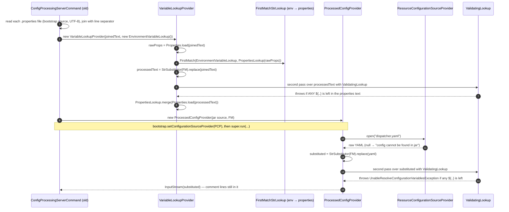
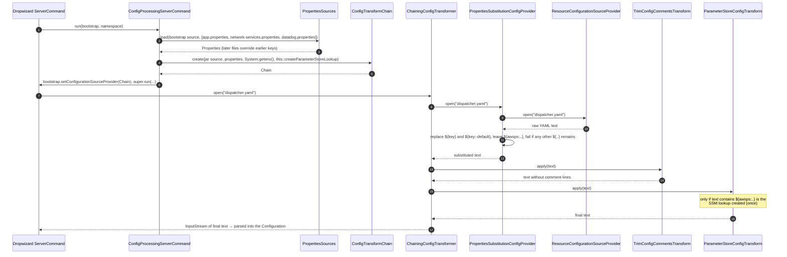
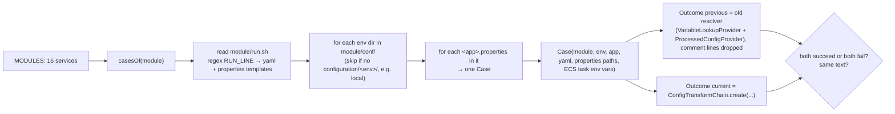
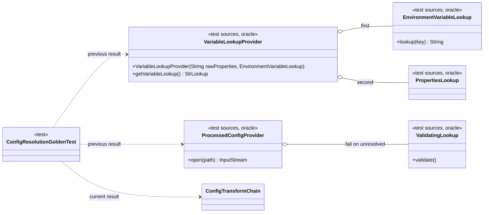

# PR #78 — WI01124532 shared: resolve configuration with the mercury-services-commons chain

Branch `WI01124532-aws-sdk-upgrade-shared-config` → `WI01124532-aws-sdk-upgrade` · 7 commits `7a5393ef` … `bbe0be17`

**Part 1** is the PR description that goes into Bitbucket; copy everything between the two `✂` lines.
**Part 2** walks through the change one commit at a time: the implementation, the tests, how each test is written and what its assertions check, with diagrams. It is for reading the PR; it doesn't go into Bitbucket.

---

## Part 1 — PR description (Bitbucket)

✂ ------------------------------------------------------------------

Step 1b of the WI01124532 AWS SDK upgrade: `shared` resolves service configuration with the mercury-services-commons chain. The resolved configuration is identical to today's, and no service code changes.

Follows #76 (step 1a, merged). Rebased onto `WI01124532-aws-sdk-upgrade` after #76, so this PR shows only the 7 commits of step 1b.

## Changes

1. **`shared` depends on `com.inttra.mercury:commons` 1.0.38** (`7a5393ef` red, `fb2b27de` green). Commons' transitive libraries that AppianWay does not use are excluded so they don't ship in service jars: mysql-connector-java, MyBatis + mybatis-guice, Apache POI, Jest 5.3.3 and aws-signing-request-interceptor, compile-scope junit, dropwizard-db and dropwizard-forms. Ingestor keeps its own Jest 6.3.1.
2. **New `com.inttra.mercury.shared.config.ConfigTransformChain`**: `PropertiesSubstitutionConfigProvider` → `TrimConfigCommentsTransform` → `ParameterStoreConfigTransform`.
   - Environment variables take precedence over properties, `${key:-default}` is supported, and an unresolved placeholder fails startup, including one on a comment line, as today.
   - The commons `ParameterStoreLookup` builds an SSM client in its constructor, so the chain creates it only on the first `${awsps:}` placeholder. No AppianWay config uses one, so no service gets an extra SSM client at startup.
3. **New `com.inttra.mercury.shared.config.PropertiesSources`**: reads the `run` command's properties files through the bootstrap source (file system or S3), as UTF-8 and in command-line order, so later files override earlier ones exactly as before.
4. **`ConfigProcessingServerCommand` uses the chain** (`e2fb7eac` red, `5f8b2e25` green). The class, CLI `run (yaml) (properties...)`, constructors and `configure` are unchanged. A properties read failure is still a `RuntimeException`. New protected hooks: `createConfigurationSourceProvider`, `createParameterStoreLookup`. Its subclasses (ingestor `CreateMappingTemplate` and the `DynamoTableCommand`s) are unaffected.
5. **No-downgrade guard** (`b19955cb` red, `cc60754c` green). A root enforcer `requireUpperBoundDeps` rule covers Guava and AWS SDK v1. Pins raised: `aws-java-sdk` 1.12.720 → 1.12.730 (needed by `cloud-sdk-aws`), Guava 33.1.0-jre → 33.6.0-jre (Dropwizard-managed, at least commons' 33.5.0-jre).
6. **Refactor**: the previous resolver (`config.lookup.*`) moves to test sources, where it stays only as the reference implementation for the golden test.

## Backward compatibility

`ConfigResolutionGoldenTest` has 89 cases: every service YAML × every deployed environment × app variant. Each case rebuilds the real start command from the service's `run.sh` (`run <yaml> ./<app>.properties ./network-services.properties ./datadog.properties`) and the ECS task environment.
- All 85 configurations that resolve today resolve to identical text with the commons chain (comment lines excluded).
- The 4 that fail today still fail: the stress environment of dispatcher, splitter and transformer, whose `configuration/stress/network-services.properties` has no `networkservices.messageRegisterServicePath`. That's an existing gap, left unchanged.
- One deliberate relaxation: the previous resolver also failed on an unresolvable `${...}` in a `.properties` value the YAML never uses (or on a `#` line of a properties file); the commons chain only fails for placeholders the YAML uses. No current configuration is affected (the golden test would show it).

## Tests (new, JUnit 5 + AssertJ)

| Class | Tests |
|---|---|
| `ConfigTransformChainTest` | 10 |
| `PropertiesSourcesTest` | 5 |
| `ConfigResolutionGoldenTest` | 89 cases + 1 coverage check |
| `ConfigProcessingServerCommandSourceTest` | 6 |

Existing tests are unchanged, including the 20 JUnit 4 `ConfigProcessingServerCommandTest` tests.

## Verification

- Full reactor `mvn clean verify`: green.
- Test counts: `shared` 1517 → 1628 (+111 new). Every other module unchanged.
- The enforcer `logback-pair` and `no-downgrade` rules pass in every root-pom module.

🤖 Generated with [Claude Code](https://claude.com/claude-code)

✂ ------------------------------------------------------------------

---

## Part 2 — Walkthrough

### 2.0 How to read along

```bash
git fetch origin
git log --oneline --reverse origin/WI01124532-aws-sdk-upgrade..origin/WI01124532-aws-sdk-upgrade-shared-config
git show 7a5393ef          # one commit: message + full diff
git show 7a5393ef --stat   # only the files it touches
```

| # | Commit | Kind | What it does | Section |
|---|---|---|---|---|
| 1 | `7a5393ef` | red | Tests for the new chain, the properties reader and the golden test; empty skeleton classes | 2.2 |
| 2 | `fb2b27de` | green | `shared` depends on commons; implements `ConfigTransformChain` and `PropertiesSources` | 2.3 |
| 3 | `b19955cb` | red | Root-pom enforcer rule: no module may downgrade Guava or AWS SDK v1 | 2.4 |
| 4 | `cc60754c` | green | Raises the two version pins so the rule passes | 2.4 |
| 5 | `e2fb7eac` | red | Command test + two empty `protected` hooks on `ConfigProcessingServerCommand` | 2.5 |
| 6 | `5f8b2e25` | green | The command uses the chain; the old private code path is deleted | 2.6 |
| 7 | `bbe0be17` | refactor | The old resolver classes move to test sources (golden-test oracle) | 2.7 |

Every "red" commit compiles: new methods exist but throw `UnsupportedOperationException("not implemented")`, so the build fails only when the tests run. This keeps every commit buildable for review and `git bisect`.

### 2.1 Background: what "configuration resolution" is

Every AppianWay service starts with the line in its `run.sh`, for example dispatcher:

```text
java -jar dispatcher.jar run dispatcher.yaml ./dispatcher.properties ./network-services.properties ./datadog.properties
```

`run` is `ConfigProcessingServerCommand`. Before Dropwizard parses the YAML, the command replaces each `${...}` placeholder in it with a value taken from the environment or the `.properties` files. The resulting text is what Dropwizard turns into the configuration object.

```text
dispatcher.yaml (in the jar)          .properties files (disk or S3)        environment (ECS task)
  sqs:                                  sqs.pickupQueue=https://...           DD_ENV=int
    queue: ${sqs.pickupQueue}           componentName=dispatcher
  tags: ${datadog.tags}                 datadog.tags=service:${componentName}
  port: ${server.port:-8081}
  # old: ${removed.key}
              │                                   │                                  │
              └──────────────┬────────────────────┴──────────────────────────────────┘
                             ▼
                 resolve ${...}  (environment first, then properties)
                             ▼
  sqs:
    queue: https://...
  tags: service:dispatcher
  port: 8081
```

The rules (all kept by this PR):

| Rule | Example |
|---|---|
| Environment variable wins over a property of the same name | `${DD_ENV}` from the ECS task even if a `.properties` file defines it |
| A property can reference another property | `datadog.tags=service:${componentName}` |
| Default value | `${server.port:-8081}` → `8081` when `server.port` is undefined |
| Later `.properties` file overrides an earlier one | `network-services.properties` beats `dispatcher.properties` for the same key |
| Any unresolved placeholder fails startup, **even on a comment line** | `# old: ${removed.key}` with no `removed.key` → startup fails |

#### 2.1.1 The previous loader in detail (develop, `shared/.../config/lookup/*`)

The old code used Apache Commons Lang `StrSubstitutor`. Three facts about it explain everything below:

- `substitutor.replace(text)` finds every `${name}` and asks its **lookup** (a `StrLookup`, "give me the value for `name`, or `null`").
- If the lookup returns `null`, the placeholder is **left in the text unchanged** — no error.
- `${name:-default}` uses `default` when the lookup returns `null`, and a value that itself contains `${...}` is resolved again (recursively).

So "fail on unresolved" is not built in; the old code added it with a trick (`ValidatingLookup`, step 5).



Step by step, with a worked example. Files on the command line, in this order:

```properties
# dispatcher.properties
componentName=dispatcher
sqs.pickupQueue=https://sqs/pickup
# network-services.properties
sqs.pickupQueue=https://sqs/override
# datadog.properties
datadog.tags=service:${componentName},env:${DD_ENV}
```

Environment (ECS task): `DD_ENV=int`. YAML in the jar:

```yaml
queue: ${sqs.pickupQueue}
tags: ${datadog.tags}
port: ${server.port:-8081}
# old: ${componentName}
```

| Step | Old code | Result in the example |
|---|---|---|
| 1. Read | `createVarLookupProvider`: open each path through `bootstrap.getConfigurationSourceProvider()` (disk or S3), UTF-8, `Collectors.joining(lineSeparator)`. A read failure → `log.error` + `new RuntimeException(e)` | one text, the three files in order |
| 2. Parse raw | `VariableLookupProvider`: `Properties.load(new StringReader(text))`. Duplicate keys: the last one wins; `#` lines are skipped by the parser | `sqs.pickupQueue=https://sqs/override`; `datadog.tags` still contains `${…}` |
| 3. Build the lookup | `FirstMatchStrLookup(envLookup, propertiesLookup)`: tries `System.getenv(key)` first, then the properties; first non-null wins | `DD_ENV` → `int` from env |
| 4. Resolve the properties text | `StrSubstitutor(firstMatch).replace(wholePropertiesText)` — the **text**, comment lines included | `datadog.tags=service:dispatcher,env:int` |
| 5. Validate the properties | Same substitutor, lookup swapped to `ValidatingLookup`, run again over the result. `ValidatingLookup.lookup` records every key it's asked for and returns `null`. After step 4 the only placeholders left are the unresolvable ones, so "asked for anything" = "something is unresolved" → `UnableResolveConfigurationVariablesException("Unable resolve unresolvedVariables: [..]")` | nothing left → OK |
| 6. Merge | `propertiesLookup.merge(Properties.load(resolvedText))` — the lookup now returns resolved values | `datadog.tags` → `service:dispatcher,env:int` |
| 7. Install | `ProcessedConfigProvider(new ResourceConfigurationSourceProvider(), firstMatch)` set on the bootstrap | — |
| 8. Resolve the YAML | When Dropwizard opens the YAML: read from the classpath, `StrSubstitutor(firstMatch).replace(yaml)` | `queue: https://sqs/override`, `tags: service:dispatcher,env:int`, `port: 8081`, `# old: dispatcher` |
| 9. Validate the YAML | Second pass with `ValidatingLookup` (same trick as step 5) | OK. Had the comment been `# old: ${nope}`, startup would fail here — the old code doesn't know about comments |
| 10. Return | The substituted text, comment lines included; Dropwizard's YAML parser ignores them | — |

#### 2.1.2 How each rule is kept, and which test pins it

| Rule | Old mechanism (step) | New mechanism | Test(s) that would break if it changed |
|---|---|---|---|
| Properties read through the bootstrap source (disk / S3), UTF-8 | step 1 | `PropertiesSources.load` — same code moved | `PropertiesSourcesTest.readsPropertiesAsUtf8`; golden (real files) |
| Files joined with a line separator, later file wins | steps 1–2 | same join, one `Properties.load` | `laterFileOverridesEarlierFile`, `keepsLastLineOfFileWithoutTrailingNewline`, command `laterPropertiesFileOverridesEarlierOne`; golden |
| Environment before properties | step 3 `FirstMatchStrLookup` | commons lookup: `System.getenv` first, then properties (with the passed environment laid over them) | `environmentTakesPrecedenceOverProperties`; golden (ECS task variables) |
| Property referencing another property / env var | steps 4–6 (resolve the text, re-parse) | `StringSubstitutor` resolves values recursively when the YAML asks for them | `resolvesPropertyThatReferencesAnotherProperty`; golden (`datadog.properties` uses `${componentName}`) |
| `${key:-default}` | `StrSubstitutor` default delimiter `:-` | `setValueDelimiter(":-")` | `usesDefaultWhenKeyIsMissing`; command test (`port` default); golden |
| YAML from the jar | step 7 `ResourceConfigurationSourceProvider` | same class as the chain's innermost delegate | command `resolvesClasspathYaml…` |
| Unresolved placeholder in the YAML fails, naming the key | step 9 `ValidatingLookup` | regex post-pass in `PropertiesSubstitutionConfigProvider` → `IllegalStateException` | `unresolvedPlaceholderFailsNamingTheKey`, command `unresolvedPlaceholderFails`; golden "both fail" (stress) |
| …even on a YAML comment line | step 9 runs on the whole text | substitution + validation run **before** `TrimConfigCommentsTransform` | `unresolvedPlaceholderInCommentLineStillFails` |
| Read failure → `RuntimeException` | step 1 | `UncheckedIOException` | `missingPropertiesFileFailsWithRuntimeException`; the 20 existing JUnit 4 `ConfigProcessingServerCommandTest` tests |
| Same final text for every real service config | — | — | `ConfigResolutionGoldenTest`, 89 cases |

**The one difference in strictness (deliberately documented):** in the old code, steps 4–5 substitute and validate the **whole properties text**. So an unresolvable `${...}` anywhere in a `.properties` file — in a value the YAML never uses, or even on a `#` comment line of the properties file — failed startup. The commons chain resolves property values only when the YAML asks for them, so such a placeholder is now ignored. The golden test shows no current AppianWay configuration has one (otherwise "previous fails, current succeeds" would fail the case). Consequence: a broken but **unused** property no longer stops a service; a broken property that **is** used still does.

Other differences, all intended: comment lines are removed from the YAML text (YAML ignores them); `${awsps:/path}` now resolves from SSM instead of failing as unresolved (no configuration uses it); the exception for an unresolved placeholder is `IllegalStateException("Unresolved configuration placeholders: [..]")` instead of `UnableResolveConfigurationVariablesException(...)`.

#### 2.1.3 How the tests make sure nothing breaks — three layers

```text
                ┌───────────────────────────────────────────────────────────┐
  layer 3       │ ConfigResolutionGoldenTest  (89 real cases)               │  "same output as before
  real configs  │   old resolver  ==  new chain   for every service × env    │   for everything we ship"
                └───────────────────────────────────────────────────────────┘
                ┌───────────────────────────────────────────────────────────┐
  layer 2       │ ConfigProcessingServerCommandSourceTest (6)               │  "the command wires the
  wiring        │ + existing JUnit 4 ConfigProcessingServerCommandTest (20) │   chain the same way"
                └───────────────────────────────────────────────────────────┘
                ┌───────────────────────────────────────────────────────────┐
  layer 1       │ ConfigTransformChainTest (10), PropertiesSourcesTest (5)  │  "each rule of 2.1.2,
  rules         │   one small in-memory example per rule                    │   one at a time"
                └───────────────────────────────────────────────────────────┘
```

- **Layer 1** fails with a precise name ("environment no longer wins") when a single rule changes, e.g. after a commons upgrade.
- **Layer 2** proves the real command uses the chain: YAML from the classpath, properties through the bootstrap source, the SSM hook not called, the exception type.
- **Layer 3** is the safety net for what we didn't think of: it runs the old code (kept in test sources only for this, commit 7) and the new code on every real configuration file in the repository and compares the full text. Adding a service or environment adds cases automatically, because they are discovered from `run.sh` and the `conf/` folders.

#### Before and after

```text
BEFORE (develop)                                         AFTER (this PR)
──────────────────────────────────────────────           ───────────────────────────────────────────────────────
ConfigProcessingServerCommand.run                        ConfigProcessingServerCommand.run
  │ private createVarLookupProvider(...)                   │ protected createConfigurationSourceProvider(...)
  │   reads + joins the .properties files                  │   PropertiesSources.load(...)        ← shared, new
  │   VariableLookupProvider (env → properties)            │   ConfigTransformChain.create(...)    ← shared, new
  ▼                                                        ▼
ProcessedConfigProvider (shared)                         ChainingConfigTransformer (commons)
  StrSubstitutor + ValidatingLookup                        ├─ PropertiesSubstitutionConfigProvider (commons)
  ▼                                                        │     ${key}, ${key:-default}, env → properties, fail-fast
ResourceConfigurationSourceProvider (YAML from jar)        ├─ then TrimConfigCommentsTransform (commons)
                                                           │     removes lines starting with '#'
                                                           └─ then ParameterStoreConfigTransform (commons)
                                                                 ${awsps:/path} → SSM (lookup created lazily)
                                                         ▼
                                                         ResourceConfigurationSourceProvider (YAML from jar)
```

#### Class diagram — after this PR

```mermaid
classDiagram
    direction LR
    class ConfigurationSourceProvider {
        <<interface, Dropwizard>>
        +open(String path) InputStream
    }
    class ConfigProcessingServerCommand~T~ {
        <<shared, changed>>
        +run(Bootstrap, Namespace)
        #createConfigurationSourceProvider(ConfigurationSourceProvider propertiesSource, List~String~ paths) ConfigurationSourceProvider
        #createParameterStoreLookup() StringLookup
    }
    class ConfigTransformChain {
        <<shared, new>>
        +create(yamlSource, Properties, Map env, Supplier~StringLookup~)$ ConfigurationSourceProvider
    }
    class PropertiesSources {
        <<shared, new>>
        +load(ConfigurationSourceProvider, List~String~ paths)$ Properties
    }
    class ChainingConfigTransformer {
        <<commons>>
        -delegate: ConfigurationSourceProvider
        -transformationFunction: Function~String,String~
        +open(path) InputStream
    }
    class PropertiesSubstitutionConfigProvider {
        <<commons>>
        -delegate: ConfigurationSourceProvider
        -substitutor: StringSubstitutor
        +open(path) InputStream
    }
    class TrimConfigCommentsTransform {
        <<commons>>
        +apply(String) String
    }
    class ParameterStoreConfigTransform {
        <<commons>>
        +apply(String) String
    }
    class ParameterStoreLookup {
        <<commons>>
        +lookup(String name) String
    }
    class ResourceConfigurationSourceProvider {
        <<Dropwizard>>
    }

    ConfigurationSourceProvider <|.. ChainingConfigTransformer
    ConfigurationSourceProvider <|.. PropertiesSubstitutionConfigProvider
    ConfigurationSourceProvider <|.. ResourceConfigurationSourceProvider
    ConfigProcessingServerCommand ..> PropertiesSources : load properties
    ConfigProcessingServerCommand ..> ConfigTransformChain : create
    ConfigProcessingServerCommand ..> ParameterStoreLookup : creates (lazily)
    ConfigTransformChain ..> ChainingConfigTransformer : builds
    ChainingConfigTransformer o-- PropertiesSubstitutionConfigProvider : delegate
    ChainingConfigTransformer o-- TrimConfigCommentsTransform : function (1st)
    ChainingConfigTransformer o-- ParameterStoreConfigTransform : function (2nd)
    PropertiesSubstitutionConfigProvider o-- ResourceConfigurationSourceProvider : delegate (YAML from jar)
```



Reading the diagram: every box that implements `ConfigurationSourceProvider` has one job, "give me the text of the file at `path`". They are **decorators**: each one asks the provider inside it (its `delegate`) for the text, changes it, and returns the changed text. The outermost one is what Dropwizard calls.

#### Sequence — what happens at startup



The order matters for one rule: placeholders are substituted **before** comment lines are removed. That is why an unresolved `${...}` on a comment line still fails startup, exactly as the old resolver did (it never removed comment lines at all).

### 2.2 Commit 1 — `7a5393ef` red: the chain must resolve configuration like the shared command

**Files:** skeletons `ConfigTransformChain`, `PropertiesSources` (both throw `UnsupportedOperationException`); tests `ConfigTransformChainTest`, `PropertiesSourcesTest`, `ConfigResolutionGoldenTest`.

#### Test syntax primer (applies to every new test in this PR)

| Syntax | Meaning |
|---|---|
| `class XTest { ... }` with no `public` | JUnit 5 (Jupiter) only needs package-private test classes and methods |
| `@Test void name()` | One test. The method name is the sentence describing the behaviour (`environmentTakesPrecedenceOverProperties`) |
| `@ParameterizedTest(name = "{0}")` + `@MethodSource("cases")` | Runs the method once per element returned by the static method `cases()`. `name = "{0}"` names each run after the first argument's `toString()`, so the report shows `dispatcher / int / dispatcher` |
| `assertThat(actual).isEqualTo(expected)` | AssertJ: reads left to right — "assert that actual is equal to expected". On failure it prints both values |
| `assertThatThrownBy(() -> code).isInstanceOf(X.class).hasMessageContaining("k")` | Runs the lambda, expects it to throw, then checks the exception's type and message. Fails if nothing is thrown |
| `.as("description %s", arg)` | Adds a description to the failure message of the assertion that follows it |
| `path -> new ByteArrayInputStream(...)` | A lambda used as a `ConfigurationSourceProvider` (an interface with one method `open(path)`), i.e. a fake file system in memory. No mocking library needed |
| `throws IOException` on a test | A checked exception that escapes the test fails it with that exception |

#### `ConfigTransformChainTest` — 10 tests

All tests go through one helper that runs the full chain on an in-memory YAML string:

```java
private static String resolve(String yaml, Properties properties, Map<String, String> environment,
                              Supplier<StringLookup> parameterStoreLookup) throws IOException {
    ConfigurationSourceProvider yamlSource = path -> new ByteArrayInputStream(yaml.getBytes(UTF_8)); // fake YAML file
    ConfigurationSourceProvider chain = ConfigTransformChain.create(yamlSource, properties, environment, parameterStoreLookup);
    try (InputStream in = chain.open("app.yaml")) {         // what Dropwizard does at startup
        return new String(in.readAllBytes(), UTF_8);         // the resolved text
    }
}
```

Flow of every test: build inputs → `resolve(...)` → assert on the returned text (or on the exception).

`NO_PARAMETER_STORE` is a `Supplier` that throws `AssertionError` when called. Tests that pass it therefore also prove that **no SSM lookup was created**.

| Test | Input | Assertion and why |
|---|---|---|
| `resolvesPlaceholderFromProperties` | `queue: ${sqs.queueUrl}`, property `sqs.queueUrl=https://q` | text is `queue: https://q` |
| `environmentTakesPrecedenceOverProperties` | same key `WI01124532_TEST_ONLY_ENV` in properties and in the environment map | env value wins. The key is invented so a real variable on the build machine can't interfere |
| `usesDefaultWhenKeyIsMissing` | `${server.port:-8081}`, no properties | `port: 8081` |
| `resolvesPropertyThatReferencesAnotherProperty` | `datadog.tags=service:${componentName}`, `componentName=dispatcher` | `tags: service:dispatcher` — the pattern used by every `datadog.properties` |
| `unresolvedPlaceholderFailsNamingTheKey` | `${sqs.missing}`, nothing defines it | throws a `RuntimeException` whose message contains `sqs.missing`, so the startup log names the missing key |
| `unresolvedPlaceholderInCommentLineStillFails` | `# old: ${sqs.missing}` | still throws — same as today (section 2.1) |
| `removesCommentLines` | `a: 1\n  # comment\nb: 2` | `a: 1\nb: 2` — indented comments are removed too (`line.trim().startsWith("#")`) |
| `resolvesParameterStorePlaceholderThroughTheLookup` | `${awsps:/app/secret}`, lookup lambda returning `s3cr3t` for `/app/secret` | `secret: s3cr3t` |
| `doesNotCreateParameterStoreLookupWithoutParameterStorePlaceholder` | `a: ${x}`, `NO_PARAMETER_STORE` | resolves **and** the throwing supplier was never called |
| `createsParameterStoreLookupOnceForSeveralPlaceholders` | two `${awsps:}` placeholders; the supplier counts its calls in an `AtomicInteger` | `assertThat(created).hasValue(1)` — one SSM client, however many placeholders |

#### `PropertiesSourcesTest` — 5 tests

A helper `source(Map<String,String> files)` builds a fake `ConfigurationSourceProvider` from a map *file name → content*; an unknown name throws `FileNotFoundException(path)`, as the real file system or S3 provider would.

| Test | Assertion and why |
|---|---|
| `readsPropertiesAsUtf8` | `city=Zürich` comes back as `Zürich`. `Properties.load(InputStream)` would read ISO-8859-1 and corrupt it; the old command read UTF-8 |
| `laterFileOverridesEarlierFile` | `queue=app` then `queue=network` → `network`; keys only in the first file (`componentName`) are kept |
| `keepsLastLineOfFileWithoutTrailingNewline` | `a=1` and `b=2`, neither ending in a newline → both keys present. Joining the files without a separator would produce `a=1b=2` |
| `noPathsGiveEmptyProperties` | `assertThat(properties).isEmpty()` |
| `missingFileFails` | `IOException` naming `missing.properties` |

#### `ConfigResolutionGoldenTest` — 89 cases + 1 (the backward-compatibility proof)

Idea: run **both** resolvers — the old shared one (the "oracle") and the new commons chain — on every real configuration in the repository, and require identical output.



Key parts of the code:

- `record Case(module, environment, app, yaml, properties, variables)` — one start command. `toString()` returns `module / env / app`, which is the run's name in the report (because of `@ParameterizedTest(name = "{0}")`).
- `RUN_LINE = "\\.jar run (\\S+\\.yaml)((?: \\S+\\.properties)+)"` — reads the real command from `run.sh`, so the test uses each service's real list and order of properties files. Group 1 is the YAML, group 2 the properties list. `${app}` in them is replaced by the app variant (splitter has `splitter` and `ce-splitter`, transformer `transformer`, `ce-…`, `os-…`).
- The app's own `.properties` comes from `<module>/conf/<env>/`, the shared ones (`network-services`, `datadog`) from `configuration/<env>/` — the same files the build script packs into the image.
- `taskEnvironment(envDir, app)` reads the `environment` array of the ECS task JSON `<app>-latest-*-Task.json` with Jackson, so variables set only in ECS are part of the case.
- `record Outcome(config, failure)` + `Outcome.of(...)` — runs one resolver and captures **either** the text **or** the exception as `"ClassName: message"`, so a failure doesn't abort the test before it is compared.

The test method:

```java
Outcome previous = Outcome.of(() -> withoutCommentLines(resolveWithPreviousCommand(c)));
Outcome current  = Outcome.of(() -> resolveWithCommonsChain(c));

assertThat(current.failure() == null)                                   // 1) both succeed or both fail
        .as("both resolve or both fail; previous=%s, current=%s", previous.failure(), current.failure())
        .isEqualTo(previous.failure() == null);
assertThat(current.config()).as("resolved configuration").isEqualTo(previous.config()); // 2) same text (both null if both failed)
```

- Assertion 1 compares two booleans ("did it succeed?"). The `.as(...)` text puts both error messages in the report when they disagree.
- Assertion 2 compares the full resolved text. `withoutCommentLines` is applied to the old output only, because the new chain removes comment lines and the old one kept them; YAML ignores comments, so this is the one intended difference.
- `resolveWithPreviousCommand` uses an anonymous subclass of the old `EnvironmentVariableLookup` that answers from the real process environment first and the case's ECS variables second. The new chain gets the same two layers: commons reads the process environment first, and `ConfigTransformChain` puts the ECS variables over the properties (section 2.3).
- `NO_PARAMETER_STORE` throws if any configuration contains `${awsps:...}` — proving none do.

`everyModuleHasAtLeastOneCase` guards the guard: `containsExactlyInAnyOrderElementsOf(MODULES)` fails if a module's `conf/` layout changes so that it silently produces no case.

**Red result:** the 85 golden cases that resolve today and all 15 unit tests fail on the skeletons. The 4 stress cases already fail in both resolvers (missing `networkservices.messageRegisterServicePath` in `configuration/stress/network-services.properties`), so they "pass" as *both fail*.

### 2.3 Commit 2 — `fb2b27de` green: `shared` builds configuration with the commons chain classes

#### `shared/pom.xml`

Adds `com.inttra.mercury:commons` (version from the root pom, set in #76) with 10 exclusions. Commons brings libraries for features AppianWay doesn't use; excluding them keeps them out of every service jar:

| Excluded | Why |
|---|---|
| `mysql-connector-java`, `mybatis`, `mybatis-guice`, `dropwizard-db` | commons' database support; AppianWay has no SQL database |
| `poi`, `poi-ooxml` | Excel support |
| `jest`, `aws-signing-request-interceptor` | commons declares Jest 5.3.3; ingestor declares its own Jest 6.3.1 and signer |
| `junit:junit` | declared at *compile* scope in commons; it must not reach production jars |
| `dropwizard-forms` | multipart forms, unused |

The comment in the pom says to re-check the list when the commons version changes.

#### `ConfigTransformChain.create(...)`

```java
public static ConfigurationSourceProvider create(ConfigurationSourceProvider yamlSource, Properties properties,
                                                 Map<String, String> environment,
                                                 Supplier<StringLookup> parameterStoreLookup) {
    Properties variables = new Properties();          // (1)
    variables.putAll(properties);
    variables.putAll(environment);

    Supplier<StringLookup> lazyLookup = Suppliers.memoize(parameterStoreLookup::get);   // (2)
    StringLookup parameterStore = key -> lazyLookup.get().lookup(key);

    return new ChainingConfigTransformer(                                                // (3)
            new PropertiesSubstitutionConfigProvider(yamlSource, variables),
            new TrimConfigCommentsTransform().andThen(new ParameterStoreConfigTransform(parameterStore)));
}
```

1. **Precedence.** `putAll(environment)` after `putAll(properties)` lets an environment entry replace a property of the same name. Inside commons, `PropertiesSubstitutionConfigProvider` additionally asks `System.getenv(key)` first. So the order is: real process environment → `environment` argument → properties. In production the argument *is* `System.getenv()`, so this is "environment, then properties", as before. In tests the argument lets a test supply variables without touching the real environment.
2. **Lazy SSM lookup.** `Suppliers.memoize` (Guava) wraps the supplier so the first `get()` calls it and later calls return the same object. `parameterStore` is a `StringLookup` lambda that calls `lazyLookup.get()` only when a `${awsps:...}` is actually looked up. `ParameterStoreConfigTransform` only calls its lookup for `${awsps:` placeholders, so without one, nothing is created. This matters because the commons `ParameterStoreLookup()` constructor builds an SSM client immediately (decision D9).
3. **The chain.** `ChainingConfigTransformer(delegate, function)`: `open(path)` reads the delegate's text and applies `function`. `a.andThen(b)` is plain `java.util.function.Function` composition: first `a`, then `b`. So the order is substitution (inside the delegate) → trim comments → Parameter Store.

What the commons classes do (read from commons 1.0.38 sources):

| Commons class | Behaviour |
|---|---|
| `PropertiesSubstitutionConfigProvider` | Apache `StringSubstitutor` with delimiter `:-` for defaults. Lookup: if the key starts with `awsps:` → `null` (left for later); else `System.getenv(key)`; else the properties. Values are resolved recursively (`${componentName}` inside a property value). Undefined variables are left as text, then a post-pass regex `\$\{([^}]*)}` finds any remaining non-`awsps:` placeholder and throws `IllegalStateException("Unresolved configuration placeholders: [..]")` |
| `TrimConfigCommentsTransform` | Keeps lines where `!line.trim().startsWith("#")`, joined with `\n` |
| `ParameterStoreConfigTransform` | `StringSubstitutor` with prefix `${awsps:` and suffix `}`; each key goes to the given `StringLookup` |
| `ParameterStoreLookup()` | SSM client for us-east-1 with default credentials; `lookup(name)` throws if the parameter doesn't exist |

One visible difference: the old resolver threw `UnableResolveConfigurationVariablesException("Unable resolve unresolvedVariables: [..]")`; the new one throws `IllegalStateException("Unresolved configuration placeholders: [..]")`. Both are `RuntimeException`s that stop startup and name the keys; nothing catches either type.

#### `PropertiesSources.load(...)`

```java
StringBuilder joined = new StringBuilder();
for (String path : paths) {
    if (!joined.isEmpty()) {
        joined.append(System.lineSeparator());        // never glue the last line of one file to the next
    }
    try (InputStream in = source.open(path)) {        // file system or S3, as configured by the bootstrap
        joined.append(new String(in.readAllBytes(), StandardCharsets.UTF_8));
    }
}
Properties properties = new Properties();
properties.load(new StringReader(joined.toString())); // Reader → no ISO-8859-1 decoding
return properties;
```

This is the old private `createVarLookupProvider` reading logic, moved into a small public class so it can be tested on its own. Joining first and parsing once gives "later file wins", because `Properties.load` overwrites a key each time it meets it.

**Green result:** golden 90/90, unit tests 15/15; full reactor green (13:04 min); test counts unchanged except `shared` +105.

### 2.4 Commits 3–4 — `b19955cb` red / `cc60754c` green: no-downgrade guard

**Problem.** Maven picks *one* version of each library per module. A version pinned in AppianWay's root pom wins over the version a dependency (commons, cloud-sdk) asked for, even if it is older. A silent downgrade can break commons at runtime (`NoSuchMethodError`) without failing any compile.

**Red (`b19955cb`)** adds a second execution of the root `maven-enforcer-plugin`:

```xml
<execution>
    <id>no-downgrade</id>
    <goals><goal>enforce</goal></goals>
    <configuration>
        <rules>
            <requireUpperBoundDeps>
                <includes>
                    <include>com.google.guava:guava</include>
                    <include>com.amazonaws:aws-java-sdk-core</include>
                    <include>com.amazonaws:aws-java-sdk-s3</include>
                    <include>com.amazonaws:aws-java-sdk-sqs</include>
                    <include>com.amazonaws:aws-java-sdk-sns</include>
                </includes>
            </requireUpperBoundDeps>
        </rules>
    </configuration>
</execution>
```

`requireUpperBoundDeps` walks the module's dependency tree. For each listed library it collects every version requested anywhere in the tree and fails the build if the version actually chosen is lower than the highest one requested. `includes` limits the check to these five, because the whole tree has many harmless differences.

```text
shared
├── aws-java-sdk-sqs 1.12.720      ← chosen (root pom pin)
└── cloud-sdk-aws
    └── aws-java-sdk-core 1.12.730 ← requested by a dependency  ⇒ 1.12.720 < 1.12.730 ⇒ FAIL
```

This is a "red" without a Java test: the failing check is the enforcer itself, at the `validate` phase, before anything compiles.

**Green (`cc60754c`)** raises the two root-pom properties:

| Property | Before | After | Note |
|---|---|---|---|
| `aws-java-sdk.version` | 1.12.720 | 1.12.730 | the version cloud-sdk-aws needs |
| `google-guava.version` | 33.1.0-jre | 33.6.0-jre | the Dropwizard-managed version, at least commons' 33.5.0-jre; dispatcher and ingestor had 33.1.0 |

**Green result:** enforcer passes in every root-pom module; full reactor green (8:39 min); test counts unchanged.

### 2.5 Commit 5 — `e2fb7eac` red: the command must build its source with the commons chain

**Production change (skeleton only):** two `protected` hooks on `ConfigProcessingServerCommand`, both throwing `UnsupportedOperationException`:

| Hook | Purpose |
|---|---|
| `createConfigurationSourceProvider(propertiesSource, propertiesPaths)` | Returns the provider that `run` installs. `protected` so the test can call it without starting a server |
| `createParameterStoreLookup()` | Creates the SSM lookup. `protected` so a test (or a subclass) can replace it |

**Test resource** `shared/src/test/resources/wi01124532/command-source-test.yaml`:

```yaml
# configuration used by ConfigProcessingServerCommandSourceTest
name: ${app.name}
port: ${server.port:-8081}
```

It's on the test classpath because in production the YAML is read from the jar (`ResourceConfigurationSourceProvider` = classpath).

#### `ConfigProcessingServerCommandSourceTest` — 6 tests

```java
private final Application<Configuration> application = new Application<>() {
    @Override
    public void run(Configuration configuration, Environment environment) { }   // never started
};
```

`ConfigProcessingServerCommand` needs an `Application` in its constructor. This anonymous class is the smallest possible one; nothing in the test starts it.

Helper (flow of every test):

```java
ConfigurationSourceProvider propertiesSource = path -> { ...in-memory files, FileNotFoundException if absent... };
ConfigurationSourceProvider source = command.createConfigurationSourceProvider(propertiesSource, propertiesPaths); // what run() installs
try (InputStream in = source.open(YAML)) { return new String(in.readAllBytes(), UTF_8); }                          // what Dropwizard reads
```

| Test | Assertion and why |
|---|---|
| `resolvesClasspathYamlWithPropertiesAndRemovesCommentLines` | `isEqualTo("name: dispatcher\nport: 8081")` — the YAML came from the classpath, `${app.name}` from properties, the default applied, the comment line removed |
| `laterPropertiesFileOverridesEarlierOne` | `startsWith("name: splitter")` — the command passes the paths in command-line order |
| `doesNotCreateParameterStoreLookupWithoutParameterStorePlaceholder` | Anonymous **subclass** of the command overrides `createParameterStoreLookup()` to throw `AssertionError`; resolution still succeeds, so the hook was never called. It also shows how a subclass can replace the hook |
| `unresolvedPlaceholderFails` | no `app.name` → `RuntimeException` mentioning `app.name` |
| `missingPropertiesFileFails` | (red version) expects an `IOException` naming the file — tightened in commit 6 |
| `keepsCommandNameAndConstructors` | `getName()` is `run` for the 1-arg constructor and the given name for the 3-arg one (used by ingestor's `create-mapping-template` and the `DynamoTableCommand`s) |

**Red result:** 5 of 6 fail on the stub hooks (`keepsCommandNameAndConstructors` passes: it doesn't touch the hooks).

### 2.6 Commit 6 — `5f8b2e25` green: the command resolves configuration with the commons chain

```diff
 public void run(Bootstrap<?> bootstrap, Namespace namespace) throws Exception {
     final List<String> properties = requireNonNull(namespace.getList(PROPERTIES_PARAMS), "Properties file parameter is required");
-    VariableLookupProvider variableLookupProvider = createVarLookupProvider(bootstrap.getConfigurationSourceProvider(), properties);
-    ProcessedConfigProvider processedConfigProvider = new ProcessedConfigProvider(new ResourceConfigurationSourceProvider(), variableLookupProvider.getVariableLookup());
-    bootstrap.setConfigurationSourceProvider(processedConfigProvider);
+    bootstrap.setConfigurationSourceProvider(createConfigurationSourceProvider(bootstrap.getConfigurationSourceProvider(), properties));
     super.run(bootstrap, namespace);
 }
```

`bootstrap.getConfigurationSourceProvider()` is whatever the service's `initialize` set up — the file system by default, or `S3ConfigurationProvider` when `CONFIG_LOCATION` says S3. It's used only to read the `.properties` files; the YAML always comes from the jar. Both points are the same as before.

```java
protected ConfigurationSourceProvider createConfigurationSourceProvider(ConfigurationSourceProvider propertiesSource,
                                                                        List<String> propertiesPaths) {
    try {
        return ConfigTransformChain.create(new ResourceConfigurationSourceProvider(),               // YAML from the jar
                PropertiesSources.load(propertiesSource, propertiesPaths),                           // .properties, in order
                System.getenv(),                                                                     // environment
                this::createParameterStoreLookup);                                                   // lazy SSM lookup
    } catch (IOException e) {
        log.error("Error reading config " + propertiesPaths + ":", e);
        throw new UncheckedIOException(e);
    }
}

protected StringLookup createParameterStoreLookup() {
    return new ParameterStoreLookup();
}
```

- `this::createParameterStoreLookup` is a method reference used as `Supplier<StringLookup>`: it isn't called here, only handed over, and the chain calls it on the first `${awsps:}` (section 2.3, point 2).
- **Exception contract.** The old code wrapped a read failure in `new RuntimeException(e)` inside a stream lambda, and the existing JUnit 4 tests (`testRunWithIOException…`) expect a `RuntimeException`. `UncheckedIOException` *is* a `RuntimeException`, so those 20 tests pass unchanged. The method no longer declares `throws IOException`.
- Deleted: the private `createVarLookupProvider` and `streamToString` — the old reading code, now in `PropertiesSources`.

**Test change in the same commit** — the red test expected the wrong type; the green one states the real contract:

```java
@Test
void missingPropertiesFileFailsWithRuntimeException() {
    // Same contract as the previous command: the read failure is wrapped in a RuntimeException.
    assertThatThrownBy(() -> resolve(..., Map.of(), List.of("missing.properties")))
            .isInstanceOf(RuntimeException.class)          // what callers see
            .hasRootCauseInstanceOf(IOException.class)     // the original failure is kept as the cause
            .hasMessageContaining("missing.properties");    // and the file is named
}
```

`hasRootCauseInstanceOf` follows `getCause()` to the end of the chain and checks that exception's type.

Subclasses — ingestor `CreateMappingTemplate` and the three `DynamoTableCommand`s — only call the constructors, so they are unaffected.

**Green result:** command tests 6/6, existing JUnit 4 command tests 20/20, golden 90/90; full reactor green (7:42 min); `shared` +6.

### 2.7 Commit 7 — `bbe0be17` refactor: the previous resolver stays only as the golden-test oracle

After commit 6 nothing in production uses `com.inttra.mercury.shared.config.lookup.*`, but the golden test needs it as the reference. The five classes move from `src/main/java` to `src/test/java`, same package (`git mv`, 0 changed lines, so `git log --follow` keeps their history), plus a `package-info.java` stating that role. They are no longer in the `shared` jar.



How the old resolver worked, for comparison: `VariableLookupProvider` parsed the joined properties, built a first-match lookup *environment → properties*, substituted the properties text with it (resolving `${componentName}` inside values), validated, and re-parsed. `ProcessedConfigProvider` then substituted the YAML with that lookup and ran a second pass with `ValidatingLookup`, which records every key still unresolved and throws if there is any.

**Result:** full reactor green (7:38 min), counts unchanged. After the rebase onto the feature branch the code tree is identical to this build (`git rev-parse <commit>^{tree}`).

### 2.8 Things a reviewer may ask

| Question | Answer |
|---|---|
| Is the resolved configuration really identical? | Yes for all 85 configurations that resolve today: `ConfigResolutionGoldenTest` compares the full text per service × environment × app variant. The 4 stress cases fail in both |
| Any extra AWS call at startup? | No. The SSM client is created only for `${awsps:}`, which no AppianWay configuration uses (the golden test would fail if one did) |
| Why remove comment lines now? | That's how the commons chain works; YAML ignores comments, so Dropwizard parses the same configuration. Placeholders on comment lines are still validated, as before |
| Why keep the old classes at all? | They are the oracle for the golden test. They can be deleted together with the test once the upgrade is released |
| Different exception for an unresolved placeholder? | Type and text differ (`IllegalStateException`, "Unresolved configuration placeholders: […]"); both stop startup and name the keys; nothing catches either type |
| Do services change? | No. Same command, same CLI, same constructors; services pick the change up through `shared` |
| Is anything less strict now? | Yes, one thing (section 2.1.2): an unresolvable placeholder in a `.properties` value that the YAML never uses no longer fails startup. A used one still does |

---

## Appendix A — Java and JUnit 5 syntax refresher (as used in these tests)

### A.1 `record` (Java 16+)

```java
record Case(String module, String environment, String app, Path yaml, List<Path> properties,
            Map<String, String> variables) {
    @Override
    public String toString() {
        return module + " / " + environment + " / " + app;
    }
}
```

A `record` is a class whose only job is to carry data. From the one header line the compiler generates:

| Generated | For `Case` |
|---|---|
| `private final` fields | `module`, `environment`, … |
| a constructor with all of them, in order | `new Case(module, env, app, yaml, props, vars)` |
| accessors **without** `get` | `c.module()`, `c.yaml()` — not `getModule()` |
| `equals` / `hashCode` over all fields | two cases with the same values are equal |
| `toString` | `Case[module=…, environment=…, …]` — overridden here to get short test names |

You can add methods (like `toString` above, or the static factory `Outcome.of` below) but not extra instance fields. Records declared inside a class are implicitly `static`. Equivalent pre-Java-16 code would be ~40 lines of fields, constructor, getters, `equals`, `hashCode`.

```java
record Outcome(String config, String failure) {
    static Outcome of(Callable callable) {
        try {
            return new Outcome(callable.call(), null);                                     // success: text, no failure
        } catch (Exception e) {
            return new Outcome(null, e.getClass().getSimpleName() + ": " + e.getMessage()); // failure captured as data
        }
    }
}
```

`Outcome` turns "it threw" into a value, so the test can compare two runs even when one of them failed.

### A.2 A small functional interface of our own

```java
interface Callable {
    String call() throws Exception;
}
```

An interface with exactly one abstract method can be implemented by a lambda: `() -> resolveWithCommonsChain(c)`. It is declared here instead of using `java.util.concurrent.Callable<String>` only to keep the test self-contained; `Supplier<String>` would not do, because `Supplier.get()` can't throw checked exceptions like `IOException`.

### A.3 Lambdas and method references as interface implementations

| Code | What it is |
|---|---|
| `path -> new ByteArrayInputStream(bytes)` | implements `ConfigurationSourceProvider.open(String path)` — a fake file system |
| `key -> "/app/secret".equals(key) ? "s3cr3t" : null` | implements `StringLookup.lookup(String key)` — a fake Parameter Store |
| `() -> { throw new AssertionError("..."); }` | a `Supplier` that fails the test if anyone calls it — used to prove something is **not** created |
| `this::createParameterStoreLookup` | method reference: "call this method later"; passed as `Supplier<StringLookup>`, not called yet |
| `parameterStoreLookup::get` | method reference to the `get` of another supplier |
| `ConfigResolutionGoldenTest::casesOf` | static method reference, used in `flatMap` |

These replace a mocking library: the fakes are a few characters long and behave exactly as written.

### A.4 Anonymous classes

```java
new Application<>() {                                   // an unnamed subclass of the abstract Application
    @Override
    public void run(Configuration configuration, Environment environment) { }
};

new ConfigProcessingServerCommand<>(application) {      // an unnamed subclass that replaces one hook
    @Override
    protected StringLookup createParameterStoreLookup() {
        throw new AssertionError("parameter store lookup must not be created");
    }
};
```

Used when you need to override a method of a **class** (a lambda only works for an interface with one method). `<>` lets the compiler infer the generic type (allowed for anonymous classes since Java 9).

### A.5 Streams used in the golden test

```java
MODULES.stream().flatMap(ConfigResolutionGoldenTest::casesOf)   // each module → a Stream<Case>; flatMap joins them into one stream
c.properties().stream().map(Path::toString).toList()            // Path → String; toList() (Java 16) gives an unmodifiable List
...collect(Collectors.joining(System.lineSeparator()))          // strings joined with a separator
config.lines().filter(line -> !line.trim().startsWith("#"))      // String.lines() splits on \n, \r\n or \r
cases().map(Case::module).distinct()                            // the set of modules that produced at least one case
```

### A.6 try-with-resources

```java
try (InputStream in = chain.open("app.yaml")) {
    return new String(in.readAllBytes(), StandardCharsets.UTF_8);
}
```

Anything `AutoCloseable` declared in `try (...)` is closed automatically when the block ends, also on an exception. `readAllBytes()` (Java 9) reads the whole stream.

### A.7 Pattern matching `instanceof` (Java 16+; used in step 1c, shown for completeness)

```java
if (failure instanceof CloudSdkException cloudSdkFailure) {
    cloudSdkFailure.isRetryable();   // already cast — no (CloudSdkException) failure needed
}
```

### A.8 JUnit 5 (Jupiter) basics

| Element | Meaning |
|---|---|
| `org.junit.jupiter.api.Test` | JUnit 5 `@Test` (JUnit 4's is `org.junit.Test`; both run here — Jupiter for new tests, the Vintage engine for old ones, set up in #76) |
| no `public` | Jupiter finds package-private classes and methods |
| no `@Rule`, no `@RunWith` | Jupiter uses extensions instead; none needed here |
| a new instance per test method | fields like `private final Application<Configuration> application = …` are fresh for every test |
| `throws IOException` on the method | allowed; an exception that escapes fails the test and shows its stack trace |

### A.9 Parameterized tests

```java
static Stream<Case> cases() {                       // (1) the data: one element per run
    return MODULES.stream().flatMap(ConfigResolutionGoldenTest::casesOf);
}

@ParameterizedTest(name = "{0}")                    // (3) display name of each run = argument 0's toString()
@MethodSource("cases")                              // (2) where the data comes from: a static method of this class
void commonsChainResolvesTheSameConfigurationAsThePreviousSharedCommand(Case c) {   // (4) one run per element
    ...
}
```

1. The source method is `static`, has no parameters, and returns a `Stream`, `Iterable` or array.
2. `@MethodSource("cases")` names it. Without a name, JUnit looks for a method with the same name as the test.
3. `name = "{0}"`: placeholders `{0}`, `{1}`… are the arguments; `{index}` is the run number. The report then shows `dispatcher / int / dispatcher` instead of `[1] Case[module=...]`.
4. Each element becomes one independent test: one failing case doesn't stop the others, and the report lists every case separately.

With **several** arguments per run, the source returns `Stream<Arguments>`:

```java
static Stream<Arguments> cloudSdkFailures() {
    return Stream.of(
            Arguments.of("SQS", new MessagingException("receive failed", ...)),   // run 1: role="SQS", failure=...
            Arguments.of("SNS", new NotificationException("publish failed", ...)));
}

@ParameterizedTest(name = "{0}")
@MethodSource("cloudSdkFailures")
void cloudSdkFailureIsRecognised(String role, RuntimeException failure) { ... }   // arguments in the same order
```

The same source can feed several test methods. Other sources exist (`@ValueSource(strings = {...})`, `@CsvSource`, `@EnumSource`), but `@MethodSource` is the one to use when the arguments are objects.

### A.10 AssertJ

Every assertion starts with `assertThat(actual)` and chains checks that read as English. The available checks depend on the type of `actual` (IDE completion lists them).

| Assertion | Passes when |
|---|---|
| `assertThat(text).isEqualTo("a: 1")` | `text.equals("a: 1")` |
| `assertThat(text).startsWith("name: x")` | prefix match |
| `assertThat(properties).containsEntry("a", "1").containsEntry("b", "2")` | map / `Properties` has those entries (chained = all must hold) |
| `assertThat(properties).isEmpty()` | no entries |
| `assertThat(counter).hasValue(1)` | `AtomicInteger` currently holds 1 |
| `assertThat(stream).containsExactlyInAnyOrderElementsOf(list)` | same elements, any order, nothing extra, nothing missing |
| `assertThat(mapped).isSameAs(failure)` | the **same object** (`==`), not just equal |
| `assertThat(mapped).isExactlyInstanceOf(RecoverableException.class)` | that class exactly, not a subclass |
| `assertThat(flag).as("both resolve or both fail; previous=%s", x).isEqualTo(other)` | `as(...)` comes **before** the check and only changes the failure message |

Exceptions:

```java
assertThatThrownBy(() -> resolve("queue: ${sqs.missing}", new Properties(), Map.of()))   // run this; it must throw
        .isInstanceOf(RuntimeException.class)          // type, or a subclass of it
        .hasRootCauseInstanceOf(IOException.class)     // the last exception in the getCause() chain
        .hasMessageContaining("sqs.missing");          // part of the message
```

If the lambda does **not** throw, the assertion fails with "Expecting code to raise a throwable".

### A.11 Guava `Suppliers.memoize`

```java
Supplier<StringLookup> lazyLookup = Suppliers.memoize(parameterStoreLookup::get);
```

Returns a supplier that calls the original only on the first `get()` and returns that same object afterwards (thread-safe). Used so the SSM client is created at most once, and only if needed. `createsParameterStoreLookupOnceForSeveralPlaceholders` proves the "once"; `doesNotCreateParameterStoreLookupWithoutParameterStorePlaceholder` proves the "only if needed".
