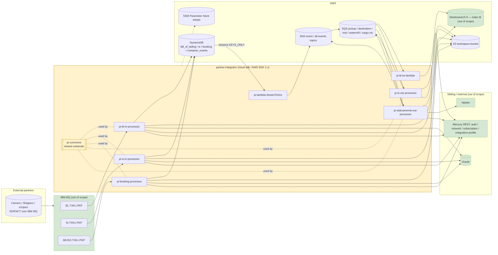

# partner-integrator — AWS SDK 2.x (cloud-sdk) Upgrade Summary, Business Flows & QA Regression Guide

**Date:** 2026-09-02
**Suite:** `partner-integrator` ("PI") — `pi-commons` (shared library) + `pi-bl-in-processor` + `pi-si-in-processor` + `pi-booking-processor` + `pi-si-out-processor` + `pi-statusevents-out-processor` + `pi-lambda-streamToSns` + `pi-bl-es-lambda`
**Jira:** ION-16417 (AWS SDK 1.x → 2.x cloud-sdk upgrade). PR #1200. Confluence pageId 672221381.
**Code state documented:** `feature/ION-16417-pi-owasp-issue-fix` @ `fc97551fae` (PI head) — `commons` / `cloud-sdk-api` / `cloud-sdk-aws` **`1.0.33-SNAPSHOT`**, model pins `booking 3.0.0.M`, `visibility 2.0.M`, `shipping-instruction 2.0.M`, AWS SDK **2.x** over Apache HTTP.

> **Why this document exists.** The design, refactor and PR-fix docs in this folder each capture one slice of the
> upgrade at one point in time. This document consolidates them against the **current** code, states what actually
> changed per sub-module, what did **not**, and — the part QA needs — exactly which AWS touchpoints must be
> regression-tested to prove the SDK swap introduced no functional regression.
>
> **How to read it.** §1–§3 are suite-wide. §5–§12 are the eight per-sub-module sections (starting with the shared
> substrate `pi-commons`, where most of the change lives); **each has its own *Business & functional flow*, *AWS touchpoints*,
> *Upgrade impact*, and *QA regression (high level + detailed)* sub-sections**. §13 collects the two cross-cutting
> known issues (the BL "all-versions" GSI read and the `pi-bl-es-lambda` SigV4 packaging pin). §14 is the suite-level
> QA regression summary.

**Companion documents**

| Document | What it holds |
|---|---|
| `docs/2026-06-30-partner-integrator-current-state-DESIGN-claude.md` | Pre-upgrade (AWS SDK v1) baseline for the whole suite |
| `docs/2026-06-30-partner-integrator-aws2x-DESIGN-claude.md` | Target cloud-sdk design / suite-wide playbook |
| `docs/2026-0731-pi-aws-upgrade-design.md` | Detailed per-sub-module upgrade design |
| `docs/2026-08-20-pi-awsupgrade-refactoring.md` | The refactoring pass toward cloud-sdk |
| `docs/2026-08-21-pi-awsupgrade-confluence-design.md` | Confluence design doc (requirements, LLD, risks) |
| `docs/2026-08-29-pibl-es-lambda-build-issue.md` | `pi-bl-es-lambda` package-size / SigV4 build investigation |
| `docs/2026-0825-pi-refactor-pr-fix.md` | PR #1200 review handling |
| `docs/2026-09-02-pi-aws-upgrade-owasp-refactor.md` | OWASP / dependency hardening on top of the upgrade |

---

## 1. Executive summary — what the AWS upgrade actually is

`partner-integrator` is the **EDI / partner B2B integration platform** bridging the INTTRA Ocean Logistics network and
external trading partners (carriers, shippers, forwarders, e2open) for three document domains — **Bill of Lading (BL)**,
**Shipping Instruction (SI)** and **Booking** — plus **container status events**. It is event-driven and polyglot in
runtime: long-running **Dropwizard** MQ/SQS workers plus stateless **AWS Lambda** relays, backed by **DynamoDB**
(system of record for versions/events), **Oracle** (relational mirror), **Elasticsearch 8** (BL search), **S3**
(workspace payload store), **SQS** and **SNS**.

The suite was an AWS SDK **v1** (`com.amazonaws` `1.12.715`) consumer. Under **ION-16417** every AWS interaction —
**S3, SQS, DynamoDB (ORM), SNS** — moved to the in-house **cloud-sdk** (`cloud-sdk-api` + `cloud-sdk-aws`, AWS SDK
**2.x** over Apache HTTP), and the `dynamo-client` ORM was replaced by the **DynamoDB Enhanced Client**
(`@DynamoDbBean` + `DatabaseRepository`).

**The one-line answer to "did the upgrade change behaviour?"**

> The **AWS client library changed; the business logic did not.** Every DynamoDB table name, key schema, GSI, stream
> view type, and on-disk attribute encoding (gzip/Base64 compression, epoch-second TTL); every SQS/SNS wire envelope;
> the S3 object body and its charset; and every EDI translation and canonical-model transformation are unchanged. IBM
> MQ, Oracle, Appian and Elasticsearch/Jest are **out of scope** and must keep working unchanged.

**What is explicitly out of scope and untouched:** IBM MQ ingestion (`com.ibm.mq.allclient`), Oracle/JDBI mirroring,
Appian integration, the Elasticsearch/Jest SigV4 search path (a separate OpenSearch track), EDIFACT translation, the
canonical model transformers, and `${awsps:}` Parameter Store resolution.

**Two items are carried forward as known behaviours, not upgrade regressions** (see §13): the BL DAO
`findByInttraReferenceNumber → findByBlId` path returns **every version** in a matched `id` partition (PR #1200
finding — pre-existing, not introduced by the upgrade), and `pi-bl-es-lambda` retains a **pinned v1 `aws-java-sdk-core`**
purely so the Jest SigV4 interceptor can resolve `com.amazonaws.regions.AwsRegionProvider` at Lambda cold start.

---

## 2. Suite architecture after the upgrade

**Legend:** 🟡 yellow = migrated to cloud-sdk by ION-16417 · 🟢 green = out of scope / untouched.

### 2.1 Aggregate AWS footprint

| AWS service | Where used | Direction |
|---|---|---|
| **DynamoDB** | `bill_of_lading`, `si`, `container_events`, `booking_<BookingDetail>` (system of record; versioned; `KEYS_ONLY` streams) | read/write |
| **DynamoDB Streams** | source for the relay Lambda and downstream SNS fan-out | out |
| **S3** | `<env>-workspace` payload store (put/get/copy of EDI payloads and PI XML) | read/write |
| **SQS** | pickup, destination (file/rest), watermill, cargo-visibility-subscription queues (+ DLQs) | read/write |
| **SNS** | event / all-events topics (stream fan-out, tx-tracking close-run events) | out |
| **SSM Parameter Store** | `${awsps:}` secret/URL resolution | read |
| **Elasticsearch 8 (Jest + SigV4)** | BL search index `bl` — **out of scope of this SDK upgrade** | read/write |

---

## 3. Shared upgrade pattern (applied everywhere)

| Concern | Pre-upgrade (AWS SDK v1) | Post-upgrade (cloud-sdk / AWS SDK 2.x) |
|---|---|---|
| S3 | `AmazonS3` + `GetObjectRequest`/`CopyObjectRequest`/`S3Object`/`ObjectMetadata` | `StorageClient` + `StorageObject` (via `StorageClientFactory`) |
| SQS receive | `AmazonSQS` + `ReceiveMessageRequest`/`Message` | `MessagingClient<String>` + `ReceiveMessageOptions` + `QueueMessage<String>` |
| SQS send/delete | `AmazonSQS` + `SendMessageRequest`/`DeleteMessageRequest` | `MessagingClient<String>` (via `MessagingClientFactory`) |
| DynamoDB ORM | `DynamoDBMapper` + `@DynamoDBTable`/`@DynamoDB*` + `DynamoDBMapperConfig` | Enhanced Client: `DatabaseRepository<T,K>` + `@DynamoDbBean`/`@Table` (via `DynamoRepositoryFactory`) |
| DynamoDB converters | `DynamoDBTypeConverter` (`CompressionConverter`, `DateToEpochSecond`) | `software.amazon.awssdk.enhanced.dynamodb.AttributeConverter` (same byte output) |
| SNS | `AmazonSNS` + `PublishRequest` (`SNSEventPublisher`) | `NotificationService` / `EventPublisher` (via `NotificationClientFactory`) |
| Lambda triggers | `aws-lambda-java-events` POJOs (`DynamodbEvent`, `SQSEvent`, `SNSEvent`, `OperationType`) | **kept** as the trigger contract; only *client* calls migrated |
| HTTP client | Netty (v1/transitive) | Apache HTTP (cloud-sdk default) |

### 3.1 Backward-compatibility hard contracts (must remain byte-identical)

1. **Table names** after env-prefixing: `<prefix>_bill_of_lading`, `<prefix>_si`, `<prefix>_container_events`, and the
   special `<prefix>_booking_<BookingDetail table>` resolution for `BookingDetail`.
2. **Key schema + GSIs:** `id` (hash) / `sequenceNumber` (range) on `si` / `bill_of_lading` / `booking`; `id` (hash) on
   `container_events`; GSI `INTTRA_REFERENCE_NUMBER_INDEX` on `siInttraReferenceNumber` (SI), `blInttraReferenceNumber`
   (BL), `inttraReferenceNumber` (booking).
3. **Auto `sequenceNumber`** format (`m_{millis}_{state}` for booking/container; `m_{millis}_{state}_{inttraReferenceNumber}`
   for BL; UUID fallback for SI).
4. **`@DynamoDbStream(KEYS_ONLY)`** view type on `si` / `container_events` / `bill_of_lading` — feeds the relay Lambdas.
5. **On-disk encodings:** `CompressionConverter` (ISO-8859-1, 300 KiB threshold, `COMPRESSED|` marker, gzip + Base64) and
   `DateToEpochSecond` (epoch-second numeric `expiresOn` TTL) produce byte-identical stored values.
6. **Wire envelopes:** the SNS body is the JSON-serialized `DynamodbStreamRecord`; the ES indexer parses an SNS-in-SQS
   envelope; SQS delivery bodies (file / rest / watermill / cargo-visibility) stay identical.

---

## 4. Per-sub-module sections

The remaining sections cover each sub-module in build order. Every section follows the same shape: **Business &
functional flow → AWS touchpoints → Upgrade impact → QA regression (high level) → QA regression (detailed)**.

| § | Sub-module | Runtime | Domain |
|---|---|---|---|
| 5 | `pi-commons` | jar (library) | Shared S3 / SQS / DynamoDB-entity substrate |
| 6 | `pi-bl-in-processor` | Dropwizard | BL inbound (MQ → DDB/Oracle/S3) |
| 7 | `pi-si-in-processor` | Dropwizard | SI inbound (MQ → DDB/Oracle/S3) |
| 8 | `pi-booking-processor` | Dropwizard | Booking + SO inbound (MQ → DDB/Oracle/S3) |
| 9 | `pi-si-out-processor` | Dropwizard | SI outbound (SQS → Appian/S3/SQS) |
| 10 | `pi-statusevents-out-processor` | Dropwizard | Status-event outbound (SQS → Appian/SNS/SQS/S3) |
| 11 | `pi-lambda-streamToSns` | AWS Lambda | DynamoDB Stream → SNS relay |
| 12 | `pi-bl-es-lambda` | AWS Lambda | BL version → Elasticsearch index |

---

## 5. `pi-commons` (shared substrate — where most of the change lives)

Built as a plain `pi-commons-1.0.jar`, a `compile`-scope dependency of every Dropwizard sub-module. The two Lambdas do
**not** depend on it. It owns the shared S3 / SQS / DynamoDB-entity surface; every Dropwizard module inherits the fix.

### 5.1 Business & functional flow

- **SQS receive** — `SQSListener` long-polls using `ReceiveMessageOptions`, obtains `QueueMessage<String>` via
  `SQSListenerClient`, and submits to the shared `Dispatcher` sized by `dispatcher.getIdleThreadCount()`.
- **SQS send/delete** — `SQSClient implements MessageSender` sends normal/delayed messages `[0,900]` and deletes
  processed messages by receipt handle.
- **S3 workspace** — `S3WorkspaceService implements WorkspaceService`: `putObject`/`getObject`/`copyObject`/
  `getContent`/`getMetaData`/`getS3InputStream`/`copyS3FileToFileSystem`.
- **Shared DynamoDB entities** — `vo.SI` (`@Table("si")`) and `vo.ContainerEvent` (`@Table("container_events")`), both
  `KEYS_ONLY` streams, with `CompressionConverter` (message) and `DateToEpochSecond` (`expiresOn` TTL).
- **Network enrichment** — `NetworkServiceClient` authenticated JSON GET/POST (retry ×3, token refresh on 401, GET 404 →
  `Optional.empty()`). *(JAX-RS, not AWS — unaffected by the upgrade.)*

> **Scope note:** `pi-commons` contains **no SNS publisher**. SNS publishing is provided per-module via
> `NotificationService` (from `commons`/cloud-sdk); do not attribute an SNS implementation to `pi-commons`.

### 5.2 AWS touchpoints

| Service | Resource / config key | Operation(s) | Direction | Implementing class | v1 → cloud-sdk |
|---|---|---|---|---|---|
| S3 | `S3Config.bucket` | put (string/bytes/+metadata), copy (+metadata), get object/content, get metadata, input-stream, copy-to-fs | in/out | `workspace.S3WorkspaceService` | `AmazonS3`/`S3Object` → `StorageClient`/`StorageObject` |
| SQS receive | `SQSConfig.queueUrl` / `waitTimeSeconds` / `maxNumberOfMessages` | long-poll receive batches; dispatch | in | `listener.sqs.SQSListener` + `messaging.SQSListenerClient` | `AmazonSQS`/`ReceiveMessageRequest`/`Message` → `MessagingClient<String>`/`ReceiveMessageOptions`/`QueueMessage<String>` |
| SQS send | queue URL (`target`) | send, send-with-delay `[0,900]`, delete by receipt handle | out | `messaging.SQSClient` | `AmazonSQS`/`SendMessageRequest`/`DeleteMessageRequest` → `MessagingClient<String>` |
| DynamoDB (schema) | `@Table("si")`, `@Table("container_events")`, `@TTL("expiresOn")` | enhanced-client entity mapping / converters | in/out | `vo.SI`, `vo.ContainerEvent`, `CompressionConverter`, `DateToEpochSecond` | `DynamoDBMapper`/`DynamoDBTypeConverter` → Enhanced Client `@DynamoDbBean`/`AttributeConverter` |

### 5.3 Upgrade impact

**Changed:** `S3WorkspaceService` delegates to `StorageClient`; SDK failures (`SdkException`) and read failures are
classified as `RecoverableException`; streams are explicitly closed in read / `getMetaData` / `copyS3FileToFileSystem`
(`getS3InputStream` intentionally returns an open stream). `getContent(bucket,key)` preserves legacy
`BufferedReader.lines()` join semantics (CRLF→LF, trailing newline dropped); `getContent(bucket,key,charset)` is
byte-exact with the caller charset. `SQSListenerClient`/`SQSClient` inject `MessagingClient<String>` (named
`amazonSQSForListener` / `amazonSQSForSender`); `MessagingException` → `RecoverableException`, invalid delay stays an
`IllegalArgumentException`. `SI`/`ContainerEvent` migrated to `@DynamoDbBean` + `@DynamoDbConvertedBy`.

**Not changed:** table names, attribute names, key schema, GSI name/projection, compression marker/encoding, epoch-second
TTL representation, `KEYS_ONLY` streams (entity Javadocs assert byte compatibility); network-client HTTP contract.

### 5.4 QA regression — high level

1. Can PI receive, dispatch, process and acknowledge SQS messages with no duplicate delete and no message loss?
2. Do S3 read/write/copy preserve EDI content, metadata, charset and newline behaviour?
3. Are S3/SQS infra failures classified `RecoverableException`, while invalid caller inputs stay validation errors?
4. Can existing `si` / `container_events` records be read/written with unchanged keys, attributes, compression, TTL and `KEYS_ONLY` stream?

### 5.5 QA regression — detailed

| Touchpoint | Test | Expected result | Where to observe |
|---|---|---|---|
| S3 put | Put string & byte objects, incl. metadata | Content/metadata match input; SDK failure → `RecoverableException` | S3 object; logs |
| S3 read | Read via both `getContent` overloads | Default overload keeps LF-join/trailing-newline; charset overload byte-exact | Returned payload |
| S3 stream handling | Exercise metadata / read / copy-to-fs paths | Input streams closed; local file exact bytes | File output; mock close verify |
| SQS receive | Poll with idle dispatcher capacity | `ReceiveMessageOptions` correct; `QueueMessage<String>` dispatched | Dispatcher; queue metrics |
| SQS listener validation | Start with null/empty queue URL | Immediate `IllegalArgumentException` | Listener construction |
| SQS send/delay | Send normal, delayed, and out-of-range delay | Delay honoured; `MessagingException` → `RecoverableException`; bad delay → `IllegalArgumentException` | Queue message; assertions |
| SQS ack | Process one message successfully | `deleteMessage` called once | Queue state; mock verify |
| DynamoDB `SI` / `ContainerEvent` | Write/read representative items | Keys/attrs/table unchanged | Tables `si` / `container_events` |
| Compression converter | Round-trip null / below / at / above 300 KiB with ISO-8859-1 data | ≤threshold uncompressed; >threshold `COMPRESSED|` and exact round-trip | Stored `message`; unit test |
| TTL converter | Round-trip dates incl. sub-second + null | Stored number = epoch seconds; sub-second discarded; null omitted | `expiresOn` |
| Streams | Inspect table stream config | View stays `KEYS_ONLY` | Table config |

---

## 6. `pi-bl-in-processor`

### 6.1 Business & functional flow

Dropwizard service. `BLPIApplication` installs `BLApplicationInjector`, starts MQ listeners via `ListenerManager`.
Consumes inbound BL EDI from `BL.TXN.I.PKP`, translates to canonical BL versions, persists a **versioned** record in
DynamoDB (`<env>_bill_of_lading`), mirrors relational state to Oracle, and emits a `KEYS_ONLY` stream record that drives
the fan-out Lambdas. Version sort-key format `m_{millis}_{state}_{inttraReferenceNumber}`.

### 6.2 AWS touchpoints

| Service | Resource / config key | Operation(s) | Direction | Implementing class | v1 → cloud-sdk |
|---|---|---|---|---|---|
| DynamoDB | `dynamoDbConfig`; `<prefix>_bill_of_lading` | save, strong-consistent composite-key load, GSI query, partition query | in/out | `dao.BLDynamoDao` → `DatabaseRepository<BLVersion, DefaultCompositeKey<String,String>>` | `DynamoDBMapper` → Enhanced Client |
| DynamoDB Streams | table stream `KEYS_ONLY` | emits key-only version records | out | `model.BLVersion` `@DynamoDbStream(KEYS_ONLY)` | annotation migration |
| S3 | `s3WorkspaceConfig.bucket` | put/get/copy payload | in/out | `pi-commons` `S3WorkspaceService` → `StorageClient` | `AmazonS3` → `StorageClient` |
| IBM MQ *(out of scope)* | `mqPickupConfig`; `BL.TXN.I.PKP` | receive EDI | in | `MQListener`/`MQService` | unchanged |
| Oracle *(out of scope)* | `database` | JDBI mirror | out | `Jdbi` via `JdbiFactory` | unchanged |

### 6.3 Upgrade impact

**Changed:** `BLVersion` → `@DynamoDbBean`/`@Table`/`@DynamoDbPartitionKey`/`@DynamoDbSortKey`/`@DynamoDbSecondaryPartitionKey`;
`@DynamoDbConvertedBy(DateToEpochSecond.class)` for `expiresOn`; repository via
`DynamoRepositoryFactory.createEnhancedRepository(...)`; S3 through `StorageClient`.
**Not changed:** table name/prefix, `id`+`sequenceNumber` schema, `INTTRA_REFERENCE_NUMBER_INDEX` on
`blInttraReferenceNumber`, `KEYS_ONLY` stream, version-key format, MQ/Oracle.
**Known behaviour (see §13):** `BLDynamoDao.findByInttraReferenceNumber()` → `findByBlId()` returns **all versions** in
the matched `id` partition; unchanged by the upgrade.

### 6.4 QA regression — high level

1. Is a BL transaction consumed from MQ and translated to the same canonical result?
2. Is each save persisted with the expected `id`/`sequenceNumber` and `m_{millis}_{state}_{ref}` sort key?
3. Does the GSI lookup return the expected records (with awareness of the all-versions behaviour)?
4. Are `KEYS_ONLY` stream records and Oracle mirror unchanged?

### 6.5 QA regression — detailed

| Touchpoint | Test | Expected result | Where to observe |
|---|---|---|---|
| MQ receive | Submit valid BL EDI to `BL.TXN.I.PKP` | Consumed & processed once | MQ depth; `MQListener` logs |
| Translation | create/update/cancel BL messages | Canonical fields/state match baseline | Logs; DDB item; Oracle row |
| DynamoDB save | Inspect item | `<env>_bill_of_lading`; `id`, `sequenceNumber`, `expiresOn` populated | DDB console/CLI |
| Versioning | Send multiple versions | Distinct `m_{millis}_{state}_{ref}` sort keys | DDB query by `id` |
| GSI lookup | Query by `blInttraReferenceNumber` | GSI query succeeds; returns all versions for matched IDs (documented) | `findByInttraReferenceNumber()` |
| Stream | Update BL item | Key-only stream record | Streams consumer |
| S3 workspace | Trace payload persistence | put/get/copy unchanged semantics | S3 object; `S3WorkspaceService` |
| Oracle | Process mirroring transaction | Row matches baseline | Oracle/JDBI |

---

## 7. `pi-si-in-processor`

### 7.1 Business & functional flow

Dropwizard service. `SIPIApplication` installs `SIApplicationInjector`, starts MQ listeners. Consumes inbound SI EDI
from `SI.TXN.I.PKP`, builds the canonical SI model, persists SI versions to `<env>_si`, mirrors to Oracle, and emits a
`KEYS_ONLY` stream. `SIDao.save()` generates a **UUID** sort key when absent (rather than the BL-style state-bearing key).

### 7.2 AWS touchpoints

| Service | Resource / config key | Operation(s) | Direction | Implementing class | v1 → cloud-sdk |
|---|---|---|---|---|---|
| DynamoDB | `dynamoDbConfig`; `<prefix>_si` | save, GSI query, partition query | in/out | `dao.SIDao` → `DatabaseRepository<SIVersion, DefaultCompositeKey<String,String>>` | `DynamoDBMapper` → Enhanced Client (`DefaultQuerySpec`, `CloudAttributeValue`) |
| DynamoDB Streams | `si` stream `KEYS_ONLY` | emits version keys | out | `pi-commons` `vo.SI` | annotation migration |
| S3 | `s3WorkspaceConfig.bucket` | put/get/copy payload | in/out | `S3WorkspaceService` → `StorageClient` | `AmazonS3` → `StorageClient` |
| IBM MQ *(out of scope)* | `mqPickupConfig`; `SI.TXN.I.PKP` | receive EDI | in | `MQListener`/`MQService` | unchanged |
| Oracle *(out of scope)* | `database` | JDBI mirror | out | `Jdbi` | unchanged |

### 7.3 Upgrade impact

**Changed:** v1 mapper/repository → Enhanced Client + cloud-sdk `DatabaseRepository`/`DefaultCompositeKey`/
`DefaultQuerySpec`/`CloudAttributeValue`; S3 via `StorageClient`.
**Not changed:** `<env>_si` naming, `id`/`sequenceNumber` schema, `INTTRA_REFERENCE_NUMBER_INDEX` on
`siInttraReferenceNumber`, `KEYS_ONLY` stream, MQ/Oracle, the absent-sort-key UUID generation.
`SIDao.findByInttraReferenceNumber()` follows the same GSI→collect-IDs→full-partition pattern as BL.

### 7.4 QA regression — high level

1. Are SI EDI messages consumed and translated identically?
2. Is the SI item written to `<env>_si` with the same keys/attributes?
3. Does an absent `sequenceNumber` still receive the generated UUID value?
4. Do stream, Oracle and S3 outputs remain compatible?

### 7.5 QA regression — detailed

| Touchpoint | Test | Expected result | Where to observe |
|---|---|---|---|
| MQ | Submit valid SI EDI | Consumed & processed once | MQ metrics/logs |
| Canonical builder | create/amend/cancel SI variants | Canonical SI matches baseline | Persisted item |
| DynamoDB save | Inspect saved SI | `<env>_si`; correct `id`, `sequenceNumber`, attrs | DynamoDB |
| Sort-key generation | Save SI with null sort key | UUID generated; non-null key preserved | `SIDao.save()` / DDB |
| GSI | Query by SI INTTRA reference | Correct IDs; partition fan-out documented | `findByInttraReferenceNumber()` |
| Stream | Insert/update SI | `KEYS_ONLY` record emitted | Streams |
| S3 | Common workspace ops | put/get/copy succeed | S3; `S3WorkspaceService` |
| Oracle | Mirror transaction | Output matches baseline | Oracle/JDBI |

---

## 8. `pi-booking-processor`

### 8.1 Business & functional flow

Dropwizard service. `BookingPIApplication` installs `BookingApplicationInjector`, starts MQ listeners and registers the
booking resource. Consumes inbound **Booking + Shipping Order (SO)** EDI from `BK/SO.TXN.I.PKP`, transforms to canonical
booking data, persists versioned `BookingDetail` to the special-prefixed `<prefix>_booking_<BookingDetail>` table, and
mirrors to Oracle. Model pin `booking 3.0.0.M`.

### 8.2 AWS touchpoints

| Service | Resource / config key | Operation(s) | Direction | Implementing class | v1 → cloud-sdk |
|---|---|---|---|---|---|
| DynamoDB | `dynamoDbConfig`; `<prefix>_booking_<BookingDetail>` | save, GSI query, strong-consistent composite-key lookup | in/out | `dao.BookingDao` → `DatabaseRepository<BookingDetail, DefaultCompositeKey<String,String>>` | `DynamoDBMapper` → Enhanced Client |
| DynamoDB Streams | booking table stream | emits version records | out | booking model / cloud-sdk metadata | annotation migration |
| S3 | `s3WorkspaceConfig.bucket` | put/get/copy payload | in/out | `S3WorkspaceService` → `StorageClient` | `AmazonS3` → `StorageClient` |
| IBM MQ *(out of scope)* | `mqPickupConfig`; `BK/SO.TXN.I.PKP` | receive EDI | in | `MQListener`/`MQService` | unchanged |
| Oracle *(out of scope)* | `database` | booking/party persistence + mirror | out | `Jdbi` | unchanged |

### 8.3 Upgrade impact

**Changed:** v1 mapper/repository → Enhanced Client `@DynamoDbBean` + `DatabaseRepository`; queries via `DefaultQuerySpec`
+ `CloudAttributeValue`; S3 via `StorageClient`.
**Not changed:** the `_booking` table-prefix segment, booking table name, composite-key semantics, GSI
`INTTRA_REFERENCE_NUMBER_INDEX` on `inttraReferenceNumber`, MQ/Oracle, transformation behaviour.
`BookingDao.findLatestVersion()` queries the GSI, takes the last result and re-fetches by exact composite key —
**narrower** than the BL/SI all-partition read (correctness depends on GSI ordering).

### 8.4 QA regression — high level

1. Are Booking and SO messages consumed and routed to the correct transformers?
2. Are booking versions persisted without changing keys or item shape?
3. Do `findBookingId()` and `findLatestVersion()` return the same result as before?
4. Are stream records, S3 payloads and Oracle rows unchanged?

### 8.5 QA regression — detailed

| Touchpoint | Test | Expected result | Where to observe |
|---|---|---|---|
| MQ | Submit Booking and SO EDI variants | Correct listener/task processing & ack | MQ/logs |
| Transformation | create/amend/cancel/confirm/decline flows | Canonical values/state match baseline | Transformers; DDB; Oracle |
| DynamoDB save | Inspect persisted detail | `<prefix>_booking_<BookingDetail>`; correct booking id + sequenceNumber | DynamoDB |
| GSI lookup | Query by `inttraReferenceNumber` | Booking id resolved correctly | `findBookingId()` |
| Latest version | Multiple versions then lookup | Last GSI result re-fetched by exact key | `findLatestVersion()` |
| Stream | Persist booking update | Stream record per deployed view config | Streams |
| S3 | Workspace write/read/copy | Payload at expected bucket/key + metadata | S3; `S3WorkspaceService` |
| Oracle | Booking/SO transaction | Rows & relationships match baseline | Oracle/JDBI |
| HTTP resource | Exercise booking resource | Endpoint behaviour unchanged | Dropwizard resource |

---

## 9. `pi-si-out-processor`

### 9.1 Business & functional flow

Dropwizard SQS worker. `SIPIOBApplication` installs `SIFeedApplicationInjector` and registers the SQS listener.
`OutboundProcessor` consumes SNS-wrapped DynamoDB-stream notifications from `sqsPickupConfig`, loads `SIVersion`, and
sends eligible SI content to the Appian / integration-profile path. Eligible **cargo-visibility subscriptions** are
serialized to S3 and a metadata message is sent to `sqsCargoVisibilitySubscriptionConfig`. Close-run events are
published to `txTrackingEventTopicArn`.

> Config reality: this module declares `sqsDestinationConfig` and `sqsCargoVisibilitySubscriptionConfig` — **not**
> `sqsDistributorConfig` / `snsTopicArn` / `allEventsSnsTopicArn`. The event topic key is `txTrackingEventTopicArn`.

### 9.2 AWS touchpoints

| Service | Resource / config key | Operation(s) | Direction | Implementing class | v1 → cloud-sdk |
|---|---|---|---|---|---|
| SQS | `sqsPickupConfig` | long-poll receive; delete/ack | in | `SIFeedApplicationInjector.getSQSListener`, `ListenerManager`, `AbstractTask` | `AmazonSQS` → `MessagingClient<String>` |
| SQS | `sqsDestinationConfig` | destination delivery | out | injected `SQSClient` path | `AmazonSQS` → `MessagingClient<String>` |
| SQS | `sqsCargoVisibilitySubscriptionConfig` | send workflow metadata | out | `OutboundProcessor.publishSubscription` | `AmazonSQS` → `MessagingClient<String>` |
| S3 | `s3WorkspaceConfig.bucket` | upload subscription JSON | out | `OutboundProcessor.publishSubscription`, `S3WorkspaceService` | `AmazonS3` → `StorageClient` |
| DynamoDB | `dynamoDbConfig` + `SIVersion.@Table` | load by `id`+`sequenceNumber` | in | `provideSIDao`, `dao.SIDao` | `DynamoDBMapper` → Enhanced Client |
| SNS / event | `txTrackingEventTopicArn` | publish close-run events | out | `provideNotificationService`, `EventLogger` | `SNSEventPublisher`/`AmazonSNS` → `NotificationService` |

### 9.3 Upgrade impact

**Changed:** injector uses `MessagingClientFactory.createDefaultStringClient()` (separate listener/sender clients),
`StorageClientFactory.createDefaultS3Client()`, `NotificationService`/`EventGenerator`/`EventLogger`, and
`DynamoRepositoryFactory.createEnhancedRepository(...)`. `OutboundProcessor` consumes `QueueMessage<String>`.
**Not changed:** SNS-wrapped stream parsing, SI payload content & Appian integration, S3 subscription object format,
SQS message bodies/routing, SI table name = `tablePrefix + SIVersion.@Table.name`.

### 9.4 QA regression — high level

1. Can the worker receive, process and acknowledge pickup messages?
2. Are SI payloads delivered identically to Appian / integration-profile consumers?
3. Are S3 objects and cargo-visibility SQS metadata messages unchanged?
4. Are close-run events still published to `txTrackingEventTopicArn`?

### 9.5 QA regression — detailed

| Touchpoint | Test | Expected result | Where to observe |
|---|---|---|---|
| Pickup SQS | Publish valid SNS-wrapped INSERT/MODIFY | Consumed & acknowledged | Worker logs; pickup metrics |
| Invalid/REMOVE | Publish REMOVE/malformed | Existing ignore/error behaviour preserved | Logs; DLQ |
| SI DynamoDB read | Known `id`/`sequenceNumber` | Correct `SIVersion` loaded | Logs; DDB metrics |
| Appian delivery | SI with subscribed IPF | Same body & target list delivered | Appian/IPF endpoint |
| S3 subscription | Eligible SI subscription | JSON written under workflow path | S3 bucket |
| Cargo-visibility SQS | Inspect metadata message | Body/schema & bucket/key refs unchanged | `sqsCargoVisibilitySubscriptionConfig` |
| Tracking event | success & ignored cases | Correct close-run event published | `txTrackingEventTopicArn` |
| DDB table mapping | Run against QA/int table | Reads pre-upgrade SI table (not a new name) | DDB access logs |

---

## 10. `pi-statusevents-out-processor`

### 10.1 Business & functional flow

Dropwizard SQS worker. `StatusEventPIOBApplication` installs `SEFeedApplicationInjector`. `OutboundProcessor` consumes
SNS-wrapped DynamoDB-stream events (or reprocess requests) from `sqsPickupConfig`, loads a `ContainerEvent`, enriches
from `BookingDetail`, converts to PI XML via `PISEFeedHandler`, and invokes `AppianwayIntegrator`. `AppianwayIntegrator`
writes the XML to S3 and routes: **EDI → `sqsDistributorConfig`**, **`EDI_WEBHOOK` → `sqsRestDistributorConfig`**,
**Watermill → `watermillPublisherConfig`**; GPS (`CI`) events are filtered (ignored). Close-run events go to
`txTrackingEventTopicArn`. Model pins `visibility 2.0.M`, `booking 3.0.0.M`.

> **Special table resolution:** `SEFeedApplicationInjector.provideBookingDao` builds
> `clientConfig.getTablePrefix() + "booking_" + BookingDetail.@Table.name()` → `<prefix>_booking_<BookingDetail>`,
> preserving the pre-upgrade special resolver. `ContainerEvent` uses the ordinary `<prefix>_<table>` form.

### 10.2 AWS touchpoints

| Service | Resource / config key | Operation(s) | Direction | Implementing class | v1 → cloud-sdk |
|---|---|---|---|---|---|
| SQS | `sqsPickupConfig` | long-poll receive; delete/ack | in | `getSQSListener`, `ListenerManager`, `AbstractTask` | `AmazonSQS` → `MessagingClient<String>` |
| SQS | `sqsDistributorConfig` | send file/EDI delivery metadata | out | `AppianwayIntegrator.sendSubscription` | `AmazonSQS` → `MessagingClient<String>` |
| SQS | `sqsRestDistributorConfig` | send REST/webhook delivery metadata | out | `AppianwayIntegrator.sendSubscription` | `AmazonSQS` → `MessagingClient<String>` |
| SQS | `watermillPublisherConfig` | send Watermill metadata (+DX routes) | out | `AppianwayIntegrator.sendtoSQS` | `AmazonSQS` → `MessagingClient<String>` |
| S3 | `s3WorkspaceConfig.bucket` | store generated PI XML | out | `AppianwayIntegrator.outbound`, `S3WorkspaceService` | `AmazonS3` → `StorageClient` |
| DynamoDB | `dynamoDbConfig` + `BookingDetail.@Table` | booking lookup | in | `provideBookingDao`, `PISEFeedHandler` | `DynamoDBMapper` → Enhanced Client |
| DynamoDB | `dynamoDbConfig` + `ContainerEvent.@Table` | container-event lookup by partition key | in | `provideContainerEventDao`, `OutboundProcessor` | `DynamoDBMapper` → Enhanced Client |
| SNS / event | `txTrackingEventTopicArn` | publish close-run event | out | `provideNotificationService`, `EventLogger` | `SNSEventPublisher`/`AmazonSNS` → `NotificationService` |

### 10.3 Upgrade impact

**Changed:** injector swaps to `MessagingClient<String>` (listener+senders), `StorageClientFactory`,
`NotificationService`/`EventLogger`, and enhanced booking/container-event repositories; explicitly preserves the
`booking_` segment. `OutboundProcessor` consumes `QueueMessage<String>`.
**Not changed:** file/REST/Watermill SQS bodies, SNS close-run JSON, generated PI XML, Appian integration, `_booking`
segment, `ContainerEvent` naming/partition-key lookup, subscription routing, DX-route calc, Watermill flags, GPS (`CI`)
filtering.

### 10.4 QA regression — high level

1. Does the worker consume normal and reprocess requests correctly?
2. Are container-event and booking reads pointed at the exact pre-upgrade tables (incl. `_booking`)?
3. Is generated PI XML unchanged and available in S3?
4. Do EDI / REST-webhook / Watermill messages route to the correct queues with unchanged bodies?

### 10.5 QA regression — detailed

| Touchpoint | Test | Expected result | Where to observe |
|---|---|---|---|
| Pickup SQS | Publish SNS-wrapped MODIFY event | Event loaded; pickup acknowledged | Worker logs; pickup metrics |
| Reprocessing | Valid `ProcessRequest` with reprocess IDs | Events reprocessed; flags/tokens preserved | Logs; tracking event |
| Container-event DDB | Process `ce:` event id | Correct `ContainerEvent` from unchanged table | DDB metrics; logs |
| Booking DDB | Event needing booking enrichment | Lookup against `<prefix>_booking_<BookingDetail>` | DDB access logs |
| XML generation | Enriched non-GPS event | PI XML byte/schema equivalent to baseline | `PISEFeedHandler`; S3 object |
| S3 workspace | Inspect generated object | Stored in configured bucket under workflow path | S3 bucket |
| File/EDI delivery | Action `EDI` | Metadata JSON → `sqsDistributorConfig` | Distributor SQS body |
| REST delivery | Action `EDI_WEBHOOK` | Same metadata JSON → `sqsRestDistributorConfig` | REST-delivery SQS body |
| Watermill | Normal event with DX routes | Metadata incl. format id, event id, provider, DX routes | `watermillPublisherConfig` |
| Watermill controls | Reprocess with Watermill disabled/only flags | Suppression/isolated behaviour retained | Logs; Watermill queue |
| GPS filtering | Event code `CI` | No Appian delivery; ignored as before | Logs; tracking event |
| Appian | Ordinary subscribed event | Same PI payload & subscription targets | Appian/integration logs |
| Tracking SNS | success/ignored/failure | Same close-run structure/status/tokens | `txTrackingEventTopicArn` |
| Queue failure | Force destination/S3 failure | Existing exception/retry/DLQ behaviour retained | Logs; DLQ |

---

## 11. `pi-lambda-streamToSns`

### 11.1 Business & functional flow

AWS Lambda. Relays DynamoDB Stream records to SNS. `StreamToSnSProcessor` publishes **`INSERT` and `REMOVE`** records to
`snsTopicArn`. `StreamStatusEventsToSnsProcessor` publishes `INSERT`/`REMOVE` to **both** topics and `MODIFY` **only** to
`allEventsSnsTopicArn`. The published body is the JSON serialization of each `DynamodbStreamRecord` (not the whole
event). The Lambda **trigger POJOs are kept**; only the SNS client calls migrated. No DynamoDB table is read by the
handler code.

### 11.2 AWS touchpoints

| Service | Resource / config key | Operation(s) | Direction | Implementing class | v1 → cloud-sdk |
|---|---|---|---|---|---|
| DynamoDB Streams | Lambda event source | receive `DynamodbEvent`; evaluate `OperationType` | in | `StreamToSnSProcessor`, `StreamStatusEventsToSnsProcessor` | trigger POJO kept |
| SNS | `snsTopicArn` | `NotificationService.publish(topicArn, message)` for INSERT/REMOVE | out | both processors | `AmazonSNS` → `NotificationService` (via `NotificationClientFactory.createConfiguredClient`) |
| SNS | `allEventsSnsTopicArn` | publish INSERT/MODIFY/REMOVE | out | `StreamStatusEventsToSnsProcessor` | `AmazonSNS` → `NotificationService` |

### 11.3 Upgrade impact

**Changed:** v1 `AmazonSNSClientBuilder.defaultClient()` → cloud-sdk `NotificationService` built by
`HandlerSupport.createNotificationService` with **explicit region** (`DefaultAwsRegionProviderChain`, default
`us-east-1`) and `DefaultCredentialsProvider` — addressing the cold-start config-failure pattern.
**Not changed:** DynamoDB Stream trigger contract; `DynamodbEvent`/`DynamodbStreamRecord`/`OperationType` usage; SNS body
= JSON `DynamodbStreamRecord`; routing rules; env keys `snsTopicArn` / `allEventsSnsTopicArn`.

### 11.4 QA regression — high level

1. Are all stream operation types routed to the correct SNS topic?
2. Is the SNS payload still exactly one serialized `DynamodbStreamRecord`?
3. Do both handlers initialize successfully in the deployed Lambda environment (region/credentials)?
4. Does a failed publish produce the expected Lambda logging/error behaviour?

### 11.5 QA regression — detailed

| Touchpoint | Test | Expected result | Where to observe |
|---|---|---|---|
| `StreamToSnSProcessor` INSERT | Send INSERT record | One message on `snsTopicArn` | SNS subscription / CW Logs |
| `StreamToSnSProcessor` REMOVE | Send REMOVE record | One message on `snsTopicArn` | SNS / CW Logs |
| `StreamToSnSProcessor` MODIFY | Send MODIFY record | No message on `snsTopicArn` | SNS / logs |
| Status handler routing | Send INSERT or REMOVE | Message on **both** topics | Both subscriptions |
| Status handler routing | Send MODIFY | Message only on `allEventsSnsTopicArn` | SNS subscriptions |
| Payload compatibility | Inspect SNS body | Deserializes to `DynamodbStreamRecord`; keys/event name intact | SNS message / consumer |
| Client init | Cold-start each Lambda | Initializes without region/credentials failure | CW Logs |
| IAM/ARN config | Publish in each SI/BL/status stack | Publish succeeds, no `AccessDenied` | CloudTrail / CW Logs |

---

## 12. `pi-bl-es-lambda`

### 12.1 Business & functional flow

AWS Lambda. Triggered by an **SNS-in-SQS** envelope carrying a `DynamodbStreamRecord`. `IndexerHandler` parses
SQS→SNS→stream-record, reads `id`/`sequenceNumber`, and for **`INSERT`/`MODIFY`** loads the exact BL version from
`<dynamoDbEnvironment>_bill_of_lading` (composite-key `load`) and indexes its `BLContract` into Elasticsearch (index/type
`bl`/`bl`) via a Jest **SigV4** client. For **`REMOVE`** it searches ES by `siId` and deletes the first match. Does not
depend on `pi-commons`.

### 12.2 AWS touchpoints

| Service | Resource / config key | Operation(s) | Direction | Implementing class | v1 → cloud-sdk |
|---|---|---|---|---|---|
| SQS | `SQSEvent`/`SQSMessage` | receive; read `getBody()` | in | `IndexerHandler`, `HandlerSupport.extractSns` | trigger POJO kept |
| SNS (envelope) | SNS JSON in SQS body | parse `SNS.getMessage()` | in | `HandlerSupport.extractDynamoDbStreamRecord` | trigger POJO kept |
| DynamoDB | `<dynamoDbEnvironment>_bill_of_lading` | composite-key load; partition query; GSI query | in | `dao.BLDynamoDao` → `DatabaseRepository` | `DynamoDBMapper`/`AmazonDynamoDB` → Enhanced Client (`DynamoRepositoryFactory`) |
| Elasticsearch *(out of scope)* | index `bl`, type `bl`; `elasticsearchEndpointUrl`, `AWS_DEFAULT_REGION` | index / search / delete; SigV4-signed | out | `Indexer`, `ElasticsearchSupport`, `JestModule.newAwsSigningClient` | Jest/SigV4 (separate OpenSearch track) |

### 12.3 Upgrade impact

**Changed:** `HandlerSupport.newBLDao()` builds an Enhanced Client repository (`DynamoDbClientConfig` +
`DynamoRepositoryFactory.createEnhancedRepository`) with explicit region + `DefaultCredentialsProvider`;
`BLDynamoDao` → `DatabaseRepository<BLVersion, DefaultCompositeKey<String,String>>`; `BLVersion` → SDK 2.x Enhanced
Client annotations (keys/GSI/stream preserved).
**Packaging fix (see §13):** the Jest SigV4 interceptor still needs the **v1** class
`com.amazonaws.regions.AwsRegionProvider`; the module pins `aws-java-sdk-core` `1.12.730` so the packaged Lambda no
longer fails cold start with `NoClassDefFoundError: com/amazonaws/regions/AwsRegionProvider` (commit `fc97551fae`).
**Not changed:** SNS-in-SQS envelope structure, trigger POJOs, INSERT/MODIFY vs REMOVE behaviour, table base name
`bill_of_lading` and runtime `<env>_bill_of_lading`, `id`/`sequenceNumber` schema, GSI
`INTTRA_REFERENCE_NUMBER_INDEX`, `BLContract` deserialization, ES index/type `bl`/`bl`.
**Known behaviour (§13):** `findByInttraReferenceNumber → findByBlId` returns all versions; the `INSERT`/`MODIFY` index
path does **not** use it (it uses exact composite-key `load`).

### 12.4 QA regression — high level

1. Can the Lambda parse the full SQS→SNS→stream envelope without payload changes?
2. Does each `INSERT`/`MODIFY` load and index only the event's exact BL version?
3. Does `REMOVE` delete the correct ES document?
4. Does the packaged Lambda cold-start and issue SigV4-signed Jest requests (no `AwsRegionProvider` error)?

### 12.5 QA regression — detailed

| Touchpoint | Test | Expected result | Where to observe |
|---|---|---|---|
| Envelope parsing | Deliver representative SNS-in-SQS message | `extractSns` + `extractDynamoDbStreamRecord` parse cleanly | Lambda logs / test |
| Missing key | Omit `id` from record keys | Existing `id key not found` failure | CW Logs |
| INSERT path | INSERT with `id`+`sequenceNumber` | `load(id, sequenceNumber)` one exact version; `Indexer.index` called | DDB metrics / ES doc |
| MODIFY path | MODIFY with known version | Exact version deserialized and indexed | DDB / ES |
| Version isolation | Multiple versions under one `id`; one record | Only the record's composite key loaded | DDB request logs |
| GSI lookup | `findByInttraReferenceNumber` on multi-version BL | May return all versions per matched id — documented/handled separately | DAO test / DDB query |
| REMOVE path | REMOVE for an indexed SI | `findInttraRefBySiId` + `delete` remove ES doc | ES index / logs |
| Retry | Force transient index failure | Retry uses configured `maxRetries` (default 5) | Logs; ES metrics |
| Table naming | Deploy `dynamoDbEnvironment=qa` | Targets `qa_bill_of_lading` | DDB request logs |
| Enhanced mapping | Read/write `BLVersion` | `id`, `sequenceNumber`, `blInttraReferenceNumber`, message, expiry map correctly | DDB item |
| SigV4 client | Cold-start + execute ES request | Jest client initializes; request accepted | CW Logs / ES audit |
| Packaging | Build + deploy artifact | No `AwsRegionProvider` `NoClassDefFoundError`; signing dep present | Maven output; Lambda init logs |

---

## 13. Cross-cutting known issues

### 13.1 BL DAO "all versions" GSI read (PR #1200, pre-existing)

`BLDynamoDao.findByInttraReferenceNumber()` queries `INTTRA_REFERENCE_NUMBER_INDEX`, collects the returned BL IDs, then
`findByBlId()` queries the **entire `id` partition** — returning **every `sequenceNumber` version** for each matched BL
ID, not only the versions matching the reference. This exists in both `pi-bl-in-processor` and `pi-bl-es-lambda` DAO
copies. It is **pre-existing v1 behaviour, not introduced by the upgrade**, and was flagged (importance 1) on PR #1200.
The `pi-bl-es-lambda` INSERT/MODIFY index path is unaffected (it uses exact composite-key `load`). Treat any change to
this as a **separate functional ticket**, and keep it as an explicit regression item.

### 13.2 `pi-bl-es-lambda` SigV4 packaging pin

Elasticsearch request signing (Jest) still uses the **v1** `com.amazonaws.regions.AwsRegionProvider`. With the
`aws-java-sdk-core` exclusion on `cloud-sdk-aws`, the packaged Lambda failed cold start with
`NoClassDefFoundError: com/amazonaws/regions/AwsRegionProvider`. Fix: pin `aws-java-sdk-core` `1.12.730` (test/runtime
for the signer only) while all AWS data-plane clients use SDK 2.x. This is a **packaging** concern, not a behaviour
change, and is resolved by commit `fc97551fae`. It goes away when ES moves to the OpenSearch track.

---

## 14. Suite-level QA regression summary

| Area | Pass criterion |
|---|---|
| **DynamoDB parity** | For every table (`bill_of_lading`, `si`, `container_events`, `booking`), items written post-upgrade are byte-identical in table name, key schema, attributes, `COMPRESSED\|` gzip/Base64 `message`, epoch-second `expiresOn` TTL, and `KEYS_ONLY` stream view. Verify with DynamoDB-Local integration tests (`dynamo-integration-test`) and the admin/table IT per module. |
| **Stream fan-out** | `KEYS_ONLY` stream records still trigger `pi-lambda-streamToSns`; SNS body remains a JSON `DynamodbStreamRecord`; routing INSERT/REMOVE/MODIFY unchanged. |
| **S3 payloads** | put/get/copy preserve content, charset and metadata; PI XML and cargo-visibility subscription JSON byte-equivalent to baseline. |
| **SQS delivery** | pickup consumed & acknowledged (no double-delete, no loss); file/REST/Watermill/cargo-visibility message bodies unchanged; transient failures classified recoverable and left on-queue → DLQ. |
| **SNS tracking** | close-run events on `txTrackingEventTopicArn` unchanged in shape/status/tokens. |
| **ES indexer** | `pi-bl-es-lambda` cold-starts (no `AwsRegionProvider` error), indexes exact BL version, deletes on REMOVE. |
| **Out-of-scope untouched** | IBM MQ ingestion, Oracle mirror, Appian integration, EDIFACT translation, canonical transformers, `${awsps:}` resolution behave exactly as before. |
| **Known items** | §13.1 BL all-versions read and §13.2 SigV4 pin are documented and separately tracked, not treated as new regressions. |

**Recommended gate:** `mvn -pl partner-integrator -am verify` (unit + failsafe integration incl. DynamoDB-Local ITs) must
pass for all eight sub-modules before release.
