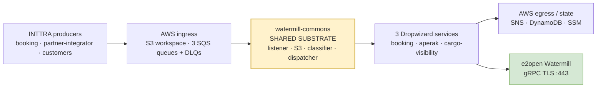
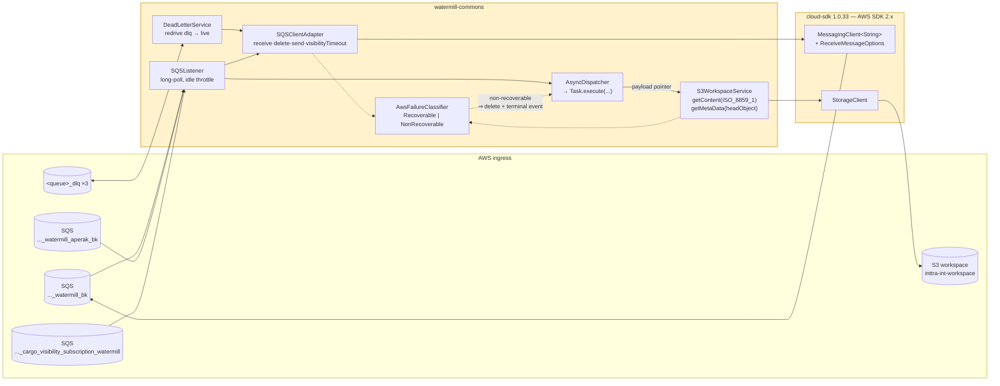
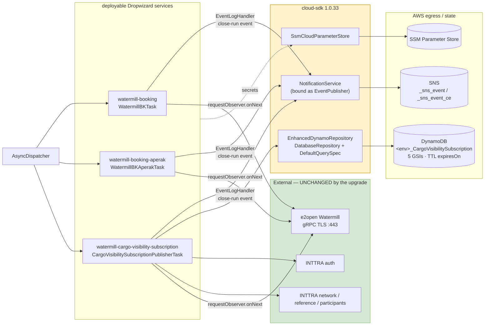
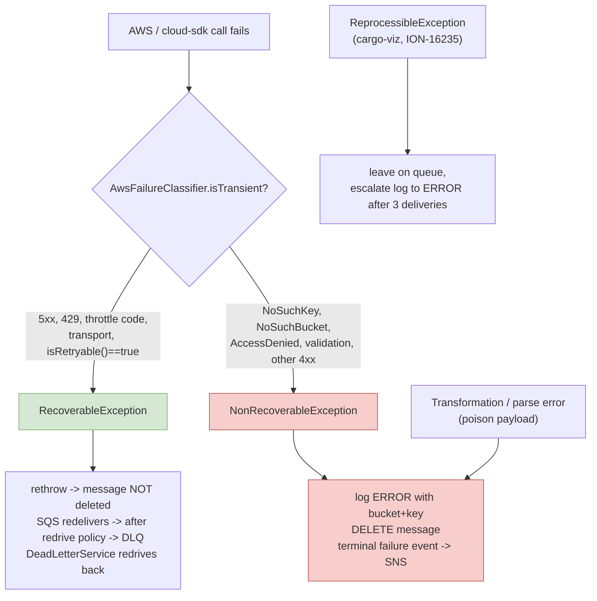
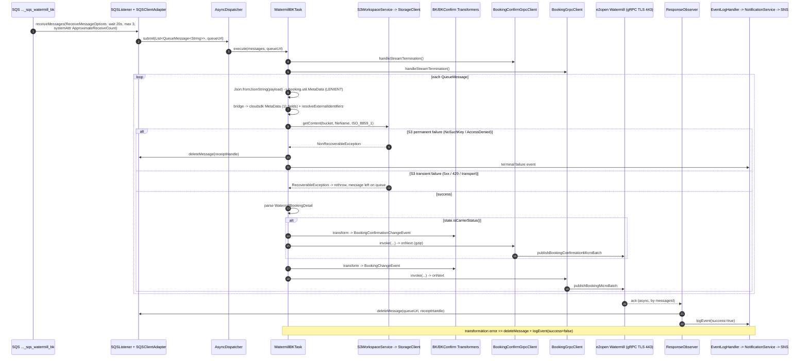
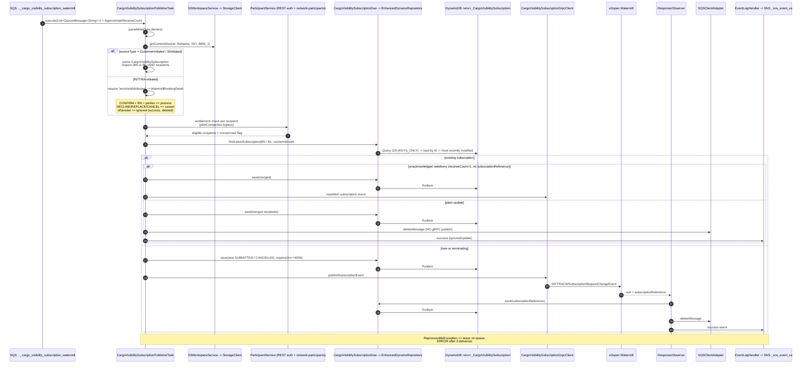
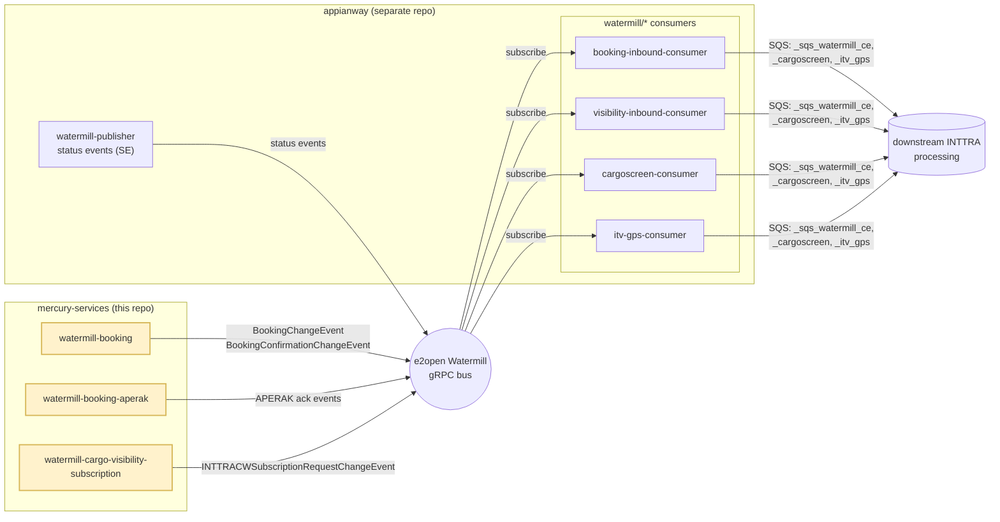

# watermill-publisher — AWS SDK 2.x (cloud-sdk) Upgrade Summary, Data Flows & QA Regression Guide

**Date:** 2026-09-02
**Suite:** `watermill-publisher` — `watermill-commons` (shared library) + `watermill-booking` + `watermill-cargo-visibility-subscription` + `watermill-booking-aperak`
**Jira:** ION-16380 (AWS SDK 2.x upgrade) — built on ION-16235 (SQS retry framework), ION-16520 (carrier SCAC), ION-16564 (BL/BN check), ION-16650 (GSI RCU/WCU)
**Code state documented:** `develop` @ `2ff603b53d` — `commons` / `cloud-sdk-api` / `cloud-sdk-aws` **`1.0.33-SNAPSHOT`**, `booking` model **`3.0.0.M`**, AWS SDK **2.x**, gRPC `grpc-netty-shaded` 1.77.0 (unchanged)
**AWS INT verification:** account `081020446316`, `us-east-1`, SSO role `AWSReservedSSO_INTTRA-Dev-Engg` — live resources re-confirmed on 2026-09-02 (§9)

> **Why this document exists.** The design and refactor docs in this repo each capture one slice of the upgrade at one
> point in time. This document consolidates them against the **current** code, states what actually changed per
> sub-module, what did **not**, and — the part QA needs — exactly which touchpoints must be regression-tested to prove
> the AWS SDK swap introduced no functional regression.
>
> **How to read it.** §1–§4 are suite-wide (the shared substrate is where most of the change lives). §5, §6, §7 are the
> three per-sub-module sections, each with its own *Business & functional flows*, *Validations*, *Upgrade impact* and
> *QA regression* sub-sections. §8 re-checks the gaps raised in the Confluence design. §9 is the live AWS evidence.
> §10 explains how this suite relates to the `appianway` watermill-consumer modules. §11 is the suite-level QA summary.
> **§12 answers the review questions raised on this document** with pre/post code snippets and measured evidence, and
> lists the corrections that were made to the body as a result — including one **substantive correction** (§12.10: the
> permanent-S3-failure fix was *not* ported to cargo-visibility). **§13 verifies the cargo-visibility DynamoDB
> `DefaultQuerySpec` queries** against the `ContainerEventOutboundDao` "dropped key condition" PROD defect class.
> **§14 answers a second round of review questions** — why the envelope was parsed twice pre-upgrade, ISO-8859-1 from
> first principles, the cost of widening timestamp parsing, and what "only the target type changed" means.

**Companion documents**

| Document | What it holds |
|---|---|
| `watermill-publisher/docs/2026-06-30-watermill-publisher-current-state-DESIGN-claude.md` | Pre-upgrade (AWS SDK v1) baseline for the whole suite |
| `watermill-publisher/watermill-booking/docs/2026-07-30-waermillpub-awsupgrade-confluence-design.md` | The Confluence design doc (requirements, LLD, risks, open gaps) — gap status updated by this document |
| `watermill-publisher/docs/2026-08-31-wm-aws-upgrade-refactor.md` | The 1.0.33 alignment: S3 poison-message loop fix, recoverable/non-recoverable split, SqsClient removal |
| `watermill-publisher/watermill-booking/docs/2026-08-13-wm-final-rebase.md` | Rebase onto ION-16520 and PR #1127 review handling |

---

## 1. Executive summary — what the AWS upgrade actually is

The suite was the last AWS SDK **v1** consumer in its area. Every AWS interaction — S3, SQS, SNS, DynamoDB, SSM — moved
to the in-house **cloud-sdk** (`cloud-sdk-api` + `cloud-sdk-aws`, AWS SDK **2.x** over Apache HTTP), and the removed
`com.inttra.mercury.messaging.*` event API was re-pointed to `com.inttra.mercury.cloudsdk.notification.*`.

It landed in **three waves**, and the current code is the sum of all three:

| Wave | Commit / ticket | What it did |
|---|---|---|
| **1 — the migration** | `32608bbccb` — ION-16380 (on top of ION-16235 + ION-16520) | v1 → cloud-sdk for S3/SQS/SNS/DynamoDB; `Message` → `QueueMessage<String>`; v1 DynamoDB ORM → v2 `@DynamoDbBean` enhanced client; `dynamo-client` removed; `booking` model `2.1.x.M` → `3.0.0.M`; ION-16235 retry framework ported v1 → v2 exceptions |
| **2 — DynamoDB provisioning** | ION-16650 (`f347a58c94`, `ec4208bccb`) | `dynamoDbConfig.readCapacityUnits` / `writeCapacityUnits` reintroduced so the admin command provisions table **and GSI** capacity per environment (INT 25/25, CVT/PROD 200/200) |
| **3 — the 1.0.33 alignment** | `2ff603b53d` — ION-16380 | Real **recoverable vs non-recoverable** failure classification (`AwsFailureClassifier`); permanent S3 failures now delete the message instead of looping forever; the direct AWS v2 `SqsClient` reach-around **removed** (cloud-sdk `ReceiveMessageOptions` can now request `ApproximateReceiveCount`); `SQSClient` → `SQSClientAdapter`; `getMetaData` uses the real `headObject`; SNS ARN validated at startup; SNS publish failures can no longer escape into the caller's error handling |

**The one-line answer to "did the upgrade change behaviour?"**

> The **AWS client library changed; the business logic did not.** Every DynamoDB attribute name/type/encoding, the SQS
> envelope, the S3 object body and its ISO-8859-1 charset, the SNS audit payload, and every protobuf message and gRPC
> RPC are unchanged. **Two runtime behaviours did change deliberately** (both in wave 3, both improvements, both listed
> in §5.4 / §6.4 and must be regression-tested): a *permanently unreadable* S3 payload is now **deleted** rather than
> retried forever, and `MetaData` parsing is now **lenient** rather than strict.

**What is explicitly out of scope and untouched:** the Watermill **gRPC** transport (`PublisherInitializer`, every
`*GrpcClient`, `ResponseObserver`, `AuthCredentials`, `grpc-netty-shaded` 1.77.0), the protobuf transformer / `TypeMap`
chain, the JAX-RS network-services client stack, and `${awsps:}` Parameter Store resolution semantics.

---

## 2. Component architecture after the upgrade

> **Reading these diagrams.** The architecture is split into three progressively-detailed views so each one stays
> legible at preview width. If you need to zoom or pan, open the generated viewer
> **[`diagrams/wmpub-diagrams.html`](diagrams/wmpub-diagrams.html)** in a browser (mouse-wheel zoom, drag to pan), or
> the standalone SVGs in [`diagrams/`](diagrams/) — see [§2.4](#24-viewing-the-diagrams).

### 2.1 At a glance — the five stages



**Legend (all diagrams):** 🟡 yellow = migrated by ION-16380 · 🟢 green = untouched by the AWS upgrade.

### 2.2 Ingress and the shared substrate — this is where the upgrade lives



### 2.3 Services and egress



### 2.4 Viewing the diagrams

VS Code's **Markdown Preview Enhanced** renders Mermaid as a fixed-size inline SVG with **no pan/zoom**, so dense
diagrams become unreadable at preview width. Three ways round it, best first:

| Option | How | Notes |
|---|---|---|
| **Zoomable viewer (recommended)** | Open [`diagrams/wmpub-diagrams.html`](diagrams/wmpub-diagrams.html) in a browser | All 7 diagrams from this document with **mouse-wheel zoom, drag-to-pan**, a diagram picker, `←`/`→` navigation and *Fit* / *Reset* / *100%* controls. Needs network access (Mermaid + svg-pan-zoom from jsDelivr) |
| **Standalone SVG (works offline)** | Open `docs/diagrams/NN-*.svg` | VS Code opens SVG in its own image viewer with `Ctrl` + mouse-wheel zoom. Vector, so sharp at any zoom, and no network needed |
| **In-preview zoom** | In the MPE preview: right-click → *Zoom In*, or `Ctrl` `+` | Zooms the **whole document**, not just the diagram, but it does make a dense diagram readable |

Regenerate after editing any Mermaid block — the generators read the ` ```mermaid ` blocks straight out of this file, so
there is no second copy to maintain:

```powershell
node watermill-publisher/docs/diagrams/build-diagrams.mjs   # viewer + .mmd sources (no install)
pwsh watermill-publisher/docs/diagrams/render-svg.ps1       # the .svg renders (needs mermaid-cli)
```

See [`diagrams/README.md`](diagrams/README.md) for details.

---

## 3. AWS touchpoint inventory

Every touchpoint, which client owns it, and which module reaches it. All verified live on INT (§9).

| # | AWS service | Operation | cloud-sdk client | Owning class | booking | aperak | cargo-viz |
|---|---|---|---|---|:---:|:---:|:---:|
| T1 | **SQS** | `receiveMessage` — long-poll 20 s, max 3, **`ApproximateReceiveCount`** system attribute | `MessagingClient<String>` + `ReceiveMessageOptions` | `SQSClientAdapter.receiveMessage` ← `SQSListener` | ✅ | ✅ | ✅ |
| T2 | **SQS** | `deleteMessage` (success, poison drop, permanent failure) | `MessagingClient<String>` | `SQSClientAdapter.deleteMessage` | ✅ | ✅ | ✅ |
| T3 | **SQS** | `sendMessage` (DLQ redrive back to the live queue) | `MessagingClient<String>` | `SQSClientAdapter.sendMessage` ← `DeadLetterService` | ✅ | ✅ | ✅ |
| T4 | **SQS** | `getQueueAttributes` → `VisibilityTimeout` (fallback **30 s**) | `MessagingClient<String>` | `SQSClientAdapter.getVisibilityTimeout` | ✅ | ✅ | ✅ |
| T5 | **S3** | `getContent(bucket, key, ISO_8859_1)` — the payload read | `StorageClient.getContent` | `S3WorkspaceService.getContent` | ✅ | ✅ | ✅ |
| T6 | **S3** | `getMetadata` — **`headObject`**, no body transfer | `StorageClient.getMetadata` | `S3WorkspaceService.getMetaData` | (no prod caller) | (no prod caller) | (no prod caller) |
| T7 | **S3** | `putObject` / `copyObject` / `copyS3FileToFileSystem` | `StorageClient` | `S3WorkspaceService` | (no prod caller) | (no prod caller) | (no prod caller) |
| T8 | **SNS** | `publish` — workflow close-run audit event | `NotificationService` (bound as `EventPublisher`) | `EventLogHandler.logEvent` | ✅ `_sns_event` | ✅ `_sns_event` | ✅ `_sns_event_ce` |
| T9 | **DynamoDB** | `GetItem` by partition key `id` | `EnhancedDynamoRepository.findById` | `CargoVisibilitySubscriptionDao` | — | — | ✅ |
| T10 | **DynamoDB** | `Query` on 3 KEYS_ONLY GSIs, then load by primary key | `DefaultQuerySpec` + `CloudAttributeValue` | `CargoVisibilitySubscriptionDao` | — | — | ✅ |
| T11 | **DynamoDB** | `PutItem` (create / update / cancel / subscriptionReference back-fill) | `EnhancedDynamoRepository.save` | `CargoVisibilitySubscriptionDao`, `ResponseObserver` | — | — | ✅ |
| T12 | **DynamoDB** | table/GSI provisioning — `dynamo-create` command | `DynamoDbAdminCommand` | `CargoVisibilitySubscriptionTableCommand` | — | — | ✅ (one-off) |
| T13 | **DynamoDB** | booking lookups (`BookingDao`) | `EnhancedDynamoRepository` | `BookingDao` | — | — | ✅ |
| T14 | **SSM Parameter Store** | gRPC username/password, auth `clientSecret` via `${awsps:}` | `SsmCloudParameterStore` / `ParameterStoreLookup` | commons config resolution | ✅ | ✅ | ✅ |
| T15 | *gRPC (not AWS)* | `publishBookingMicroBatch` / `…ConfirmationMicroBatch` / subscription stream / `ping` | `grpc-netty-shaded` | `PublisherInitializer`, `*GrpcClient` | ✅ | ✅ | ✅ |
| T16 | *REST (not AWS)* | `auth` + `network/reference/participants` | commons service-client | `ParticipantService` | — | — | ✅ |

### 3.1 Per-environment resources

| Resource | INT (`081020446316`) | QA (`642960533737`) | CVT (`642960533737`) | PROD (`642960533737`) |
|---|---|---|---|---|
| S3 workspace bucket | `inttra-int-workspace` | `inttra2-qa-workspace` | `inttra2-cv-workspace` | `inttra2-pr-workspace` |
| SQS — booking | `inttra_int_sqs_watermill_bk` | `inttra2_qa_…` | `inttra2_cv_…` | `inttra2_pr_…` |
| SQS — aperak | `inttra_int_sqs_watermill_aperak_bk` | `inttra2_qa_…` | `inttra2_cv_…` | `inttra2_pr_…` |
| SQS — cargo-viz | `inttra_int_sqs_cargo_visibility_subscription_watermill` | `inttra2_qa_…` | `inttra2_cv_…` | `inttra2_pr_…` |
| DLQ | `<queueUrl>_dlq` for each of the above | same | same | same |
| SNS — booking/aperak | `…:inttra_int_sns_event` | `…:inttra2_qa_sns_event` | `…:inttra2_cv_sns_event` | `…:inttra2_pr_sns_event` |
| SNS — cargo-viz | `…:inttra_int_sns_event_ce` | `…:inttra2_qa_sns_event_ce` | `…:inttra2_cv_sns_event_ce` | `…:inttra2_pr_sns_event_ce` |
| **DynamoDB prefix** (`dynamoDbConfig.environment`) | `inttra_int` | `inttra2_qa` | **`inttra2_test`** | **`inttra2_prod`** |
| DynamoDB table | `inttra_int_CargoVisibilitySubscription` | `inttra2_qa_…` | `inttra2_test_…` | `inttra2_prod_…` |
| DynamoDB provisioned RCU/WCU (ION-16650) | 25 / 25 | 25 / 25 | 200 / 200 | 200 / 200 |
| Watermill gRPC | `watermill.staging.e2open.com:443`, tenant `INTTRA_INT` | staging, `INTTRA_QA` | staging, `INTTRA` | `watermill.e2open.com:443`, `INTTRA` |
| REST base | `api-alpha.inttra.com` | `api-beta` | `api-test` | `api` |

> ⚠️ **Prefix trap — the single most dangerous config mistake in this suite.** The **DynamoDB** prefix and the
> **S3/SQS/SNS** prefix are *different strings in the same environment*. CVT is DynamoDB `inttra2_test` but
> S3/SQS/SNS `inttra2_cv` / `inttra2-cv-`; PROD is DynamoDB `inttra2_prod` but S3/SQS/SNS `inttra2_pr`. INT is a
> **different AWS account** entirely. Getting one wrong points a live service at another environment's data.

---

## 4. The shared substrate — `watermill-commons`

All three services are headless Dropwizard `InttraServer` apps with **no JAX-RS resources of their own**. The whole
messaging pipeline is in `watermill-commons`, so **that library is the blast radius**: a regression there breaks all
three services at once. This is why §5–§7 each re-test the same commons touchpoints from their own service.

| Class | Role after the upgrade | Migration note |
|---|---|---|
| `sqs.SQSListener` | Long-poll loop; asks the dispatcher for `getIdleThreadCount()` messages per poll; submits to `AsyncDispatcher` | v1 request-building and `AbortedException` removed; loop semantics identical |
| `sqs.SQSClientAdapter` **(was `SQSClient`)** | The only SQS entry point: `receiveMessage` / `deleteMessage` / `sendMessage` / `getVisibilityTimeout`. Pins `ApproximateReceiveCount` on receive; falls back to **30 s** when `VisibilityTimeout` is absent or unparseable; classifies every failure | Replaced the split listener/sender clients **and** the temporary direct AWS v2 `SqsClient` |
| `s3.S3WorkspaceService` | `getContent(bucket, key, charset)` delegates straight to `StorageClient.getContent`; `getMetaData` is a real `headObject`; every failure names bucket **and** key | Charset fidelity preserved byte-for-byte |
| `sqs.DeadLetterService` | Scheduled **redrive**: polls `<queue>_dlq` (20 s wait, 10 msgs, stops after 3 empty polls) and sends each message back to the live queue; per-message failures contained; logs a redriven count | Direction of travel unchanged; SQS's own redrive policy is what *puts* messages in the DLQ |
| `exception.AwsFailureClassifier` **(new)** | Classifies any AWS/cloud-sdk failure as `RecoverableException` (leave on queue) or `NonRecoverableException` (permanent). Allow-list: 5xx, 429, throttle error codes, transport failures ⇒ transient; everything else (`NoSuchKey`, `NoSuchBucket`, `AccessDenied`, validation) ⇒ permanent. Walks the cause chain (depth cap 25, cycle-safe); honours `CloudSdkException.isRetryable()==false` as authoritative | **New behaviour**, wave 3 |
| `logging.EventLogHandler` | Publishes the workflow close-run event; an SNS failure is now **logged, not propagated** (it used to replace the real processing outcome and resurrect an already-deleted message) | `messaging.*` → `cloudsdk.notification.*`, 1:1 body |
| `support.Json` | Lenient Jackson (`FAIL_ON_UNKNOWN=false`), `yyyy-MM-dd HH:mm:ss.SS` timestamp contract, plus `fromJsonField` for single-field wire extraction | `fromJsonField` added to preserve `externalIdentifiers` across the `booking 3.0.0.M` model bump |
| `task.Task`, `threaddispatcher.*` | `execute(List<QueueMessage<String>>, queueUrl)` | The cross-cutting `Message` → `QueueMessage<String>` signature change |

### 4.1 Suite-wide failure-handling contract (post-upgrade)



---

## 5. `watermill-booking`

Main class `com.inttra.mercury.watermill.booking.WatermillBKApplication`. Queue `…_sqs_watermill_bk`. The primary,
highest-volume path in the suite. Publishes to Watermill over **two** gRPC streams.

### 5.1 Business & functional flows

1. **Booking change publication (the main flow).** Every booking-change event dropped on the queue by the `booking`
   service is dereferenced from S3, transformed to a `BookingChangeEvent` protobuf and streamed to Watermill via
   `BookingGrpcClient`. This is the outbound feed the e2open Watermill platform consumes.
2. **Booking confirmation publication (legacy, backward compatibility).** *Additionally*, when
   `bookingDetail.getState().isCarrierStatus()` is true, a legacy `BookingConfirmationChangeEvent` is published first
   via `BookingConfirmGrpcClient`. Both events are published for those states — this duplication is deliberate and
   must not be "optimised away".
3. **Transformation.** `BKProtobufTransformer` (+ `BKCargo` / `BKCarriage` / `BKEquipment` / `BKLocation` / `BKParty`
   sub-transformers and ~40 `type/*TypeMap` enum mappers) and `BKConfirmProtobufTransformer`. Notification parties come
   from the *booking* `MetaData`; `externalIdentifiers` is lifted straight off the wire JSON.
4. **Acknowledgement.** The Watermill ack arrives asynchronously on the `ResponseObserver`, keyed by message id; the
   observer deletes the SQS message and emits the success audit event to SNS.
5. **Stream recovery.** Before every batch, `handleStreamTermination()` completes a broken stream, then pings
   (`PingReq entity=SHIPMENTSTATUS`) every 5 s until `OK`, rebuilds the Netty TLS channel and the observer pair.



### 5.2 Validations in this module

| # | Validation | Where | Effect when it fails |
|---|---|---|---|
| B1 | SQS envelope parses to `booking.util.MetaData` — **lenient**, unknown wire fields tolerated | `WatermillBKTask.execute` → `Json.fromJsonString` | Poison drop (delete + failure event) |
| B2 | `externalIdentifiers` extracted leniently; **null → empty map** | `WatermillBKTask.resolveExternalIdentifiers` | Never fails; defaults |
| B3 | `projections` **null → empty map** before bridging to the cloud-sdk `MetaData` | `WatermillBKTask.toWorkflowMetaData` | Never fails; defaults |
| B4 | S3 failure classified transient vs permanent | `S3WorkspaceService` → `AwsFailureClassifier` | Permanent ⇒ delete + terminal event; transient ⇒ leave on queue |
| B5 | Payload parses to `WatermillBookingDetail` | inner `try` in `execute` | Poison drop |
| B6 | `bookingDetail.getState().isCarrierStatus()` gates the legacy confirm publish | `execute` | Skips the confirm event only |
| B7 | Transformer may return `null` — publish is **skipped**, not NPE'd | `transformAndPublishBooking` / `…Confirm` | Nothing published for that message |
| B8 | gRPC stream health before each batch | `handleStreamTermination()` | Ping-recover loop until `OK` |
| B9 | `snsEventTopicArn` present and well-formed | `WatermillBKApplicationInjector.requireTopicArn` | **Startup fails fast** (`IllegalStateException`) |
| B10 | SNS publish failure is logged, never propagated | `EventLogHandler.logEvent` | Processing outcome preserved |
| B11 | Config bean validation (`@NotNull` on queue/bucket/topic/watermill config) | Dropwizard config deserialization | Startup fails |

### 5.3 Data flow across AWS resources

`SQS …_sqs_watermill_bk` **(T1)** → `S3 <env>-workspace` **(T5, ISO-8859-1)** → in-process transform → **gRPC** to
Watermill **(T15)** → ack → `SQS deleteMessage` **(T2)** → `SNS <env>_sns_event` **(T8)**.
Failure side: transient ⇒ redelivery ⇒ SQS redrive policy ⇒ `…_bk_dlq` ⇒ `DeadLetterService` sends it back **(T3)**.
Permanent ⇒ delete **(T2)** + terminal SNS event **(T8)**. Secrets from SSM **(T14)**.

### 5.4 Has the upgrade impacted functional flow or business logic?

| Area | Impacted? | Detail |
|---|---|---|
| Which events are published, and when | **No** | Same `isCarrierStatus()` gate, same dual publish, same protobuf, same RPCs |
| Transformer / `TypeMap` chain | **No** | Not touched by the migration |
| S3 payload interpretation | **No** | Still `getContent(bucket, file, ISO_8859_1)` — the identical call, byte-for-byte the same decode. See [§12.1](#121-q1--iso-8859-1-is-latin-1-so-how-can-it-preserve-non-latin--edifact-content) |
| SQS long-poll semantics | **No** | 20 s / max 3 / 1 listener thread |
| SNS audit body | **No** | Same topic, same 7-field `MetaData` builder shape |
| gRPC channel, auth, compression, recovery | **No** | Entirely out of scope |
| **`MetaData` envelope parsing** | **Deliberate** | The envelope is no longer deserialised *into* the workflow `MetaData` type. It is parsed into `booking.util.MetaData` with the module's own lenient mapper and then **bridged** into the cloud-sdk `MetaData` via its Builder. Necessary because the cloud-sdk type is `final`, has no setters and no no-arg constructor, and its own `parseJson` is **strict**: it throws `UnrecognizedPropertyException` on the `notificationParties` / `externalIdentifiers` fields that every real booking envelope carries (proven in [§12.2](#122-q2--what-metadata-parsing-strictness-actually-means)). Strictly **more permissive** than pre-upgrade — no envelope that parsed before can fail now |
| **Envelope timestamp formats** | **Deliberate — widened** | Pre-upgrade only `yyyy-MM-dd HH:mm:ss.SS` parsed. A 3-tier fallback deserialiser now also accepts ISO-8601 with 0–9 fractional digits. Purely additive; see [§12.7](#127-q7--how-can-nanosecond-millisecond-and-no-fraction-timestamps-all-parse-was-that-pre-upgrade-behaviour) |
| **Permanently unreadable S3 payload** | **Fixed** | **Before:** rethrown → redelivered → DLQ → redriven by `DeadLetterService` every 30 min, forever, never reported complete. **After:** one ERROR naming bucket + key, a terminal failure event on SNS, and the message is **deleted**. See [§12.4](#124-q4--permanently-unreadable-s3-payload) |
| **`externalIdentifiers` availability** | **No (preserved)** | `booking 3.0.0.M` **removed** `getExternalIdentifiers()` from `MetaData` (verified by `javap`), so the old typed accessor no longer exists. The value is now read straight off the raw wire JSON, so it still reaches the transformer and still becomes `ExternalPartyIdentifiers` on the protobuf. Business output unchanged — see [§12.5](#125-q5--externalidentifiers-in-detail) |

### 5.5 QA regression — `watermill-booking`

#### 5.5.1 High level (the four questions QA must answer)

| # | Question | Pass criterion |
|---|---|---|
| H1 | Does a normal booking event still reach Watermill unchanged? | Same protobuf content as a pre-upgrade capture, same RPC, ack received, SQS message deleted, success event on SNS |
| H2 | Is the confirm/booking dual-publish still correct? | Carrier-status booking ⇒ **two** events (confirmation + change); non-carrier-status ⇒ **one** (change only) |
| H3 | Do failures still leave good messages on the queue and only drop genuinely undeliverable ones? | Transient failure ⇒ message stays; permanent S3 failure ⇒ deleted + terminal event; poison payload ⇒ deleted + failure event |
| H4 | Do Latin-1 / EDIFACT payloads still come through exactly as they did before? | Characters in the published protobuf are **identical to a pre-upgrade capture** of the same S3 object. (Note: the guarantee is *decode parity with pre-upgrade*, not Unicode correctness — see [§12.1](#121-q1--iso-8859-1-is-latin-1-so-how-can-it-preserve-non-latin--edifact-content)) |

#### 5.5.2 Detailed regression touchpoints

| # | Touchpoint | Test | Expected result | Where to observe |
|---|---|---|---|---|
| BK-1 | **T1** SQS receive | Drop a valid booking `MetaData` envelope on `<env>_sqs_watermill_bk` | Picked up within ~20 s; `Processing workflowId :<id>` logged | Service log; queue `ApproximateNumberOfMessages` → 0 |
| BK-2 | **T5** S3 read, charset | Payload with Latin-1 high characters (`Ä Ö Ü é ñ`) and an EDIFACT `UNB+UNOC:3` envelope | Published protobuf carries the identical characters — no `?`, no `�`, no mojibake. **Compare against a pre-upgrade capture, not against "correct UTF-8"** ([§12.1](#121-q1--iso-8859-1-is-latin-1-so-how-can-it-preserve-non-latin--edifact-content)) | Compare S3 object vs Watermill-side payload |
| BK-3 | Envelope leniency | Replay a **real captured production envelope** from `<env>_sqs_watermill_bk` (these always carry `notificationParties`, and `externalIdentifiers` when E2NET parties exist); then a second one with an extra unknown field | Both processed; `externalIdentifiers` → `ExternalPartyIdentifiers` on the protobuf; when absent ⇒ empty, not an error ([§12.6](#126-q6--is-bk-3-a-real-scenario-where-does-such-an-envelope-come-from)) | Published protobuf |
| BK-4 | Timestamp formats **(widened)** | Envelopes with `2026-04-21 15:21:44.90`, `2026-04-21T15:21:44.900966705` (nanos), `…T15:21:44.900` (millis) and `…T15:21:44` (none) | All four parse. Only the **first** would have parsed pre-upgrade ([§12.7](#127-q7--how-can-nanosecond-millisecond-and-no-fraction-timestamps-all-parse-was-that-pre-upgrade-behaviour)) | Service log; no parse error |
| BK-5 | **T15** dual publish | Booking in a **carrier-status** state | `publishBookingConfirmationMicroBatch` **and** `publishBookingMicroBatch` both invoked | gRPC/Watermill side; service log |
| BK-6 | **T15** single publish | Booking in a **non-carrier-status** state | Only `publishBookingMicroBatch` | Same |
| BK-7 | **T2** delete on ack | Successful publish | Message deleted; queue returns to 0 | Queue depth |
| BK-8 | **T8** SNS success audit | Successful publish | Close-run event on `<env>_sns_event`, body shape identical to a pre-upgrade sample | SNS subscriber / event-log store |
| BK-9 | **Permanent S3 failure — FIXED BEHAVIOUR** | Enqueue an envelope pointing at a **deleted / non-existent S3 key** | ERROR `Permanent failure for workflowId … (bucket=…, file=…); deleting the message …`; message **deleted**; **failure** event on SNS; **queue and DLQ both return to 0** and stay there | Log + both queue depths + SNS |
| BK-10 | **Transient failure** | Simulate an S3 5xx / throttle (or revoke S3 read to force retryable transport failure) | Message **stays** on the queue and is redelivered; **not** deleted | Queue depth stays > 0 |
| BK-11 | Poison payload | S3 object that is not valid `WatermillBookingDetail` JSON | `Transformation Error -> MetaData: …`; message deleted; failure event on SNS | Log + SNS |
| BK-12 | **T3** DLQ redrive | Put a valid message directly in `…_bk_dlq` | `DeadLetterService redrove N message(s) from …_dlq to …` and the message is processed normally | Log + both queue depths |
| BK-13 | **T4** visibility timeout | Queue with no explicit `VisibilityTimeout` attribute | No exception at `ResponseObserver` construction; falls back to **30 s** | Startup log; no error |
| BK-14 | **T15** stream recovery | Break the Watermill stream (restart the far side / drop the connection) mid-batch | Ping loop until `OK`, channel and observers rebuilt, publishing resumes; **no message loss** | Log; queue drains after recovery |
| BK-15 | **T14** SSM secrets | Boot the service per environment | gRPC credentials resolved from `${awsps:}`; no hard-coded credentials | Startup log |
| BK-16 | **T8/B9** SNS misconfig | Boot with `snsEventTopicArn` blank or malformed | Startup **fails fast** with a clear `IllegalStateException` | Startup log |
| BK-17 | SNS outage tolerance | Make SNS publish fail while processing succeeds | Processing outcome preserved; the SNS failure is logged only; message **not** resurrected | Log |
| BK-18 | Throughput / soak | Sustained load at production-like rate for ≥ 1 h | No connection-pool starvation, no leaked streams, steady queue drain (single merged `MessagingClient` — see §8 note) | Queue depth trend; ECS task metrics |
| BK-19 | Health endpoints | `GET /watermill-booking/services/ping` and `/version`; admin `:8091/admin/healthcheck` | Unchanged responses | HTTP |

---

## 6. `watermill-cargo-visibility-subscription`

Main class `…WatermillCargoVisibilitySubscriptionPublisherApplication`. Queue
`…_sqs_cargo_visibility_subscription_watermill`. **The only stateful service** and by far the most business logic —
`CargoVisibilitySubscriptionPublisherTask` is ~1000 lines. It is also the only DynamoDB toucher, so it carries the
largest share of the upgrade risk.

### 6.1 Business & functional flows

The service manages the **cargo-visibility subscription lifecycle** (`SUBMITTED → CANCELLED`) and tells Watermill which
parties may see container events for a booking / bill of lading.

**Two payload shapes arrive on one queue**, routed by `metaData.projections["sourceType"]`:

- **Customer- / SI-initiated** (`sourceType` = `CustomerInitiated` or `SIInitiated`) → parsed as
  `CargoVisibilitySubscription`; requires (`carrierBookingNumber` **OR** `billOfLadingNumber`) **and** a non-empty
  `requestedRecipients`.
- **INTTRA-initiated** (any other `sourceType`) → payload must contain `enrichedAttributes`; parsed as
  `WatermillBookingDetail`. Processed when state is **`CONFIRM`** with a booking number and non-empty booking parties;
  or when the state is **terminating** (`DECLINE` / `REPLACE` / `CANCEL`), which cancels existing subscriptions.
  Anything else is **explicitly ignored** — recorded as a *successful* close-run with `ignored=true` and a reason, and
  the message is deleted.

Core business rules:

| Rule | Detail |
|---|---|
| **Recipient eligibility** | Each requested recipient must hold the **cargo-visibility** sub-module entitlement, resolved over REST from `network/reference/participants`. A recipient listed in the configured **`pilotCompanies`** list bypasses the entitlement check entirely. Unrestricted-access recipients are flagged and drive INTTRA `clientType` logic |
| **Idempotent update vs create** | An existing subscription (found via GSI) ⇒ merge in only the **new** recipients, save, delete the message, and **do not** re-publish over gRPC. No existing subscription ⇒ create, save, publish |
| **Unacknowledged redelivery** | If `ApproximateReceiveCount > 1` and the subscription is persisted in DynamoDB but has no `subscriptionReference` (crashed before publish), the subscription is **republished** rather than silently treated as an update |
| **Subscription reference back-fill** | Watermill's ack carries a `subscriptionReference`; `ResponseObserver` writes it back to DynamoDB |
| **Expiry** | `expiresOn = createdOn + 400 days`, stored as epoch **seconds**, DynamoDB **TTL** attribute |
| **Carrier SCAC supplementation** (ION-16520) | SCAC derived from `companyId` when absent |
| **BL/BN precedence** (ION-16564) | The bill-of-lading based check is skipped when a booking number is present |
| **Transport-leg date sanity** (`TransformationHelper`) | The consuming system rejects a leg whose estimated arrival precedes its departure, or whose departure precedes the previous leg's arrival — such date sets are dropped rather than published invalid |
| **Retry framework** (ION-16235) | Transient DynamoDB / gRPC / JAX-RS / socket / I/O failures ⇒ `ReprocessibleException` ⇒ message left on the queue; in-process exponential backoff on throttling; log escalated to ERROR after 3 deliveries; `JsonProcessingException` stays a poison guard |



### 6.2 Validations in this module

| # | Validation | Where | Effect when it fails |
|---|---|---|---|
| C1 | `sourceType` routing (`CustomerInitiated` / `SIInitiated` vs INTTRA-initiated) | `processSubscriptionRequest` | Wrong branch ⇒ `IllegalArgumentException("Invalid payload…")` ⇒ classified, then poison-dropped or reprocessed |
| C2 | Customer path: (`carrierBookingNumber` OR `billOfLadingNumber`) **AND** non-empty `requestedRecipients` | `processSubscriptionRequest` | Falls through to the invalid-payload error |
| C3 | INTTRA path: payload contains `enrichedAttributes` | `processSubscriptionRequest` | Invalid-payload error |
| C4 | INTTRA path: state `CONFIRM` **with** booking number **and** non-empty booking parties | `processSubscriptionRequest` | Recorded as **ignored** (success, deleted, reason logged) |
| C5 | Terminating-state set is exactly `DECLINE`, `REPLACE`, `CANCEL` (case-insensitive) | `isTerminatingState` / `TERMINATING_STATES` | Non-terminating, non-CONFIRM ⇒ ignored |
| C6 | `carrierIntttraId` present — **required** for the composite GSI query | `processInttraInitiated…` and `processCustomerInitiated…` | Cannot query ⇒ error path |
| C7 | Recipient entitlement (`cargoVisibility` sub-module) unless in `pilotCompanies` | `filterEligibleRecipients` / `hasCargoVisibility` | Recipient excluded; a **transient** entitlement lookup failure ⇒ `ReprocessibleException` (left on queue) |
| C8 | Unrestricted-access detection | `hasUnrestrictedCargoVisibility` / `isUnrestrictedAccessType` | Drives INTTRA `clientType` |
| C9 | New-recipient diffing before an update | `identifyNewRecipients` / `mergeRecipients` | No new recipients ⇒ update only, no publish |
| C10 | Unacknowledged-redelivery detection (`ApproximateReceiveCount` + missing `subscriptionReference`) | `isUnacknowledgedRedelivery` | Republish instead of silent update |
| C11 | Transport-leg date consistency (arrival ≥ departure; departure ≥ previous arrival) | `TransformationHelper` / `dropAllDatesFromAllLegs` | Dates dropped so the consumer does not reject the event |
| C12 | Expiry = creation + 400 days | `calculateExpirationDate` | — |
| C13 | Transient-vs-permanent classification for DynamoDB / gRPC / REST / socket / IO | `RetryClassifier` (+ `AwsFailureClassifier` verdicts) | Transient ⇒ `ReprocessibleException`; permanent ⇒ terminal |
| C14 | Throttle backoff walks the **cause chain** (cloud-sdk wraps in `DynamoSupportException`) | `RetryableOperation` | Without it the backoff silently stops firing |
| C15 | `dynamoDbConfig` present; `@Table` annotation present on the entity | `…ApplicationInjector` | **Startup fails fast** (`IllegalStateException`) |
| C16 | `snsEventTopicArn` present and well-formed | `…ApplicationInjector.requireTopicArn` | Startup fails fast |
| C17 | Config bean validation — `@NotNull` on `dynamoDbConfig`, `pilotCompanies`, queue/bucket/topic | `CargoVisibilitySubscriptionConfig` | Startup fails |

### 6.3 Data flow across AWS resources

`SQS …_cargo_visibility_subscription_watermill` **(T1)** → `S3` **(T5)** → REST entitlement check **(T16)** →
`DynamoDB` GSI query + load **(T10, T9)** → `DynamoDB` PutItem **(T11)** → **gRPC** **(T15)** → ack →
`DynamoDB` PutItem for `subscriptionReference` **(T11)** → `SQS delete` **(T2)** → `SNS <env>_sns_event_ce` **(T8)`**.
Provisioning is the separate one-off `dynamo-create` command **(T12)** — *not* part of `server` startup.

**DynamoDB encoding contract (must round-trip byte-identically):**

| Attribute | Type | Encoding |
|---|---|---|
| `id` (Java property `hashKey`) | S | partition key — `@DynamoDbPartitionKey @DynamoDbAttribute("id")` |
| `expiresOn` | **N** | epoch **seconds** (`getTime()/1000`) via `DateEpochSecondAttributeConverter` — this is what TTL reads |
| `createdOn` / `modifiedOn` | S | ISO-8601 via `LegacyDynamoDbDateAttributeConverter` |
| `state`, `type`, `clientType` (+ nested enums) | S | `name()` |
| `references`, `transportLegs` | M / L | nested `@DynamoDbBean` |
| `requestedRecipients` | SS | `Set<String>` |
| `vesselFlagCountry` | *absent* | `@DynamoDbIgnore` — deliberately unpersisted |

### 6.4 Has the upgrade impacted functional flow or business logic?

| Area | Impacted? | Detail |
|---|---|---|
| Subscription create / update / cancel decision tree | **No** | Same routing, same eligibility filter, same merge-only-new-recipients rule, same no-publish-on-plain-update |
| Recipient entitlement / `pilotCompanies` bypass | **No** | REST stack untouched |
| ION-16235 retry, redelivery detection, republish | **No** | Preserved through the rebase; `RetryClassifier` ported v1 → v2 exception model; `RetryableOperation` now walks the cause chain (**required**, because cloud-sdk wraps the throttle) |
| ION-16520 SCAC supplementation, ION-16564 BL/BN precedence | **No** | Functional commits kept; the migration was re-applied on top |
| DynamoDB item encoding | **No** | Byte-identical per attribute; v1-written items readable by v2 and vice-versa (proven by DynamoDB-Local ITs) |
| Table / GSI / TTL structure | **No** | Nothing provisioned or altered on existing tables; `dynamo-create` is describe-then-skip |
| gRPC subscription stream + `subscriptionReference` back-fill | **No** | Unchanged |
| **DynamoDB provisioned capacity for *fresh* creates** | **Deliberate (ION-16650)** | `dynamoDbConfig.readCapacityUnits`/`writeCapacityUnits` now drive **table and GSI** capacity (INT 25/25, CVT/PROD 200/200). **No effect on existing tables** — live INT GSIs remain 5/5 because the command skips existing indexes |
| **`MetaData` envelope parsing** | **Deliberate** | Identical bridge to booking — `parseMetaData()` deserialises the envelope into `booking.util.MetaData` with the lenient mapper, then rebuilds the cloud-sdk `MetaData` through its Builder, defaulting `projections` to an empty map. **Fully backward compatible**: the wire format is unchanged and it is strictly more permissive than the cloud-sdk's own strict `parseJson`. See [§12.9](#129-cargo-visibility-q1--metadata-parsing-strictness-here) |
| **Permanently unreadable S3 payload** | **⚠️ NOT fixed in this module** | The delete-instead-of-loop fix was applied to **`watermill-booking` and `watermill-booking-aperak` only**. `CargoVisibilitySubscriptionPublisherTask.execute` catches **only** `ReprocessibleException`; a permanent failure is rethrown as `RuntimeException`, so the message is **not** deleted and still loops queue → DLQ → `DeadLetterService` redrive. See [§12.10](#1210-cargo-visibility-q2--does-the-permanent-s3-failure-fix-apply-here) — **this is a newly-identified gap, not a regression** (the behaviour is the same as pre-upgrade) |
| **Fresh-environment partition-key name** | **⚠️ OPEN GAP** | A *brand-new* environment provisioned by `dynamo-create` would get a partition key named `hashKey`, not `id` — see §8 gap G3 |

### 6.5 QA regression — `watermill-cargo-visibility-subscription`

#### 6.5.1 High level

| # | Question | Pass criterion |
|---|---|---|
| H1 | Do subscriptions still get created, updated and cancelled correctly for both payload shapes? | Same DynamoDB items and same gRPC publishes as pre-upgrade for the same inputs |
| H2 | Are DynamoDB items still readable both ways? | Items written before the upgrade are read correctly now; items written now are readable by the old code path |
| H3 | Is the ION-16235 retry / redelivery safety net intact? | Transient failure ⇒ message stays; ERROR after 3 deliveries; unacknowledged redelivery ⇒ republished, not silently updated |
| H4 | Is recipient eligibility (entitlement + pilot companies) unchanged? | Same eligible set for the same participant data |
| H5 | Did provisioning change anything live? | `describe-table` / `describe-time-to-live` before and after are **identical** in every environment |

#### 6.5.2 Detailed regression touchpoints

| # | Touchpoint | Test | Expected result | Where to observe |
|---|---|---|---|---|
| CV-1 | **T1** receive + `ApproximateReceiveCount` | Any message | Received; receive-count available to the retry framework | Log |
| CV-2 | **T5** S3 read | Latin-1 / EDIFACT payload | Byte-identical characters in the persisted item and the published event | DynamoDB item + Watermill payload |
| CV-3 | Routing — customer | `sourceType=CustomerInitiated`, BN only | Parsed as `CargoVisibilitySubscription`; processed | `Parsed as SubscriptionRequest…` log |
| CV-4 | Routing — SI | `sourceType=SIInitiated`, BL only | Same path, BL-based | Log + item |
| CV-5 | Routing — INTTRA | Payload with `enrichedAttributes`, state `CONFIRM`, BN + parties | `Parsed as BookingDetail…`; subscription created | Log + item |
| CV-6 | **Ignored** path | INTTRA payload in a non-CONFIRM, non-terminating state | Recorded as **success with `ignored=true`** and a reason; message deleted; **no** DynamoDB write, **no** gRPC publish | SNS event + item absence |
| CV-7 | Terminating states | States `DECLINE`, `REPLACE`, `CANCEL` (each) | Existing subscription **cancelled** (`state=CANCELLED`), event published | DynamoDB item + Watermill |
| CV-8 | Invalid payload | Neither shape parseable | Poison-dropped: deleted + failure event (not looped) | Log + SNS + queue depth |
| CV-9 | Missing `carrierIntttraId` | Payload without it | Error path, no partial write | Log |
| CV-10 | **T16** entitlement — eligible | Recipient **with** cargo-visibility entitlement | Included in `requestedRecipients` | DynamoDB item (SS attribute) |
| CV-11 | **T16** entitlement — ineligible | Recipient **without** the entitlement, not a pilot company | Excluded | DynamoDB item |
| CV-12 | `pilotCompanies` bypass | Recipient id present in the configured `pilotCompanies` list | Included **without** an entitlement call | Item + absence of the REST call |
| CV-13 | Unrestricted access | Recipient with unrestricted access type | `clientType` set per INTTRA logic | Item + published event |
| CV-14 | **T10** GSI query — booking number | Existing subscription for the BN + carrierIntttraId | Found via `bookingNumber-carrierInttraId-index`, then loaded by `id`; **most recently modified** wins when several match | Item returned |
| CV-15 | **T10** GSI query — bill of lading | Existing subscription for the BL | Found via `billOfLading-carrierInttraId-index` | Item returned |
| CV-16 | **T10** GSI — subscription reference | Ack back-fill lookup | `subscriptionReference-index` query works | Item updated |
| CV-17 | ION-16564 precedence | Payload with **both** BN and BL | BL-based check **skipped** when BN present | Log / item |
| CV-18 | ION-16520 SCAC | Payload without SCAC but with `companyId` | SCAC supplemented | Item |
| CV-19 | **Update path (no publish)** | Second request for an **existing** subscription adding a new recipient | Item updated with merged recipients; **no** gRPC publish; message deleted | Item + absence of a Watermill event |
| CV-20 | Update with **no** new recipients | Duplicate request, same recipients | Idempotent — no spurious publish | Item unchanged apart from `modifiedOn` |
| CV-21 | **T11** create + publish | First-ever request for a BN/BL | Item created `state=SUBMITTED`, event published, ack received | Item + Watermill |
| CV-22 | **T11** `subscriptionReference` back-fill | After the ack | `subscriptionReference` written to the item | Item |
| CV-23 | **TTL / `expiresOn`** | Any new subscription | `expiresOn` is an **`N`** attribute equal to epoch **seconds** of creation + 400 days | `aws dynamodb get-item` raw output |
| CV-24 | Date encodings | Any new subscription | `createdOn` / `modifiedOn` are ISO-8601 **`S`** strings, matching pre-upgrade format exactly | Raw item |
| CV-25 | **Backward read** | Read a subscription **created before the upgrade** | Loads and updates correctly, all fields populated | Item + service behaviour |
| CV-26 | **Forward read** | Item created **after** the upgrade, read by any older consumer/report | Readable — no attribute renamed or retyped | Downstream consumers / carrier report |
| CV-27 | **Retry — transient DynamoDB** | Force a throttle / 5xx | `ReprocessibleException`, message **left on queue**, in-process exponential backoff, ERROR escalation after 3 deliveries | Log + queue depth |
| CV-28 | **Unacknowledged redelivery** | Kill the service after the DynamoDB write but before the gRPC publish, then let SQS redeliver | On redelivery the subscription is **republished**, not silently treated as an update | Watermill + log |
| CV-29 | Permanent S3 failure | Envelope pointing at a missing key | Deleted + terminal failure event; no endless loop | Log + queue/DLQ depths |
| CV-30 | **T3** DLQ redrive | Message placed in `…_watermill_dlq` | Redriven and processed | Log + depths |
| CV-31 | **T8** SNS `_ce` topic | Success and failure paths | Events on `<env>_sns_event_ce` with unchanged body | SNS subscriber |
| CV-32 | **T12** provisioning idempotency | Run `dynamo-create` against an **existing** table in a lower environment | *Table already exists* / index-exists skips; `describe-table` and `describe-time-to-live` output **byte-identical before and after** — key schema, GSIs, projections, throughput and TTL all unchanged | AWS CLI diff |
| CV-33 | **Gap G3 guard** | Only if a **greenfield** environment is stood up | Partition key must be `id`. With cloud-sdk 1.0.33 the admin command would create **`hashKey`** — **do not provision a new environment with `dynamo-create` until G3 is fixed**; create the table from the existing schema instead | `describe-table` |
| CV-34 | Transport-leg date sanity | Legs with arrival before departure, or departure before the previous arrival | Dates dropped; the event is accepted by the consumer rather than rejected | Watermill acceptance |
| CV-35 | Expiry behaviour | Item past its `expiresOn` | Removed by DynamoDB TTL (within AWS's usual 48 h window) | Item count |
| CV-36 | Startup validation | Boot with `dynamoDbConfig` or `snsEventTopicArn` missing | Fails fast with a clear message | Startup log |
| CV-37 | Health endpoints | `/watermill-cargo-visibility-subscription/services/ping`, `/version`, `:8091/admin/healthcheck` | Unchanged | HTTP |
| CV-38 | Soak | Sustained load ≥ 1 h | No pool starvation, steady drain, no item corruption | Metrics + spot-check items |

---

## 7. `watermill-booking-aperak` (brief)

Structurally the **simplest** of the three and the smallest risk surface: no DynamoDB, no REST calls, no dual publish,
no retry framework.

- **Flow.** `…_sqs_watermill_aperak_bk` → `WatermillBKAperakTask` → S3 read (ISO-8859-1) → `BKAperakTransformer` +
  `BKAperakPartyTransformer` → single `BookingAperakGrpcClient` stream → ack → delete → SNS `<env>_sns_event`.
  The source events are APERAK booking acknowledgements produced by `partner-integrator` statusevents-out.
- **What the upgrade changed here.** Only what the shared substrate and the model bump forced: injector rewritten to
  the single cloud-sdk `MessagingClient` / `StorageClient` / `NotificationService` providers plus SNS ARN validation;
  `Message` → `QueueMessage<String>`; `messaging.*` → `cloudsdk.notification.*`; `SQSClient` → `SQSClientAdapter`;
  `booking` model `2.1.7.M` → **`3.0.0.M`** (this module previously lagged one minor behind the other two — the
  version drift is now gone); the same `finalisePermanentFailure` behaviour change as booking.
  Its explicit AWS SDK **v1** exclusions in the pom are now moot — there is no v1 on the classpath at all.
- **Validations.** The same envelope/leniency/classification set as booking (B1–B4, B7–B11); no domain-specific
  validation of its own beyond "transformer may return null ⇒ skip publish".
- **Business logic impact.** **None.** Same APERAK events, same protobuf, same stream.
- **Test posture.** JUnit **4** module (`@RunWith(MockitoJUnitRunner.Silent.class)`) — the only one in the suite.

### 7.1 QA regression — aperak

**High level:** does an APERAK acknowledgement still reach Watermill unchanged, and do failures behave like booking's?

| # | Touchpoint | Test | Expected result |
|---|---|---|---|
| AP-1 | **T1/T2** | Valid APERAK envelope on `…_sqs_watermill_aperak_bk` | Consumed, published, deleted |
| AP-2 | **T5** | Latin-1 / EDIFACT payload | Byte-identical characters published |
| AP-3 | **T15** | Any valid message | Single aperak stream publish; ack received |
| AP-4 | **T8** | Success and failure | Events on `<env>_sns_event`, body unchanged |
| AP-5 | Permanent S3 failure | Envelope with a missing key | Deleted + terminal event (**changed behaviour**) |
| AP-6 | Transient failure | Forced 5xx / throttle | Left on the queue |
| AP-7 | Poison payload | Untransformable payload | Deleted + failure event |
| AP-8 | **T3** | Message in `…_aperak_bk_dlq` | Redriven and processed |
| AP-9 | Model bump smoke | An APERAK payload exercising fields that moved in `booking 3.0.0.M` | Transformed identically to a pre-upgrade capture |
| AP-10 | Health | `/watermill-booking-aperak/services/ping`, `/version`, admin | Unchanged |

---

## 8. Gap re-verification against the 2026-07-30 Confluence design

The Confluence design (`watermill-booking/docs/2026-07-30-waermillpub-awsupgrade-confluence-design.md`, *Assumptions and
Open Issues* and *Blocking Issues and Actions from the Design Review*) listed **three open cloud-sdk gaps**. All three
were re-checked against the current code and the **1.0.33-SNAPSHOT** jars on 2026-09-02.

| Gap | Description (as filed) | Status now | Evidence |
|---|---|---|---|
| **G2** — `ApproximateReceiveCount` | cloud-sdk `MessagingClient.receiveMessages` could not request SQS system attributes, so ION-16235's retry framework was blinded. **Worked around** by using the AWS SDK v2 `SqsClient` directly on the receive path with a `SqsQueueMessage` adapter | ✅ **CLOSED** | cloud-sdk 1.0.33 added `com.inttra.mercury.cloudsdk.messaging.model.ReceiveMessageOptions` with `messageSystemAttributeNames(...)`. `SQSClientAdapter.receiveMessage` now calls `messagingClient.receiveMessages(ReceiveMessageOptions.builder()….messageSystemAttributeNames(List.of("ApproximateReceiveCount")).build())`. `SQSListenerClient`, `SqsQueueMessage` and the direct `SqsClient` provider were **deleted**; there is now a **single** `MessagingClient` provider per service |
| **G4** — no metadata-only S3 read | cloud-sdk `StorageClient` had no `headObject`, so `getMetaData` had to issue a full object GET | ✅ **CLOSED** | `cloud-sdk-api` 1.0.33 `StorageClient` exposes `default Map<String,String> getMetadata(String,String)`; `S3WorkspaceService.getMetaData` delegates to it — a real `headObject`, no body transfer. **Residual quirk (documented in the javadoc, not a blocker):** `getMetadata` returns an **empty map** when the *bucket* does not exist, rather than failing; a missing *key* does throw |
| **G3** — `DynamoDbAdminCommand` partition-key naming | The admin command derives the partition-key attribute from the **bean property name**, ignoring `@DynamoDbAttribute`. `CargoVisibilitySubscription` has property `hashKey` + `@DynamoDbAttribute("id")`, so a *freshly created* table would get a key named `hashKey` while the DAO reads/writes `id` | ❌ **STILL OPEN** | Verified **empirically** on 1.0.33: `EntityTableMetadata.fromEntityClass(CargoVisibilitySubscription.class)` returns key schema attribute **`hashKey`** (should be `id`). GSIs are derived **correctly** (`billOfLading-carrierInttraId-index`, `bookingNumber-carrierInttraId-index`, `subscriptionReference-index`, all `KEYS_ONLY`, capacity now **25/25** from `dynamoDbConfig` per ION-16650) and no TTL attribute is derived (correct — the entity has no `@DynamoDbTtl`). **No live impact:** every environment's table already exists with the `id` schema and the command is describe-then-skip. **Impact is limited to standing up a brand-new environment** — see QA touchpoint CV-33 |

**Two further items were also resolved since the design was written** (they were listed as risks/assumptions rather
than numbered gaps):

| Item | Status |
|---|---|
| "The temporary AWS-v2 `SqsClient` reach-around, if forgotten, leaves two SQS client stacks in the codebase" (*Risks*) | ✅ **Resolved** — removed entirely in `2ff603b53d`. Consequence to be aware of: listener receive and DLQ send now share **one** `MessagingClient`, so a starved connection pool would affect both. Guarded by the tuning described in `2026-08-31-wm-aws-upgrade-refactor.md` §3.3a and covered by soak tests BK-18 / CV-38 |
| "`develop` bumped PROD throughput 5 → 25; the cloud-sdk side removes the config block entirely" (*Assumptions* #5) | ✅ **Superseded by ION-16650** — `dynamoDbConfig.readCapacityUnits` / `writeCapacityUnits` are back and now drive **both** table and GSI capacity (INT/QA 25/25, CVT/PROD 200/200). Still no effect on existing live tables |

**New follow-ups raised by the 1.0.33 work** (from `2026-08-31-wm-aws-upgrade-refactor.md` §7, for the cloud-sdk team):

1. `S3OperationException` extends `RuntimeException` rather than `CloudSdkException`, so **S3 is the only cloud-sdk
   service without `isRetryable()`** — every caller must re-derive the verdict from the wrapped AWS exception, as
   `AwsFailureClassifier` now does.
2. `StorageClient.getMetadata` swallows a missing **bucket** into an empty map.
3. `CloudSdkException.isRetryable()` defaults to `true`, so a `true` cannot be distinguished from "unset".

> **All cloud-sdk gaps are now tracked on the cloud-sdk side** in
> `mercury-services-commons/cloud-sdk-aws/docs/gaps/2026-09-02-sdk-gaps-todo.md` (SDK-1 … SDK-10), which supersedes the
> scattered consumer-side lists. G3 above is SDK-6, G4's residual quirk is SDK-7, and the three follow-ups here are
> SDK-8, SDK-7 and SDK-9. Three further DynamoDB query gaps found during the §13 verification are SDK-1 to SDK-4.

**New in-repo gap identified during the 2026-09-02 document review:**

| Gap | Description | Status | Evidence |
|---|---|---|---|
| **G5** — permanent-failure poison loop still present in `watermill-cargo-visibility-subscription` | The delete-instead-of-loop fix (`finalisePermanentFailure`) was added to `WatermillBKTask` and `WatermillBKAperakTask` only. `CargoVisibilitySubscriptionPublisherTask.execute` catches **only** `ReprocessibleException`; a permanent failure (e.g. an S3 object deleted between enqueue and processing) is rethrown as `RuntimeException`, escapes `execute`, is merely logged by `SQSListener`, and the message is never deleted → redelivered → DLQ → redriven by `DeadLetterService` → loops | ❌ **OPEN — not a regression** (identical pre-upgrade behaviour); low severity, rare trigger | See §12.10 for the full code trace and the recommended fix |

### 8.1 Action required on the Confluence design document

The Confluence design's *Assumptions and Open Issues* items **#2 and #4**, its *Blocking Issues* rows **#1 and #3**,
its *AWS Services Used* table (which still names the direct AWS v2 `SqsClient` for receive), its
`ApproximateReceiveCount` section, its *Performance* note about `getMetaData` costing a full GET, and its dependency
table (`1.0.28-SNAPSHOT`) are now **out of date**. The local copy at
`watermill-publisher/watermill-booking/docs/2026-07-30-waermillpub-awsupgrade-confluence-design.md` has been updated in
step with this document (see its **2026-09-02 update** banner and the amended rows); **the published Confluence page
must be re-published from it** (use the `publish-doc` flow).

> **Publish status (2026-09-02 17:00 ET):** re-publishing to Confluence is **blocked** — the Confluence REST API is
> returning `401 Unauthorized` because the cached E2open SSO cookie has expired (`auth_reload` reports cookies present
> but the server still 401s, i.e. the cookie file on disk is stale). To complete this step: re-run the SSO login
> (`sso_login.py`) so a fresh `confluence.dev.e2open.com` session cookie is written, call `auth_reload`, then publish
> the updated local design doc. **No content work remains — only the publish action.**
>
> **Publishing is gated on explicit owner approval** — do not push this or the design document to Confluence without
> the document owner signing off on the final content first.

---

## 9. Live AWS verification — INT, 2026-09-02

```
aws sts get-caller-identity
  Account 081020446316, assumed-role/AWSReservedSSO_INTTRA-Dev-Engg…, region us-east-1
```

**SQS** — all six queues + DLQs present (plus the consumer-side queues, which belong to `appianway`, see §10):

```
inttra_int_sqs_watermill_bk                                (+ _dlq)
inttra_int_sqs_watermill_aperak_bk                         (+ _dlq)
inttra_int_sqs_cargo_visibility_subscription_watermill     (+ _dlq)
inttra_int_sqs_watermill_ce / _cargoscreen / _itv_gps      (+ _dlq)   <- appianway consumers
```

**DynamoDB** `inttra_int_CargoVisibilitySubscription` — **unchanged by the upgrade**:

| Aspect | Live value | Model / DAO | Parity |
|---|---|---|---|
| Partition key | `id` (S) HASH | `hashKey` + `@DynamoDbAttribute("id")` | ✅ |
| `bookingNumber-carrierInttraId-index` | HASH `carrierBookingNumber`, RANGE `carrierIntttraId`, KEYS_ONLY, 5/5 | annotated + queried | ✅ |
| `billOfLading-carrierInttraId-index` | HASH `billOfLadingNumber`, RANGE `carrierIntttraId`, KEYS_ONLY, 5/5 | annotated + queried | ✅ |
| `subscriptionReference-index` | HASH `subscriptionReference`, KEYS_ONLY, 5/5 | annotated + queried | ✅ |
| `bookingNumber-carrierScac-index`, `billOfLading-carrierScac-index` | present, KEYS_ONLY, 5/5 | **not** annotated, **not** used | ✅ intentional — the idempotent command neither provisions nor alters them |
| Table throughput | 5 / 5 | config says 25/25 (fresh-create only) | ✅ existing table untouched |
| TTL | **ENABLED** on `expiresOn` | no `@DynamoDbTtl` — left as an env/table setting | ✅ deliberately preserved |
| Item count | **45** (was 43 on 2026-07-30) | — | live traffic |

**Commands used** (repeat these per environment for CV-32):

```powershell
aws sts get-caller-identity
aws sqs list-queues --queue-name-prefix inttra_int_sqs_ --region us-east-1
aws dynamodb describe-table        --table-name inttra_int_CargoVisibilitySubscription --region us-east-1
aws dynamodb describe-time-to-live --table-name inttra_int_CargoVisibilitySubscription --region us-east-1
aws ecs describe-services --cluster ANEDVAW-001 --services `
  WatermillPublisherBooking-dev WatermillBookingAperak-dev WatermillPublisherCargoVisibilitySubscription-dev
```

---

## 10. Relationship to the `appianway` watermill modules

`C:\Users\arijit.kundu\projects\appianway` contains **two** watermill areas, and neither is this suite — they sit on the
**other side** of the same e2open Watermill bus.

| Repository / module | Direction | What it does |
|---|---|---|
| **`mercury-services/watermill-publisher`** *(this suite)* | **OUTBOUND** — INTTRA ⟶ Watermill | Booking change/confirmation, APERAK and cargo-visibility subscription events. **This is the suite the AWS upgrade covers.** |
| `appianway/watermill` (aggregator: `consumer-commons`, `booking-inbound-consumer`, `visibility-inbound-consumer`, `cargoscreen-consumer`, `itv-gps-consumer`) | **INBOUND** — Watermill ⟶ INTTRA | Subscribes to Watermill gRPC topics (e.g. `ITV-GPSUPDATE`), transforms the protobuf back into the INTTRA model, and drops the result onto INTTRA SQS queues (`inttra_int_sqs_watermill_itv_gps`, `…_cargoscreen`, `…_ce`) for downstream INTTRA processing. Package root `com.inttra.watermill.consumer.*` |
| `appianway/watermill-publisher` (`com.inttra.mercury.watermill.WatermillPubApplication`) | **OUTBOUND** — INTTRA ⟶ Watermill | A *different, older* publisher for **status events** (`StatusEventGrpcClient`, `StatusEventProtobufTransformer`, XML/JAXB input). Same architectural pattern (SQS → transform → gRPC), **separate service, separate repo, separate deployment** |



**Why this matters to QA and to the upgrade:**

- **The cargo-visibility subscriptions this suite publishes are what authorise the inbound consumers' data.** A
  subscription created by `watermill-cargo-visibility-subscription` tells Watermill which parties may receive container
  events; those events then come back into INTTRA through `appianway`'s inbound consumers. So a regression in the
  subscription lifecycle surfaces **downstream, in a different repository**, as missing container-event visibility —
  not as an error in this suite. End-to-end regression should therefore include a **round-trip** check (CV-21 → events
  observed by the inbound consumer).
- **They share the *contract*, not the *code*.** There is no shared library between `appianway` and this suite — the
  coupling is the Watermill **protobuf contract**, which the AWS upgrade did not touch. `appianway`'s modules are
  **out of scope** for ION-16380 and are **not** affected by it.
- **Naming collision warning.** `appianway/watermill-publisher` and `mercury-services/watermill-publisher` are
  *different services with the same directory name*, and both use `com.inttra.mercury.watermill` package roots. When
  triaging a "watermill publisher" issue, always confirm which repository and which queue is involved.

---

## 11. QA regression — suite-level summary

If time is limited, this is the **minimum credible regression set** to prove the AWS SDK upgrade introduced no
functional change:

| Priority | Scenario | Covers |
|---|---|---|
| **P1** | Happy path per service — valid message end-to-end to Watermill, deleted, audited | BK-1/5/6/7/8, CV-21/22, AP-1/3/4 |
| **P1** | Latin-1 / EDIFACT charset fidelity | BK-2, CV-2, AP-2 |
| **P1** | DynamoDB round-trip both ways (pre-upgrade item read; new item read by old path) | CV-25, CV-26 |
| **P1** | `expiresOn` epoch-seconds + TTL, ISO-8601 dates, enum `name()` in the raw item | CV-23, CV-24 |
| **P1** | **Changed behaviour** — permanent S3 failure deletes instead of looping | BK-9, CV-29, AP-5 |
| **P1** | Transient failure leaves the message on the queue | BK-10, CV-27, AP-6 |
| **P2** | Subscription update-vs-create decision and no-publish-on-update | CV-19, CV-20 |
| **P2** | Unacknowledged redelivery republishes | CV-28 |
| **P2** | Entitlement + `pilotCompanies` eligibility | CV-10/11/12 |
| **P2** | DLQ redrive | BK-12, CV-30, AP-8 |
| **P2** | `dynamo-create` idempotency — `describe-table` diff is empty | CV-32 |
| **P3** | Stream recovery, visibility-timeout fallback, startup validation, health endpoints, soak | BK-13/14/16/18/19, CV-36/37/38 |
| **P3** | Greenfield-environment guard (only if a new environment is created) | CV-33 |

**Environments.** INT is verified (§9). QA, CVT and PROD verification is still **pending promotion and a released
`commons 1.0.33`** — the suite currently consumes `1.0.33-SNAPSHOT`, which is a promotion blocker.

**Test evidence already in place (do not re-do — use it to scope manual testing):** full reactor
`mvn -f watermill-publisher/pom.xml verify` = **979 tests, 0 failures**, including DynamoDB-Local integration tests that
assert the raw on-disk item format (`CargoVisibilitySubscriptionDaoIT`, `BookingDaoIT`,
`CargoVisibilitySubscriptionTableCommandIT`), the SQS receive request carrying `ApproximateReceiveCount`
(`SQSClientAdapterTest`), ISO-8859-1 round-tripping and the `headObject` metadata read (`S3WorkspaceServiceTest`), the
permanent/transient split (`AwsFailureClassifierTest`), and the retry framework on the v2 exception model
(`RetryClassifierTest`, `RetryableOperationTest`).


---

## 12. Clarifications — reviewer questions answered

Raised during review on 2026-09-02. Every answer below was **verified against the current code and jars**, not
inferred from the earlier documents. Where a claim in the body of this document was wrong, it has been corrected in
place and the correction is called out here.

### 12.1 Q1 — ISO-8859-1 is Latin-1, so how can it preserve non-Latin / EDIFACT content?

**Short answer: it preserves *bytes*, not *meaning* — and the original wording in H4/BK-2 overstated it. Both have
been corrected.**

ISO-8859-1 is the one charset in Java where the byte→char mapping is the identity on all 256 values: byte `0x00`–`0xFF`
maps to code point `U+0000`–`U+00FF`. So it is the only decode that **cannot fail and cannot lose information** — there
is no such thing as an invalid ISO-8859-1 byte. It is being used here as a *byte container*, not as a language.

Measured (`ProbeCharset`, JDK 17):

```
1. ISO-8859-1 round-trip of all 256 byte values: IDENTICAL (lossless)
   chars produced = 256 (1 char per byte)
2. Same bytes decoded as UTF-8 and re-encoded:    CORRUPTED (256 bytes in, 512 out)
```

That is the whole reason for the choice. UTF-8 would map every invalid sequence to `U+FFFD` (`�`) and destroy the data
irrecoverably:

```
5. Latin-1 bytes decoded as UTF-8: "M?LLER a?? UNB+UNOC:3"  -> replacement chars present: true
```

**Where the "byte-for-byte" claim holds and where it does not:**

| Path | Byte-identical? |
|---|---|
| S3 bytes → `String` → back to ISO-8859-1 bytes | ✅ Yes, always, for all 256 values |
| S3 bytes → `String` → **protobuf** (protobuf strings are UTF-8) | ❌ No — code points ≥ `U+0080` re-encode to 2 UTF-8 bytes |

Measured on genuine UTF-8 Chinese content stored in S3:

```
3. UTF-8 source text  : ??  (6 bytes on S3)
   decoded ISO-8859-1 : "a?­?" <- mojibake AS CHARACTERS
   re-encoded ISO-8859-1 gives back the original bytes: true
   re-encoded UTF-8 (what protobuf does) matches source bytes: false  <- 12 bytes, EXPANDED
```

So for **truly non-Latin script** (CJK, Cyrillic, Arabic) stored as UTF-8, the characters are mangled — deterministically
and reversibly, but mangled. **For EDIFACT it is exactly right**, which is why it was chosen: EDIFACT syntax levels
`UNOA` and `UNOB` are ASCII subsets and **`UNOC` *is* ISO-8859-1**. Latin-1 accented text survives perfectly as
characters, end to end:

```
4. Latin-1/EDIFACT UNOC text "MULLER aen UNB+UNOC:3"
   read back identical as characters: true
   protobuf (UTF-8) carries the same characters: true
```

**The point for QA:** the upgrade did not change any of this. Pre- and post-upgrade the call is character-for-character
the same —

```java
workspaceService.getContent(metaData.getBucket(), metaData.getFileName(), StandardCharsets.ISO_8859_1);
```

— so BK-2 is a **parity test against a pre-upgrade capture**, not a test of Unicode correctness. If a payload was
mojibake before the upgrade it will be identically mojibake after it, and that is a pass. (A genuine multi-byte-charset
requirement would be a *new feature request*, not an upgrade defect.)

### 12.2 Q2 — What "`MetaData` parsing strictness" actually means

**"Lenient" was doing too much work in the original wording.** Two separate things are involved, and only one of them
changed.

**What did *not* change:** unknown-field tolerance. `FAIL_ON_UNKNOWN_PROPERTIES=false` has been set on this module's
mapper since well before the upgrade (commit `31dbdd49c1`, *"Watermill ignore new unknown fields"*).

**What *did* change:** which class the envelope is deserialised into.

The pre-upgrade code parsed the envelope **twice**, into two different types:

```java
// PRE-UPGRADE  (com.inttra.mercury.messaging.model.MetaData - legacy commons)
final MetaData metaData =
        Json.fromJsonString(message.getBody(), MetaData.class);
final com.inttra.mercury.booking.util.MetaData bookingMetaData =
        Json.fromJsonString(message.getBody(), com.inttra.mercury.booking.util.MetaData.class);
Map<String, Set<String>> externalIdentifiers = bookingMetaData.getExternalIdentifiers();
```

The upgrade replaced the legacy `messaging.model.MetaData` with the cloud-sdk
`com.inttra.mercury.cloudsdk.notification.workflow.MetaData`. That type **cannot be Jackson-deserialised at all** —
`javap` shows it is `final`, with no no-arg constructor, no setters, and only a static `parseJson` plus a nested
`Builder`. So a direct `Json.fromJsonString(body, MetaData.class)` was never an option.

The obvious alternative, the cloud-sdk's own `MetaData.parseJson(body)`, is **strict**. Measured against a realistic
envelope (`ProbeMeta`, cloud-sdk-api 1.0.33):

```
=== A. parseJson on a REAL envelope (notificationParties + externalIdentifiers present) ===
  THREW java.lang.RuntimeException
  msg  : com.fasterxml.jackson.databind.exc.UnrecognizedPropertyException:
         Unrecognized field "notificationParties"
         (class ...workflow.MetaData$Builder), not marked as ignorable
         (10 known properties: "exitStatus", "messageId", "parentWorkflowId", "timestamp", "fileName", ...)

=== B. parseJson on a MINIMAL envelope (known fields only) ===
  PARSED OK  workflowId=wf-1 timestamp=2026-04-21T15:21:44.900 projections={}
```

Hence the **bridge**: parse into the booking type with the lenient mapper, then hand-build the cloud-sdk type.

```java
// POST-UPGRADE
final com.inttra.mercury.booking.util.MetaData bookingMetaData =
        Json.fromJsonString(message.getPayload(), com.inttra.mercury.booking.util.MetaData.class);
final MetaData metaData = toWorkflowMetaData(bookingMetaData);          // <- bridge

private MetaData toWorkflowMetaData(com.inttra.mercury.booking.util.MetaData source) {
    Map<String, String> projections =
            source.getProjections() != null ? source.getProjections() : new HashMap<>();
    return new MetaData.Builder(
            source.getWorkflowId(), source.getParentWorkflowId(), source.getRootWorkflowId(),
            source.getBucket(), source.getFileName(), source.getComponent(), source.getTimestamp())
            .setExitStatus(source.getExitStatus())
            .setMessageId(source.getMessageId())
            .setProjections(projections)
            .build();
}
```

**"No producer can newly fail" — what that claim means.** It is a statement about the *set of envelopes that are
accepted*. Post-upgrade the envelope is parsed by the same lenient mapper as before, into a type
(`booking.util.MetaData`) that is a **superset** of the fields the workflow type needs. So:

- every envelope that parsed pre-upgrade still parses (same mapper, same settings, superset of fields);
- envelopes that would have been **rejected** by the cloud-sdk's strict `parseJson` — i.e. every real production
  envelope, because they all carry `notificationParties` — are still accepted;
- the accepted set is therefore **unchanged or larger**, never smaller. No producer needs to change anything.

Had the bridge *not* been written and `MetaData.parseJson` been called directly, **every message in production would
have failed** on `notificationParties`. That is the bug the bridge exists to prevent.

### 12.3 Q3 — "`externalIdentifiers` extracted leniently"?

"Leniently" was imprecise; the accurate word is **"positionally, off the raw JSON"**. It is extracted as a single named
field from the raw envelope rather than through a typed getter, and a missing field yields `null` → defaulted to an
empty map rather than throwing:

```java
private Map<String, Set<String>> resolveExternalIdentifiers(String messageBody) {
    Map<String, Set<String>> externalIdentifiers = Json.fromJsonField(messageBody, "externalIdentifiers",
            new TypeReference<Map<String, Set<String>>>() {});
    return externalIdentifiers != null ? externalIdentifiers : new HashMap<>();
}
```

`Json.fromJsonField` reads the tree, returns `null` when the node is absent or JSON `null`, and otherwise converts it to
the requested generic type. The "lenient" part is only the `null → new HashMap<>()` fallback. See §12.5 for why this is
needed at all.

### 12.4 Q4 — Permanently unreadable S3 payload

§5.4 now reads **Fixed**, and the "no longer recoverable" caveat has been removed as requested.

For completeness, the operational note behind that caveat: the fix deletes the SQS message, so restoring the S3 object
afterwards will not cause a replay — a replay has to be re-driven from the source system. The terminal SNS failure event
carries the full `MetaData` (workflow id, bucket, key), so the message is fully identifiable for replay. The previous
behaviour was strictly worse: the message looped between the queue and the DLQ indefinitely and the workflow was
**never** reported complete either way.

### 12.5 Q5 — `externalIdentifiers` in detail

**Root cause: the `booking` model bump removed the field from `MetaData`.** Confirmed with `javap` on
`booking-3.0.0.M.jar`:

```
public class com.inttra.mercury.booking.util.MetaData implements ...WorkflowAware {
  public java.util.Map<java.lang.String, java.lang.String> getProjections();
  public java.util.List<...TransactionParty> getNotificationParties();
  public void setProjections(java.util.Map<java.lang.String, java.lang.String>);
  public void setNotificationParties(java.util.List<...TransactionParty>);
}
```

There is **no `getExternalIdentifiers()`** in `3.0.0.M`. In `2.1.8.M` there was, and the pre-upgrade code used it:

```java
// PRE-UPGRADE - typed getter off the model object
Map<String, Set<String>> externalIdentifiers = bookingMetaData.getExternalIdentifiers();
```

That line no longer compiles. Two options existed: drop the field (a **business regression** — see below), or read it
from the wire. The second was chosen:

```java
// POST-UPGRADE - read the same wire field directly, defaulting to empty
Map<String, Set<String>> externalIdentifiers = resolveExternalIdentifiers(message.getPayload());
```

**Why dropping it would have been a business regression.** The value feeds E2NET party visibility on the published
booking event:

```java
private void transformExternalIdentifiers(BookingTransaction.Builder bookingTransactionBuilder,
                                          Map<String, Set<String>> externalIdentifiers) {
    if (externalIdentifiers != null) {
        externalIdentifiers.forEach((duns, maps) -> {
            ExternalPartyIdentifiers externalPartyIdentifiers = ExternalPartyIdentifiers.newBuilder()
                    .setDuns(duns)
                    .setSubscriptionType(SubscriptionType.SUBSCRIPTION_TYPE_E2NET)
                    .addAllMaps(maps).build();
            bookingTransactionBuilder.addExternalPartyIdentifiers(externalPartyIdentifiers);
        });
    }
}
```

Losing it would silently strip `ExternalPartyIdentifiers` from every published event — no error, no alert, just missing
E2NET party visibility downstream.

**Net effect: none.** Same wire field, same map, same protobuf output. The only difference is that the value is now read
from JSON instead of from a model getter, which also **decouples this consumer from the producer's model version** — the
field keeps working whichever `booking` version the producer serialises with.

### 12.6 Q6 — Is BK-3 a real scenario? Where does such an envelope come from?

**Yes, it is the *normal* case, not an edge case.** BK-3 has been reworded to make that clear.

The producer is the **booking service's outbound/workflow layer**, which serialises a
`com.inttra.mercury.booking.util.MetaData` onto `<env>_sqs_watermill_bk` (the queue URL is asserted in
`booking/src/test/java/.../OutboundServiceTest.java`). That serialised object carries the booking-domain fields
`notificationParties` and `externalIdentifiers` **in addition to** the 10 workflow fields — which is precisely why the
cloud-sdk's strict `parseJson` rejects it (§12.2, probe result A).

So the envelope shape is:

```json
{
  "workflowId": "...", "parentWorkflowId": "...", "rootWorkflowId": "...",
  "bucket": "inttra-int-workspace", "fileName": "booking/....json",
  "component": "booking", "timestamp": "2026-04-21 15:21:44.90",
  "exitStatus": "SUCCESS", "messageId": "...", "projections": { "sourceType": "SIInitiated" },

  "notificationParties":  [ ... ],                                  <-- booking-domain, always present
  "externalIdentifiers":  { "<duns>": ["<id>", ...] }               <-- booking-domain, present when E2NET parties exist
}
```

`externalIdentifiers` is **absent** for bookings with no E2NET parties — which is the other half of BK-3 and is covered
by the unit test `shouldHandleBodyWithoutExternalIdentifiersAndWithProjections`. The recommendation in the reworded BK-3
is to replay a **captured production envelope** rather than hand-craft one, so the test exercises the real shape.

### 12.7 Q7 — How can nanosecond, millisecond and no-fraction timestamps all parse? Was that pre-upgrade behaviour?

**No — this is new, added by the upgrade commit `32608bbccb`.** BK-4 has been re-labelled *(widened)* accordingly.

Pre-upgrade there was exactly **one** accepted format:

```java
// PRE-UPGRADE
javaTimeModule.addDeserializer(LocalDateTime.class, new LocalDateTimeDeserializer(DATE_FORMATTER));
// DATE_FORMATTER = "yyyy-MM-dd HH:mm:ss.SS"
```

An ISO-8601 nanosecond timestamp would have thrown. The upgrade replaced that with a custom deserialiser that tries
three formats in order and only fails if all three fail:

```java
// POST-UPGRADE
try {
    return LocalDateTime.parse(dateTimeString, DateTimeFormatter.ISO_LOCAL_DATE_TIME);   // 1
} catch (DateTimeParseException e1) {
    try {
        return LocalDateTime.parse(dateTimeString, DATE_FORMATTER);                      // 2
    } catch (DateTimeParseException e2) {
        try {
            return LocalDateTime.parse(dateTimeString, FLEXIBLE_FORMATTER);              // 3
        } catch (DateTimeParseException e3) {
            throw new IOException("Unable to parse LocalDateTime from: " + dateTimeString, e3);
        }
    }
}
```

**Why all four variants parse:** attempt 1, `ISO_LOCAL_DATE_TIME`, treats the fractional second as *optional with 0–9
digits*, so it alone covers nanosecond, millisecond and no-fraction ISO forms. Attempt 2 covers the legacy
space-separated INTTRA format. Attempt 3 (`FLEXIBLE_FORMATTER`, date with optional `T`-time or space-time) is a
belt-and-braces fallback.

It is **purely additive** — the pre-upgrade format is still attempt 2, so nothing that parsed before can fail now. It was
needed because the cloud-sdk emits `LocalDateTime` in ISO-8601 with full nanosecond precision (probe result C in §12.2
shows `parseJson` handling `2026-04-21T15:21:44.900966705`), so envelopes can now legitimately arrive in either shape.

### 12.8 Q8 — Will all the scenarios in §5.5.2 pass on the upgraded code?

**BK-9 has been re-labelled `FIXED BEHAVIOUR`.** On the evidence available, here is the honest split.

Automated verification run for this review:

```
mvn -o test -pl watermill-publisher/watermill-commons,watermill-publisher/watermill-booking -am
=> Tests run: 503, Failures: 0, Errors: 0, Skipped: 0
```

| Verdict | Cases | Basis |
|---|---|---|
| **Expected to pass — already covered by automated tests** | BK-2, BK-3, BK-4, BK-9, BK-10, BK-11, BK-13, BK-16, BK-17 | Directly asserted by `WatermillBKTaskTest`, `S3WorkspaceServiceTest`, `AwsFailureClassifierTest`, `SQSClientAdapterTest`, `Json` tests and the injector tests — all green in the 503 above |
| **Expected to pass — needs a live environment to confirm** | BK-1, BK-5, BK-6, BK-7, BK-8, BK-12, BK-15, BK-19 | Logic is unchanged by the upgrade, but these exercise real SQS/S3/SNS/gRPC and cannot be proven by unit tests |
| **Genuinely at risk — must be tested** | **BK-14** (gRPC stream recovery under a real break) and **BK-18** (soak) | BK-18 is the one *new* risk introduced by the upgrade: receive and DLQ-send now share a single `MessagingClient`, so connection-pool sizing is load-bearing (§8). BK-14 depends on timing that no unit test reproduces |

So: **yes for the deterministic cases, with BK-14 and BK-18 as the two that genuinely need environment time.** Note the
979-test full-reactor figure quoted in §11 is from the 2026-08-31 document; the 503 above is the subset re-run today.

### 12.9 Cargo-visibility Q1 — `MetaData` parsing strictness here

**Same mechanism as booking, same conclusion: backward compatible.** `CargoVisibilitySubscriptionPublisherTask` has its
own copy of the bridge:

```java
protected MetaData parseMetaData(QueueMessage<String> message) {
    com.inttra.mercury.booking.util.MetaData source =
            Json.fromJsonString(message.getPayload(), com.inttra.mercury.booking.util.MetaData.class);
    Map<String, String> projections =
            source.getProjections() != null ? source.getProjections() : new HashMap<>();
    return new MetaData.Builder(
            source.getWorkflowId(), source.getParentWorkflowId(), source.getRootWorkflowId(),
            source.getBucket(), source.getFileName(), source.getComponent(), source.getTimestamp())
            .setExitStatus(source.getExitStatus())
            .setMessageId(source.getMessageId())
            .setProjections(projections)
            .build();
}
```

**Impact assessment for this module specifically:** the `projections` null-guard matters more here than in booking,
because cargo-visibility **routes on `projections["sourceType"]`**. If `projections` were allowed to be `null`, routing
would NPE on every envelope that omits it. The guard makes an absent/`null` `projections` behave as an empty map, which
falls through to the INTTRA-initiated branch — the same outcome as pre-upgrade.

**Compatible with pre-upgrade:** yes. Same wire format, same lenient mapper, same field semantics; the only change is
the target type. `externalIdentifiers` is not used by this module, so it needs no equivalent of
`resolveExternalIdentifiers`.

### 12.10 Cargo-visibility Q2 — Does the permanent-S3-failure fix apply here?

**No — and §6.4 has been corrected.** This document previously claimed *"Same delete-instead-of-loop change as
booking"*. That was **wrong**. Checking the code:

`finalisePermanentFailure` exists only in `WatermillBKTask` and `WatermillBKAperakTask`. The cargo-visibility task
catches **only** `ReprocessibleException`:

```java
@Override
public void execute(List<QueueMessage<String>> messages, String queueUrl) {
    grpcClient.handleStreamTermination();
    for (QueueMessage<String> message : messages) {
        try {
            processMessage(message);
        } catch (ReprocessibleException e) {
            handleReprocessibleFailure(message, e);      // transient: leave on queue, log
        }
    }
}
```

and inside `processMessage`, a **permanent** failure takes the final branch:

```java
} catch (Exception e) {
    log.error("Exception in Watermill publisher", e);
    if (RetryClassifier.isReprocessible(e)) {
        throw new ReprocessibleException("Transient failure for workflowId: " + ..., e);
    }
    throw new RuntimeException(e);        // <-- permanent: NOT deleted, propagates out of execute()
}
```

`RetryClassifier.isReprocessible` correctly returns `false` for a `NonRecoverableException` — but nothing then deletes
the message. The `RuntimeException` propagates past `execute`, up to `SQSListener`, which only logs it:

```java
} catch (Throwable ex) {
    logger.error("Exception in SQS Listener :", ex);
}
```

The message is never deleted, its visibility timeout expires, it is redelivered, reaches `maxReceiveCount`, moves to
`…_dlq`, and `DeadLetterService` (which **is** wired into this module's injector) redrives it back. **The poison loop
still exists in cargo-visibility for a permanently unreadable S3 payload.**

**Severity: low, and it is not a regression** — this is exactly the pre-upgrade behaviour, and the trigger (an S3 object
deleted or made unreadable between enqueue and processing) is rare. But it should not be marked Fixed, and QA should not
expect BK-9's behaviour on this queue. Recommended follow-up: port `finalisePermanentFailure` into
`CargoVisibilitySubscriptionPublisherTask`, guarding it so that a genuinely reprocessible failure is still retained.
Until then, CV-x cases covering permanent S3 failure should assert the **looping** behaviour, and operators should watch
`…_cargo_visibility_subscription_watermill_dlq` depth.

### 12.11 Summary of corrections made to this document

| # | What was wrong | Now |
|---|---|---|
| 1 | H4 / BK-2 claimed non-Latin payloads survive "byte-for-byte" | Reworded to *decode parity with a pre-upgrade capture*; §12.1 sets out where byte identity does and does not hold |
| 2 | §5.4 called `MetaData` parsing simply "lenient" | Explained as a **bridge** around a strict, non-Jackson-constructible cloud-sdk type, with the measured `UnrecognizedPropertyException` |
| 3 | §5.4 Impacted column used "YES — deliberate" | Now `Deliberate` / `Fixed` / `No` |
| 4 | §5.4 permanent-S3 row carried a "no longer recoverable" caveat | Removed; row marked **Fixed** |
| 5 | BK-4 implied flexible timestamps were pre-existing | Marked **(widened)**; pre-upgrade accepted only one format |
| 6 | BK-9 labelled "CHANGED BEHAVIOUR" | **FIXED BEHAVIOUR** |
| 7 | §6.4 claimed cargo-visibility got the same permanent-S3 fix | **Corrected — it did not.** Marked as a newly-identified open gap (§12.10) |
| 8 | §6.4 described `MetaData` parsing as one line, "Lenient, as in booking" | Expanded, including the `projections`/`sourceType` routing consequence |


---

## 13. DynamoDB query correctness — `DefaultQuerySpec` in `watermill-cargo-visibility-subscription`

Raised during review on 2026-09-02: *"verify the DynamoDB query using `DefaultQuerySpec` in cargo-visibility is
accurate, and that the service call that makes the DAO call is tested with both inclusive and exclusive criteria. There
was an issue with the visibility upgrade in `ContainerEventOutboundDao` where the sort query was a dud and was just dropped
because a string query string was passed."*

**Verdict up front:**

| Question | Answer |
|---|---|
| Is the `DefaultQuerySpec` built by the CVS DAOs accurate? | ✅ **Yes** — index names, key names and values all match the model's `@DynamoDbSecondaryPartitionKey` / `@DynamoDbSecondarySortKey` mapping |
| Is the sort key actually applied at runtime, or silently dropped? | ✅ **Applied** — proven against DynamoDB Local with a negative control (§13.3) |
| Does the `ContainerEventOutboundDao` defect class exist here? | ✅ **No** — but the repo had **no test that could have detected it** (§13.4) |
| Is the service call tested with inclusive and exclusive criteria? | ⚠️ **Partially** — DAO level yes, service level had a gap (§13.5) |

### 13.1 The defect this was compared against — `ContainerEventOutboundDao` (a real PROD incident)

**Corrected:** an earlier draft of this section attributed the defect to `ContainerEventDao`. The actual defect was in
**`ContainerEventOutboundDao.getUnprocessedTransactions`** (`visibility/visibility-commons`), and it was not a
theoretical wart — it caused a **production outage** on `Inttra2_prod_container_events_outbound`, IPF `5680` (and
earlier `4486`), analysed in `visibility/docs/2026-08-21-vis-prod-issue.md`.

**What the DAO intended.** A bounded key condition over the composite key, expressed as a string:

```java
String sortKeyLowerLimit = creationTimestamp.getTime() + "_g";                                  // cursor
String sortKeyUpperLimit = Instant.now().minusMillis(TIME_DELAY_IN_MILLISECONDS).toEpochMilli() + "_g";
String queryExpression =
    "integrationProfileFormatId = :hashKeyValue AND sequenceNumber BETWEEN :srtKeyLower AND :srtKeyUpper";

DefaultQuerySpec.builder()
        .partitionKeyName("integrationProfileFormatId").partitionKeyValue(...)
        .queryExpression(queryExpression)                       // <-- the intended bound
        .expressionAttributeValues(Map.of(":srtKeyLower", ..., ":srtKeyUpper", ...))
        .consistentRead(true)
        .limit(RESULT_SIZE_LIMIT).maxResultSize(RESULT_SIZE_LIMIT)   // 1000
        .build();
```

Note what it does **not** set: `sortKeyName`, `sortKeyCondition`, `sortKeyValue`, `filterExpression`.

**Why it worked before the upgrade.** The pre-upgrade DAO passed the *same* string into the AWS SDK v1 helper
`queryWithSizeLimit(...)`, where it became the DynamoDB **`keyConditionExpression`**. `BETWEEN` executed server-side,
the poller only ever read rows `>= cursor`, and the cursor advanced.

**Why it broke after the upgrade.** The migration kept the DAO source essentially identical but swapped the *executor*
to `EnhancedDynamoRepository`, whose `query()` **has no branch that reads `getQueryExpression()`**. Verified by
disassembling the deployed `cloud-sdk-aws-1.0.29-SNAPSHOT`:

| Class | `getQueryExpression` references inside `query()` |
|---|---|
| `EnhancedDynamoRepository` (what visibility is wired to) | **0** |
| `StandardDynamoRepository` (not used) | 3 |

So the entire `BETWEEN` bound was **silently discarded** and the executed request degraded to:

> `integrationProfileFormatId = 5680` only — **no sort-key restriction**, `scanIndexForward = true` (ascending),
> capped at `maxResultSize = 1000`.

**The business impact.** The poller read the **oldest 1000 rows from the start of the partition** instead of the
newest rows after the cursor. Those oldest outbound rows reference the oldest inbound `ContainerEvent`s, many already
removed by the inbound 400-day TTL:

```
java.lang.IllegalArgumentException: Could not find inbound transaction with ID ce:505efc6b-4cd8-4654-bc37-5a90c58a635a
    at OutboundGenerator.getInboundContainerEvent(OutboundGenerator.java:196)
```

Outbound processing for the IPF **stalled**, and the discrepancy was baffling from the console — an ops-run console
query with `sequenceNumber >= cursor` returned 4226 rows, all in range, and could not reproduce the failure. It could
not, because *the two queries were not the same query*: the console enforced the bound, the deployed application
enforced nothing.

**The fix** (ION-16663, `8bd89dffbd`) replaced the string with native sort-key parameters and added a client-side
re-check of both bounds as defence-in-depth:

```java
DefaultQuerySpec.builder()
        .partitionKeyName("integrationProfileFormatId")
        .partitionKeyValue(CloudAttributeValue.ofString(ipfId))
        .sortKeyName("sequenceNumber")
        .sortKeyCondition(">=")                                          // native, server-side
        .sortKeyValue(CloudAttributeValue.ofString(sortKeyLowerLimit))
        .consistentRead(true)
        .limit(RESULT_SIZE_LIMIT).maxResultSize(RESULT_SIZE_LIMIT)
        .build();

// Defence-in-depth: mirror "sequenceNumber BETWEEN lower AND upper" client-side, so a record outside
// [cursor, now-delay] is never returned even if the server-side condition is not honoured.
results.removeIf(r -> r.getSequenceNumber().compareTo(sortKeyLowerLimit) < 0
                   || r.getSequenceNumber().compareTo(sortKeyUpperLimit) > 0);
```

The upper bound had to move client-side because DynamoDB does not permit key attributes in a `FilterExpression`, and
`DefaultQuerySpec` cannot express `BETWEEN` (a single `CloudAttributeValue`; `buildSortKeyConditional` throws for
`BETWEEN`). That SDK limitation is what pushed the original author to `queryExpression` in the first place.

**Three lessons carried into the cargo-visibility check below:**

1. `queryExpression` is a **live trap**, not a documentation wart — it is declared and documented on `DefaultQuerySpec`
   but ignored by the implementation every module actually uses (**SDK-1**).
2. The degraded query **succeeds** and returns a plausible-looking result set. Nothing logs, nothing throws.
3. The defect survived code review, unit tests and integration tests, and only surfaced in PROD.

### 13.2 Are the CVS query specs accurate?

Cross-checking each `DefaultQuerySpec` against `CargoVisibilitySubscription`'s annotations:

| DAO method | Index | Partition key in spec | Sort key in spec | Model mapping | Verdict |
|---|---|---|---|---|---|
| `findByBookingNumberFromIndex` | `bookingNumber-carrierInttraId-index` | `carrierBookingNumber` | `carrierIntttraId`, `EQ` | `@DynamoDbSecondaryPartitionKey` on `getCarrierBookingNumber()`; `@DynamoDbSecondarySortKey` on `getCarrierIntttraId()` | ✅ correct |
| `findByBillOfLadingFromIndex` | `billOfLading-carrierInttraId-index` | `billOfLadingNumber` | `carrierIntttraId`, `EQ` | ditto for `getBillOfLadingNumber()` | ✅ correct |
| `findBySubscriptionReferenceFromIndex` | `subscriptionReference-index` | `subscriptionReference` | *(none — correct, this GSI has no sort key)* | `@DynamoDbSecondaryPartitionKey` on `getSubscriptionReference()` | ✅ correct |
| `BookingDao.findByInttraReferenceNumberFromInttraRefIndex` | `INTTRA_REFERENCE_NUMBER_INDEX` | `inttraReferenceNumber` | *(none)* | — | ✅ correct |
| `BookingDao.findBookingDetail` | *(base table)* | `bookingId` | `sequenceNumber`, `EQ` | composite primary key | ✅ correct |

> **`carrierIntttraId` with three `t`s is not a typo in the DAO.** The model property really is
> `carrierIntttraId` (misspelt at some point in the past and now baked into the live table's GSI key schema). The DAO
> matches the model, so the query resolves. It is *cosmetically* wrong and must **not** be "fixed" without a table
> migration.

`consistentRead` is also correct everywhere: `false` on all GSI queries (DynamoDB forbids strongly consistent reads on
a GSI) and `true` on the `BookingDao` base-table read.

### 13.3 Is the sort key actually applied? — proven, not assumed

This is where the `ContainerEventOutboundDao` lesson bites. Look at how the conditional is built:

```java
// EnhancedDynamoRepository.query, lines 418-421
final QueryConditional conditional = querySpec.getSortKeyCondition() != null
    && querySpec.getSortKeyValue() != null
    ? buildSortKeyConditional(querySpec, partitionKeyValue)
    : QueryConditional.keyEqualTo(Key.builder().partitionValue(partitionKeyValue).build());
```

If either `sortKeyCondition` or `sortKeyValue` is absent, the sort key is **silently dropped** and the query degrades to
partition-key-only. It does not throw. It returns **more** rows, not an error. That is precisely the failure mode that
makes a dud sort criterion invisible.

Two further observations on the same code:

- `getSortKeyName()` is **not consulted at all** by `query()`. The enhanced client derives the real sort-key attribute
  name from the table schema, so `.sortKeyName(...)` is documentation-only on this path. A wrong value there would be
  ignored rather than rejected. (`queryPages()` *does* null-check it at line 852 — an inconsistency; filed as **SDK-2**.)
- `buildSortKeyConditional` supports `BEGINS_WITH`, `GE/GT/LE/LT`, `EQ` and throws on anything else, so a *misspelt*
  condition fails loudly. Only an *absent* one is silent.

**Verification performed.** Four new integration tests plus a negative control were written against DynamoDB Local. The
key insight: **every pre-existing IT row was created by a `sample()` helper that hard-coded a single
`carrierIntttraId`**, so no existing assertion could distinguish "sort key applied" from "sort key dropped". The new
tests store two subscriptions differing *only* by `carrierInttraId`:

```java
repository.save(sample("sub-carrier-a", "BK-SHARED", null, "…10:00:00Z", null, INTTRA_ID));       // INTTRA_MSCU
repository.save(sample("sub-carrier-b", "BK-SHARED", null, "…10:00:00Z", null, OTHER_INTTRA_ID)); // INTTRA_HLCU

assertThat(dao.findByBookingNumberFromIndex("BK-SHARED", INTTRA_ID))
        .extracting(CargoVisibilitySubscription::getHashKey)
        .containsExactly("sub-carrier-a");   // NOT sub-carrier-b
```

and a **negative control** that proves the assertion is meaningful rather than vacuous:

```java
// Exactly what the repository falls back to when the sort key is dropped:
DefaultQuerySpec withoutSortKey = DefaultQuerySpec.builder()
        .indexName(BOOKING_NUMBER_CARRIER_INTTRA_ID_INDEX)
        .partitionKeyName("carrierBookingNumber")
        .partitionKeyValue(CloudAttributeValue.ofString("BK-NC"))
        .consistentRead(false)
        .build();

assertThat(repository.query(withoutSortKey))
        .containsExactlyInAnyOrder("nc-carrier-a", "nc-carrier-b");   // degraded query: BOTH carriers
assertThat(dao.findByBookingNumberFromIndex("BK-NC", INTTRA_ID))
        .containsExactly("nc-carrier-a");                              // DAO query: ONE carrier
```

**Result — all green against DynamoDB Local:**

```
[INFO] Tests run: 5, Failures: 0, Errors: 0 -- in "GSI sort key (carrierInttraId) is actually applied"
[INFO] Tests run: 22, Failures: 0, Errors: 0    (integration, was 17)
[INFO] Tests run: 467, Failures: 0, Errors: 0   (unit, was 465)
[INFO] BUILD SUCCESS
```

**Conclusion: the sort key is genuinely applied. The CVS query behaves correctly. The `ContainerEventOutboundDao` defect class
does not exist in this module.** A booking number or bill of lading shared across two carriers resolves to the
requested carrier only — which is the business-critical property, since a BOL can legitimately be reused by different
carriers.

### 13.4 The real finding: a blind spot in the test suite, not a bug in the query

The query was right, but **nothing in the repository proved it was right.** Had the upgrade dropped the sort key, all
17 pre-existing ITs and all 465 unit tests would still have passed, and the defect would have reached production as
*"subscriptions occasionally resolve to the wrong carrier"* — a silent data-correctness bug, not a crash.

| Layer | Pre-existing coverage | Could it detect a dropped sort key? |
|---|---|---|
| `CargoVisibilitySubscriptionDaoTest` (unit, mocked) | Captures the `DefaultQuerySpec` and asserts `getSortKeyName()`, `getSortKeyValue()`, `getSortKeyCondition()` | ❌ No — asserts what goes **into** the spec, never that DynamoDB honours it |
| `CargoVisibilitySubscriptionDaoIT` (DynamoDB Local) | 17 tests, all rows sharing one `carrierIntttraId` | ❌ No — the discriminating value never varied |
| `CargoVisibilitySubscriptionPublisherTaskTest` (service) | DAO fully mocked | ❌ No |

This is the general lesson from the `ContainerEventOutboundDao` outage: **mock-based assertions on a query spec verify intent, not
behaviour.** Only an integration test whose data actually varies along the filtered dimension can prove a key condition
is live.

### 13.5 Is the service call tested with inclusive and exclusive criteria?

"Inclusive" = both booking number and bill of lading supplied. "Exclusive" = only one of them.

The orchestration under test is `findLatestSubscriptionInternal`: the booking number is authoritative, and the BOL
index is consulted **only** when no booking number was supplied (a BOL can be shared across bookings, so falling back
would match a different booking).

| Combination | DAO unit test | DAO IT | Service (task) test |
|---|---|---|---|
| Booking number only | ✅ `findLatestSubscription_usesOnlyBookingNumber_whenBillOfLadingIsMissing` | ✅ | ✅ (the overwhelming majority of cases) |
| Both supplied (inclusive) | ✅ `findLatestSubscription_doesNotFallBackToBillOfLading_whenBookingNumberIsSupplied` | ✅ `prefersBookingThenFallsBackToBol` | ✅ two cases only (`"BN123","BL999","123"`, `"356SL2014663","MEDUO9551013","800541"`) |
| **BOL only (exclusive)** | ✅ `findLatestSubscription_usesBillOfLading_whenBookingNumberIsMissing` / `…IsBlank` | ✅ | ❌ **was not covered** |
| Neither supplied | ✅ | ✅ | ✅ |

**Gap found and closed.** `processCustomerInitiatedSubscriptionRequest` explicitly documents that it *"Supports
subscriptions by carrierBookingNumber, billOfLadingNumber, or both"*, yet **every** service-level stub passed `null` as
the bill of lading except the two inclusive cases above. The BOL-only path — a documented, supported customer flow —
was never exercised end-to-end through the task. Two tests were added:

```java
verify(subscriptionDao).findLatestSubscription(null, "BL-ONLY-1", "456");
```

The assertion deliberately pins the first argument to `null` rather than `anyString()`: if the task ever substituted a
blank string for a missing booking number, the DAO would take the booking-number branch and **never consult the BOL
index**, silently returning "not found" and creating a duplicate subscription. Both new tests pass.

### 13.6 QA regression touchpoints arising from this section

Add to the CVS QA set in §6.5:

| # | Case | Expectation | Priority |
|---|---|---|---|
| **CV-40** | Two subscriptions exist for the **same booking number** under **different carriers**; publish an event for carrier A | Only carrier A's subscription is updated/republished; carrier B's is untouched | **P1** |
| **CV-41** | Two subscriptions exist for the **same bill of lading** under **different carriers**; publish for carrier B | Only carrier B's subscription resolves | **P1** |
| **CV-42** | Customer subscription request carrying **only a bill of lading** (no booking number) | Subscription is created/updated via the BOL index; not reported as "not found" | **P1** |
| **CV-43** | Request carrying **both** booking number and BOL where they point at *different* subscriptions | Booking number wins; no BOL fallback | **P2** |
| **CV-44** | Booking number supplied but unknown, BOL supplied and known | Reported **not found** (no fallback) — this is intentional, not a defect | **P2** |

CV-40/CV-41 are the direct regression guards for a dropped sort key and are the highest-value manual checks in this
area, because no pre-existing automated test covered them.

### 13.7 Verification artefacts and follow-ups

**Tests written for this verification are held in a stash, not committed** (per instruction — verification only):

```
stash@{0}  dc17db80a1
  "ION-16380 wmpub: CVS DynamoDB GSI sort-key discrimination ITs + BOL-only service tests
   (verification only, not for commit)"

  watermill-cargo-visibility-subscription/src/test/.../dao/CargoVisibilitySubscriptionDaoIT.java   +116
  watermill-cargo-visibility-subscription/src/test/.../task/CargoVisibilitySubscriptionPublisherTaskTest.java  +65
```

Restore with `git stash apply dc17db80a1` (use the SHA, not `stash@{0}` — the index shifts as other stashes are added).

> **Recommendation:** these tests should ultimately be committed. They are the only regression guard against a silently
> dropped sort key, and §13.4 shows the suite is otherwise blind to it. Raising them as a follow-up story is preferable
> to leaving them in a stash.

**cloud-sdk gaps raised by this analysis** are recorded in
`mercury-services-commons/cloud-sdk-aws/docs/gaps/2026-09-02-sdk-gaps-todo.md` (SDK-1 `queryExpression` silently
ignored, SDK-2 `sortKeyName` not validated, SDK-3 silent sort-key drop, plus the previously known G3/G4/G5 items).

---

## 14. Further clarifications (second review round)

This section answers five follow-up questions raised on §12. Where §12 stated a conclusion, this section explains the
*mechanism* behind it and defines the jargon used.

| # | Question | Answered in |
|---|---|---|
| 1 | Why did the pre-upgrade code parse the envelope **twice**, into two different types? What is "workflow `MetaData`"? Why were there two `MetaData` classes at all? | §14.1 |
| 2 | §12.1 is still unclear — explain the ISO-8859-1 syntax and jargon with sample code | §14.2 |
| 3 | §12.7 — what is the **impact** of widening timestamp parsing, and **why** was it widened? | §14.3 |
| 4 | §12.9 — what does "the only change is the target type" mean? | §14.4 |

---

### 14.1 Why the pre-upgrade code parsed one message into two `MetaData` types

#### 14.1.1 The code in question

Pre-upgrade `WatermillBKTask.execute` (at commit `10d7f99889`) did this:

```java
// ONE SQS message body...
final MetaData metaData =
        Json.fromJsonString(message.getBody(), MetaData.class);                       // (A) com.inttra.mercury.messaging.model.MetaData

// ...parsed a SECOND time, into a DIFFERENT class
final com.inttra.mercury.booking.util.MetaData bookingMetaData =
        Json.fromJsonString(message.getBody(), com.inttra.mercury.booking.util.MetaData.class);   // (B)

// (A) is used for the infrastructure fields
String bucket   = metaData.getBucket();
String fileName = metaData.getFileName();
eventLogHandler.logEvent(metaData, ...);            // <-- (A) is required here

// (B) is used for the booking-domain fields
Map<String, Set<String>> externalIdentifiers = bookingMetaData.getExternalIdentifiers();
List<TransactionParty>   notificationParties = bookingMetaData.getNotificationParties();
```

Same JSON string. Two `Json.fromJsonString` calls. Two different target classes.

#### 14.1.2 Why two classes existed — they model two different things that happen to travel together

There is **one wire message with two audiences**, and neither Java type covered both.

| | `messaging.model.MetaData` (A) | `booking.util.MetaData` (B) |
|---|---|---|
| Owned by | the shared messaging/workflow platform (`commons`) | the `booking` module |
| Models | **a step in a workflow** | **a booking transaction envelope** |
| Fields | `workflowId`, `parentWorkflowId`, `rootWorkflowId`, `bucket`, `fileName`, `component`, `timestamp`, `exitStatus`, `messageId`, `projections` | the workflow fields **plus** `notificationParties`, `externalIdentifiers`, and other booking-domain fields |
| Who demands it | `EventLogHandler.logEvent(MetaData, …)` — the shared event-log API is *typed against this class* | nothing external; it is the module's own richer view |

So:

- The **infrastructure** fields (`bucket`, `fileName`, `workflowId`) had to be in an (A) instance, because
  `EventLogHandler.logEvent` will not accept anything else. That is a hard compile-time constraint, not a preference.
- The **booking-domain** fields (`notificationParties`, `externalIdentifiers`) exist **only** on (B). Class (A) does
  not declare them, and Jackson discards unknown JSON properties, so parsing into (A) throws that data away.

Neither type alone had everything the task needed, so the task parsed the message once per type. It was not a bug —
it was the cheapest way to satisfy two incompatible type requirements from one payload. It was, however, wasteful
(two full JSON parses per message) and fragile (two classes must stay in sync with one wire format).

> **"Why were there 2 `MetaData` before?"** — Because one is a *platform* type (a workflow step, shared by every
> module) and the other is a *domain* type (a booking envelope, owned by booking). They overlap in field names because
> the booking envelope embeds the workflow fields, but they are not the same class and never were.

#### 14.1.3 What "workflow `MetaData`" means

Throughout this document, **"workflow `MetaData`"** means the *platform* type — the one that describes a step in a
processing workflow rather than a booking. Pre-upgrade that was `com.inttra.mercury.messaging.model.MetaData`;
post-upgrade the cloud-sdk replaced it with `com.inttra.mercury.cloudsdk.notification.workflow.MetaData`. Same role,
new package, ten properties:

```
workflowId, parentWorkflowId, rootWorkflowId,   // where this step sits in the workflow tree
bucket, fileName,                                // where the payload lives in S3
component, timestamp, exitStatus,                // who processed it, when, with what outcome
messageId, projections                           // correlation id, and a free-form String->String map
```

The rename was not optional for the modules: `EventLogHandler` was migrated wholesale to the cloud-sdk equivalents —

| Pre-upgrade | Post-upgrade |
|---|---|
| `com.inttra.mercury.messaging.model.MetaData` | `com.inttra.mercury.cloudsdk.notification.workflow.MetaData` |
| `com.inttra.mercury.messaging.logging.EventLogger` | `com.inttra.mercury.cloudsdk.notification.workflow.EventLogger` |
| `com.inttra.mercury.messaging.model.Annotations` | `com.inttra.mercury.cloudsdk.notification.annotation.Annotations` |

— so every caller of `logEvent` had to supply the new type.

#### 14.1.4 What the upgrade changed

The new workflow `MetaData` **cannot be built by Jackson** (no no-args constructor, no setters — builder only; this is
gap **SDK-10**). The double-parse therefore could not simply be re-pointed at the new class. Instead:

```java
// Post-upgrade: parse ONCE, into the booking type (which has every field we need)
final com.inttra.mercury.booking.util.MetaData metaData =
        Json.fromJsonString(message.getBody(), com.inttra.mercury.booking.util.MetaData.class);

// ...then BRIDGE to the workflow type by hand, for the EventLogHandler API
private MetaData toWorkflowMetaData(com.inttra.mercury.booking.util.MetaData source) {
    Map<String, String> projections = source.getProjections() != null ? source.getProjections() : new HashMap<>();
    return new MetaData.Builder(
            source.getWorkflowId(),
            source.getParentWorkflowId(),
            source.getRootWorkflowId(),
            source.getBucket(),
            source.getFileName(),
            source.getComponent(),
            source.getTimestamp())
            .setExitStatus(source.getExitStatus())
            .setMessageId(source.getMessageId())
            .setProjections(projections)
            .build();
}
```

Net effect: **one parse instead of two**, and the platform/domain split is now handled by an explicit, testable
mapping method rather than by re-reading the wire format. The `projections` null-guard is new and deliberate — see
§14.4.

---

### 14.2 ISO-8859-1, explained from first principles

§12.1 answered "does the upgrade change EDIFACT handling?" (no). This subsection explains *why* Latin-1 works as a
byte carrier, with the jargon defined.

#### 14.2.1 Jargon

| Term | Plain meaning |
|---|---|
| **Byte** | A number 0–255. What is actually stored in S3 and sent over a socket. |
| **Character / code point** | An abstract character identity, written `U+0041` (= `A`), `U+4E2D` (= `中`). |
| **Charset (encoding)** | A rulebook mapping code points ⇄ bytes. `UTF-8` and `ISO-8859-1` are two different rulebooks. |
| **Decode** | bytes → `String`. Java `String`s hold code points, never bytes. |
| **Encode** | `String` → bytes. |
| **`U+FFFD`** | The replacement character `�`. What a decoder substitutes when it meets a byte sequence that is *illegal* in its rulebook. **The original byte is destroyed.** |
| **Round-trip** | `encode(decode(bytes)) == bytes`. If this holds, no data was lost. |

The critical point: **Java has no "raw bytes" `String`.** To put S3 bytes into a `String` you must pick a charset.
The question is only *which charset loses the least*.

#### 14.2.2 Why ISO-8859-1 is special

ISO-8859-1 is the **only** common charset whose mapping is `byte N ⇄ code point U+00NN` for **all 256** byte values.
There are no illegal bytes and no multi-byte sequences. It is a perfect 1:1 table.

UTF-8 is not: most bytes ≥ 0x80 are only legal as part of a multi-byte sequence. A lone `0xE9` is illegal input.

```java
byte[] all = new byte[256];
for (int i = 0; i < 256; i++) all[i] = (byte) i;

// Latin-1: lossless round trip
byte[] rt = new String(all, ISO_8859_1).getBytes(ISO_8859_1);
Arrays.equals(all, rt);              // => true, 256 bytes in, 256 bytes out

// UTF-8: destroys the input
byte[] bad = new String(all, UTF_8).getBytes(UTF_8);
bad.length;                          // => 512, not 256  (illegal bytes became U+FFFD, 3 bytes each)
Arrays.equals(all, bad);             // => false
```

Measured on this codebase's JDK 17. So the rule is:

> **ISO-8859-1 is not being used as a *language*. It is being used as a *byte container*** — the one charset that can
> carry any byte sequence through a Java `String` unharmed.

#### 14.2.3 "But how does that preserve non-Latin content?"

It preserves the **bytes**, not the *meaning*. Those are different guarantees, and byte preservation is the one that
matters when the `String` is only a transport hop.

```java
byte[] utf8Chinese = "中文订舱".getBytes(UTF_8);        // 12 bytes

// Read as Latin-1 -> nonsense text, but every byte survives
String mojibake = new String(utf8Chinese, ISO_8859_1);  // "中文订è^Œ"  (12 chars, unreadable)

// Encode back as Latin-1 -> the ORIGINAL bytes, exactly
Arrays.equals(utf8Chinese, mojibake.getBytes(ISO_8859_1));   // => true
```

The intermediate `String` is unreadable to a human, but it is **byte-exact**. Hand those bytes to a downstream
consumer that decodes them as UTF-8 and the Chinese comes back perfectly. Had the same bytes been read as UTF-8 and
then re-encoded, they would also have survived — but only because they *were* valid UTF-8. Latin-1 survives
regardless of what the bytes actually are, which is the property a generic transport needs.

> **Caveat worth stating explicitly:** this holds only if you re-encode with **the same charset you decoded with**.
> Decode as Latin-1 and re-encode as UTF-8 and those 12 bytes become 24 — the mojibake gets "encoded for real". The
> watermill code is safe because it decodes and re-encodes with `ISO_8859_1` on both sides.

#### 14.2.4 Why this is more than adequate for EDIFACT

EDIFACT declares its own character repertoire in the `UNB` segment:

| Level | Repertoire | Relationship to ISO-8859-1 |
|---|---|---|
| `UNOA` | A–Z, 0–9, and a small punctuation set | strict subset |
| `UNOB` | `UNOA` plus lower case | strict subset |
| `UNOC` | **ISO-8859-1** | **exactly this charset** |

For `UNOA`/`UNOB` the choice is irrelevant (pure ASCII survives every charset). For `UNOC` it is not merely safe, it
is *correct* — the file genuinely is Latin-1, so the `String` is both byte-exact and semantically readable.

#### 14.2.5 What the upgrade changed here: nothing

```java
// Pre-upgrade (AWS SDK v1 wrapper)
String content = s3Client.getContent(bucket, fileName, StandardCharsets.ISO_8859_1);

// Post-upgrade (cloud-sdk StorageClient)
String content = storageClient.getContent(bucket, fileName, StandardCharsets.ISO_8859_1);
```

Same charset argument, same semantics, different client class. **No EDIFACT regression is possible from the charset
dimension of this upgrade**, and QA does not need a character-set test matrix for it.

---

### 14.3 Timestamp parsing was widened — why, and what it costs

#### 14.3.1 Why it had to change

Two producers now write to the same queue, and they format timestamps differently:

| Producer | Format | Example |
|---|---|---|
| Legacy (pre-upgrade components still in production) | `yyyy-MM-dd HH:mm:ss.SS` | `2026-04-21 15:21:44.90` |
| cloud-sdk (upgraded components) | ISO-8601 `LocalDateTime.toString()`, **nanosecond** precision, `T` separator | `2026-04-21T15:21:44.900966705` |

`LocalDateTime.toString()` is also *variable* — it emits **0, 3, 6 or 9 fractional digits** depending on the value, and
omits the fraction entirely on an exact second (`2026-04-21T15:21:44`).

During a phased rollout both producers are live simultaneously. A deserialiser accepting only the legacy format would
throw on every cloud-sdk-produced envelope; one accepting only ISO would throw on every legacy envelope. The
deserialiser therefore had to accept **both**. This is a direct, unavoidable consequence of migrating producers
incrementally rather than in a big bang.

#### 14.3.2 How it was done

`Json.FlexibleLocalDateTimeDeserializer` (in
`watermill-publisher/watermill-commons/src/main/java/com/inttra/mercury/watermill/commons/support/Json.java`, added in
`32608bbccb`) tries formats in order and returns on the first success:

```java
// 1. ISO_LOCAL_DATE_TIME  -> handles 0..9 fractional digits, 'T' separator  (cloud-sdk producers)
// 2. DATE_FORMATTER       -> "yyyy-MM-dd HH:mm:ss.SS"                       (legacy producers)
// 3. FLEXIBLE_FORMATTER   -> space separator, variable fraction
// 4. throw IOException
```

Point 1 answers "how can nanosecond, millisecond and no-fraction all parse without error": they are not three formats.
`DateTimeFormatter.ISO_LOCAL_DATE_TIME` defines the fractional part as **optional, 0 to 9 digits**, so all three are a
single format by specification. No special-casing was written.

#### 14.3.3 Impact — and why nothing that worked before can now fail

The change is **purely additive**:

- The legacy format is still attempted (tier 2). Any envelope that parsed pre-upgrade still parses post-upgrade,
  producing an identical `LocalDateTime`.
- The *only* difference is that inputs which previously threw now succeed.

So **no existing producer can newly fail** — the accepted set strictly grew. Concretely:

| Input | Pre-upgrade | Post-upgrade |
|---|---|---|
| `2026-04-21 15:21:44.90` | ✅ parses | ✅ parses (unchanged) |
| `2026-04-21T15:21:44.900966705` | ❌ throws | ✅ parses |
| `2026-04-21T15:21:44` | ❌ throws | ✅ parses |
| `not-a-date` | ❌ throws | ❌ throws (unchanged) |

#### 14.3.4 What it costs

Two trade-offs, both worth naming:

1. **Reduced strictness.** A value that is malformed *for its producer* but coincidentally ISO-parseable is now
   accepted instead of rejected. The envelope proceeds with a timestamp nobody intended. Timestamps here are used for
   event-log ordering and diagnostics, not for routing or business decisions, so the blast radius is confined to
   observability — but it is not zero.
2. **Silent tolerance can mask a producer bug.** If a component starts emitting the wrong shape, the deserialiser
   absorbs it and no alarm sounds. Pre-upgrade, that would have been a loud parse failure.

Neither justifies reverting — the alternative is a hard outage during the phased rollout — but once every producer is
on the cloud-sdk, tiers 2 and 3 become dead weight and should be removed. **Follow-up:** revisit
`Json.FlexibleLocalDateTimeDeserializer` when the last legacy producer is decommissioned.

#### 14.3.5 QA note

There is no functional regression to test here. If QA wants coverage, the meaningful assertion is that an envelope
from a **cloud-sdk producer** and an envelope from a **legacy producer** both process end-to-end on the same queue —
not a unit-level format matrix, which is already covered.

---

### 14.4 "The only change is the target type" — what that means in `parseMetaData`

#### 14.4.1 The claim

In §12.9 this document said the cargo-visibility `parseMetaData` change was low risk because *"the only change is the
target type"*. Unpacked, that is a claim about **five** things, four of which did **not** change:

| Aspect | Changed? | Detail |
|---|---|---|
| The wire JSON | ❌ No | Byte-for-byte the same message on the same queue |
| The JSON field names | ❌ No | `workflowId`, `bucket`, `fileName`, `projections`, … all identical |
| The field semantics | ❌ No | Each field means exactly what it meant before |
| The mapper config | ❌ No | `Json.fromJsonString`, `FAIL_ON_UNKNOWN_PROPERTIES = false` in both cases |
| **The Java class the values land in** | ✅ **Yes** | `messaging.model.MetaData` → `cloudsdk.notification.workflow.MetaData` |

That is the whole of it: same input, same parser, same field meanings — a different destination class.

#### 14.4.2 What that looks like in code

```java
// PRE-UPGRADE: Jackson constructs the target class directly
protected MetaData parseMetaData(Message message) {                      // messaging.model.MetaData
    return Json.fromJsonString(message.getBody(), MetaData.class);
}

// POST-UPGRADE: Jackson constructs the *booking* type, then we bridge to the workflow type
protected MetaData parseMetaData(QueueMessage<String> message) {          // cloudsdk.notification.workflow.MetaData
    com.inttra.mercury.booking.util.MetaData source =
            Json.fromJsonString(message.getPayload(), com.inttra.mercury.booking.util.MetaData.class);
    Map<String, String> projections = source.getProjections() != null ? source.getProjections() : new HashMap<>();
    return new MetaData.Builder(
            source.getWorkflowId(), source.getParentWorkflowId(), source.getRootWorkflowId(),
            source.getBucket(), source.getFileName(), source.getComponent(), source.getTimestamp())
            .setExitStatus(source.getExitStatus())
            .setMessageId(source.getMessageId())
            .setProjections(projections)
            .build();
}
```

The indirection exists only because the cloud-sdk type is builder-only and cannot be Jackson-constructed (**SDK-10**).
It is mechanical plumbing, not a behaviour change.

#### 14.4.3 The one place where it is not purely mechanical

The `projections` null-guard is a real behaviour change, and it matters **more in cargo-visibility than in booking**,
because CVS *routes* on that map:

```java
String requestOrigin = metaData.getProjections().get("sourceType");   // routing decision (line 271)
```

Pre-upgrade, an envelope omitting `projections` yielded a `null` map and this line threw `NullPointerException` on
**every such message** — an unhandled failure, and (before the permanent-failure fix) a redrive loop. Post-upgrade the
guard substitutes an empty map, `requestOrigin` is `null`, neither `SIInitiated` nor `CustomerInitiated` matches, and
the message follows the normal "unknown source type" handling path instead of crashing.

So the honest formulation is: **the parsing is a pure type change; the null-guard bundled with it is a small, strictly
defensive improvement.** Both are compatible with pre-upgrade behaviour for every well-formed envelope.

#### 14.4.4 Regression risk

Nil for well-formed envelopes: identical JSON in, identical values out, only a different class holding them. The
mapping method is the single point of risk — a field omitted from the builder chain would be silently dropped — and
that is exactly what the `parseMetaData` unit tests assert field-by-field.

---

